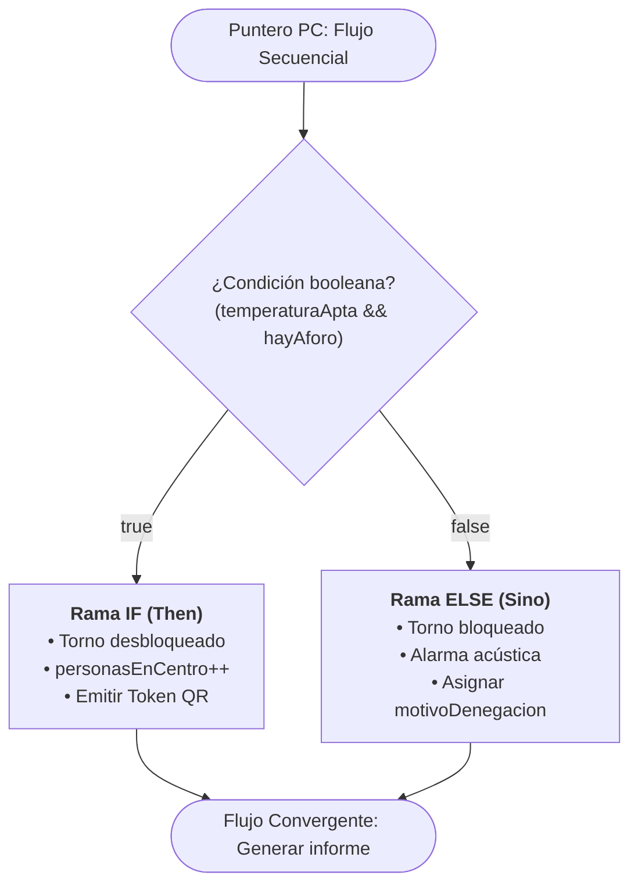
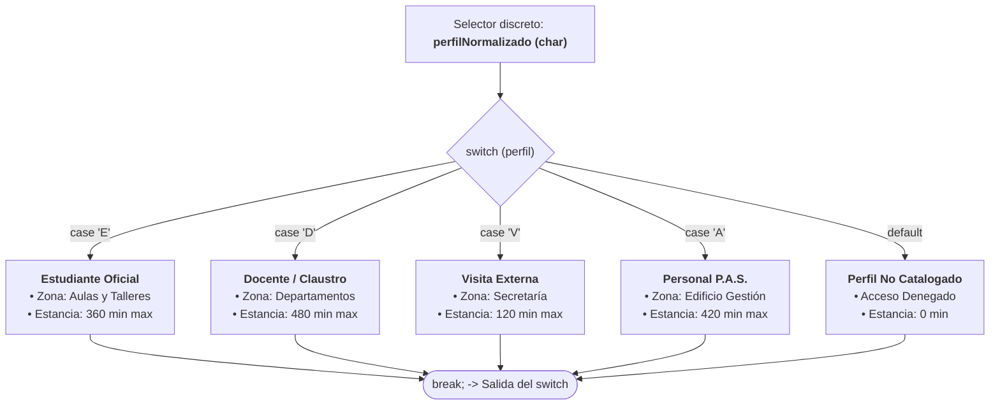
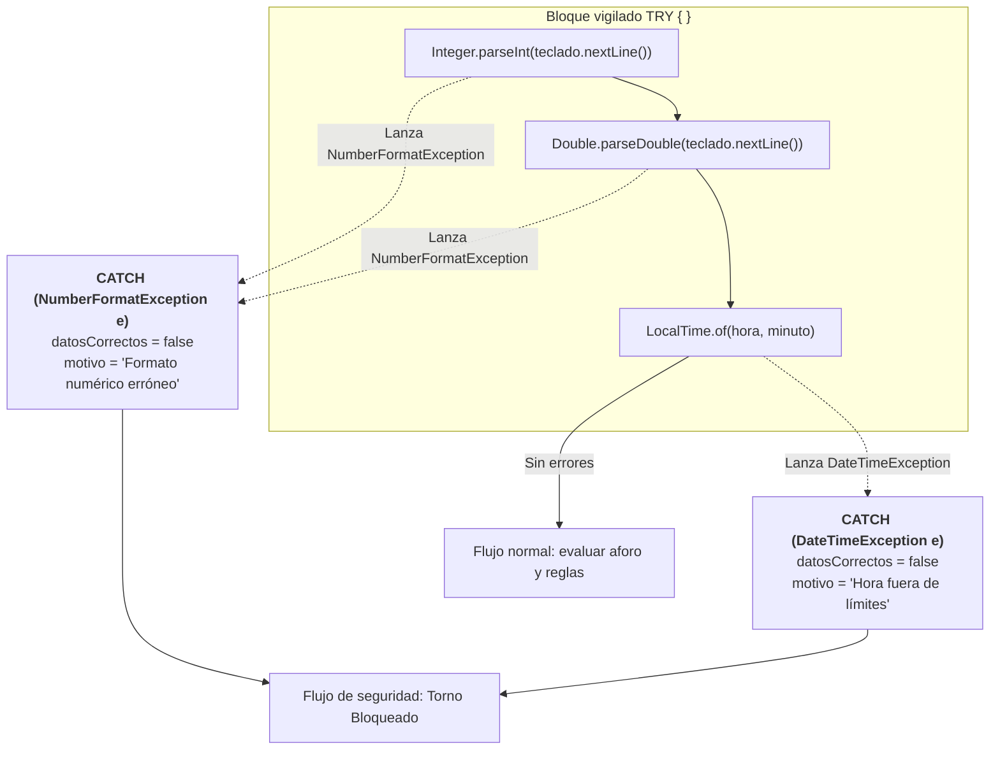

# Sprint 3. Uso de estructuras de control
## Semana 7. Estructuras de selección y toma de decisiones

---

### Día 24 - 2 sesiones

---

#### 1. Caso guía en AzaharTech

Son las 15:00 h del **lunes 26 de octubre de 2026**. En la sede de **AzaharTech** en Castellón de la Plana, el equipo de desarrollo arranca formalmente el **Sprint 3**. En este nuevo hito del curso se produce un cambio metodológico esencial: **se abandona PSeInt**; a partir de este instante, toda la algorítmica, análisis y diseño se implementa **directa y exclusivamente en Java**.

Sobre la pantalla de la sala de reuniones, **Alba Torres** y **Pau Ferrer** proyectan el código fuente de la versión `v2.0` que cerró el Sprint 2 el pasado viernes. **Laia Claramunt** toma la palabra para contextualizar el salto cualitativo que exige el cliente:

> *«Alba, Pau: la versión `v2.0` consolidó una arquitectura modular impecable. Desacoplamos la descomposición horaria con `Duration`, aislamos el cálculo de distancias euclídeas con `Math.sqrt` y parametrizamos la construcción de tokens QR en métodos estáticos independientes. Sin embargo, nuestro sistema adolece de un fallo crítico de concepto:*
>
> *Las líneas 129 a 131 de la versión `v2.0` dicen textualmente:*
> ```java
> personasEnCentro++;
> aforoDisponible--;
> idUltimoFichaje++;
> ```
> *El programa es **completamente ciego y secuencial**. No evalúa el contexto antes de actuar: si una persona llega con 39 ºC de fiebre, el torno se abre; si el aforo disponible es cero y el instituto está desbordado, el contador sigue sumando; si el DNI no cumple la longitud legal o el perfil introducido es una letra errónea, el terminal emite alegremente un token oficial de acceso.*
>
> *La dirección del **IES El Caminàs** nos ha trasladado una directriz tajante para este sprint: **el torno físico solo debe franquearse si se cumplen rigurosamente las condiciones de seguridad, aforo y formato**. Si cualquiera de estos filtros falla, el flujo de ejecución debe desviarse, denegar el paso, advertir por consola del motivo del rechazo y congelar los contadores del centro.*
>
> *Hoy introducimos la toma de decisiones en Java mediante la estructura **`if-else`**. Aprenderemos cómo la JVM evalúa expresiones booleanas en cortocircuito y gobernaremos el grafo de flujo de la aplicación»*.

---

#### 2. Fundamento teórico: la bifurcación del flujo de ejecución y la sentencia `if-else` en Java

Hasta la versión `v2.0`, el puntero de instrucción del procesador (*Program Counter* o PC) recorría el método `main` de manera estrictamente lineal. Las **estructuras de control de selección** alteran esta linealidad, permitiendo que la máquina virtual elija rutas alternativas en tiempo de ejecución tras evaluar una expresión booleana.



##### A. Estructuras condicionales en Java (`if`, `if-else`, `if-else if-else`)

1. **Condicional simple (`if`).** Evalúa un predicado booleano. Si la condición resulta `true`, se ejecutan las sentencias encerradas en su bloque; si es `false`, la JVM salta directamente a la siguiente instrucción fuera del bloque.
2. **Condicional doble (`if-else`).** Modela dos alternativas mutuamente excluyentes. Si la condición es `true`, se ejecuta únicamente el bloque del `if`; si es `false`, se ejecuta con total certeza el bloque `else`. Jamás se ejecutan ambos ni se ignoran los dos a la vez.
3. **Escalera de selección múltiple (`if-else if-else`).** Permite encadenar validaciones jerárquicas. Las condiciones se comprueban en estricto orden descendente; en cuanto una se cumple, se ejecuta su bloque y se omiten todas las ramas inferiores.

##### B. Operadores lógicos y evaluación en cortocircuito (*Short-Circuit*)

Recordemos que, para validar reglas de negocio complejas, combinamos operadores relacionales (`>`, `<`, `>=`, `<=`, `==`, `!=`) y lógicos (`&&`, `||`, `!`):

* **Conjunción (`&&`).** Devuelve `true` solo si **ambos** operandos son verdaderos. Si el primer operando evalúa a `false`, Java aborta de inmediato la evaluación (*cortocircuito*), ya que la expresión completa no puede ser cierta bajo ninguna circunstancia.
* **Disyunción (`||`).** Devuelve `true` si al menos **uno** de los operandos es verdadero. Si el primer operando evalúa a `true`, Java ignora el segundo y da la condición por satisfecha.
* **Negación (`!`).** Invierte el valor de verdad del operando (`!true` es `false`).

```java
// Ejemplo de cortocircuito en AzaharTech:
// Si aforoDisponible <= 0, el segundo operando NO se evalúa, evitando llamadas costosas a métodos
boolean puedePasar = (aforoDisponible > 0) && verificarCredencialEnServidor(dniPersonaLimpio);
```

##### C. Estándar de ingeniería AzaharTech: obligatoriedad de llaves y prevención del *Dangling Else*

En Java, prescindir de las llaves `{ }` tras un `if` o `else` hace que el compilador ligue únicamente la primera sentencia siguiente:

```java
// ¡VULNERABILIDAD GRAVE!: Prohibido en el estándar de código de AzaharTech
if (accesoAutorizado)
    abrirTorno();
    personasEnCentro++; // ¡Esta línea se ejecutará SIEMPRE, incluso si el acceso fue denegado!
```

> **Regla de estilo de AzaharTech:** todo bloque condicional debe delimitarse obligatoriamente mediante llaves `{ }`, sin excepción, con independencia del número de líneas que contenga.

##### D. Ámbito de las variables locales (*Block Scope*)

Toda variable declarada en el interior de las llaves `{ }` de un bloque nace y muere en la memoria de pila (*Stack*) asociada a ese bloque. Si se requiere disponer del valor tras la bifurcación (por ejemplo, para imprimir el informe final), la variable debe declararse en el ámbito externo antes del `if`.

---

#### 3. Evolución del caso guía a `ControlAccesoQR v2.1`

En esta versión sustituimos la mutación ciega de estado de la versión `v2.0` por un **árbol de decisión condicional**. Conservamos intactas las constantes corporativas, los métodos modulares construidos en el Sprint 2 y la captura interactiva por teclado.

##### A. Comparativa de cambios respecto a v2.0 (`diff`)

```diff
- // =========================================================================
- // EN v2.0: Mutación ciega e incondicional (la puerta siempre se abría)
- // =========================================================================
- personasEnCentro++;
- aforoDisponible--;
- idUltimoFichaje++;

+ // =========================================================================
+ // EN v2.1: Mutación condicionada al cumplimiento estricto de requisitos
+ // =========================================================================
+ boolean temperaturaApta = (tempVestibulo >= TEMP_CORPORAL_MIN_FALLO && tempVestibulo <= TEMP_CORPORAL_MAX_FIEBRE);
+ boolean aforoSuficiente = (aforoDisponible > 0);
+ boolean perfilPermitido = esLetraValida && (perfilNormalizado == 'E' || perfilNormalizado == 'D' || perfilNormalizado == 'V');
+
+ if (!temperaturaApta) {
+     accesoConcedido = false;
+     motivoDenegacion = String.format("Lectura térmica anómala (%.1f ºC fuera de rango)", tempVestibulo);
+ } else if (!aforoSuficiente) {
+     accesoConcedido = false;
+     motivoDenegacion = "Aforo de recinto saturado. No hay plazas libres disponibles.";
+ } else if (!esLongitudDniCorrecta) {
+     accesoConcedido = false;
+     motivoDenegacion = "Documento irregular. El DNI debe contener exactamente 9 caracteres.";
+ } else if (!perfilPermitido) {
+     accesoConcedido = false;
+     motivoDenegacion = "Perfil de acceso '" + perfilNormalizado + "' no autorizado por jefatura.";
+ } else {
+     accesoConcedido = true;
+     personasEnCentro++;
+     aforoDisponible--;
+     idUltimoFichaje++;
+ }
```

##### B. Foco en la novedad: árbol de decisión y salida bifurcada

Observa cómo se integran las nuevas variables de control dentro de `main` y cómo se bifurca la respuesta visual:

```java
// ... [Captura de datos previa con Scanner y cálculo de tiempos idéntico a v2.0] ...

// 1. Declaración en el ámbito de main para su consumo en el informe final
boolean accesoConcedido;
String motivoDenegacion = "";

// 2. Evaluación lógica de condiciones de negocio
boolean temperaturaApta = (tempVestibulo >= TEMP_CORPORAL_MIN_FALLO && tempVestibulo <= TEMP_CORPORAL_MAX_FIEBRE);
boolean aforoSuficiente = (aforoDisponible > 0);
boolean perfilPermitido = esLetraValida && (perfilNormalizado == 'E' || perfilNormalizado == 'D' || perfilNormalizado == 'V');

if (!temperaturaApta) {
    accesoConcedido = false;
    motivoDenegacion = String.format("Lectura térmica anómala (%.1f ºC fuera del rango %.1f-%.1f ºC)", 
            tempVestibulo, TEMP_CORPORAL_MIN_FALLO, TEMP_CORPORAL_MAX_FIEBRE);
} else if (!aforoSuficiente) {
    accesoConcedido = false;
    motivoDenegacion = "Aforo de recinto saturado. No hay plazas libres disponibles.";
} else if (!esLongitudDniCorrecta) {
    accesoConcedido = false;
    motivoDenegacion = "Documento irregular. El DNI debe contener exactamente 9 caracteres.";
} else if (!perfilPermitido) {
    accesoConcedido = false;
    motivoDenegacion = "Perfil de acceso '" + perfilNormalizado + "' no autorizado por jefatura de estudios.";
} else {
    accesoConcedido = true;
    // Mutación condicionada: solo muta el estado si el acceso es estrictamente legítimo
    personasEnCentro++;
    aforoDisponible--;
    idUltimoFichaje++;
}

// 3. Emisión de informe bifurcado según el veredicto
if (accesoConcedido) {
    System.out.println("----------------------------------------------------------------------");
    System.out.println(">> VEREDICTO:         [ACCESO AUTORIZADO - TORNO ABIERTO]");
    System.out.printf(">> TOKEN QR EMITIDO:  %s%n", tokenResumenVestibulo);
    System.out.printf(">> TOKEN BARRAS:      %s%n", tokenFormatoBarras);
    System.out.printf(">> PUERTA NORTE LINK: %s%n", tokenResumenPuertaNorte);
} else {
    System.out.println("----------------------------------------------------------------------");
    System.out.println(">> VEREDICTO:         [ACCESO DENEGADO - TORNO BLOQUEADO]");
    System.out.printf(">> MOTIVO RECHAZO:    %s%n", motivoDenegacion);
    System.out.println(">> PROTOCOLO:         Diríjase a la conserjería central para verificación manual.");
}

// ... [Resto del informe de telemetría y diagnóstico idéntico a v2.0] ...
```

##### C. Código fuente completo integrado

<details>
<summary><b>🔍 Desplegar archivo completo ControlAccesoQR.java (v2.1)</b></summary>

```java
/**
 * SISTEMA DE CONTROL DE ASISTENCIA POR CÓDIGO QR
 * Cliente: IES El Caminàs (Castellón de la Plana)
 * Consultora: AzaharTech Software Consulting
 * 
 * Versión 2.1:
 * Evolución hacia estructuras de control de selección (Sprint 3).
 * Incorpora bifurcación condicional if-else nativa en Java.
 * Protege los contadores de aforo mediante validación previa de seguridad térmica,
 * capacidad disponible, coherencia de DNI y perfil de usuario autorizado.
 * 
 * @author Equipo AzaharTech (Alba Torres, Pau Ferrer, Laia Claramunt)
 * @version 2.1 (Octubre 2026)
 * @since JDK 21 LTS
 * 
 */

import java.util.Scanner;
import java.util.Random;
import java.time.LocalTime;
import java.time.LocalDate;
import java.time.Duration;

public class ControlAccesoQR {

    // -------------------------------------------------------------------------
    // 1. CONSTANTES INMUTABLES DEL SISTEMA (configuración corporativa)
    // -------------------------------------------------------------------------
    final static String NOMBRE_CENTRO = "IES El Caminàs (Castellón)";
    final static String PREFIJO_CENTRO = "CAMINAS";
    final static String RUTA_LOGS = ".\\caminas\\terminal\\logs";

    final static int MINUTOS_POR_HORA = 60;
    final static int SEGUNDOS_POR_HORA = 3600;
    final static int SEGUNDOS_POR_MINUTO = 60;
    final static int JORNADA_BASE_MINUTOS = 480; // 8 horas
    final static double FACTOR_PORCENTAJE = 100.0;

    final static int ID_TERMINAL_PUERTA_NORTE = 102;
    final static int BASE_TOKEN_SEGURIDAD = 1000;
    final static int RANGO_TOKEN_SEGURIDAD = 9000;
    final static long SEMILLA_CALIBRACION = 987654321L;

    final static double TEMP_MIN_SEGURA = 15.0;
    final static double TEMP_MAX_SEGURA = 35.0;
    final static double MAX_VARIACION_TERMICA = 0.5;
    final static int LONGITUD_DNI_ESTANDAR = 9;

    // Umbrales de seguridad biométrica y capacidad (Sprint 3)
    final static double TEMP_CORPORAL_MAX_FIEBRE = 37.5;
    final static double TEMP_CORPORAL_MIN_FALLO = 35.0;

    // -------------------------------------------------------------------------
    // 2. MÉTODOS ESTÁTICOS PROPIOS (modularización de la lógica del sistema)
    // -------------------------------------------------------------------------

    /**
     * Calcula la estancia neta en minutos entre dos marcas temporales usando Duration.
     */
    public static int calcularEstanciaMinutos(LocalTime entrada, LocalTime salida) {
        return (int) Duration.between(entrada, salida).toMinutes();
    }

    /**
     * Calcula el porcentaje de ocupación con precisión decimal aplicando casting explícito.
     */
    public static double calcularPorcentajeOcupacion(int personas, int aforoTotal) {
        return ((double) personas / aforoTotal) * FACTOR_PORCENTAJE;
    }

    /**
     * Construye y concatena el token QR oficial parametrizado para cualquier monitor.
     */
    public static String construirTokenQR(String prefijo, String dni, int terminalId, int codigoSec, int idFichaje) {
        String token = prefijo + "-" + dni;
        token += "-T" + terminalId;
        token += "-SEC#" + codigoSec;
        token += "-REG" + idFichaje;
        return token;
    }

    /**
     * Calcula la distancia euclídea (hipotenusa) a la pantalla mediante el teorema de Pitágoras.
     */
    public static double calcularDistanciaDiagonal(double x, double y) {
        return Math.sqrt(Math.pow(x, 2.0) + Math.pow(y, 2.0));
    }

    // -------------------------------------------------------------------------
    // 3. MÉTODO PRINCIPAL: ORQUESTADOR DEL FLUJO CON BIFURCACIÓN CONDICIONAL
    // -------------------------------------------------------------------------
    public static void main(String[] args) {
        Scanner teclado = new Scanner(System.in);

        // Generadores independientes en el Heap
        Random generadorVestibulo   = new Random();
        Random generadorPuertaNorte = new Random();
        Random generadorCalibracion = new Random(SEMILLA_CALIBRACION);

        LocalDate fechaActual = LocalDate.now();
        LocalTime horaEmisionQr = LocalTime.now();

        int terminalId;
        double tempVestibulo;

        String nombrePersonaBruto, nombrePersonaLimpio;
        String dniPersonaBruto, dniPersonaLimpio;
        char perfilPersonaBruto;
        char perfilNormalizado;
        boolean esLetraValida;
        boolean esEntrada = true;

        int horaEntrada, minutoEntrada;
        int horaSalida, minutoSalida;

        int personasEnCentro = 1200;
        int aforoDisponible = 800;
        int idUltimoFichaje = 1042;

        int segundosActividadTerminal;
        double coordenadaXMetros, coordenadaYMetros;

        // Captura de datos interactiva
        System.out.println("=================================================");
        System.out.println("   AZAHARTECH - TERMINAL " + NOMBRE_CENTRO);
        System.out.println("   Versión 2.1 Oficial (Sprint 3: Control if-else)  ");
        System.out.println("=================================================");
        System.out.print("Introduce identificador del terminal en texto (ej. 101): ");
        terminalId = Integer.parseInt(teclado.nextLine());

        System.out.print("Temperatura base del sensor (ºC): ");
        tempVestibulo = teclado.nextDouble();

        System.out.print("Segundos de actividad del terminal (uptime): ");
        segundosActividadTerminal = teclado.nextInt();

        System.out.print("Distancia horizontal a pantalla en metros (eje X): ");
        coordenadaXMetros = teclado.nextDouble();

        System.out.print("Altura de la pantalla de TV en metros (eje Y): ");
        coordenadaYMetros = teclado.nextDouble();

        teclado.nextLine(); // Limpieza del buffer de entrada

        System.out.print("DNI de la persona: ");
        dniPersonaBruto = teclado.nextLine();

        System.out.print("Nombre completo: ");
        nombrePersonaBruto = teclado.nextLine();

        // Normalización y limpieza con métodos de String y Character
        dniPersonaLimpio = dniPersonaBruto.trim().toUpperCase();
        nombrePersonaLimpio = nombrePersonaBruto.trim().toUpperCase();

        System.out.print("Perfil de acceso (e = estudiante, d = docente, v = visita): ");
        perfilPersonaBruto = teclado.next().charAt(0);
        perfilNormalizado = Character.toUpperCase(perfilPersonaBruto);
        esLetraValida = Character.isLetter(perfilNormalizado);

        System.out.print("Hora de entrada (0-23): ");
        horaEntrada = teclado.nextInt();
        System.out.print("Minuto de entrada (0-59): ");
        minutoEntrada = teclado.nextInt();

        System.out.print("Hora de salida (0-23): ");
        horaSalida = teclado.nextInt();
        System.out.print("Minuto de salida (0-59): ");
        minutoSalida = teclado.nextInt();

        // Operaciones temporales
        LocalTime tiempoEntrada = LocalTime.of(horaEntrada, minutoEntrada);
        LocalTime tiempoSalida  = LocalTime.of(horaSalida, minutoSalida);
        int minutosEstanciaTotal = calcularEstanciaMinutos(tiempoEntrada, tiempoSalida);

        // Calibración ambiental y diagnóstico
        double tempCalibrada = tempVestibulo + (generadorCalibracion.nextDouble() * MAX_VARIACION_TERMICA);
        boolean sensorNfcOperativo = generadorCalibracion.nextBoolean();
        int codigoTestCalibracion  = BASE_TOKEN_SEGURIDAD + generadorCalibracion.nextInt(RANGO_TOKEN_SEGURIDAD);

        int aforoTotal = personasEnCentro + aforoDisponible;

        // Desglose del documento
        boolean esLongitudDniCorrecta = (dniPersonaLimpio.length() == LONGITUD_DNI_ESTANDAR);
        String numeroDniSolo = dniPersonaLimpio.substring(0, Math.max(0, dniPersonaLimpio.length() - 1));
        char letraFinalDni   = dniPersonaLimpio.charAt(Math.max(0, dniPersonaLimpio.length() - 1));

        // ---------------------------------------------------------------------
        // 4. BIFURCACIÓN CONDICIONAL (NOVEDAD SPRINT 3 - DÍA 24)
        // ---------------------------------------------------------------------
        boolean accesoConcedido;
        String motivoDenegacion = "";

        // Reglas de negocio del IES El Caminàs
        boolean temperaturaApta = (tempVestibulo >= TEMP_CORPORAL_MIN_FALLO && tempVestibulo <= TEMP_CORPORAL_MAX_FIEBRE);
        boolean aforoSuficiente = (aforoDisponible > 0);
        boolean perfilPermitido = esLetraValida && (perfilNormalizado == 'E' || perfilNormalizado == 'D' || perfilNormalizado == 'V');

        if (!temperaturaApta) {
            accesoConcedido = false;
            motivoDenegacion = String.format("Lectura térmica anómala (%.1f ºC fuera del rango %.1f-%.1f ºC)", 
                    tempVestibulo, TEMP_CORPORAL_MIN_FALLO, TEMP_CORPORAL_MAX_FIEBRE);
        } else if (!aforoSuficiente) {
            accesoConcedido = false;
            motivoDenegacion = "Aforo de recinto saturado. No hay plazas libres disponibles.";
        } else if (!esLongitudDniCorrecta) {
            accesoConcedido = false;
            motivoDenegacion = "Documento irregular. El DNI debe contener exactamente 9 caracteres.";
        } else if (!perfilPermitido) {
            accesoConcedido = false;
            motivoDenegacion = "Perfil de acceso '" + perfilNormalizado + "' no autorizado por jefatura de estudios.";
        } else {
            accesoConcedido = true;
            personasEnCentro++;
            aforoDisponible--;
            idUltimoFichaje++;
        }

        // Generación de códigos de seguridad condicionados
        int codigoTokenVestibulo   = BASE_TOKEN_SEGURIDAD + generadorVestibulo.nextInt(RANGO_TOKEN_SEGURIDAD);
        int codigoTokenPuertaNorte = BASE_TOKEN_SEGURIDAD + generadorPuertaNorte.nextInt(RANGO_TOKEN_SEGURIDAD);

        // Construcción de tokens mediante método modular propio
        String tokenResumenVestibulo   = construirTokenQR(PREFIJO_CENTRO, dniPersonaLimpio, terminalId, codigoTokenVestibulo, idUltimoFichaje);
        String tokenResumenPuertaNorte = construirTokenQR(PREFIJO_CENTRO, dniPersonaLimpio, ID_TERMINAL_PUERTA_NORTE, codigoTokenPuertaNorte, idUltimoFichaje);
        String tokenFormatoBarras      = tokenResumenVestibulo.replace("-", "/");

        // Cálculos métricos auxiliares
        int aforoSeguroVisualizado = Math.min(personasEnCentro, aforoTotal);
        double porcentajeOcupacionReal = calcularPorcentajeOcupacion(aforoSeguroVisualizado, aforoTotal);
        int porcentajeOcupacionRedondeado = (int) Math.round(porcentajeOcupacionReal);

        double distanciaDiagonalAntena = calcularDistanciaDiagonal(coordenadaXMetros, coordenadaYMetros);
        int desviacionJornadaMinutos   = Math.abs(minutosEstanciaTotal - JORNADA_BASE_MINUTOS);
        double tempSeguraAcotada       = Math.max(TEMP_MIN_SEGURA, Math.min(tempCalibrada, TEMP_MAX_SEGURA));

        // Descomposición temporal de servicio
        int horasUptime    = segundosActividadTerminal / SEGUNDOS_POR_HORA;
        int minutosUptime  = (segundosActividadTerminal % SEGUNDOS_POR_HORA) / SEGUNDOS_POR_MINUTO;
        int segundosUptime = segundosActividadTerminal % SEGUNDOS_POR_MINUTO;

        // ---------------------------------------------------------------------
        // 5. SALIDA FORMATEADA CONDICIONAL (System.out.printf)
        // ---------------------------------------------------------------------
        System.out.println("\n======================================================================");
        System.out.println("             INFORME OFICIAL DE ACCESO EN VESTÍBULO                   ");
        System.out.println("======================================================================");
        System.out.printf("CENTRO:               %-30s | FECHA: %s%n", NOMBRE_CENTRO, fechaActual);
        System.out.printf("REGISTRO N.º:         #%05d | HORA EMISIÓN QR: %s%n", idUltimoFichaje, horaEmisionQr);

        // Respuesta diferenciada según la decisión tomada
        if (accesoConcedido) {
            System.out.println("----------------------------------------------------------------------");
            System.out.println(">> VEREDICTO:         [ACCESO AUTORIZADO - TORNO ABIERTO]");
            System.out.printf(">> TOKEN QR EMITIDO:  %s%n", tokenResumenVestibulo);
            System.out.printf(">> TOKEN BARRAS:      %s%n", tokenFormatoBarras);
            System.out.printf(">> PUERTA NORTE LINK: %s%n", tokenResumenPuertaNorte);
        } else {
            System.out.println("----------------------------------------------------------------------");
            System.out.println(">> VEREDICTO:         [ACCESO DENEGADO - TORNO BLOQUEADO]");
            System.out.printf(">> MOTIVO RECHAZO:    %s%n", motivoDenegacion);
            System.out.println(">> PROTOCOLO:         Diríjase a la conserjería central para verificación manual.");
        }

        System.out.println("----------------------------------------------------------------------");
        System.out.printf("PERSONA:              %-30s | LONGITUD: %d%n", nombrePersonaLimpio, nombrePersonaLimpio.length());
        System.out.printf("DNI DESGLOSADO:       Número: %s | Letra: '%c'%n", numeroDniSolo, letraFinalDni);
        System.out.printf("PERFIL PROCESADO:     %c (Válido: %b) | SENTIDO: Entrada (%b)%n", perfilNormalizado, perfilPermitido, esEntrada);
        System.out.println("----------------------------------------------------------------------");
        System.out.printf("HORARIO FORMAL:       Entrada %s | Salida %s (LocalTime)%n", tiempoEntrada, tiempoSalida);
        System.out.printf("PERMANENCIA EXACTA:   %03d minutos (Método modular calcularEstancia)%n", minutosEstanciaTotal);
        System.out.printf("DESVIACIÓN JORNADA:   %03d min respecto a jornada completa (480 min).%n", desviacionJornadaMinutos);
        System.out.println("----------------------------------------------------------------------");
        System.out.printf("OCUPACIÓN REDONDEADA: %d %% (Math.round) | Exacta: %6.2f %%%n", porcentajeOcupacionRedondeado, porcentajeOcupacionReal);
        System.out.printf("AFORO DISPONIBLE:     %d plazas restantes de un total de %d%n", aforoDisponible, aforoTotal);
        System.out.printf("DISTANCIA ENFOQUE TV: %.2f metros (Método modular calcularDistancia)%n", distanciaDiagonalAntena);
        System.out.printf("ACTIVO:               %02dh %02dm %02ds (Sensor acotado: %.1f ºC)%n", horasUptime, minutosUptime, segundosUptime, tempSeguraAcotada);
        System.out.printf("DIAGNÓSTICO TEST:     Patrón #%04d | Sensor NFC: Activo (%b)%n", codigoTestCalibracion, sensorNfcOperativo);
        System.out.printf("REGISTRO LOG:         %s%n", RUTA_LOGS);
        System.out.println("======================================================================");

        teclado.close();
    }
}
```

</details>

---

#### 4. Segunda sesión: dojo de entrenamiento y katas de código

En esta segunda sesión, cada estudiante integrará directamente en Java su primera bifurcación condicional en su proyecto propio.

##### Kata 1 (Cinturón blanco / Nivel base). Bifurcación esencial en proyectos seleccionados

Abre el archivo `pr/src/MiProyecto.java` e implementa una estructura `if-else` que bifurque la lógica de negocio y controle las mutaciones de estado:

* **Aventura conversacional.** Verifica los puntos de vida del protagonista tras recibir el impacto del adversario. Si `vidaActual <= 0`, ejecuta la bifurcación de derrota imprimiendo la secuencia de fin de partida y bloqueando nuevas acciones; si la vida es superior a cero, continúa la aventura mostrando las opciones tácticas del siguiente asalto.
* **Motor de recomendación.** Evalúa el porcentaje de compatibilidad o afinidad calculado entre el usuario y el ítem. Si la afinidad supera el umbral del 75% (`afinidad >= 75.0`), cataloga el elemento en la rama positiva como *«Altamente recomendado»* y genera un cupón promocional; en caso contrario, clasifícalo en la rama alternativa como *«Recomendación estándar»*.
* **Simulador de físicas 2D.** Evalúa la posición proyectada del objeto respecto a los límites espaciales del área de simulación. Si la coordenada horizontal excede el margen (`posicionX >= LIMITE_DERECHO`), detecta la colisión perimetral, invierte el signo del vector de velocidad (`velocidadX = -velocidadX`) y notifica el rebote; si permanece dentro del espacio, continúa el desplazamiento inercial sin alteración.
* **Bóveda de contraseñas.** Comprueba si la clave candidata cumple con el umbral mínimo de seguridad reglamentario (`password.length() >= 8`). Si no alcanza dicho tamaño, deniega el registro en la bóveda emitiendo una alerta por baja entropía; si satisface la longitud, confirma el guardado seguro y genera su identificador en el almacén.

---

##### Kata 2 (Cinturón marrón / Nivel avanzado). La trampa del ámbito de bloque (*Block Scope*) y el operador ternario

1. **Auditoría de ámbito de variables:** Analiza y subsana el siguiente defecto recurrente detectado en las revisiones de código de AzaharTech:
   ```java
   if (tempVestibulo > 37.5) {
       String alerta = "¡Fiebre detectada!";
       int codigoIncidencia = 503;
   } else {
       String alerta = "Temperatura nominal";
   }
   // ¿Por qué la siguiente instrucción produce un error de compilación?
   System.out.println(alerta); // Error: cannot find symbol variable alerta
   ```
   *Corrección requerida:* Eleva la declaración de `alerta` al ámbito inmediatamente superior previo a la estructura condicional.
2. **Compactación mediante operador ternario (`?:`):** El operador ternario permite condensar asignaciones binarias en una única instrucción limpia:
   ```java
   String estadoTorno = accesoConcedido ? "TORNO DESBLOQUEADO" : "TORNO BLOQUEADO";
   ```
   Refactoriza una asignación simple de tu proyecto aplicando el operador ternario sin que empeore la legibilidad del código.

---

##### Kata 3 (Cinturón negro / «Hacker AzaharTech»). Radiografía de bytecode en la JVM: saltos condicionales (`if_icmpge`, `goto`)

Abre la terminal integrada de IntelliJ en la raíz del proyecto y analiza el bytecode compilado de `ControlAccesoQR.class` con el desensamblador oficial de Java:

```bash
javap -c pr/src/ControlAccesoQR.class
```

Localiza la sección correspondiente a la evaluación de la variable `aforoDisponible` o `tempVestibulo`. Observarás instrucciones mnemónicas similares a las siguientes:

```text
 42: if_icmpge     55    // Si el valor en la cima de la pila es >= salta al offset 55 (rama else)
 45: iconst_1            // Carga booleano true
 ...
 52: goto          63    // Salto incondicional: evita ejecutar la rama else
 55: iconst_0            // Offset 55: Rama else (carga booleano false)
 ...
 63: return              // Flujo convergente
```

**Reto de ingeniería.** Documenta mediante un comentario técnico en la cabecera de tu clase por qué la instrucción de bajo nivel **`goto`** es imprescindible al término del bloque `if` compilado para preservar el flujo de ejecución, y describe cómo el mecanismo de predicción de saltos (*Branch Prediction*) del procesador evita penalizaciones de rendimiento en la cola de instrucciones cuando se evalúan condicionales repetitivos.

---

### Día 25 - 2 sesiones

---

#### 1. Caso guía en AzaharTech

Es la mañana del **martes 27 de octubre de 2026** en las oficinas de **AzaharTech**. Tras la puesta en marcha de la versión `v2.1` con bifurcación condicional `if-else`, la dirección del **IES El Caminàs** ha remitido una nueva especificación de requisitos para el control de accesos.

**Alba Torres** reúne a **Pau Ferrer** frente al terminal de desarrollo:

> *«Pau, ayer conseguimos que el torno no se abriera a ciegas: si la temperatura corporal no es apta o el centro está lleno, el sistema bloquea el paso. Sin embargo, nuestro tratamiento de los colectivos que conviven en el centro sigue siendo excesivamente plano.*
>
> *En la versión `v2.1` nos limitamos a verificar si el carácter pertenecía a una lista básica:*
> ```java
> boolean perfilPermitido = esLetraValida && (perfilNormalizado == 'E' || perfilNormalizado == 'D' || perfilNormalizado == 'V');
> ```
> *En la realidad cotidiana del instituto coexisten cuatro perfiles diferenciados con **normativas de acceso y permanencia específicas**:*
>
> 1. **Perfil 'E' (Estudiante).** Debe asignarse a *"Aulas y Talleres"*, con una estancia lectiva máxima de 360 minutos y control de puntualidad: si accede después de las 08:15 h, el terminal debe registrar una advertencia de *"RETRASO LECTIVO"*.*
> 2. **Perfil 'D' (Docente).** Se asigna a *"Departamentos y Claustro"*, con una jornada base de 480 minutos y sin restricción de retraso matinal.*
> 3. **Perfil 'V' (Visita externa).** Solo puede acceder a *"Secretaría y Vestíbulo"*, con un límite de permanencia de 120 minutos.*
> 4. **Perfil 'A' (Administración y Servicios - PAS).** Personal administrativo, asignado al *"Edificio de Gestión"* con una jornada de 420 minutos.*
>
> *Si intentamos resolver estas asignaciones encadenando múltiples `if-else if-else`, generaremos un código repetitivo y difícil de mantener. Hoy introducimos la **sentencia de selección múltiple `switch` clásica** en Java, comprenderemos el papel de la cláusula **`break`**, aprenderemos a agrupar casos mediante caída controlada (*fall-through*) y encapsularemos estas decisiones en métodos estáticos modulares»*.

---

#### 2. Fundamento teórico: la sentencia de selección múltiple `switch` en Java

Cuando el flujo del programa debe ramificarse en función de valores discretos exactos de una variable primitiva o inmutable (`char`, `byte`, `short`, `int`, `String` o tipos enumerados), la estructura estándar en programación estructurada es la **sentencia `switch`**.



##### A. Componentes de la sentencia `switch` clásica

1. **Expresión selectora.** Variable evaluada entre paréntesis tras la palabra reservada `switch`. Debe ser de un tipo discreto compatible (en nuestro caso, el carácter `perfilNormalizado`).
2. **Etiquetas `case`.** Literales constantes contra los que se compara el selector. Si coincide el valor, la ejecución salta a ese punto.
3. **Sentencia de salto `break`.** Fuerza la salida inmediata del bloque `switch`. Si se omite, la ejecución continúa secuencialmente hacia las instrucciones del siguiente caso (*fall-through*), lo que suele constituir una fuente grave de errores si no se planifica de forma consciente.
4. **Cláusula `default`.** Bloque opcional que se ejecuta cuando el selector no coincide con ninguna de las etiquetas `case` definidas. Actúa como red de seguridad (*fallback*).

##### B. El fenómeno del *Fall-Through* y la agrupación de casos

Aunque el olvido involuntario de un `break` es un fallo habitual, la caída secuencial entre etiquetas puede emplearse de forma intencionada para aplicar una misma consecuencia lógica a múltiples entradas:

```java
// Agrupación válida: tanto 'E', 'D', 'V' como 'A' activan la misma rama
boolean perfilReconocido;
switch (perfilNormalizado) {
    case 'E':
    case 'D':
    case 'V':
    case 'A':
        perfilReconocido = true;
        break;
    default:
        perfilReconocido = false;
        break;
}
```

##### C. Evaluación de marcas temporales con `LocalTime.isAfter()`

Para controlar la puntualidad del alumnado, combinamos condicionales con métodos de la API `java.time`:

* `tiempoEntrada.isAfter(HORA_LIMITE_PUNTUALIDAD)`. Devuelve `true` si la hora de entrada es estrictamente posterior a las 08:15 h.
* Esta comprobación se acopla a la regla de perfil: únicamente generará aviso de retraso si el usuario es un estudiante (`perfilNormalizado == 'E'`).

---

#### 3. Evolución del caso guía a `ControlAccesoQR v2.2`

En esta versión incorporamos la selección múltiple por perfil delegando cada asignación en métodos estáticos modulares, añadimos la comprobación de puntualidad con `isAfter()` y actualizamos el informe de consola.

##### A. Comparativa de cambios respecto a v2.1 (`diff`)

```diff
  // =========================================================================
  // CONSTANTES DEL SISTEMA
  // =========================================================================
+ final static LocalTime HORA_LIMITE_PUNTUALIDAD = LocalTime.of(8, 15);

  // =========================================================================
  // MÉTODOS ESTÁTICOS PROPIOS (Modularización con switch clásico)
  // =========================================================================
+ public static String obtenerDescripcionPerfil(char perfil) { ... }
+ public static String determinarZonaAutorizada(char perfil) { ... }
+ public static int obtenerEstanciaMaximaPorPerfil(char perfil) { ... }

  // =========================================================================
  // MÉTODO MAIN: Toma de decisiones
  // =========================================================================
- boolean perfilPermitido = esLetraValida && (perfilNormalizado == 'E' || perfilNormalizado == 'D' || perfilNormalizado == 'V');
+ boolean perfilReconocido;
+ switch (perfilNormalizado) {
+     case 'E':
+     case 'D':
+     case 'V':
+     case 'A':
+         perfilReconocido = true;
+         break;
+     default:
+         perfilReconocido = false;
+         break;
+ }
+
+ String descripcionRol    = obtenerDescripcionPerfil(perfilNormalizado);
+ String zonaDesignada     = determinarZonaAutorizada(perfilNormalizado);
+ int estanciaMaxPermitida = obtenerEstanciaMaximaPorPerfil(perfilNormalizado);
+ boolean esRetrasoLectivo = (perfilNormalizado == 'E') && tiempoEntrada.isAfter(HORA_LIMITE_PUNTUALIDAD);
```

##### B. Foco en la novedad: métodos modulares y bifurcación con `switch`

Observa cómo aislamos la lógica de cada atributo del perfil en métodos independientes y cómo controlamos la puntualidad:

```java
// -------------------------------------------------------------------------
// Métodos estáticos modulares gobernados por switch clásico
// -------------------------------------------------------------------------
public static String obtenerDescripcionPerfil(char perfil) {
    String descripcion;
    switch (perfil) {
        case 'E':
            descripcion = "Estudiante Oficial";
            break;
        case 'D':
            descripcion = "Docente / Claustro";
            break;
        case 'V':
            descripcion = "Visita Externa / Proveedor";
            break;
        case 'A':
            descripcion = "Personal de Administración y Servicios (PAS)";
            break;
        default:
            descripcion = "Perfil No Catalogado";
            break;
    }
    return descripcion;
}

public static String determinarZonaAutorizada(char perfil) {
    String zona;
    switch (perfil) {
        case 'E':
            zona = "Aulas Docentes y Talleres de Informática";
            break;
        case 'D':
            zona = "Departamentos Didácticos, Aulas y Sala de Profesores";
            break;
        case 'V':
            zona = "Secretaría, Conserjería y Despachos de Dirección";
            break;
        case 'A':
            zona = "Área de Gestión Administrativa y Archivo Central";
            break;
        default:
            zona = "Acceso Denegado / Zona No Autorizada";
            break;
    }
    return zona;
}

public static int obtenerEstanciaMaximaPorPerfil(char perfil) {
    int estanciaMinutos;
    switch (perfil) {
        case 'E':
            estanciaMinutos = 360; // 6 horas lectivas
            break;
        case 'D':
            estanciaMinutos = 480; // 8 horas jornada docente
            break;
        case 'V':
            estanciaMinutos = 120; // 2 horas límite visitas
            break;
        case 'A':
            estanciaMinutos = 420; // 7 horas jornada administrativa
            break;
        default:
            estanciaMinutos = 0;
            break;
    }
    return estanciaMinutos;
}

// -------------------------------------------------------------------------
// Dentro de main: Invocación e informe condicional de puntualidad
// -------------------------------------------------------------------------
// [Tras validar y autorizar el acceso...]
System.out.printf("ROL CLASIFICADO:      [%c] %-25s | Válido: %b%n", perfilNormalizado, descripcionRol, perfilReconocido);
System.out.printf("ZONA ASIGNADA:        %s%n", zonaDesignada);
System.out.printf("LÍMITE AUTORIZADO:    %d minutos (Tiempo previsto: %d min)%n", estanciaMaxPermitida, minutosEstanciaTotal);

if (esRetrasoLectivo && accesoConcedido) {
    System.out.println(">> AVISO PUNTUALIDAD: [RETRASO LECTIVO REGISTRADO - Entrada posterior a las 08:15]");
}
```

##### C. Código fuente completo integrado

<details>
<summary><b>🔍 Desplegar archivo completo ControlAccesoQR.java (v2.2)</b></summary>

```java
/**
 * SISTEMA DE CONTROL DE ASISTENCIA POR CÓDIGO QR
 * Cliente: IES El Caminàs (Castellón de la Plana)
 * Consultora: AzaharTech Software Consulting
 * 
 * Versión 2.2:
 * Incorpora estructuras de selección múltiple mediante sentencias switch clásicas.
 * Despliega lógica diferenciada por rol (Estudiante, Docente, Visita, PAS).
 * Control de puntualidad y asignación dinámica de zonas y estancias máximas.
 * 
 * @author Equipo AzaharTech (Alba Torres, Pau Ferrer, Laia Claramunt)
 * @version 2.2 (Octubre 2026)
 * @since JDK 21 LTS
 * 
 */

import java.util.Scanner;
import java.util.Random;
import java.time.LocalTime;
import java.time.LocalDate;
import java.time.Duration;

public class ControlAccesoQR {

    // -------------------------------------------------------------------------
    // 1. CONSTANTES INMUTABLES DEL SISTEMA (configuración corporativa)
    // -------------------------------------------------------------------------
    final static String NOMBRE_CENTRO = "IES El Caminàs (Castellón)";
    final static String PREFIJO_CENTRO = "CAMINAS";
    final static String RUTA_LOGS = ".\\caminas\\terminal\\logs";

    final static int MINUTOS_POR_HORA = 60;
    final static int SEGUNDOS_POR_HORA = 3600;
    final static int SEGUNDOS_POR_MINUTO = 60;
    final static int JORNADA_BASE_MINUTOS = 480; // 8 horas
    final static double FACTOR_PORCENTAJE = 100.0;

    final static int ID_TERMINAL_PUERTA_NORTE = 102;
    final static int BASE_TOKEN_SEGURIDAD = 1000;
    final static int RANGO_TOKEN_SEGURIDAD = 9000;
    final static long SEMILLA_CALIBRACION = 987654321L;

    final static double TEMP_MIN_SEGURA = 15.0;
    final static double TEMP_MAX_SEGURA = 35.0;
    final static double MAX_VARIACION_TERMICA = 0.5;
    final static int LONGITUD_DNI_ESTANDAR = 9;

    // Umbrales de seguridad biométrica y capacidad (Sprint 3)
    final static double TEMP_CORPORAL_MAX_FIEBRE = 37.5;
    final static double TEMP_CORPORAL_MIN_FALLO = 35.0;

    // Control horario de puntualidad lectiva para estudiantes (Día 25)
    final static LocalTime HORA_LIMITE_PUNTUALIDAD = LocalTime.of(8, 15);

    // -------------------------------------------------------------------------
    // 2. MÉTODOS ESTÁTICOS PROPIOS (modularización de la lógica del sistema)
    // -------------------------------------------------------------------------

    /**
     * Calcula la estancia neta en minutos entre dos marcas temporales usando Duration.
     */
    public static int calcularEstanciaMinutos(LocalTime entrada, LocalTime salida) {
        return (int) Duration.between(entrada, salida).toMinutes();
    }

    /**
     * Calcula el porcentaje de ocupación con precisión decimal aplicando casting explícito.
     */
    public static double calcularPorcentajeOcupacion(int personas, int aforoTotal) {
        return ((double) personas / aforoTotal) * FACTOR_PORCENTAJE;
    }

    /**
     * Construye y concatena el token QR oficial parametrizado para cualquier monitor.
     */
    public static String construirTokenQR(String prefijo, String dni, int terminalId, int codigoSec, int idFichaje) {
        String token = prefijo + "-" + dni;
        token += "-T" + terminalId;
        token += "-SEC#" + codigoSec;
        token += "-REG" + idFichaje;
        return token;
    }

    /**
     * Calcula la distancia euclídea (hipotenusa) a la pantalla mediante el teorema de Pitágoras.
     */
    public static double calcularDistanciaDiagonal(double x, double y) {
        return Math.sqrt(Math.pow(x, 2.0) + Math.pow(y, 2.0));
    }

    /**
     * Retorna la denominación oficial del perfil mediante una sentencia switch clásica con break.
     */
    public static String obtenerDescripcionPerfil(char perfil) {
        String descripcion;
        switch (perfil) {
            case 'E':
                descripcion = "Estudiante Oficial";
                break;
            case 'D':
                descripcion = "Docente / Claustro";
                break;
            case 'V':
                descripcion = "Visita Externa / Proveedor";
                break;
            case 'A':
                descripcion = "Personal de Administración y Servicios (PAS)";
                break;
            default:
                descripcion = "Perfil No Catalogado";
                break;
        }
        return descripcion;
    }

    /**
     * Asigna la zona física autorizada del campus mediante una sentencia switch clásica.
     */
    public static String determinarZonaAutorizada(char perfil) {
        String zona;
        switch (perfil) {
            case 'E':
                zona = "Aulas Docentes y Talleres de Informática";
                break;
            case 'D':
                zona = "Departamentos Didácticos, Aulas y Sala de Profesores";
                break;
            case 'V':
                zona = "Secretaría, Conserjería y Despachos de Dirección";
                break;
            case 'A':
                zona = "Área de Gestión Administrativa y Archivo Central";
                break;
            default:
                zona = "Acceso Denegado / Zona No Autorizada";
                break;
        }
        return zona;
    }

    /**
     * Determina el límite de minutos de permanencia permitidos según el perfil con switch clásico.
     */
    public static int obtenerEstanciaMaximaPorPerfil(char perfil) {
        int estanciaMinutos;
        switch (perfil) {
            case 'E':
                estanciaMinutos = 360; // 6 horas lectivas
                break;
            case 'D':
                estanciaMinutos = 480; // 8 horas jornada docente
                break;
            case 'V':
                estanciaMinutos = 120; // 2 horas límite visitas
                break;
            case 'A':
                estanciaMinutos = 420; // 7 horas jornada administrativa
                break;
            default:
                estanciaMinutos = 0;
                break;
        }
        return estanciaMinutos;
    }

    // -------------------------------------------------------------------------
    // 3. MÉTODO PRINCIPAL: ORQUESTADOR CON IF-ELSE Y SELECCIÓN MÚLTIPLE SWITCH
    // -------------------------------------------------------------------------
    public static void main(String[] args) {
        Scanner teclado = new Scanner(System.in);

        // Generadores independientes en el Heap
        Random generadorVestibulo   = new Random();
        Random generadorPuertaNorte = new Random();
        Random generadorCalibracion = new Random(SEMILLA_CALIBRACION);

        LocalDate fechaActual = LocalDate.now();
        LocalTime horaEmisionQr = LocalTime.now();

        int terminalId;
        double tempVestibulo;

        String nombrePersonaBruto, nombrePersonaLimpio;
        String dniPersonaBruto, dniPersonaLimpio;
        char perfilPersonaBruto;
        char perfilNormalizado;
        boolean esLetraValida;
        boolean esEntrada = true;

        int horaEntrada, minutoEntrada;
        int horaSalida, minutoSalida;

        int personasEnCentro = 1200;
        int aforoDisponible = 800;
        int idUltimoFichaje = 1042;

        int segundosActividadTerminal;
        double coordenadaXMetros, coordenadaYMetros;

        // Captura de datos interactiva
        System.out.println("=================================================");
        System.out.println("   AZAHARTECH - TERMINAL " + NOMBRE_CENTRO);
        System.out.println("   Versión 2.2 Oficial (Sprint 3: Switch & Perfiles)");
        System.out.println("=================================================");
        System.out.print("Introduce identificador del terminal en texto (ej. 101): ");
        terminalId = Integer.parseInt(teclado.nextLine());

        System.out.print("Temperatura base del sensor (ºC): ");
        tempVestibulo = teclado.nextDouble();

        System.out.print("Segundos de actividad del terminal (uptime): ");
        segundosActividadTerminal = teclado.nextInt();

        System.out.print("Distancia horizontal a pantalla en metros (eje X): ");
        coordenadaXMetros = teclado.nextDouble();

        System.out.print("Altura de la pantalla de TV en metros (eje Y): ");
        coordenadaYMetros = teclado.nextDouble();

        teclado.nextLine(); // Limpieza del buffer de entrada

        System.out.print("DNI de la persona: ");
        dniPersonaBruto = teclado.nextLine();

        System.out.print("Nombre completo: ");
        nombrePersonaBruto = teclado.nextLine();

        // Normalización y limpieza con métodos de String y Character
        dniPersonaLimpio = dniPersonaBruto.trim().toUpperCase();
        nombrePersonaLimpio = nombrePersonaBruto.trim().toUpperCase();

        System.out.print("Perfil de acceso (E=Estudiante, D=Docente, V=Visita, A=Admin): ");
        perfilPersonaBruto = teclado.next().charAt(0);
        perfilNormalizado = Character.toUpperCase(perfilPersonaBruto);
        esLetraValida = Character.isLetter(perfilNormalizado);

        System.out.print("Hora de entrada (0-23): ");
        horaEntrada = teclado.nextInt();
        System.out.print("Minuto de entrada (0-59): ");
        minutoEntrada = teclado.nextInt();

        System.out.print("Hora de salida (0-23): ");
        horaSalida = teclado.nextInt();
        System.out.print("Minuto de salida (0-59): ");
        minutoSalida = teclado.nextInt();

        // Operaciones temporales
        LocalTime tiempoEntrada = LocalTime.of(horaEntrada, minutoEntrada);
        LocalTime tiempoSalida  = LocalTime.of(horaSalida, minutoSalida);
        int minutosEstanciaTotal = calcularEstanciaMinutos(tiempoEntrada, tiempoSalida);

        // Calibración ambiental y diagnóstico
        double tempCalibrada = tempVestibulo + (generadorCalibracion.nextDouble() * MAX_VARIACION_TERMICA);
        boolean sensorNfcOperativo = generadorCalibracion.nextBoolean();
        int codigoTestCalibracion  = BASE_TOKEN_SEGURIDAD + generadorCalibracion.nextInt(RANGO_TOKEN_SEGURIDAD);

        int aforoTotal = personasEnCentro + aforoDisponible;

        // Desglose del documento
        boolean esLongitudDniCorrecta = (dniPersonaLimpio.length() == LONGITUD_DNI_ESTANDAR);
        String numeroDniSolo = dniPersonaLimpio.substring(0, Math.max(0, dniPersonaLimpio.length() - 1));
        char letraFinalDni   = dniPersonaLimpio.charAt(Math.max(0, dniPersonaLimpio.length() - 1));

        // ---------------------------------------------------------------------
        // 4. CLASIFICACIÓN CON SENTENCIA SWITCH CLÁSICA Y VALIDACIÓN (DÍA 25)
        // ---------------------------------------------------------------------
        // Verificación de reconocimiento del perfil mediante agrupación con fall-through
        boolean perfilReconocido;
        switch (perfilNormalizado) {
            case 'E':
            case 'D':
            case 'V':
            case 'A':
                perfilReconocido = true;
                break;
            default:
                perfilReconocido = false;
                break;
        }

        String descripcionRol    = obtenerDescripcionPerfil(perfilNormalizado);
        String zonaDesignada     = determinarZonaAutorizada(perfilNormalizado);
        int estanciaMaxPermitida = obtenerEstanciaMaximaPorPerfil(perfilNormalizado);

        // Control de puntualidad específico para estudiantes
        boolean esRetrasoLectivo = (perfilNormalizado == 'E') && tiempoEntrada.isAfter(HORA_LIMITE_PUNTUALIDAD);

        // Variables de decisión de acceso
        boolean accesoConcedido;
        String motivoDenegacion = "";

        // Reglas de negocio consolidadas
        boolean temperaturaApta = (tempVestibulo >= TEMP_CORPORAL_MIN_FALLO && tempVestibulo <= TEMP_CORPORAL_MAX_FIEBRE);
        boolean aforoSuficiente = (aforoDisponible > 0);

        if (!temperaturaApta) {
            accesoConcedido = false;
            motivoDenegacion = String.format("Lectura térmica anómala (%.1f ºC fuera del rango %.1f-%.1f ºC)", 
                    tempVestibulo, TEMP_CORPORAL_MIN_FALLO, TEMP_CORPORAL_MAX_FIEBRE);
        } else if (!aforoSuficiente) {
            accesoConcedido = false;
            motivoDenegacion = "Aforo de recinto saturado. No hay plazas libres disponibles.";
        } else if (!esLongitudDniCorrecta) {
            accesoConcedido = false;
            motivoDenegacion = "Documento irregular. El DNI debe contener exactamente 9 caracteres.";
        } else if (!perfilReconocido) {
            accesoConcedido = false;
            motivoDenegacion = "Perfil '" + perfilNormalizado + "' no autorizado por jefatura de estudios.";
        } else {
            accesoConcedido = true;
            // Mutación de estado condicionada
            personasEnCentro++;
            aforoDisponible--;
            idUltimoFichaje++;
        }

        // Generación de códigos de seguridad condicionados
        int codigoTokenVestibulo   = BASE_TOKEN_SEGURIDAD + generadorVestibulo.nextInt(RANGO_TOKEN_SEGURIDAD);
        int codigoTokenPuertaNorte = BASE_TOKEN_SEGURIDAD + generadorPuertaNorte.nextInt(RANGO_TOKEN_SEGURIDAD);

        // Construcción de tokens mediante método modular propio
        String tokenResumenVestibulo   = construirTokenQR(PREFIJO_CENTRO, dniPersonaLimpio, terminalId, codigoTokenVestibulo, idUltimoFichaje);
        String tokenResumenPuertaNorte = construirTokenQR(PREFIJO_CENTRO, dniPersonaLimpio, ID_TERMINAL_PUERTA_NORTE, codigoTokenPuertaNorte, idUltimoFichaje);
        String tokenFormatoBarras      = tokenResumenVestibulo.replace("-", "/");

        // Cálculos métricos auxiliares
        int aforoSeguroVisualizado = Math.min(personasEnCentro, aforoTotal);
        double porcentajeOcupacionReal = calcularPorcentajeOcupacion(aforoSeguroVisualizado, aforoTotal);
        int porcentajeOcupacionRedondeado = (int) Math.round(porcentajeOcupacionReal);

        double distanciaDiagonalAntena = calcularDistanciaDiagonal(coordenadaXMetros, coordenadaYMetros);
        int desviacionJornadaMinutos   = Math.abs(minutosEstanciaTotal - JORNADA_BASE_MINUTOS);
        double tempSeguraAcotada       = Math.max(TEMP_MIN_SEGURA, Math.min(tempCalibrada, TEMP_MAX_SEGURA));

        // Descomposición temporal de servicio
        int horasUptime    = segundosActividadTerminal / SEGUNDOS_POR_HORA;
        int minutosUptime  = (segundosActividadTerminal % SEGUNDOS_POR_HORA) / SEGUNDOS_POR_MINUTO;
        int segundosUptime = segundosActividadTerminal % SEGUNDOS_POR_MINUTO;

        // ---------------------------------------------------------------------
        // 5. SALIDA FORMATEADA CON TRAZA DE PERFIL (System.out.printf)
        // ---------------------------------------------------------------------
        System.out.println("\n======================================================================");
        System.out.println("             INFORME OFICIAL DE ACCESO EN VESTÍBULO                   ");
        System.out.println("======================================================================");
        System.out.printf("CENTRO:               %-30s | FECHA: %s%n", NOMBRE_CENTRO, fechaActual);
        System.out.printf("REGISTRO N.º:         #%05d | HORA EMISIÓN QR: %s%n", idUltimoFichaje, horaEmisionQr);

        if (accesoConcedido) {
            System.out.println("----------------------------------------------------------------------");
            System.out.println(">> VEREDICTO:         [ACCESO AUTORIZADO - TORNO ABIERTO]");
            System.out.printf(">> TOKEN QR EMITIDO:  %s%n", tokenResumenVestibulo);
            System.out.printf(">> TOKEN BARRAS:      %s%n", tokenFormatoBarras);
            System.out.printf(">> PUERTA NORTE LINK: %s%n", tokenResumenPuertaNorte);
        } else {
            System.out.println("----------------------------------------------------------------------");
            System.out.println(">> VEREDICTO:         [ACCESO DENEGADO - TORNO BLOQUEADO]");
            System.out.printf(">> MOTIVO RECHAZO:    %s%n", motivoDenegacion);
            System.out.println(">> PROTOCOLO:         Diríjase a la conserjería central para verificación manual.");
        }

        System.out.println("----------------------------------------------------------------------");
        System.out.printf("PERSONA:              %-30s | LONGITUD: %d%n", nombrePersonaLimpio, nombrePersonaLimpio.length());
        System.out.printf("DNI DESGLOSADO:       Número: %s | Letra: '%c'%n", numeroDniSolo, letraFinalDni);
        System.out.printf("ROL CLASIFICADO:      [%c] %-25s | Válido: %b%n", perfilNormalizado, descripcionRol, perfilReconocido);
        System.out.printf("ZONA ASIGNADA:        %s%n", zonaDesignada);
        System.out.printf("LÍMITE AUTORIZADO:    %d minutos (Tiempo previsto: %d min)%n", estanciaMaxPermitida, minutosEstanciaTotal);

        // Advertencia condicional de puntualidad (si aplica)
        if (esRetrasoLectivo && accesoConcedido) {
            System.out.println(">> AVISO PUNTUALIDAD: [RETRASO LECTIVO REGISTRADO - Entrada posterior a las 08:15]");
        }

        System.out.println("----------------------------------------------------------------------");
        System.out.printf("HORARIO FORMAL:       Entrada %s | Salida %s (LocalTime)%n", tiempoEntrada, tiempoSalida);
        System.out.printf("PERMANENCIA EXACTA:   %03d minutos (Método modular calcularEstancia)%n", minutosEstanciaTotal);
        System.out.printf("DESVIACIÓN JORNADA:   %03d min respecto a jornada completa (480 min).%n", desviacionJornadaMinutos);
        System.out.println("----------------------------------------------------------------------");
        System.out.printf("OCUPACIÓN REDONDEADA: %d %% (Math.round) | Exacta: %6.2f %%%n", porcentajeOcupacionRedondeado, porcentajeOcupacionReal);
        System.out.printf("AFORO DISPONIBLE:     %d plazas restantes de un total de %d%n", aforoDisponible, aforoTotal);
        System.out.printf("DISTANCIA ENFOQUE TV: %.2f metros (Método modular calcularDistancia)%n", distanciaDiagonalAntena);
        System.out.printf("ACTIVO:               %02dh %02dm %02ds (Sensor acotado: %.1f ºC)%n", horasUptime, minutosUptime, segundosUptime, tempSeguraAcotada);
        System.out.printf("DIAGNÓSTICO TEST:     Patrón #%04d | Sensor NFC: Activo (%b)%n", codigoTestCalibracion, sensorNfcOperativo);
        System.out.printf("REGISTRO LOG:         %s%n", RUTA_LOGS);
        System.out.println("======================================================================");

        teclado.close();
    }
}
```

</details>

---

#### 4. Segunda sesión: dojo de entrenamiento y katas de código

En esta sesión práctica, cada alumno desarrollará directamente en Java estructuras de selección múltiple sobre el archivo maestro de su especialidad técnica.

##### Kata 1 (Cinturón blanco / Nivel base). Selección múltiple clásica con `switch` y `break`

Abre tu archivo `pr/src/MiProyecto.java` e implementa una sentencia `switch` tradicional que controle la toma de decisiones en función de una variable discreta, asegurando la inclusión de `break` en cada caso y una cláusula `default`:

* **Aventura conversacional.** Evalúa mediante un `switch` clásico el carácter del comando táctico introducido por el jugador (`'A'`, `'D'`, `'H'`, `'U'`). Cada caso debe actualizar las variables de combate (modificador de ataque, defensa, probabilidad de huida o puntos de curación mediante poción) y finalizar con su correspondiente sentencia `break`, contemplando una cláusula `default` para comandos desconocidos que penalice el turno del jugador.
* **Motor de recomendación.** Implementa un `switch` clásico sobre el carácter identificador de la categoría de contenido (`'C'` para Cine, `'M'` para Música, `'V'` para Videojuegos, `'L'` para Literatura). En cada caso, asigna el umbral mínimo de afinidad porcentual exigido y una cadena con la etiqueta descriptiva del sector, incluyendo una cláusula `default` de seguridad para categorías no catalogadas.
* **Simulador de físicas 2D.** Estructura un `switch` clásico que discrimine según el carácter representativo del material del cuerpo impactado (`'M'` para Metal, `'G'` para Goma, `'B'` para Barro, `'H'` para Hielo). En cada rama, asigna el coeficiente de restitución elástica específico (entre 0.05 y 0.98) que multiplicará el vector de velocidad para calcular la pérdida de energía en el rebote, cerrando con un `default` que asigne un rebote genérico.
* **Bóveda de contraseñas.** Utiliza un `switch` clásico para evaluar el nivel de clasificación de seguridad del secreto (`'B'` para Básico, `'C'` para Confidencial, `'S'` para Secreto, `'T'` para Top Secret). Cada caso debe fijar la longitud mínima obligatoria de la clave (8, 12, 16 o 24 caracteres) y el periodo de caducidad en días (365, 90, 30 o 7 días), previendo una rama `default` que rechace niveles no homologados.

---

##### Kata 2 (Cinturón marrón / Nivel avanzado). Transición hacia el estándar moderno: las `switch expression` de Java 21

La sintaxis clásica de `switch` arrastra desde los años 70 el riesgo de olvidar un `break`, provocando caídas involuntarias de flujo. Para resolverlo definitivamente, Java incorporó en sus versiones LTS modernas las **`switch expression`**.

1. **Sintaxis de flecha (`->`) y asignación directa.** La expresión `switch` no necesita `break` y puede devolver un valor que se asigna directamente a una variable:
   ```java
   // Comparativa: de 15 líneas a una expresión concisa y segura
   String descripcion = switch (perfil) {
       case 'E' -> "Estudiante Oficial";
       case 'D' -> "Docente / Claustro";
       case 'V' -> "Visita Externa / Proveedor";
       case 'A' -> "Personal de Administración y Servicios (PAS)";
       default  -> "Perfil No Catalogado";
   };
   ```
2. **Bloques multilínea con `yield`.** Si una rama de la flecha requiere ejecutar varias operaciones antes de producir su resultado, se encierra entre llaves `{ }` y se utiliza la palabra reservada `yield`:
   ```java
   int estanciaMinutos = switch (perfil) {
       case 'V' -> {
           System.out.println(">> Aviso de seguridad: activando protocolo de acreditación temporal.");
           yield 120;
       }
       case 'E' -> 360;
       case 'D' -> 480;
       case 'A' -> 420;
       default  -> 0;
   };
   ```
3. **Reto de refactorización.** Toma la sentencia `switch` clásica que implementaste en la Kata 1 para tu proyecto (**Aventura conversacional**, **Motor de recomendación**, **Simulador de físicas 2D** o **Bóveda de contraseñas**) y refactorízala en un método estático independiente utilizando la sintaxis moderna de `switch expression` con flecha (`->`) y al menos una rama gobernada por `yield`.

---

##### Kata 3 (Cinturón negro / «Hacker AzaharTech»). Radiografía de bytecode en la JVM: `tableswitch` frente a `lookupswitch`

Abre la terminal de comandos de IntelliJ en el directorio del proyecto y compila y desensambla el archivo `ControlAccesoQR.class`:

```bash
javap -c pr/src/ControlAccesoQR.class
```

Localiza en el volcado las instrucciones que implementan los métodos `obtenerDescripcionPerfil` o la validación del perfil. Comprobarás que la máquina virtual de Java compila los bloques `switch` mediante dos instrucciones bytecode bien diferenciadas:

* **`tableswitch`.** Se genera cuando los valores de los casos son números consecutivos o forman una secuencia muy compacta (por ejemplo, `1, 2, 3, 4`). La JVM construye una tabla de saltos indexada directa donde el acceso a la rama tiene una complejidad algorítmica constante **$O(1)$**.
* **`lookupswitch`.** Se utiliza cuando los valores numéricos de los casos están dispersos o alejados en la tabla ASCII/Unicode (como nuestros caracteres `'A'=65`, `'D'=68`, `'E'=69` y `'V'=86`). La JVM genera una lista ordenada de pares `(clave, offset)` y ejecuta una búsqueda binaria en la tabla con coste **$O(\log n)$**.

**Reto técnico.** Identifica en el volcado de tu desensamblador cuál de las dos instrucciones bytecode (`tableswitch` o `lookupswitch`) ha seleccionado el compilador `javac` para tu clase y redacta un breve comentario técnico en la cabecera del método justificando la elección en función de la dispersión de los caracteres analizados.

---

### Día 26 - 2 sesiones

---

#### 1. Caso guía en AzaharTech

Son las 15:00 h del **miércoles 28 de octubre de 2026** en la sede de **AzaharTech**. Durante la sesión matinal de pruebas de la versión `v2.2`, el equipo de conserjería del **IES El Caminàs** estuvo testeando el terminal físico en el vestíbulo principal. En una de las pruebas, un técnico introdujo por error la palabra *"diez"* en lugar del dígito `10` al indicar la hora de entrada; en otra, el sensor térmico envió una cadena vacía al leer la temperatura.

El resultado fue inmediato y desastroso: la consola arrojó una traza roja de excepción (`NumberFormatException` / `InputMismatchException`), la máquina virtual abortó la ejecución y el torno quedó congelado a mitad de jornada sin emitir ningún informe.

**Laia Claramunt** convoca a **Alba Torres** y **Pau Ferrer**:

> *«Alba, Pau: la lógica que implementamos ayer con sentencias `switch` clásicas para catalogar a estudiantes, docentes, visitas y personal de administración es impecable, pero tiene un talón de Aquiles:*
>
> *Las líneas 153 a 179 de la versión `v2.2` ejecutan de forma directa:*
> ```java
> terminalId = Integer.parseInt(teclado.nextLine());
> tempVestibulo = teclado.nextDouble();
> ...
> tiempoEntrada = LocalTime.of(horaEntrada, minutoEntrada);
> ```
> *Nuestro software **asume ciegamente que el usuario y los sensores nunca se equivocan**. En un entorno real, una aplicación profesional jamás puede desplomarse con un volcado de pila (*stack trace*) ante un fallo tipográfico o una lectura corrupta de hardware.*
>
> *Si alguien escribe texto en un campo numérico, o si introduce la hora 25 o el minuto 78, la aplicación debe interceptar el fallo en el instante exacto en que ocurre, contener el error, activar una bandera de anomalía y denegar el paso de forma controlada mediante nuestro árbol de decisión.*
>
> *Hoy blindamos el código mediante el **control de excepciones básico con `try-catch`**. Aprenderemos a capturar errores de conversión numérica (`NumberFormatException`) y desbordamientos temporales (`DateTimeException`), garantizando que el terminal del instituto continúe operativo bajo cualquier circunstancia»*.

---

#### 2. Fundamento teórico: control de excepciones básico (`try-catch`) y programación defensiva

Una **excepción** en Java es un objeto que representa una condición anómala acontecida durante la ejecución. Si el hilo de ejecución no intercepta la excepción, la máquina virtual finaliza abruptamente el método `main`.



##### A. Anatomía del bloque `try-catch`

1. **Bloque `try`.** Delimita el conjunto de instrucciones vigiladas donde puede originarse una excepción (conversiones numéricas con `Integer.parseInt()` o instanciaciones de `LocalTime.of()`).
2. **Bloque `catch`.** Se ejecuta de forma inmediata si se produce una excepción del tipo vigilado. Permite contener el impacto, registrar el problema y asignar un estado de error sin tumbar el proceso.

##### B. Excepciones críticas en la captura por consola

* **`NumberFormatException`.** Se dispara al intentar convertir un texto alfanumérico no convertible en número entero o decimal.
* **`DateTimeException`.** Se produce si se pasan valores numéricos fuera de los rangos válidos del calendario o reloj (por ejemplo, horas fuera del rango 0–23 o minutos fuera de 0–59).

##### C. Ámbito de variables locales (*Block Scope*) e inicialización previa

Cualquier variable declarada dentro del bloque `try` sólo existe dentro de sus llaves. Para poder emplear los datos en los bloques posteriores de decisión (`if-else`) e informe, las variables deben **declararse e inicializarse con valores seguros por defecto antes del `try`**:

```java
int terminalId = 0; // Inicialización defensiva previa
boolean datosCorrectos = true;

try {
    terminalId = Integer.parseInt(teclado.nextLine().trim());
} catch (NumberFormatException e) {
    datosCorrectos = false;
    motivoDenegacion = "El identificador del terminal debe ser estrictamente numérico.";
}
```

##### D. Estándar AzaharTech: prohibición del bloque `catch` vacío (*Empty Catch*)

> **Norma de calidad en AzaharTech:** Dejar un bloque `catch` sin instrucciones (`catch (Exception e) {}`) está terminantemente prohibido. Silenciar excepciones oculta fallos de diseño y provoca estados incoherentes en memoria. Todo bloque `catch` debe activar una bandera de fallo, emitir una traza o documentar el motivo del error.

---

#### 3. Evolución del caso guía a `ControlAccesoQR v2.3`

En esta versión envolvemos la captura de datos en un bloque vigilado `try-catch`, inicializamos las variables con valores defensivos por encima del bloque para preservar su ámbito e introducimos la bandera `datosSintacticamenteCorrectos` como primer filtro de decisión.

##### A. Comparativa de cambios respecto a v2.2 (`diff`)

```diff
+ import java.time.DateTimeException;

  // =========================================================================
  // MÉTODO MAIN: Inicialización previa de variables (Block Scope)
  // =========================================================================
+ boolean datosSintacticamenteCorrectos = true;
+ String motivoDenegacion = "";

  // =========================================================================
  // CAPTURA VIGILADA CON TRY-CATCH
  // =========================================================================
- terminalId = Integer.parseInt(teclado.nextLine());
- tempVestibulo = teclado.nextDouble();
- tiempoEntrada = LocalTime.of(horaEntrada, minutoEntrada);
+ try {
+     terminalId = Integer.parseInt(teclado.nextLine().trim());
+     tempVestibulo = Double.parseDouble(teclado.nextLine().trim());
+     // ... [Lecturas restantes] ...
+     tiempoEntrada = LocalTime.of(horaEntrada, minutoEntrada);
+     tiempoSalida  = LocalTime.of(horaSalida, minutoSalida);
+ } catch (NumberFormatException e) {
+     datosSintacticamenteCorrectos = false;
+     motivoDenegacion = "Error de formato de entrada: se introdujo texto en un campo numérico.";
+ } catch (DateTimeException e) {
+     datosSintacticamenteCorrectos = false;
+     motivoDenegacion = "Error temporal cronológico: hora (0-23) o minuto (0-59) fuera de límites.";
+ }

  // =========================================================================
  // TOMA DE DECISIONES DEFENSIVA
  // =========================================================================
+ if (!datosSintacticamenteCorrectos) {
+     accesoConcedido = false; // Denegación inmediata sin evaluar más reglas
+ } else if (!temperaturaApta) { ...
```

##### B. Foco en la novedad: bloque vigilado y cortocircuito de seguridad

Observa cómo se estructura la captura protegida y cómo la bandera de integridad actúa de escudo en el árbol de decisión:

```java
// -------------------------------------------------------------------------
// Inicialización defensiva de variables en el ámbito de main
// -------------------------------------------------------------------------
int terminalId = 0;
double tempVestibulo = 0.0;
int horaEntrada = 0, minutoEntrada = 0;
int horaSalida = 0, minutoSalida = 0;
LocalTime tiempoEntrada = LocalTime.of(8, 0);
LocalTime tiempoSalida  = LocalTime.of(14, 0);

boolean datosSintacticamenteCorrectos = true;
String motivoDenegacion = "";

// -------------------------------------------------------------------------
// Captura vigilada interactiva
// -------------------------------------------------------------------------
try {
    System.out.print("Introduce identificador del terminal en texto (ej. 101): ");
    terminalId = Integer.parseInt(teclado.nextLine().trim());

    System.out.print("Temperatura base del sensor (ºC): ");
    tempVestibulo = Double.parseDouble(teclado.nextLine().trim());

    // ... [Lecturas de uptime, coordenadas, DNI, nombre y perfil] ...

    System.out.print("Hora de entrada (0-23): ");
    horaEntrada = Integer.parseInt(teclado.nextLine().trim());
    System.out.print("Minuto de entrada (0-59): ");
    minutoEntrada = Integer.parseInt(teclado.nextLine().trim());

    System.out.print("Hora de salida (0-23): ");
    horaSalida = Integer.parseInt(teclado.nextLine().trim());
    System.out.print("Minuto de salida (0-59): ");
    minutoSalida = Integer.parseInt(teclado.nextLine().trim());

    // Construcción cronológica vigilada
    tiempoEntrada = LocalTime.of(horaEntrada, minutoEntrada);
    tiempoSalida  = LocalTime.of(horaSalida, minutoSalida);

} catch (NumberFormatException e) {
    datosSintacticamenteCorrectos = false;
    motivoDenegacion = "Error de formato de entrada: se introdujo un valor alfanumérico en un campo numérico.";
} catch (DateTimeException e) {
    datosSintacticamenteCorrectos = false;
    motivoDenegacion = "Error temporal cronológico: hora (0-23) o minuto (0-59) fuera de límites válidos.";
}

// -------------------------------------------------------------------------
// Árbol de decisión defensivo
// -------------------------------------------------------------------------
boolean accesoConcedido;

if (!datosSintacticamenteCorrectos) {
    // Si la captura arrojó excepciones, se aborta la autorización de inmediato
    accesoConcedido = false;
} else if (!temperaturaApta) {
    accesoConcedido = false;
    motivoDenegacion = String.format("Lectura térmica anómala (%.1f ºC fuera del rango %.1f-%.1f ºC)", 
            tempVestibulo, TEMP_CORPORAL_MIN_FALLO, TEMP_CORPORAL_MAX_FIEBRE);
} else if (!aforoSuficiente) {
    accesoConcedido = false;
    motivoDenegacion = "Aforo de recinto saturado. No hay plazas libres disponibles.";
} else if (!esLongitudDniCorrecta) {
    accesoConcedido = false;
    motivoDenegacion = "Documento irregular. El DNI debe contener exactamente 9 caracteres.";
} else if (!perfilReconocido) {
    accesoConcedido = false;
    motivoDenegacion = "Perfil '" + perfilNormalizado + "' no autorizado por jefatura de estudios.";
} else {
    accesoConcedido = true;
    personasEnCentro++;
    aforoDisponible--;
    idUltimoFichaje++;
}
```

##### C. Código fuente completo integrado

<details>
<summary><b>🔍 Desplegar archivo completo ControlAccesoQR.java (v2.3)</b></summary>

```java
/**
 * SISTEMA DE CONTROL DE ASISTENCIA POR CÓDIGO QR
 * Cliente: IES El Caminàs (Castellón de la Plana)
 * Consultora: AzaharTech Software Consulting
 * 
 * Versión 2.3:
 * Incorpora gestión básica de excepciones con bloques try-catch (Sprint 3: «El laberinto de la lógica»).
 * Protege el flujo ante NumberFormatException y DateTimeException en la captura interactiva.
 * Integra la bandera de integridad de datos en el árbol de decisión para evitar caídas del terminal.
 * Mantiene la lógica de perfiles modularizada mediante sentencias switch clásicas.
 * 
 * @author Equipo AzaharTech (Alba Torres, Pau Ferrer, Laia Claramunt)
 * @version 2.3 (Octubre 2026)
 * @since JDK 21 LTS
 * 
 */

import java.util.Scanner;
import java.util.Random;
import java.time.LocalTime;
import java.time.LocalDate;
import java.time.Duration;
import java.time.DateTimeException;

public class ControlAccesoQR {

    // -------------------------------------------------------------------------
    // 1. CONSTANTES INMUTABLES DEL SISTEMA (configuración corporativa)
    // -------------------------------------------------------------------------
    final static String NOMBRE_CENTRO = "IES El Caminàs (Castellón)";
    final static String PREFIJO_CENTRO = "CAMINAS";
    final static String RUTA_LOGS = ".\\caminas\\terminal\\logs";

    final static int MINUTOS_POR_HORA = 60;
    final static int SEGUNDOS_POR_HORA = 3600;
    final static int SEGUNDOS_POR_MINUTO = 60;
    final static int JORNADA_BASE_MINUTOS = 480; // 8 horas
    final static double FACTOR_PORCENTAJE = 100.0;

    final static int ID_TERMINAL_PUERTA_NORTE = 102;
    final static int BASE_TOKEN_SEGURIDAD = 1000;
    final static int RANGO_TOKEN_SEGURIDAD = 9000;
    final static long SEMILLA_CALIBRACION = 987654321L;

    final static double TEMP_MIN_SEGURA = 15.0;
    final static double TEMP_MAX_SEGURA = 35.0;
    final static double MAX_VARIACION_TERMICA = 0.5;
    final static int LONGITUD_DNI_ESTANDAR = 9;

    // Umbrales de seguridad biométrica y capacidad (Sprint 3)
    final static double TEMP_CORPORAL_MAX_FIEBRE = 37.5;
    final static double TEMP_CORPORAL_MIN_FALLO = 35.0;

    // Control horario de puntualidad lectiva para estudiantes (Día 25)
    final static LocalTime HORA_LIMITE_PUNTUALIDAD = LocalTime.of(8, 15);

    // -------------------------------------------------------------------------
    // 2. MÉTODOS ESTÁTICOS PROPIOS (modularización de la lógica del sistema)
    // -------------------------------------------------------------------------

    /**
     * Calcula la estancia neta en minutos entre dos marcas temporales usando Duration.
     */
    public static int calcularEstanciaMinutos(LocalTime entrada, LocalTime salida) {
        return (int) Duration.between(entrada, salida).toMinutes();
    }

    /**
     * Calcula el porcentaje de ocupación con precisión decimal aplicando casting explícito.
     */
    public static double calcularPorcentajeOcupacion(int personas, int aforoTotal) {
        return ((double) personas / aforoTotal) * FACTOR_PORCENTAJE;
    }

    /**
     * Construye y concatena el token QR oficial parametrizado para cualquier monitor.
     */
    public static String construirTokenQR(String prefijo, String dni, int terminalId, int codigoSec, int idFichaje) {
        String token = prefijo + "-" + dni;
        token += "-T" + terminalId;
        token += "-SEC#" + codigoSec;
        token += "-REG" + idFichaje;
        return token;
    }

    /**
     * Calcula la distancia euclídea (hipotenusa) a la pantalla mediante el teorema de Pitágoras.
     */
    public static double calcularDistanciaDiagonal(double x, double y) {
        return Math.sqrt(Math.pow(x, 2.0) + Math.pow(y, 2.0));
    }

    /**
     * Retorna la denominación oficial del perfil mediante una sentencia switch clásica con break.
     */
    public static String obtenerDescripcionPerfil(char perfil) {
        String descripcion;
        switch (perfil) {
            case 'E':
                descripcion = "Estudiante Oficial";
                break;
            case 'D':
                descripcion = "Docente / Claustro";
                break;
            case 'V':
                descripcion = "Visita Externa / Proveedor";
                break;
            case 'A':
                descripcion = "Personal de Administración y Servicios (PAS)";
                break;
            default:
                descripcion = "Perfil No Catalogado";
                break;
        }
        return descripcion;
    }

    /**
     * Asigna la zona física autorizada del campus mediante una sentencia switch clásica.
     */
    public static String determinarZonaAutorizada(char perfil) {
        String zona;
        switch (perfil) {
            case 'E':
                zona = "Aulas Docentes y Talleres de Informática";
                break;
            case 'D':
                zona = "Departamentos Didácticos, Aulas y Sala de Profesores";
                break;
            case 'V':
                zona = "Secretaría, Conserjería y Despachos de Dirección";
                break;
            case 'A':
                zona = "Área de Gestión Administrativa y Archivo Central";
                break;
            default:
                zona = "Acceso Denegado / Zona No Autorizada";
                break;
        }
        return zona;
    }

    /**
     * Determina el límite de minutos de permanencia permitidos según el perfil con switch clásico.
     */
    public static int obtenerEstanciaMaximaPorPerfil(char perfil) {
        int estanciaMinutos;
        switch (perfil) {
            case 'E':
                estanciaMinutos = 360; // 6 horas lectivas
                break;
            case 'D':
                estanciaMinutos = 480; // 8 horas jornada docente
                break;
            case 'V':
                estanciaMinutos = 120; // 2 horas límite visitas
                break;
            case 'A':
                estanciaMinutos = 420; // 7 horas jornada administrativa
                break;
            default:
                estanciaMinutos = 0;
                break;
        }
        return estanciaMinutos;
    }

    // -------------------------------------------------------------------------
    // 3. MÉTODO PRINCIPAL: CAPTURA PROTEGIDA CON TRY-CATCH Y TOMA DE DECISIONES
    // -------------------------------------------------------------------------
    public static void main(String[] args) {
        Scanner teclado = new Scanner(System.in);

        // Generadores independientes en el Heap
        Random generadorVestibulo   = new Random();
        Random generadorPuertaNorte = new Random();
        Random generadorCalibracion = new Random(SEMILLA_CALIBRACION);

        LocalDate fechaActual = LocalDate.now();
        LocalTime horaEmisionQr = LocalTime.now();

        // Inicialización de variables con valores seguros de contingencia
        int terminalId = 0;
        double tempVestibulo = 0.0;
        int segundosActividadTerminal = 0;
        double coordenadaXMetros = 0.0;
        double coordenadaYMetros = 0.0;

        String nombrePersonaBruto = "", nombrePersonaLimpio = "";
        String dniPersonaBruto = "", dniPersonaLimpio = "";
        char perfilPersonaBruto = ' ';
        char perfilNormalizado = ' ';
        boolean esLetraValida = false;
        boolean esEntrada = true;

        int horaEntrada = 0, minutoEntrada = 0;
        int horaSalida = 0, minutoSalida = 0;

        LocalTime tiempoEntrada = LocalTime.of(8, 0);
        LocalTime tiempoSalida  = LocalTime.of(14, 0);

        int personasEnCentro = 1200;
        int aforoDisponible = 800;
        int idUltimoFichaje = 1042;

        // Bandera de integridad técnica para el bloque try-catch (Día 26)
        boolean datosSintacticamenteCorrectos = true;
        String motivoDenegacion = "";

        System.out.println("=================================================");
        System.out.println("   AZAHARTECH - TERMINAL " + NOMBRE_CENTRO);
        System.out.println("   Versión 2.3 Oficial (Sprint 3: Try-Catch Shield) ");
        System.out.println("=================================================");

        // ---------------------------------------------------------------------
        // BLOQUE VIGILADO: CAPTURA DE DATOS INTERACTIVA CON TRY-CATCH
        // ---------------------------------------------------------------------
        try {
            System.out.print("Introduce identificador del terminal en texto (ej. 101): ");
            terminalId = Integer.parseInt(teclado.nextLine().trim());

            System.out.print("Temperatura base del sensor (ºC): ");
            tempVestibulo = Double.parseDouble(teclado.nextLine().trim());

            System.out.print("Segundos de actividad del terminal (uptime): ");
            segundosActividadTerminal = Integer.parseInt(teclado.nextLine().trim());

            System.out.print("Distancia horizontal a pantalla en metros (eje X): ");
            coordenadaXMetros = Double.parseDouble(teclado.nextLine().trim());

            System.out.print("Altura de la pantalla de TV en metros (eje Y): ");
            coordenadaYMetros = Double.parseDouble(teclado.nextLine().trim());

            System.out.print("DNI de la persona: ");
            dniPersonaBruto = teclado.nextLine();

            System.out.print("Nombre completo: ");
            nombrePersonaBruto = teclado.nextLine();

            // Normalización de texto
            dniPersonaLimpio = dniPersonaBruto.trim().toUpperCase();
            nombrePersonaLimpio = nombrePersonaBruto.trim().toUpperCase();

            System.out.print("Perfil de acceso (E=Estudiante, D=Docente, V=Visita, A=Admin): ");
            String lineaPerfil = teclado.nextLine().trim();
            if (lineaPerfil.isEmpty()) {
                perfilPersonaBruto = '?';
            } else {
                perfilPersonaBruto = lineaPerfil.charAt(0);
            }
            perfilNormalizado = Character.toUpperCase(perfilPersonaBruto);
            esLetraValida = Character.isLetter(perfilNormalizado);

            System.out.print("Hora de entrada (0-23): ");
            horaEntrada = Integer.parseInt(teclado.nextLine().trim());
            System.out.print("Minuto de entrada (0-59): ");
            minutoEntrada = Integer.parseInt(teclado.nextLine().trim());

            System.out.print("Hora de salida (0-23): ");
            horaSalida = Integer.parseInt(teclado.nextLine().trim());
            System.out.print("Minuto de salida (0-59): ");
            minutoSalida = Integer.parseInt(teclado.nextLine().trim());

            // Construcción cronológica vigilada
            tiempoEntrada = LocalTime.of(horaEntrada, minutoEntrada);
            tiempoSalida  = LocalTime.of(horaSalida, minutoSalida);

        } catch (NumberFormatException e) {
            datosSintacticamenteCorrectos = false;
            motivoDenegacion = "Error de formato de entrada: se introdujo un valor alfanumérico en un campo numérico.";
        } catch (DateTimeException e) {
            datosSintacticamenteCorrectos = false;
            motivoDenegacion = "Error temporal cronológico: hora (0-23) o minuto (0-59) fuera de límites válidos.";
        }

        // Operaciones de permanencia
        int minutosEstanciaTotal = calcularEstanciaMinutos(tiempoEntrada, tiempoSalida);

        // Calibración ambiental y diagnóstico
        double tempCalibrada = tempVestibulo + (generadorCalibracion.nextDouble() * MAX_VARIACION_TERMICA);
        boolean sensorNfcOperativo = generadorCalibracion.nextBoolean();
        int codigoTestCalibracion  = BASE_TOKEN_SEGURIDAD + generadorCalibracion.nextInt(RANGO_TOKEN_SEGURIDAD);

        int aforoTotal = personasEnCentro + aforoDisponible;

        // Desglose del documento
        boolean esLongitudDniCorrecta = (dniPersonaLimpio.length() == LONGITUD_DNI_ESTANDAR);
        String numeroDniSolo = dniPersonaLimpio.isEmpty() ? "0" : dniPersonaLimpio.substring(0, Math.max(0, dniPersonaLimpio.length() - 1));
        char letraFinalDni   = dniPersonaLimpio.isEmpty() ? '?' : dniPersonaLimpio.charAt(Math.max(0, dniPersonaLimpio.length() - 1));

        // Clasificación con switch clásico
        boolean perfilReconocido;
        switch (perfilNormalizado) {
            case 'E':
            case 'D':
            case 'V':
            case 'A':
                perfilReconocido = true;
                break;
            default:
                perfilReconocido = false;
                break;
        }

        String descripcionRol    = obtenerDescripcionPerfil(perfilNormalizado);
        String zonaDesignada     = determinarZonaAutorizada(perfilNormalizado);
        int estanciaMaxPermitida = obtenerEstanciaMaximaPorPerfil(perfilNormalizado);

        // Control de puntualidad específico para estudiantes
        boolean esRetrasoLectivo = (perfilNormalizado == 'E') && tiempoEntrada.isAfter(HORA_LIMITE_PUNTUALIDAD);

        // ---------------------------------------------------------------------
        // 4. BIFURCACIÓN CONDICIONAL DEFENSIVA (DÍA 26)
        // ---------------------------------------------------------------------
        boolean accesoConcedido;

        // Reglas de negocio
        boolean temperaturaApta = (tempVestibulo >= TEMP_CORPORAL_MIN_FALLO && tempVestibulo <= TEMP_CORPORAL_MAX_FIEBRE);
        boolean aforoSuficiente = (aforoDisponible > 0);

        if (!datosSintacticamenteCorrectos) {
            // Primer filtro: si falló el try-catch, se deniega sin evaluar nada más
            accesoConcedido = false;
        } else if (!temperaturaApta) {
            accesoConcedido = false;
            motivoDenegacion = String.format("Lectura térmica anómala (%.1f ºC fuera del rango %.1f-%.1f ºC)", 
                    tempVestibulo, TEMP_CORPORAL_MIN_FALLO, TEMP_CORPORAL_MAX_FIEBRE);
        } else if (!aforoSuficiente) {
            accesoConcedido = false;
            motivoDenegacion = "Aforo de recinto saturado. No hay plazas libres disponibles.";
        } else if (!esLongitudDniCorrecta) {
            accesoConcedido = false;
            motivoDenegacion = "Documento irregular. El DNI debe contener exactamente 9 caracteres.";
        } else if (!perfilReconocido) {
            accesoConcedido = false;
            motivoDenegacion = "Perfil '" + perfilNormalizado + "' no autorizado por jefatura de estudios.";
        } else {
            accesoConcedido = true;
            personasEnCentro++;
            aforoDisponible--;
            idUltimoFichaje++;
        }

        // Generación de códigos de seguridad
        int codigoTokenVestibulo   = BASE_TOKEN_SEGURIDAD + generadorVestibulo.nextInt(RANGO_TOKEN_SEGURIDAD);
        int codigoTokenPuertaNorte = BASE_TOKEN_SEGURIDAD + generadorPuertaNorte.nextInt(RANGO_TOKEN_SEGURIDAD);

        // Construcción de tokens mediante métodos modulares
        String tokenResumenVestibulo   = construirTokenQR(PREFIJO_CENTRO, dniPersonaLimpio, terminalId, codigoTokenVestibulo, idUltimoFichaje);
        String tokenResumenPuertaNorte = construirTokenQR(PREFIJO_CENTRO, dniPersonaLimpio, ID_TERMINAL_PUERTA_NORTE, codigoTokenPuertaNorte, idUltimoFichaje);
        String tokenFormatoBarras      = tokenResumenVestibulo.replace("-", "/");

        // Cálculos métricos auxiliares
        int aforoSeguroVisualizado = Math.min(personasEnCentro, aforoTotal);
        double porcentajeOcupacionReal = calcularPorcentajeOcupacion(aforoSeguroVisualizado, aforoTotal);
        int porcentajeOcupacionRedondeado = (int) Math.round(porcentajeOcupacionReal);

        double distanciaDiagonalAntena = calcularDistanciaDiagonal(coordenadaXMetros, coordenadaYMetros);
        int desviacionJornadaMinutos   = Math.abs(minutosEstanciaTotal - JORNADA_BASE_MINUTOS);
        double tempSeguraAcotada       = Math.max(TEMP_MIN_SEGURA, Math.min(tempCalibrada, TEMP_MAX_SEGURA));

        // Descomposición temporal de servicio
        int horasUptime    = segundosActividadTerminal / SEGUNDOS_POR_HORA;
        int minutosUptime  = (segundosActividadTerminal % SEGUNDOS_POR_HORA) / SEGUNDOS_POR_MINUTO;
        int segundosUptime = segundosActividadTerminal % SEGUNDOS_POR_MINUTO;

        // ---------------------------------------------------------------------
        // 5. SALIDA FORMATEADA CON CONTROL DE INCIDENCIAS (System.out.printf)
        // ---------------------------------------------------------------------
        System.out.println("\n======================================================================");
        System.out.println("             INFORME OFICIAL DE ACCESO EN VESTÍBULO                   ");
        System.out.println("======================================================================");
        System.out.printf("CENTRO:               %-30s | FECHA: %s%n", NOMBRE_CENTRO, fechaActual);
        System.out.printf("REGISTRO N.º:         #%05d | HORA EMISIÓN QR: %s%n", idUltimoFichaje, horaEmisionQr);

        if (accesoConcedido) {
            System.out.println("----------------------------------------------------------------------");
            System.out.println(">> VEREDICTO:         [ACCESO AUTORIZADO - TORNO ABIERTO]");
            System.out.printf(">> TOKEN QR EMITIDO:  %s%n", tokenResumenVestibulo);
            System.out.printf(">> TOKEN BARRAS:      %s%n", tokenFormatoBarras);
            System.out.printf(">> PUERTA NORTE LINK: %s%n", tokenResumenPuertaNorte);
        } else {
            System.out.println("----------------------------------------------------------------------");
            System.out.println(">> VEREDICTO:         [ACCESO DENEGADO - TORNO BLOQUEADO]");
            System.out.printf(">> MOTIVO RECHAZO:    %s%n", motivoDenegacion);
            System.out.println(">> PROTOCOLO:         Diríjase a la conserjería central para verificación manual.");
        }

        System.out.println("----------------------------------------------------------------------");
        System.out.printf("PERSONA:              %-30s | LONGITUD: %d%n", nombrePersonaLimpio, nombrePersonaLimpio.length());
        System.out.printf("DNI DESGLOSADO:       Número: %s | Letra: '%c'%n", numeroDniSolo, letraFinalDni);
        System.out.printf("ROL CLASIFICADO:      [%c] %-25s | Válido: %b%n", perfilNormalizado, descripcionRol, perfilReconocido);
        System.out.printf("ZONA ASIGNADA:        %s%n", zonaDesignada);
        System.out.printf("LÍMITE AUTORIZADO:    %d minutos (Tiempo previsto: %d min)%n", estanciaMaxPermitida, minutosEstanciaTotal);

        if (esRetrasoLectivo && accesoConcedido) {
            System.out.println(">> AVISO PUNTUALIDAD: [RETRASO LECTIVO REGISTRADO - Entrada posterior a las 08:15]");
        }

        System.out.println("----------------------------------------------------------------------");
        System.out.printf("HORARIO FORMAL:       Entrada %s | Salida %s (LocalTime)%n", tiempoEntrada, tiempoSalida);
        System.out.printf("PERMANENCIA EXACTA:   %03d minutos (Método modular calcularEstancia)%n", minutosEstanciaTotal);
        System.out.printf("DESVIACIÓN JORNADA:   %03d min respecto a jornada completa (480 min).%n", desviacionJornadaMinutos);
        System.out.println("----------------------------------------------------------------------");
        System.out.printf("OCUPACIÓN REDONDEADA: %d %% (Math.round) | Exacta: %6.2f %%%n", porcentajeOcupacionRedondeado, porcentajeOcupacionReal);
        System.out.printf("AFORO DISPONIBLE:     %d plazas restantes de un total de %d%n", aforoDisponible, aforoTotal);
        System.out.printf("DISTANCIA ENFOQUE TV: %.2f metros (Método modular calcularDistancia)%n", distanciaDiagonalAntena);
        System.out.printf("ACTIVO:               %02dh %02dm %02ds (Sensor acotado: %.1f ºC)%n", horasUptime, minutosUptime, segundosUptime, tempSeguraAcotada);
        System.out.printf("DIAGNÓSTICO TEST:     Patrón #%04d | Sensor NFC: Activo (%b)%n", codigoTestCalibracion, sensorNfcOperativo);
        System.out.printf("ESTADO INTEGRIDAD:    Datos correctos: %b (Try-Catch Shield Activo)%n", datosSintacticamenteCorrectos);
        System.out.printf("REGISTRO LOG:         %s%n", RUTA_LOGS);
        System.out.println("======================================================================");

        teclado.close();
    }
}
```

</details>

---

#### 4. Segunda sesión: dojo de entrenamiento y katas de código

En esta segunda sesión, cada estudiante integrará el blindaje de captura de datos mediante bloques `try-catch` en su proyecto propio.

##### Kata 1 (Cinturón blanco / Nivel base). Blindaje interactivo con `try-catch`

Abre el archivo `pr/src/MiProyecto.java` de tu proyecto asignado y protege mediante `try-catch` el punto de entrada más susceptible de fallar ante entradas de usuario malformadas, declarando e inicializando variables por encima del bloque para preservar el ámbito:

* **Aventura conversacional.** Protege la lectura numérica del turno táctico o la selección de identificadores de inventario contra errores de tipo `NumberFormatException`. Si el jugador introduce texto en lugar de un número entero, intercepta el fallo, activa una bandera de acción errónea y muestra una narración que indique que el personaje pierde la concentración en este turno, garantizando que la partida no finalice por una excepción no controlada.
* **Motor de recomendación.** Envuelve la lectura de la valoración numérica del contenido (puntuación del 1 al 10 en formato decimal) con un bloque `try-catch` que intercepte entradas erróneas o separadores incompatibles (`NumberFormatException`). En caso de error, activa un estado de corrección defensiva asignando una puntuación intermedia por defecto (5.0) y notificando al usuario del ajuste automático.
* **Simulador de físicas 2D.** Blinda la captura de los parámetros iniciales del móvil (como la masa del cuerpo o la velocidad inicial de lanzamiento) ante valores alfanuméricos no numéricos mediante `try-catch`. Si se produce una excepción en la conversión, intercepta el error, restaura los parámetros cinemáticos estándar del simulador y emite una advertencia de contingencia en consola.
* **Bóveda de contraseñas.** Protege la lectura del PIN numérico de desbloqueo o del número de iteraciones del algoritmo criptográfico contra `NumberFormatException`. Si el operador teclea letras o caracteres especiales en el campo numérico, captura la excepción, computa un intento fallido en el contador de seguridad y bloquea el acceso preventivamente sin interrumpir la ejecución del servicio.

---

##### Kata 2 (Cinturón marrón / Nivel avanzado). Captura múltiple (*Multi-Catch*) y saneamiento de errores

1. **Agrupación de excepciones con el operador `|`.** En lugar de duplicar bloques de captura idénticos, Java permite asociar múltiples excepciones disjuntas en una sola cláusula `catch`:
   ```java
   try {
       int valor = Integer.parseInt(teclado.nextLine().trim());
       LocalTime hora = LocalTime.of(valor, 0);
   } catch (NumberFormatException | DateTimeException e) {
       System.err.println(">> Error de entrada detectado: " + e.getClass().getSimpleName());
       System.err.println(">> Detalle: " + e.getMessage());
   }
   ```
2. **Refactorización defensiva.** Incorpora en tu proyecto un bloque multi-catch que diferencie entre fallos tipográficos y violaciones de límites lógicos, garantizando que el usuario reciba un mensaje claro y que nunca aparezca una traza de depuración técnica en la consola.

---

##### Kata 3 (Cinturón negro / «Hacker AzaharTech»). Radiografía de bytecode en la JVM: la tabla interna de excepciones

Abre la consola de comandos de IntelliJ en el directorio raíz del proyecto y analiza el bytecode compilado de `ControlAccesoQR.class` con el desensamblador oficial en modo detallado:

```bash
javap -c -v pr/src/ControlAccesoQR.class
```

Localiza dentro del método `main` la estructura interna denominada **`Exception table`**:

```text
Exception table:
   from    to  target type
      87   164   167   Class java/lang/NumberFormatException
      87   164   185   Class java/time/DateTimeException
```

**Reto técnico:** redacta un comentario técnico en la cabecera de tu clase explicando:

1. El significado exacto de las columnas **`from`**, **`to`** y **`target`** en la tabla de excepciones de la JVM (rango de direcciones de instrucciones vigiladas y dirección del salto hacia el manejador de la excepción).
2. Por qué la gestión de excepciones en la arquitectura moderna de la JVM sigue el modelo de **coste cero (*Zero-Cost Exceptions*)**, donde el bloque `try` no introduce ninguna sobrecarga en la CPU mientras no se produzca un error real en tiempo de ejecución.

---

### Día 27 - 2 sesiones

---

#### 1. Caso guía en AzaharTech

Son las 15:00 h del **jueves 29 de octubre de 2026** en la sede de **AzaharTech**. Los equipos de desarrollo se preparan para culminar la primera semana del **Sprint 3**. Tras haber blindado ayer el terminal con bloques `try-catch` ante errores de entrada (`NumberFormatException`, `DateTimeException`), el equipo somete la versión `v2.3` a una auditoría estricta de calidad y mantenibilidad.

**Laia Claramunt** proyecta el método `main` y abre el debate con **Alba Torres** y **Pau Ferrer**:

> *«Equipo, hemos conseguido un terminal estable que ya no colapsa ante datos corruptos y clasifica los roles mediante sentencias `switch`. Sin embargo, al revisar el código antes de cerrar la semana, detectamos un síntoma evidente de **deuda técnica**: nuestro método `main` está saturado.*
>
> *Las comprobaciones de negocio en las líneas 195 a 210 acumulan expresiones booleanas compuestas cada vez más densas:*
> ```java
> boolean temperaturaApta = (tempVestibulo >= TEMP_CORPORAL_MIN_FALLO && tempVestibulo <= TEMP_CORPORAL_MAX_FIEBRE);
> boolean aforoSuficiente = (aforoDisponible > 0);
> ...
> if (!datosSintacticamenteCorrectos) { ... }
> else if (!temperaturaApta) { ... }
> else if (!aforoSuficiente) { ... }
> ```
> *Si mañana el instituto añade un control para validar que el DNI no solo tenga 9 caracteres sino que su último dígito sea una letra mayúscula, o si se modifica el rango de temperatura según la estación del año, nos veremos obligados a seguir inflando el `main` con condiciones enrevesadas.*
>
> *Hoy cerramos el bloque de estructuras de selección completando el diseño del terminal antes de abordar los bucles la próxima semana. Aplicaremos **refactorización mediante métodos predicado estáticos**, simplificaremos la lógica booleana empleando las **Leyes de De Morgan** y auditaremos la **complejidad ciclomática** para asegurar que cada regla de negocio resida en un método especializado, testeable y limpio»*.

---

#### 2. Fundamento teórico: refactorización de la selección, métodos predicado y álgebra booleana

El objetivo de un orquestador principal (`main`) es coordinar las fases del programa (capturar, validar, decidir e informar), no contener los detalles de bajo nivel de cada validación.

```
┌────────────────────────────────────────────────────────────────────────────────────────┐
│               DESACOPLO DEL ÁRBOL DE DECISIÓN MEDIANTE MÉTODOS PREDICADO               │
├────────────────────────────────────────────────────────────────────────────────────────┤
│   MÉTODO MAIN (Coordinador)                     MÉTODOS PREDICADO ESTÁTICOS            │
│  ┌─────────────────────────┐                   ┌────────────────────────────────────┐  │
│  │ ¿esTemperaturaValida()? ├──────────────────►│ public static boolean               │  │
│  └────────────┬────────────┘                   │ esTemperaturaValida(double temp)   │  │
│               │ (true)                         └────────────────────────────────────┘  │
│               ▼                                                                        │
│  ┌─────────────────────────┐                   ┌────────────────────────────────────┐  │
│  │  ¿hayAforoDisponible()? ├──────────────────►│ public static boolean               │  │
│  └────────────┬────────────┘                   │ hayAforoDisponible(int disponible) │  │
│               │ (true)                         └────────────────────────────────────┘  │
│               ▼                                                                        │
│  ┌─────────────────────────┐                   ┌────────────────────────────────────┐  │
│  │   ¿esPerfilAutorizado()?├──────────────────►│ public static boolean               │  │
│  └────────────┬────────────┘                   │ esPerfilAutorizado(char perfil)    │  │
│               │ (true)                         └────────────────────────────────────┘  │
│               ▼                                                                        │
│  [ ACCESO AUTORIZADO (Torno abierto) ]                                                 │
└────────────────────────────────────────────────────────────────────────────────────────┘
```

##### A. Métodos predicado booleanos (`boolean`)

Un **método predicado** es una función modular pura que recibe uno o más parámetros de entrada, evalúa una regla de negocio y devuelve exclusivamente un valor booleano (`true` o `false`).

* **Claridad semántica.** Reemplaza expresiones crípticas como `temp >= 35.0 && temp <= 37.5` por llamadas autoexplicativas como `esTemperaturaSegura(tempVestibulo)`.
* **Aislamiento de cambios.** Si la jefatura de estudios modifica los márgenes térmicos, el cambio se confina al método especializado sin riesgo de alterar el flujo central de la aplicación.

##### B. Simplificación booleana: Leyes de De Morgan

Al construir validaciones defensivas complejas, los desarrolladores suelen recurrir a negaciones sobre expresiones compuestas, lo que dificulta la comprensión del código. Las **Leyes de De Morgan** permiten simplificar y transformar estas expresiones:

1. `!(A && B)` es estrictamente equivalente a `(!A || !B)`
2. `!(A || B)` es estrictamente equivalente a `(!A && !B)`

```java
// Expresión negativa compleja:
if (!(dniLimpio.length() == 9 && Character.isLetter(dniLimpio.charAt(8)))) { ... }

// Equivalente simplificado y directo mediante método predicado afirmativo:
if (!esFormatoDniCorrecto(dniLimpio)) { ... }
```

##### C. Análisis de Complejidad Ciclomática (*Cyclomatic Complexity*)

La complejidad ciclomática de McCabe mide el número de caminos linealmente independientes a través del grafo de flujo de un programa:
$$V(G) = P + 1$$
Donde $P$ es el número de puntos de decisión (`if`, `else if`, `case`, operadores lógicos `&&`, `||`).
* **Estándar AzaharTech.** Un método `main` no debe superar un valor de $V(G) \le 10$. La extracción de bifurcaciones hacia métodos predicado independientes fragmenta la complejidad total en unidades pequeñas y manejables.

---

#### 3. Evolución del caso guía a `ControlAccesoQR v2.4` (Java nativo)

En esta versión extraemos las reglas de validación biométrica, documental y de perfil hacia métodos predicado estáticos (`boolean`), aligerando el árbol de decisión de `main` y reduciendo notablemente su complejidad ciclomática.

##### A. Comparativa de cambios respecto a v2.3 (`diff`)

```diff
  // =========================================================================
  // MÉTODOS PREDICADO BOOLEANOS (Extracción modular de reglas de negocio)
  // =========================================================================
+ public static boolean esTemperaturaCorporalSegura(double temperatura) {
+     return (temperatura >= TEMP_CORPORAL_MIN_FALLO && temperatura <= TEMP_CORPORAL_MAX_FIEBRE);
+ }
+
+ public static boolean esDocumentoValido(String dni) {
+     return (dni != null && dni.length() == LONGITUD_DNI_ESTANDAR);
+ }
+
+ public static boolean esPerfilAutorizado(char perfil) {
+     boolean autorizado;
+     switch (perfil) {
+         case 'E': case 'D': case 'V': case 'A': autorizado = true; break;
+         default: autorizado = false; break;
+     }
+     return autorizado;
+ }

  // =========================================================================
  // MÉTODO MAIN: Árbol de decisión desacoplado
  // =========================================================================
- boolean esLongitudDniCorrecta = (dniPersonaLimpio.length() == LONGITUD_DNI_ESTANDAR);
+ boolean esLongitudDniCorrecta = esDocumentoValido(dniPersonaLimpio);
- boolean perfilReconocido;
- switch (perfilNormalizado) { ... } // Se traslada al método predicado
+ boolean perfilReconocido = esPerfilAutorizado(perfilNormalizado);

  if (!datosSintacticamenteCorrectos) {
      accesoConcedido = false;
- } else if (!temperaturaApta) {
+ } else if (!esTemperaturaCorporalSegura(tempVestibulo)) {
      accesoConcedido = false;
      motivoDenegacion = String.format("Lectura térmica anómala (%.1f ºC fuera del rango %.1f-%.1f ºC)", 
              tempVestibulo, TEMP_CORPORAL_MIN_FALLO, TEMP_CORPORAL_MAX_FIEBRE);
  } else if (aforoDisponible <= 0) {
```

##### B. Foco en la novedad: métodos predicado y árbol de decisión limpio

Observa la claridad semántica que adquiere el orquestador `main` al apoyarse en funciones que responden preguntas booleanas concretas:

```java
// -------------------------------------------------------------------------
// Métodos predicado estáticos puros
// -------------------------------------------------------------------------
public static boolean esTemperaturaCorporalSegura(double temperatura) {
    return (temperatura >= TEMP_CORPORAL_MIN_FALLO && temperatura <= TEMP_CORPORAL_MAX_FIEBRE);
}

public static boolean esDocumentoValido(String dni) {
    return (dni != null && dni.length() == LONGITUD_DNI_ESTANDAR);
}

public static boolean esPerfilAutorizado(char perfil) {
    boolean autorizado;
    switch (perfil) {
        case 'E':
        case 'D':
        case 'V':
        case 'A':
            autorizado = true;
            break;
        default:
            autorizado = false;
            break;
    }
    return autorizado;
}

// -------------------------------------------------------------------------
// Árbol de decisión limpio en main
// -------------------------------------------------------------------------
boolean accesoConcedido;

if (!datosSintacticamenteCorrectos) {
    accesoConcedido = false;
} else if (!esTemperaturaCorporalSegura(tempVestibulo)) {
    accesoConcedido = false;
    motivoDenegacion = String.format("Lectura térmica anómala (%.1f ºC fuera del rango %.1f-%.1f ºC)", 
            tempVestibulo, TEMP_CORPORAL_MIN_FALLO, TEMP_CORPORAL_MAX_FIEBRE);
} else if (aforoDisponible <= 0) {
    accesoConcedido = false;
    motivoDenegacion = "Aforo de recinto saturado. No hay plazas libres disponibles.";
} else if (!esLongitudDniCorrecta) {
    accesoConcedido = false;
    motivoDenegacion = "Documento irregular. El DNI debe contener exactamente 9 caracteres.";
} else if (!perfilReconocido) {
    accesoConcedido = false;
    motivoDenegacion = "Perfil '" + perfilNormalizado + "' no autorizado por jefatura de estudios.";
} else {
    accesoConcedido = true;
    personasEnCentro++;
    aforoDisponible--;
    idUltimoFichaje++;
}
```

##### C. Código fuente completo integrado

<details>
<summary><b>🔍 Desplegar archivo completo ControlAccesoQR.java (v2.4)</b></summary>

```java
/**
 * SISTEMA DE CONTROL DE ASISTENCIA POR CÓDIGO QR
 * Cliente: IES El Caminàs (Castellón de la Plana)
 * Consultora: AzaharTech Software Consulting
 * 
 * Versión 2.4:
 * Consolidación de estructuras de selección y toma de decisiones.
 * Refactorización de reglas de negocio en métodos predicado estáticos booleanos.
 * Optimización de la legibilidad lógica y reducción de la complejidad ciclomática en main.
 * Preserva el blindaje interactivo con try-catch y la modularización con switch clásico.
 * 
 * @author Equipo AzaharTech (Alba Torres, Pau Ferrer, Laia Claramunt)
 * @version 2.4 (Octubre 2026)
 * @since JDK 21 LTS
 * 
 */

import java.util.Scanner;
import java.util.Random;
import java.time.LocalTime;
import java.time.LocalDate;
import java.time.Duration;
import java.time.DateTimeException;

public class ControlAccesoQR {

    // -------------------------------------------------------------------------
    // 1. CONSTANTES INMUTABLES DEL SISTEMA (configuración corporativa)
    // -------------------------------------------------------------------------
    final static String NOMBRE_CENTRO = "IES El Caminàs (Castellón)";
    final static String PREFIJO_CENTRO = "CAMINAS";
    final static String RUTA_LOGS = ".\\caminas\\terminal\\logs";

    final static int MINUTOS_POR_HORA = 60;
    final static int SEGUNDOS_POR_HORA = 3600;
    final static int SEGUNDOS_POR_MINUTO = 60;
    final static int JORNADA_BASE_MINUTOS = 480; // 8 horas
    final static double FACTOR_PORCENTAJE = 100.0;

    final static int ID_TERMINAL_PUERTA_NORTE = 102;
    final static int BASE_TOKEN_SEGURIDAD = 1000;
    final static int RANGO_TOKEN_SEGURIDAD = 9000;
    final static long SEMILLA_CALIBRACION = 987654321L;

    final static double TEMP_MIN_SEGURA = 15.0;
    final static double TEMP_MAX_SEGURA = 35.0;
    final static double MAX_VARIACION_TERMICA = 0.5;
    final static int LONGITUD_DNI_ESTANDAR = 9;

    // Umbrales de seguridad biométrica y capacidad (Sprint 3)
    final static double TEMP_CORPORAL_MAX_FIEBRE = 37.5;
    final static double TEMP_CORPORAL_MIN_FALLO = 35.0;

    // Control horario de puntualidad lectiva para estudiantes (Día 25)
    final static LocalTime HORA_LIMITE_PUNTUALIDAD = LocalTime.of(8, 15);

    // -------------------------------------------------------------------------
    // 2. MÉTODOS ESTÁTICOS PROPIOS (modularización de la lógica del sistema)
    // -------------------------------------------------------------------------

    /**
     * Calcula la estancia neta en minutos entre dos marcas temporales usando Duration.
     */
    public static int calcularEstanciaMinutos(LocalTime entrada, LocalTime salida) {
        return (int) Duration.between(entrada, salida).toMinutes();
    }

    /**
     * Calcula el porcentaje de ocupación con precisión decimal aplicando casting explícito.
     */
    public static double calcularPorcentajeOcupacion(int personas, int aforoTotal) {
        return ((double) personas / aforoTotal) * FACTOR_PORCENTAJE;
    }

    /**
     * Construye y concatena el token QR oficial parametrizado para cualquier monitor.
     */
    public static String construirTokenQR(String prefijo, String dni, int terminalId, int codigoSec, int idFichaje) {
        String token = prefijo + "-" + dni;
        token += "-T" + terminalId;
        token += "-SEC#" + codigoSec;
        token += "-REG" + idFichaje;
        return token;
    }

    /**
     * Calcula la distancia euclídea (hipotenusa) a la pantalla mediante el teorema de Pitágoras.
     */
    public static double calcularDistanciaDiagonal(double x, double y) {
        return Math.sqrt(Math.pow(x, 2.0) + Math.pow(y, 2.0));
    }

    /**
     * Retorna la denominación oficial del perfil mediante una sentencia switch clásica con break.
     */
    public static String obtenerDescripcionPerfil(char perfil) {
        String descripcion;
        switch (perfil) {
            case 'E':
                descripcion = "Estudiante Oficial";
                break;
            case 'D':
                descripcion = "Docente / Claustro";
                break;
            case 'V':
                descripcion = "Visita Externa / Proveedor";
                break;
            case 'A':
                descripcion = "Personal de Administración y Servicios (PAS)";
                break;
            default:
                descripcion = "Perfil No Catalogado";
                break;
        }
        return descripcion;
    }

    /**
     * Asigna la zona física autorizada del campus mediante una sentencia switch clásica.
     */
    public static String determinarZonaAutorizada(char perfil) {
        String zona;
        switch (perfil) {
            case 'E':
                zona = "Aulas Docentes y Talleres de Informática";
                break;
            case 'D':
                zona = "Departamentos Didácticos, Aulas y Sala de Profesores";
                break;
            case 'V':
                zona = "Secretaría, Conserjería y Despachos de Dirección";
                break;
            case 'A':
                zona = "Área de Gestión Administrativa y Archivo Central";
                break;
            default:
                zona = "Acceso Denegado / Zona No Autorizada";
                break;
        }
        return zona;
    }

    /**
     * Determina el límite de minutos de permanencia permitidos según el perfil con switch clásico.
     */
    public static int obtenerEstanciaMaximaPorPerfil(char perfil) {
        int estanciaMinutos;
        switch (perfil) {
            case 'E':
                estanciaMinutos = 360; // 6 horas lectivas
                break;
            case 'D':
                estanciaMinutos = 480; // 8 horas jornada docente
                break;
            case 'V':
                estanciaMinutos = 120; // 2 horas límite visitas
                break;
            case 'A':
                estanciaMinutos = 420; // 7 horas jornada administrativa
                break;
            default:
                estanciaMinutos = 0;
                break;
        }
        return estanciaMinutos;
    }

    // -------------------------------------------------------------------------
    // 3. MÉTODOS PREDICADO BOOLEANOS (NOVEDAD DÍA 27: REFACTORIZACIÓN MODULAR)
    // -------------------------------------------------------------------------

    /**
     * Predicado que valida si una lectura de temperatura está en el rango biométrico seguro.
     */
    public static boolean esTemperaturaCorporalSegura(double temperatura) {
        return (temperatura >= TEMP_CORPORAL_MIN_FALLO && temperatura <= TEMP_CORPORAL_MAX_FIEBRE);
    }

    /**
     * Predicado que valida la integridad formal de longitud del documento de identidad.
     */
    public static boolean esDocumentoValido(String dni) {
        return (dni != null && dni.length() == LONGITUD_DNI_ESTANDAR);
    }

    /**
     * Predicado que comprueba si un código de rol está homologado por el centro.
     */
    public static boolean esPerfilAutorizado(char perfil) {
        boolean autorizado;
        switch (perfil) {
            case 'E':
            case 'D':
            case 'V':
            case 'A':
                autorizado = true;
                break;
            default:
                autorizado = false;
                break;
        }
        return autorizado;
    }

    // -------------------------------------------------------------------------
    // 4. MÉTODO PRINCIPAL: ORQUESTADOR DESACOPLADO MEDIANTE MÉTODOS PREDICADO
    // -------------------------------------------------------------------------
    public static void main(String[] args) {
        Scanner teclado = new Scanner(System.in);

        // Generadores independientes en el Heap
        Random generadorVestibulo   = new Random();
        Random generadorPuertaNorte = new Random();
        Random generadorCalibracion = new Random(SEMILLA_CALIBRACION);

        LocalDate fechaActual = LocalDate.now();
        LocalTime horaEmisionQr = LocalTime.now();

        // Inicialización de variables con valores de contingencia
        int terminalId = 0;
        double tempVestibulo = 0.0;
        int segundosActividadTerminal = 0;
        double coordenadaXMetros = 0.0;
        double coordenadaYMetros = 0.0;

        String nombrePersonaBruto = "", nombrePersonaLimpio = "";
        String dniPersonaBruto = "", dniPersonaLimpio = "";
        char perfilPersonaBruto = ' ';
        char perfilNormalizado = ' ';
        boolean esLetraValida = false;
        boolean esEntrada = true;

        int horaEntrada = 0, minutoEntrada = 0;
        int horaSalida = 0, minutoSalida = 0;

        LocalTime tiempoEntrada = LocalTime.of(8, 0);
        LocalTime tiempoSalida  = LocalTime.of(14, 0);

        int personasEnCentro = 1200;
        int aforoDisponible = 800;
        int idUltimoFichaje = 1042;

        // Bandera de integridad técnica para el bloque try-catch (Día 26)
        boolean datosSintacticamenteCorrectos = true;
        String motivoDenegacion = "";

        System.out.println("=================================================");
        System.out.println("   AZAHARTECH - TERMINAL " + NOMBRE_CENTRO);
        System.out.println("   Versión 2.4 Oficial (Sprint 3: Predicados & Clean)");
        System.out.println("=================================================");

        // ---------------------------------------------------------------------
        // BLOQUE VIGILADO: CAPTURA DE DATOS INTERACTIVA CON TRY-CATCH
        // ---------------------------------------------------------------------
        try {
            System.out.print("Introduce identificador del terminal en texto (ej. 101): ");
            terminalId = Integer.parseInt(teclado.nextLine().trim());

            System.out.print("Temperatura base del sensor (ºC): ");
            tempVestibulo = Double.parseDouble(teclado.nextLine().trim());

            System.out.print("Segundos de actividad del terminal (uptime): ");
            segundosActividadTerminal = Integer.parseInt(teclado.nextLine().trim());

            System.out.print("Distancia horizontal a pantalla en metros (eje X): ");
            coordenadaXMetros = Double.parseDouble(teclado.nextLine().trim());

            System.out.print("Altura de la pantalla de TV en metros (eje Y): ");
            coordenadaYMetros = Double.parseDouble(teclado.nextLine().trim());

            System.out.print("DNI de la persona: ");
            dniPersonaBruto = teclado.nextLine();

            System.out.print("Nombre completo: ");
            nombrePersonaBruto = teclado.nextLine();

            // Normalización de texto
            dniPersonaLimpio = dniPersonaBruto.trim().toUpperCase();
            nombrePersonaLimpio = nombrePersonaBruto.trim().toUpperCase();

            System.out.print("Perfil de acceso (E=Estudiante, D=Docente, V=Visita, A=Admin): ");
            String lineaPerfil = teclado.nextLine().trim();
            if (lineaPerfil.isEmpty()) {
                perfilPersonaBruto = '?';
            } else {
                perfilPersonaBruto = lineaPerfil.charAt(0);
            }
            perfilNormalizado = Character.toUpperCase(perfilPersonaBruto);
            esLetraValida = Character.isLetter(perfilNormalizado);

            System.out.print("Hora de entrada (0-23): ");
            horaEntrada = Integer.parseInt(teclado.nextLine().trim());
            System.out.print("Minuto de entrada (0-59): ");
            minutoEntrada = Integer.parseInt(teclado.nextLine().trim());

            System.out.print("Hora de salida (0-23): ");
            horaSalida = Integer.parseInt(teclado.nextLine().trim());
            System.out.print("Minuto de salida (0-59): ");
            minutoSalida = Integer.parseInt(teclado.nextLine().trim());

            // Construcción cronológica vigilada
            tiempoEntrada = LocalTime.of(horaEntrada, minutoEntrada);
            tiempoSalida  = LocalTime.of(horaSalida, minutoSalida);

        } catch (NumberFormatException e) {
            datosSintacticamenteCorrectos = false;
            motivoDenegacion = "Error de formato de entrada: se introdujo un valor alfanumérico en un campo numérico.";
        } catch (DateTimeException e) {
            datosSintacticamenteCorrectos = false;
            motivoDenegacion = "Error temporal cronológico: hora (0-23) o minuto (0-59) fuera de límites válidos.";
        }

        // Operaciones de permanencia
        int minutosEstanciaTotal = calcularEstanciaMinutos(tiempoEntrada, tiempoSalida);

        // Calibración ambiental y diagnóstico
        double tempCalibrada = tempVestibulo + (generadorCalibracion.nextDouble() * MAX_VARIACION_TERMICA);
        boolean sensorNfcOperativo = generadorCalibracion.nextBoolean();
        int codigoTestCalibracion  = BASE_TOKEN_SEGURIDAD + generadorCalibracion.nextInt(RANGO_TOKEN_SEGURIDAD);

        int aforoTotal = personasEnCentro + aforoDisponible;

        // Desglose del documento
        boolean esLongitudDniCorrecta = esDocumentoValido(dniPersonaLimpio);
        String numeroDniSolo = dniPersonaLimpio.isEmpty() ? "0" : dniPersonaLimpio.substring(0, Math.max(0, dniPersonaLimpio.length() - 1));
        char letraFinalDni   = dniPersonaLimpio.isEmpty() ? '?' : dniPersonaLimpio.charAt(Math.max(0, dniPersonaLimpio.length() - 1));

        // Clasificación con switch clásico
        boolean perfilReconocido = esPerfilAutorizado(perfilNormalizado);
        String descripcionRol    = obtenerDescripcionPerfil(perfilNormalizado);
        String zonaDesignada     = determinarZonaAutorizada(perfilNormalizado);
        int estanciaMaxPermitida = obtenerEstanciaMaximaPorPerfil(perfilNormalizado);

        // Control de puntualidad específico para estudiantes
        boolean esRetrasoLectivo = (perfilNormalizado == 'E') && tiempoEntrada.isAfter(HORA_LIMITE_PUNTUALIDAD);

        // ---------------------------------------------------------------------
        // 5. ÁRBOL DE DECISIÓN REFACTORIZADO CON MÉTODOS PREDICADO (DÍA 27)
        // ---------------------------------------------------------------------
        boolean accesoConcedido;

        if (!datosSintacticamenteCorrectos) {
            accesoConcedido = false;
        } else if (!esTemperaturaCorporalSegura(tempVestibulo)) {
            accesoConcedido = false;
            motivoDenegacion = String.format("Lectura térmica anómala (%.1f ºC fuera del rango %.1f-%.1f ºC)", 
                    tempVestibulo, TEMP_CORPORAL_MIN_FALLO, TEMP_CORPORAL_MAX_FIEBRE);
        } else if (aforoDisponible <= 0) {
            accesoConcedido = false;
            motivoDenegacion = "Aforo de recinto saturado. No hay plazas libres disponibles.";
        } else if (!esLongitudDniCorrecta) {
            accesoConcedido = false;
            motivoDenegacion = "Documento irregular. El DNI debe contener exactamente 9 caracteres.";
        } else if (!perfilReconocido) {
            accesoConcedido = false;
            motivoDenegacion = "Perfil '" + perfilNormalizado + "' no autorizado por jefatura de estudios.";
        } else {
            accesoConcedido = true;
            personasEnCentro++;
            aforoDisponible--;
            idUltimoFichaje++;
        }

        // Generación de códigos de seguridad
        int codigoTokenVestibulo   = BASE_TOKEN_SEGURIDAD + generadorVestibulo.nextInt(RANGO_TOKEN_SEGURIDAD);
        int codigoTokenPuertaNorte = BASE_TOKEN_SEGURIDAD + generadorPuertaNorte.nextInt(RANGO_TOKEN_SEGURIDAD);

        // Construcción de tokens mediante métodos modulares
        String tokenResumenVestibulo   = construirTokenQR(PREFIJO_CENTRO, dniPersonaLimpio, terminalId, codigoTokenVestibulo, idUltimoFichaje);
        String tokenResumenPuertaNorte = construirTokenQR(PREFIJO_CENTRO, dniPersonaLimpio, ID_TERMINAL_PUERTA_NORTE, codigoTokenPuertaNorte, idUltimoFichaje);
        String tokenFormatoBarras      = tokenResumenVestibulo.replace("-", "/");

        // Cálculos métricos auxiliares
        int aforoSeguroVisualizado = Math.min(personasEnCentro, aforoTotal);
        double porcentajeOcupacionReal = calcularPorcentajeOcupacion(aforoSeguroVisualizado, aforoTotal);
        int porcentajeOcupacionRedondeado = (int) Math.round(porcentajeOcupacionReal);

        double distanciaDiagonalAntena = calcularDistanciaDiagonal(coordenadaXMetros, coordenadaYMetros);
        int desviacionJornadaMinutos   = Math.abs(minutosEstanciaTotal - JORNADA_BASE_MINUTOS);
        double tempSeguraAcotada       = Math.max(TEMP_MIN_SEGURA, Math.min(tempCalibrada, TEMP_MAX_SEGURA));

        // Descomposición temporal de servicio
        int horasUptime    = segundosActividadTerminal / SEGUNDOS_POR_HORA;
        int minutosUptime  = (segundosActividadTerminal % SEGUNDOS_POR_HORA) / SEGUNDOS_POR_MINUTO;
        int segundosUptime = segundosActividadTerminal % SEGUNDOS_POR_MINUTO;

        // ---------------------------------------------------------------------
        // 6. SALIDA FORMATEADA CON CONTROL DE INCIDENCIAS (System.out.printf)
        // ---------------------------------------------------------------------
        System.out.println("\n======================================================================");
        System.out.println("             INFORME OFICIAL DE ACCESO EN VESTÍBULO                   ");
        System.out.println("======================================================================");
        System.out.printf("CENTRO:               %-30s | FECHA: %s%n", NOMBRE_CENTRO, fechaActual);
        System.out.printf("REGISTRO N.º:         #%05d | HORA EMISIÓN QR: %s%n", idUltimoFichaje, horaEmisionQr);

        if (accesoConcedido) {
            System.out.println("----------------------------------------------------------------------");
            System.out.println(">> VEREDICTO:         [ACCESO AUTORIZADO - TORNO ABIERTO]");
            System.out.printf(">> TOKEN QR EMITIDO:  %s%n", tokenResumenVestibulo);
            System.out.printf(">> TOKEN BARRAS:      %s%n", tokenFormatoBarras);
            System.out.printf(">> PUERTA NORTE LINK: %s%n", tokenResumenPuertaNorte);
        } else {
            System.out.println("----------------------------------------------------------------------");
            System.out.println(">> VEREDICTO:         [ACCESO DENEGADO - TORNO BLOQUEADO]");
            System.out.printf(">> MOTIVO RECHAZO:    %s%n", motivoDenegacion);
            System.out.println(">> PROTOCOLO:         Diríjase a la conserjería central para verificación manual.");
        }

        System.out.println("----------------------------------------------------------------------");
        System.out.printf("PERSONA:              %-30s | LONGITUD: %d%n", nombrePersonaLimpio, nombrePersonaLimpio.length());
        System.out.printf("DNI DESGLOSADO:       Número: %s | Letra: '%c'%n", numeroDniSolo, letraFinalDni);
        System.out.printf("ROL CLASIFICADO:      [%c] %-25s | Válido: %b%n", perfilNormalizado, descripcionRol, perfilReconocido);
        System.out.printf("ZONA ASIGNADA:        %s%n", zonaDesignada);
        System.out.printf("LÍMITE AUTORIZADO:    %d minutos (Tiempo previsto: %d min)%n", estanciaMaxPermitida, minutosEstanciaTotal);

        if (esRetrasoLectivo && accesoConcedido) {
            System.out.println(">> AVISO PUNTUALIDAD: [RETRASO LECTIVO REGISTRADO - Entrada posterior a las 08:15]");
        }

        System.out.println("----------------------------------------------------------------------");
        System.out.printf("HORARIO FORMAL:       Entrada %s | Salida %s (LocalTime)%n", tiempoEntrada, tiempoSalida);
        System.out.printf("PERMANENCIA EXACTA:   %03d minutos (Método modular calcularEstancia)%n", minutosEstanciaTotal);
        System.out.printf("DESVIACIÓN JORNADA:   %03d min respecto a jornada completa (480 min).%n", desviacionJornadaMinutos);
        System.out.println("----------------------------------------------------------------------");
        System.out.printf("OCUPACIÓN REDONDEADA: %d %% (Math.round) | Exacta: %6.2f %%%n", porcentajeOcupacionRedondeado, porcentajeOcupacionReal);
        System.out.printf("AFORO DISPONIBLE:     %d plazas restantes de un total de %d%n", aforoDisponible, aforoTotal);
        System.out.printf("DISTANCIA ENFOQUE TV: %.2f metros (Método modular calcularDistancia)%n", distanciaDiagonalAntena);
        System.out.printf("ACTIVO:               %02dh %02dm %02ds (Sensor acotado: %.1f ºC)%n", horasUptime, minutosUptime, segundosUptime, tempSeguraAcotada);
        System.out.printf("DIAGNÓSTICO TEST:     Patrón #%04d | Sensor NFC: Activo (%b)%n", codigoTestCalibracion, sensorNfcOperativo);
        System.out.printf("ESTADO INTEGRIDAD:    Datos correctos: %b (Try-Catch Shield Activo)%n", datosSintacticamenteCorrectos);
        System.out.printf("REGISTRO LOG:         %s%n", RUTA_LOGS);
        System.out.println("======================================================================");

        teclado.close();
    }
}
```

</details>

---

#### 4. Segunda sesión: dojo de entrenamiento y katas de código

En esta sesión, cada alumno cerrará la semana refactorizando la lógica condicional de su proyecto asignado mediante métodos predicado estáticos y simplificación lógica.

##### Kata 1 (Cinturón blanco / Nivel base). Refactorización a métodos predicado en proyectos asignados

Abre el archivo `pr/src/MiProyecto.java` de tu especialidad e identifica las expresiones condicionales complejas que evalúan el estado de la aplicación. Extrae dichas expresiones a **métodos estáticos de tipo predicado (`public static boolean`)**, limpiando el flujo principal:

* **Aventura conversacional.** Encapsula las comprobaciones de supervivencia del protagonista y de viabilidad de combate en métodos predicado independientes. Define métodos que determinen si el héroe sigue con vida en función de sus puntos actuales, si dispone de puntos de acción suficientes para ejecutar una habilidad especial o si el adversario es susceptible a un golpe crítico, invocando estos métodos desde la estructura condicional de decisión del asalto.
* **Motor de recomendación.** Extrae los cálculos de afinidad a un método predicado especializado que valide si una puntuación calculada supera el corte de recomendación prioritaria. Añade otro método predicado que compruebe si los metadatos del contenido cumplen con las restricciones de edad o perfil del usuario, aligerando el bloque principal de decisión.
* **Simulador de físicas 2D.** Aísla las condiciones geométricas perimetrales en métodos predicado específicos para la detección de colisiones. Crea métodos que comprueben si la coordenada horizontal del móvil sobrepasa las fronteras laterales y si la altura vertical contacta con la superficie de impacto, delegando en ellos la activación del recálculo de la trayectoria cinemática.
* **Bóveda de contraseñas.** Modula la evaluación de robustez de las credenciales mediante métodos predicado que verifiquen los requisitos de seguridad de la clave. Implementa un método que dictamine si la longitud es conforme al estándar corporativo y otro que compruebe si el nivel de criticidad asignado pertenece a los perfiles homologados por la política del sistema.

---

##### Kata 2 (Cinturón marrón / Nivel avanzado). Simplificación lógica con las Leyes de De Morgan

1. **Refactorización de expresiones negativas.** Analiza expresiones condicionales complejas con operadores lógicos mezclados y aplica De Morgan para transformarlas en condiciones afirmativas directas:
   * Transformar expresiones del tipo `if (!(esValido && hayEspacio))` en su forma equivalente desacoplada `if (!esValido || !hayEspacio)`.
   * Evaluar cómo la inversión de operadores relacionales (`<` frente a `>=`) mejora la legibilidad cuando se combina con nombres de métodos predicado claros.
2. **Aplicación en el proyecto propio.** Localiza en tu código cualquier condición que utilice más de dos operadores lógicos combinados con negaciones y simplifícala aplicando equivalencias de De Morgan, comprobando que las pruebas de ejecución arrojen idéntico resultado funcional.

---

##### Kata 3 (Cinturón negro / «Hacker AzaharTech»). Métricas de calidad: Complejidad Ciclomática (McCabe) en el flujo de control

Abre la herramienta de inspección de código o calcula manualmente la complejidad ciclomática $V(G)$ de tu método `main` y de tus métodos predicado:

$$V(G) = P + 1$$

Donde $P$ representa el número de predicados decisionales (`if`, `case`, operadores lógicos condicionales `&&`, `||`).

**Reto técnico:** redacta un comentario técnico en la cabecera de tu clase documentando:
1. El cálculo exacto de la complejidad ciclomática de tu clase antes y después de extraer los métodos predicado.
2. Por qué mantener la complejidad ciclomática de cualquier método por debajo de 10 ($V(G) \le 10$) reduce exponencialmente la probabilidad de defectos lógicos y facilita la cobertura completa de pruebas unitarias (*branch coverage*) antes de abordar las estructuras de repetición en la Semana 8.
