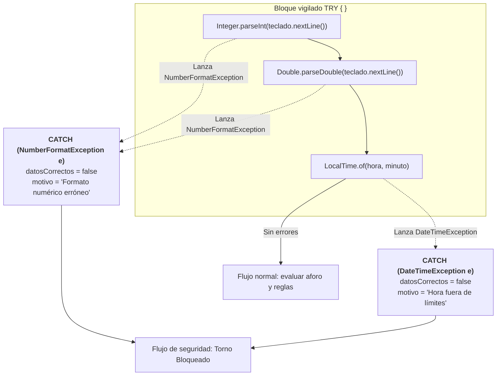
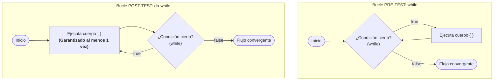
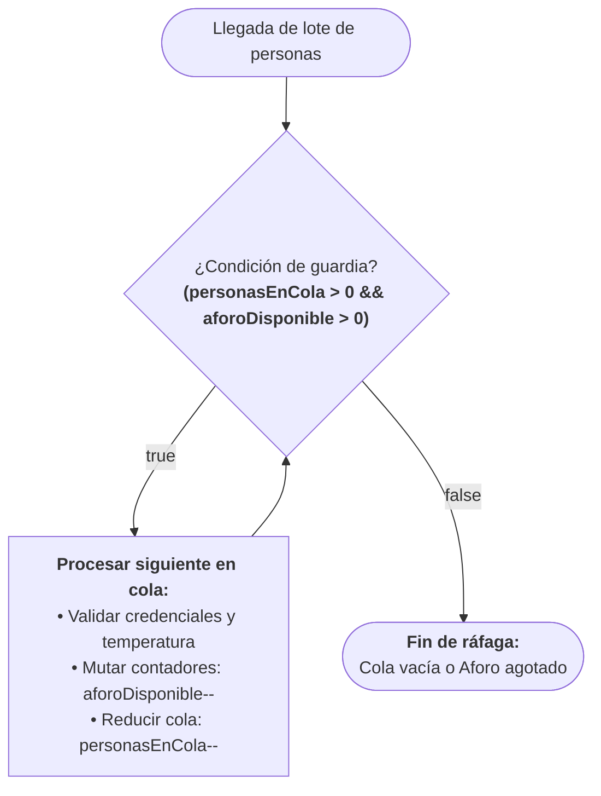
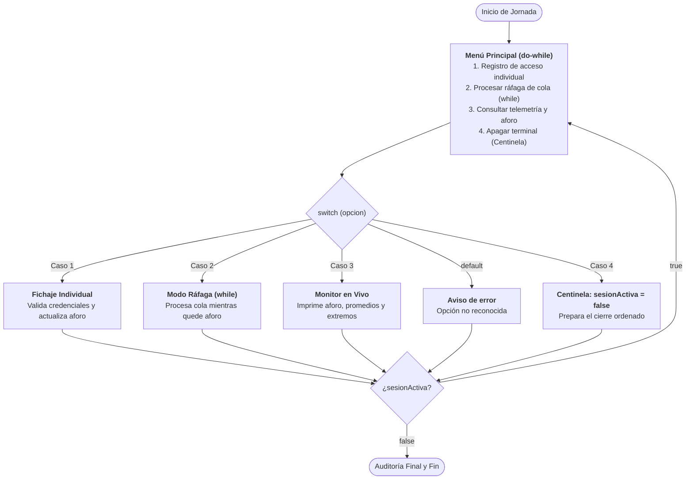
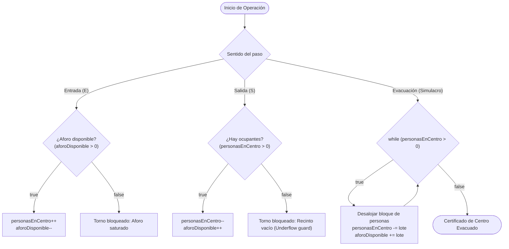

# Sprint 3. Uso de estructuras de control
## Semana 7. Selección: if-else, switch y try-catch

---

### Día 24 - 2 sesiones

---

#### 1. Caso guía en AzaharTech

Son las 15:00 h del **lunes 26 de octubre de 2026**. En la sede de **AzaharTech** en Castellón de la Plana, el equipo de desarrollo arranca formalmente el **Sprint 3**. En este nuevo hito del curso se produce un cambio metodológico esencial: **se abandona PSeInt**; a partir de este instante, toda la algorítmica, análisis y diseño se implementa **directa y exclusivamente en Java**.

Sobre la pantalla de la sala de reuniones, **Alba Torres** y **Pau Ferrer** proyectan el código fuente de la versión `v2.0` que cerró el Sprint 2 el pasado viernes. **Laia Claramunt** toma la palabra para contextualizar el salto cualitativo que exige el cliente:

> *«Alba, Pau: la versión `v2.0` consolidó una arquitectura modular impecable. Desacoplamos la descomposición horaria con `Duration`, aislamos el cálculo de distancias euclídeas con `Math.sqrt` y parametrizamos la construcción de tokens QR en métodos estáticos independientes. Sin embargo, nuestro sistema adolece de un fallo crítico de concepto:*
>
> *Las líneas 129 a 131 de la versión `v2.0` dicen textualmente:*
> ```java
> personasEnCentro++;
> aforoDisponible--;
> idUltimoFichaje++;
> ```
> *El programa es **completamente ciego y secuencial**. No evalúa el contexto antes de actuar: si una persona llega con 39 ºC de fiebre, el torno se abre; si el aforo disponible es cero y el instituto está desbordado, el contador sigue sumando; si el DNI no cumple la longitud legal o el perfil introducido es una letra errónea, el terminal emite alegremente un token oficial de acceso.*
>
> *La dirección del **IES El Caminàs** nos ha trasladado una directriz tajante para este sprint: **el torno físico solo debe franquearse si se cumplen rigurosamente las condiciones de seguridad, aforo y formato**. Si cualquiera de estos filtros falla, el flujo de ejecución debe desviarse, denegar el paso, advertir por consola del motivo del rechazo y congelar los contadores del centro.*
>
> *Hoy introducimos la toma de decisiones en Java mediante la estructura **`if-else`**. Aprenderemos cómo la JVM evalúa expresiones booleanas en cortocircuito y gobernaremos el grafo de flujo de la aplicación»*.

---

#### 2. Fundamento teórico: la bifurcación del flujo de ejecución y la sentencia `if-else` en Java

Hasta la versión `v2.0`, el puntero de instrucción del procesador (*Program Counter* o PC) recorría el método `main` de manera estrictamente lineal. Las **estructuras de control de selección** alteran esta linealidad, permitiendo que la máquina virtual elija rutas alternativas en tiempo de ejecución tras evaluar una expresión booleana.


##### A. Estructuras condicionales en Java (`if`, `if-else`, `if-else if-else`)

1. **Condicional simple (`if`).** Evalúa un predicado booleano. Si la condición resulta `true`, se ejecutan las sentencias encerradas en su bloque; si es `false`, la JVM salta directamente a la siguiente instrucción fuera del bloque.
2. **Condicional doble (`if-else`).** Modela dos alternativas mutuamente excluyentes. Si la condición es `true`, se ejecuta únicamente el bloque del `if`; si es `false`, se ejecuta con total certeza el bloque `else`. Jamás se ejecutan ambos ni se ignoran los dos a la vez.
3. **Escalera de selección múltiple (`if-else if-else`).** Permite encadenar validaciones jerárquicas. Las condiciones se comprueban en estricto orden descendente; en cuanto una se cumple, se ejecuta su bloque y se omiten todas las ramas inferiores.

##### B. Operadores lógicos y evaluación en cortocircuito (*Short-Circuit*)

Recordemos que, para validar reglas de negocio complejas, combinamos operadores relacionales (`>`, `<`, `>=`, `<=`, `==`, `!=`) y lógicos (`&&`, `||`, `!`):

* **Conjunción (`&&`).** Devuelve `true` solo si **ambos** operandos son verdaderos. Si el primer operando evalúa a `false`, Java aborta de inmediato la evaluación (*cortocircuito*), ya que la expresión completa no puede ser cierta bajo ninguna circunstancia.
* **Disyunción (`||`).** Devuelve `true` si al menos **uno** de los operandos es verdadero. Si el primer operando evalúa a `true`, Java ignora el segundo y da la condición por satisfecha.
* **Negación (`!`).** Invierte el valor de verdad del operando (`!true` es `false`).

```java
// Ejemplo de cortocircuito en AzaharTech:
// Si aforoDisponible <= 0, el segundo operando NO se evalúa, evitando llamadas costosas a métodos
boolean puedePasar = (aforoDisponible > 0) && verificarCredencialEnServidor(dniPersonaLimpio);
```

##### C. Estándar de ingeniería AzaharTech: obligatoriedad de llaves y prevención del *Dangling Else*

En Java, prescindir de las llaves `{ }` tras un `if` o `else` hace que el compilador ligue únicamente la primera sentencia siguiente:

```java
// ¡VULNERABILIDAD GRAVE!: Prohibido en el estándar de código de AzaharTech
if (accesoAutorizado)
    abrirTorno();
    personasEnCentro++; // ¡Esta línea se ejecutará SIEMPRE, incluso si el acceso fue denegado!
```

> **Regla de estilo de AzaharTech:** todo bloque condicional debe delimitarse obligatoriamente mediante llaves `{ }`, sin excepción, con independencia del número de líneas que contenga.

##### D. Ámbito de las variables locales (*Block Scope*)

Toda variable declarada en el interior de las llaves `{ }` de un bloque nace y muere en la memoria de pila (*Stack*) asociada a ese bloque. Si se requiere disponer del valor tras la bifurcación (por ejemplo, para imprimir el informe final), la variable debe declararse en el ámbito externo antes del `if`.

---

#### 3. Evolución del caso guía a `ControlAccesoQR v2.1`

En esta versión sustituimos la mutación ciega de estado de la versión `v2.0` por un **árbol de decisión condicional**. Conservamos intactas las constantes corporativas, los métodos modulares construidos en el Sprint 2 y la captura interactiva por teclado.

##### A. Comparativa de cambios respecto a v2.0 (`diff`)

```diff
- // =========================================================================
- // EN v2.0: Mutación ciega e incondicional (la puerta siempre se abría)
- // =========================================================================
- personasEnCentro++;
- aforoDisponible--;
- idUltimoFichaje++;

+ // =========================================================================
+ // EN v2.1: Mutación condicionada al cumplimiento estricto de requisitos
+ // =========================================================================
+ boolean temperaturaApta = (tempVestibulo >= TEMP_CORPORAL_MIN_FALLO && tempVestibulo <= TEMP_CORPORAL_MAX_FIEBRE);
+ boolean aforoSuficiente = (aforoDisponible > 0);
+ boolean perfilPermitido = esLetraValida && (perfilNormalizado == 'E' || perfilNormalizado == 'D' || perfilNormalizado == 'V');
+
+ if (!temperaturaApta) {
+     accesoConcedido = false;
+     motivoDenegacion = String.format("Lectura térmica anómala (%.1f ºC fuera de rango)", tempVestibulo);
+ } else if (!aforoSuficiente) {
+     accesoConcedido = false;
+     motivoDenegacion = "Aforo de recinto saturado. No hay plazas libres disponibles.";
+ } else if (!esLongitudDniCorrecta) {
+     accesoConcedido = false;
+     motivoDenegacion = "Documento irregular. El DNI debe contener exactamente 9 caracteres.";
+ } else if (!perfilPermitido) {
+     accesoConcedido = false;
+     motivoDenegacion = "Perfil de acceso '" + perfilNormalizado + "' no autorizado por jefatura.";
+ } else {
+     accesoConcedido = true;
+     personasEnCentro++;
+     aforoDisponible--;
+     idUltimoFichaje++;
+ }
```

##### B. Foco en la novedad: árbol de decisión y salida bifurcada

Observa cómo se integran las nuevas variables de control dentro de `main` y cómo se bifurca la respuesta visual:

```java
// ... [Captura de datos previa con Scanner y cálculo de tiempos idéntico a v2.0] ...

// 1. Declaración en el ámbito de main para su consumo en el informe final
boolean accesoConcedido;
String motivoDenegacion = "";

// 2. Evaluación lógica de condiciones de negocio
boolean temperaturaApta = (tempVestibulo >= TEMP_CORPORAL_MIN_FALLO && tempVestibulo <= TEMP_CORPORAL_MAX_FIEBRE);
boolean aforoSuficiente = (aforoDisponible > 0);
boolean perfilPermitido = esLetraValida && (perfilNormalizado == 'E' || perfilNormalizado == 'D' || perfilNormalizado == 'V');

if (!temperaturaApta) {
    accesoConcedido = false;
    motivoDenegacion = String.format("Lectura térmica anómala (%.1f ºC fuera del rango %.1f-%.1f ºC)", 
            tempVestibulo, TEMP_CORPORAL_MIN_FALLO, TEMP_CORPORAL_MAX_FIEBRE);
} else if (!aforoSuficiente) {
    accesoConcedido = false;
    motivoDenegacion = "Aforo de recinto saturado. No hay plazas libres disponibles.";
} else if (!esLongitudDniCorrecta) {
    accesoConcedido = false;
    motivoDenegacion = "Documento irregular. El DNI debe contener exactamente 9 caracteres.";
} else if (!perfilPermitido) {
    accesoConcedido = false;
    motivoDenegacion = "Perfil de acceso '" + perfilNormalizado + "' no autorizado por jefatura de estudios.";
} else {
    accesoConcedido = true;
    // Mutación condicionada: solo muta el estado si el acceso es estrictamente legítimo
    personasEnCentro++;
    aforoDisponible--;
    idUltimoFichaje++;
}

// 3. Emisión de informe bifurcado según el veredicto
if (accesoConcedido) {
    System.out.println("----------------------------------------------------------------------");
    System.out.println(">> VEREDICTO:         [ACCESO AUTORIZADO - TORNO ABIERTO]");
    System.out.printf(">> TOKEN QR EMITIDO:  %s%n", tokenResumenVestibulo);
    System.out.printf(">> TOKEN BARRAS:      %s%n", tokenFormatoBarras);
    System.out.printf(">> PUERTA NORTE LINK: %s%n", tokenResumenPuertaNorte);
} else {
    System.out.println("----------------------------------------------------------------------");
    System.out.println(">> VEREDICTO:         [ACCESO DENEGADO - TORNO BLOQUEADO]");
    System.out.printf(">> MOTIVO RECHAZO:    %s%n", motivoDenegacion);
    System.out.println(">> PROTOCOLO:         Diríjase a la conserjería central para verificación manual.");
}

// ... [Resto del informe de telemetría y diagnóstico idéntico a v2.0] ...
```

##### C. Código fuente completo integrado

<details>
<summary><b>🔍 Desplegar archivo completo ControlAccesoQR.java (v2.1)</b></summary>

```java
/**
 * SISTEMA DE CONTROL DE ASISTENCIA POR CÓDIGO QR
 * Cliente: IES El Caminàs (Castellón de la Plana)
 * Consultora: AzaharTech Software Consulting
 * 
 * Versión 2.1:
 * Evolución hacia estructuras de control de selección (Sprint 3).
 * Incorpora bifurcación condicional if-else nativa en Java.
 * Protege los contadores de aforo mediante validación previa de seguridad térmica,
 * capacidad disponible, coherencia de DNI y perfil de usuario autorizado.
 * 
 * @author Equipo AzaharTech (Alba Torres, Pau Ferrer, Laia Claramunt)
 * @version 2.1 (Octubre 2026)
 * @since JDK 21 LTS
 * 
 */

import java.util.Scanner;
import java.util.Random;
import java.time.LocalTime;
import java.time.LocalDate;
import java.time.Duration;

public class ControlAccesoQR {

    // -------------------------------------------------------------------------
    // 1. CONSTANTES INMUTABLES DEL SISTEMA (configuración corporativa)
    // -------------------------------------------------------------------------
    final static String NOMBRE_CENTRO = "IES El Caminàs (Castellón)";
    final static String PREFIJO_CENTRO = "CAMINAS";
    final static String RUTA_LOGS = ".\\caminas\\terminal\\logs";

    final static int MINUTOS_POR_HORA = 60;
    final static int SEGUNDOS_POR_HORA = 3600;
    final static int SEGUNDOS_POR_MINUTO = 60;
    final static int JORNADA_BASE_MINUTOS = 480; // 8 horas
    final static double FACTOR_PORCENTAJE = 100.0;

    final static int ID_TERMINAL_PUERTA_NORTE = 102;
    final static int BASE_TOKEN_SEGURIDAD = 1000;
    final static int RANGO_TOKEN_SEGURIDAD = 9000;
    final static long SEMILLA_CALIBRACION = 987654321L;

    final static double TEMP_MIN_SEGURA = 15.0;
    final static double TEMP_MAX_SEGURA = 35.0;
    final static double MAX_VARIACION_TERMICA = 0.5;
    final static int LONGITUD_DNI_ESTANDAR = 9;

    // Umbrales de seguridad biométrica y capacidad (Sprint 3)
    final static double TEMP_CORPORAL_MAX_FIEBRE = 37.5;
    final static double TEMP_CORPORAL_MIN_FALLO = 35.0;

    // -------------------------------------------------------------------------
    // 2. MÉTODOS ESTÁTICOS PROPIOS (modularización de la lógica del sistema)
    // -------------------------------------------------------------------------

    /**
     * Calcula la estancia neta en minutos entre dos marcas temporales usando Duration.
     */
    public static int calcularEstanciaMinutos(LocalTime entrada, LocalTime salida) {
        return (int) Duration.between(entrada, salida).toMinutes();
    }

    /**
     * Calcula el porcentaje de ocupación con precisión decimal aplicando casting explícito.
     */
    public static double calcularPorcentajeOcupacion(int personas, int aforoTotal) {
        return ((double) personas / aforoTotal) * FACTOR_PORCENTAJE;
    }

    /**
     * Construye y concatena el token QR oficial parametrizado para cualquier monitor.
     */
    public static String construirTokenQR(String prefijo, String dni, int terminalId, int codigoSec, int idFichaje) {
        String token = prefijo + "-" + dni;
        token += "-T" + terminalId;
        token += "-SEC#" + codigoSec;
        token += "-REG" + idFichaje;
        return token;
    }

    /**
     * Calcula la distancia euclídea (hipotenusa) a la pantalla mediante el teorema de Pitágoras.
     */
    public static double calcularDistanciaDiagonal(double x, double y) {
        return Math.sqrt(Math.pow(x, 2.0) + Math.pow(y, 2.0));
    }

    // -------------------------------------------------------------------------
    // 3. MÉTODO PRINCIPAL: ORQUESTADOR DEL FLUJO CON BIFURCACIÓN CONDICIONAL
    // -------------------------------------------------------------------------
    public static void main(String[] args) {
        Scanner teclado = new Scanner(System.in);

        // Generadores independientes en el Heap
        Random generadorVestibulo   = new Random();
        Random generadorPuertaNorte = new Random();
        Random generadorCalibracion = new Random(SEMILLA_CALIBRACION);

        LocalDate fechaActual = LocalDate.now();
        LocalTime horaEmisionQr = LocalTime.now();

        int terminalId;
        double tempVestibulo;

        String nombrePersonaBruto, nombrePersonaLimpio;
        String dniPersonaBruto, dniPersonaLimpio;
        char perfilPersonaBruto;
        char perfilNormalizado;
        boolean esLetraValida;
        boolean esEntrada = true;

        int horaEntrada, minutoEntrada;
        int horaSalida, minutoSalida;

        int personasEnCentro = 1200;
        int aforoDisponible = 800;
        int idUltimoFichaje = 1042;

        int segundosActividadTerminal;
        double coordenadaXMetros, coordenadaYMetros;

        // Captura de datos interactiva
        System.out.println("=================================================");
        System.out.println("   AZAHARTECH - TERMINAL " + NOMBRE_CENTRO);
        System.out.println("   Versión 2.1 Oficial (Sprint 3: Control if-else)  ");
        System.out.println("=================================================");
        System.out.print("Introduce identificador del terminal en texto (ej. 101): ");
        terminalId = Integer.parseInt(teclado.nextLine());

        System.out.print("Temperatura base del sensor (ºC): ");
        tempVestibulo = teclado.nextDouble();

        System.out.print("Segundos de actividad del terminal (uptime): ");
        segundosActividadTerminal = teclado.nextInt();

        System.out.print("Distancia horizontal a pantalla en metros (eje X): ");
        coordenadaXMetros = teclado.nextDouble();

        System.out.print("Altura de la pantalla de TV en metros (eje Y): ");
        coordenadaYMetros = teclado.nextDouble();

        teclado.nextLine(); // Limpieza del buffer de entrada

        System.out.print("DNI de la persona: ");
        dniPersonaBruto = teclado.nextLine();

        System.out.print("Nombre completo: ");
        nombrePersonaBruto = teclado.nextLine();

        // Normalización y limpieza con métodos de String y Character
        dniPersonaLimpio = dniPersonaBruto.trim().toUpperCase();
        nombrePersonaLimpio = nombrePersonaBruto.trim().toUpperCase();

        System.out.print("Perfil de acceso (e = estudiante, d = docente, v = visita): ");
        perfilPersonaBruto = teclado.next().charAt(0);
        perfilNormalizado = Character.toUpperCase(perfilPersonaBruto);
        esLetraValida = Character.isLetter(perfilNormalizado);

        System.out.print("Hora de entrada (0-23): ");
        horaEntrada = teclado.nextInt();
        System.out.print("Minuto de entrada (0-59): ");
        minutoEntrada = teclado.nextInt();

        System.out.print("Hora de salida (0-23): ");
        horaSalida = teclado.nextInt();
        System.out.print("Minuto de salida (0-59): ");
        minutoSalida = teclado.nextInt();

        // Operaciones temporales
        LocalTime tiempoEntrada = LocalTime.of(horaEntrada, minutoEntrada);
        LocalTime tiempoSalida  = LocalTime.of(horaSalida, minutoSalida);
        int minutosEstanciaTotal = calcularEstanciaMinutos(tiempoEntrada, tiempoSalida);

        // Calibración ambiental y diagnóstico
        double tempCalibrada = tempVestibulo + (generadorCalibracion.nextDouble() * MAX_VARIACION_TERMICA);
        boolean sensorNfcOperativo = generadorCalibracion.nextBoolean();
        int codigoTestCalibracion  = BASE_TOKEN_SEGURIDAD + generadorCalibracion.nextInt(RANGO_TOKEN_SEGURIDAD);

        int aforoTotal = personasEnCentro + aforoDisponible;

        // Desglose del documento
        boolean esLongitudDniCorrecta = (dniPersonaLimpio.length() == LONGITUD_DNI_ESTANDAR);
        String numeroDniSolo = dniPersonaLimpio.substring(0, Math.max(0, dniPersonaLimpio.length() - 1));
        char letraFinalDni   = dniPersonaLimpio.charAt(Math.max(0, dniPersonaLimpio.length() - 1));

        // ---------------------------------------------------------------------
        // 4. BIFURCACIÓN CONDICIONAL (NOVEDAD SPRINT 3 - DÍA 24)
        // ---------------------------------------------------------------------
        boolean accesoConcedido;
        String motivoDenegacion = "";

        // Reglas de negocio del IES El Caminàs
        boolean temperaturaApta = (tempVestibulo >= TEMP_CORPORAL_MIN_FALLO && tempVestibulo <= TEMP_CORPORAL_MAX_FIEBRE);
        boolean aforoSuficiente = (aforoDisponible > 0);
        boolean perfilPermitido = esLetraValida && (perfilNormalizado == 'E' || perfilNormalizado == 'D' || perfilNormalizado == 'V');

        if (!temperaturaApta) {
            accesoConcedido = false;
            motivoDenegacion = String.format("Lectura térmica anómala (%.1f ºC fuera del rango %.1f-%.1f ºC)", 
                    tempVestibulo, TEMP_CORPORAL_MIN_FALLO, TEMP_CORPORAL_MAX_FIEBRE);
        } else if (!aforoSuficiente) {
            accesoConcedido = false;
            motivoDenegacion = "Aforo de recinto saturado. No hay plazas libres disponibles.";
        } else if (!esLongitudDniCorrecta) {
            accesoConcedido = false;
            motivoDenegacion = "Documento irregular. El DNI debe contener exactamente 9 caracteres.";
        } else if (!perfilPermitido) {
            accesoConcedido = false;
            motivoDenegacion = "Perfil de acceso '" + perfilNormalizado + "' no autorizado por jefatura de estudios.";
        } else {
            accesoConcedido = true;
            personasEnCentro++;
            aforoDisponible--;
            idUltimoFichaje++;
        }

        // Generación de códigos de seguridad condicionados
        int codigoTokenVestibulo   = BASE_TOKEN_SEGURIDAD + generadorVestibulo.nextInt(RANGO_TOKEN_SEGURIDAD);
        int codigoTokenPuertaNorte = BASE_TOKEN_SEGURIDAD + generadorPuertaNorte.nextInt(RANGO_TOKEN_SEGURIDAD);

        // Construcción de tokens mediante método modular propio
        String tokenResumenVestibulo   = construirTokenQR(PREFIJO_CENTRO, dniPersonaLimpio, terminalId, codigoTokenVestibulo, idUltimoFichaje);
        String tokenResumenPuertaNorte = construirTokenQR(PREFIJO_CENTRO, dniPersonaLimpio, ID_TERMINAL_PUERTA_NORTE, codigoTokenPuertaNorte, idUltimoFichaje);
        String tokenFormatoBarras      = tokenResumenVestibulo.replace("-", "/");

        // Cálculos métricos auxiliares
        int aforoSeguroVisualizado = Math.min(personasEnCentro, aforoTotal);
        double porcentajeOcupacionReal = calcularPorcentajeOcupacion(aforoSeguroVisualizado, aforoTotal);
        int porcentajeOcupacionRedondeado = (int) Math.round(porcentajeOcupacionReal);

        double distanciaDiagonalAntena = calcularDistanciaDiagonal(coordenadaXMetros, coordenadaYMetros);
        int desviacionJornadaMinutos   = Math.abs(minutosEstanciaTotal - JORNADA_BASE_MINUTOS);
        double tempSeguraAcotada       = Math.max(TEMP_MIN_SEGURA, Math.min(tempCalibrada, TEMP_MAX_SEGURA));

        // Descomposición temporal de servicio
        int horasUptime    = segundosActividadTerminal / SEGUNDOS_POR_HORA;
        int minutosUptime  = (segundosActividadTerminal % SEGUNDOS_POR_HORA) / SEGUNDOS_POR_MINUTO;
        int segundosUptime = segundosActividadTerminal % SEGUNDOS_POR_MINUTO;

        // ---------------------------------------------------------------------
        // 5. SALIDA FORMATEADA CONDICIONAL (System.out.printf)
        // ---------------------------------------------------------------------
        System.out.println("\n======================================================================");
        System.out.println("             INFORME OFICIAL DE ACCESO EN VESTÍBULO                   ");
        System.out.println("======================================================================");
        System.out.printf("CENTRO:               %-30s | FECHA: %s%n", NOMBRE_CENTRO, fechaActual);
        System.out.printf("REGISTRO N.º:         #%05d | HORA EMISIÓN QR: %s%n", idUltimoFichaje, horaEmisionQr);

        // Respuesta diferenciada según la decisión tomada
        if (accesoConcedido) {
            System.out.println("----------------------------------------------------------------------");
            System.out.println(">> VEREDICTO:         [ACCESO AUTORIZADO - TORNO ABIERTO]");
            System.out.printf(">> TOKEN QR EMITIDO:  %s%n", tokenResumenVestibulo);
            System.out.printf(">> TOKEN BARRAS:      %s%n", tokenFormatoBarras);
            System.out.printf(">> PUERTA NORTE LINK: %s%n", tokenResumenPuertaNorte);
        } else {
            System.out.println("----------------------------------------------------------------------");
            System.out.println(">> VEREDICTO:         [ACCESO DENEGADO - TORNO BLOQUEADO]");
            System.out.printf(">> MOTIVO RECHAZO:    %s%n", motivoDenegacion);
            System.out.println(">> PROTOCOLO:         Diríjase a la conserjería central para verificación manual.");
        }

        System.out.println("----------------------------------------------------------------------");
        System.out.printf("PERSONA:              %-30s | LONGITUD: %d%n", nombrePersonaLimpio, nombrePersonaLimpio.length());
        System.out.printf("DNI DESGLOSADO:       Número: %s | Letra: '%c'%n", numeroDniSolo, letraFinalDni);
        System.out.printf("PERFIL PROCESADO:     %c (Válido: %b) | SENTIDO: Entrada (%b)%n", perfilNormalizado, perfilPermitido, esEntrada);
        System.out.println("----------------------------------------------------------------------");
        System.out.printf("HORARIO FORMAL:       Entrada %s | Salida %s (LocalTime)%n", tiempoEntrada, tiempoSalida);
        System.out.printf("PERMANENCIA EXACTA:   %03d minutos (Método modular calcularEstancia)%n", minutosEstanciaTotal);
        System.out.printf("DESVIACIÓN JORNADA:   %03d min respecto a jornada completa (480 min).%n", desviacionJornadaMinutos);
        System.out.println("----------------------------------------------------------------------");
        System.out.printf("OCUPACIÓN REDONDEADA: %d %% (Math.round) | Exacta: %6.2f %%%n", porcentajeOcupacionRedondeado, porcentajeOcupacionReal);
        System.out.printf("AFORO DISPONIBLE:     %d plazas restantes de un total de %d%n", aforoDisponible, aforoTotal);
        System.out.printf("DISTANCIA ENFOQUE TV: %.2f metros (Método modular calcularDistancia)%n", distanciaDiagonalAntena);
        System.out.printf("ACTIVO:               %02dh %02dm %02ds (Sensor acotado: %.1f ºC)%n", horasUptime, minutosUptime, segundosUptime, tempSeguraAcotada);
        System.out.printf("DIAGNÓSTICO TEST:     Patrón #%04d | Sensor NFC: Activo (%b)%n", codigoTestCalibracion, sensorNfcOperativo);
        System.out.printf("REGISTRO LOG:         %s%n", RUTA_LOGS);
        System.out.println("======================================================================");

        teclado.close();
    }
}
```

</details>

---

#### 4. Segunda sesión: dojo de entrenamiento y katas de código

En esta segunda sesión, cada estudiante integrará directamente en Java su primera bifurcación condicional en su proyecto propio.

##### Kata 1 (Cinturón blanco / Nivel base). Bifurcación esencial en proyectos seleccionados

Abre el archivo `pr/src/MiProyecto.java` e implementa una estructura `if-else` que bifurque la lógica de negocio y controle las mutaciones de estado:

* **Aventura conversacional.** Verifica los puntos de vida del protagonista tras recibir el impacto del adversario. Si `vidaActual <= 0`, ejecuta la bifurcación de derrota imprimiendo la secuencia de fin de partida y bloqueando nuevas acciones; si la vida es superior a cero, continúa la aventura mostrando las opciones tácticas del siguiente asalto.
* **Motor de recomendación.** Evalúa el porcentaje de compatibilidad o afinidad calculado entre el usuario y el ítem. Si la afinidad supera el umbral del 75% (`afinidad >= 75.0`), cataloga el elemento en la rama positiva como *«Altamente recomendado»* y genera un cupón promocional; en caso contrario, clasifícalo en la rama alternativa como *«Recomendación estándar»*.
* **Simulador de físicas 2D.** Evalúa la posición proyectada del objeto respecto a los límites espaciales del área de simulación. Si la coordenada horizontal excede el margen (`posicionX >= LIMITE_DERECHO`), detecta la colisión perimetral, invierte el signo del vector de velocidad (`velocidadX = -velocidadX`) y notifica el rebote; si permanece dentro del espacio, continúa el desplazamiento inercial sin alteración.
* **Bóveda de contraseñas.** Comprueba si la clave candidata cumple con el umbral mínimo de seguridad reglamentario (`password.length() >= 8`). Si no alcanza dicho tamaño, deniega el registro en la bóveda emitiendo una alerta por baja entropía; si satisface la longitud, confirma el guardado seguro y genera su identificador en el almacén.

---

##### Kata 2 (Cinturón marrón / Nivel avanzado). La trampa del ámbito de bloque (*Block Scope*) y el operador ternario

1. **Auditoría de ámbito de variables:** Analiza y subsana el siguiente defecto recurrente detectado en las revisiones de código de AzaharTech:
   ```java
   if (tempVestibulo > 37.5) {
       String alerta = "¡Fiebre detectada!";
       int codigoIncidencia = 503;
   } else {
       String alerta = "Temperatura nominal";
   }
   // ¿Por qué la siguiente instrucción produce un error de compilación?
   System.out.println(alerta); // Error: cannot find symbol variable alerta
   ```
   *Corrección requerida:* Eleva la declaración de `alerta` al ámbito inmediatamente superior previo a la estructura condicional.
2. **Compactación mediante operador ternario (`?:`):** El operador ternario permite condensar asignaciones binarias en una única instrucción limpia:
   ```java
   String estadoTorno = accesoConcedido ? "TORNO DESBLOQUEADO" : "TORNO BLOQUEADO";
   ```
   Refactoriza una asignación simple de tu proyecto aplicando el operador ternario sin que empeore la legibilidad del código.

---

##### Kata 3 (Cinturón negro / «Hacker AzaharTech»). Radiografía de bytecode en la JVM: saltos condicionales (`if_icmpge`, `goto`)

Abre la terminal integrada de IntelliJ en la raíz del proyecto y analiza el bytecode compilado de `ControlAccesoQR.class` con el desensamblador oficial de Java:

```bash
javap -c pr/src/ControlAccesoQR.class
```

Localiza la sección correspondiente a la evaluación de la variable `aforoDisponible` o `tempVestibulo`. Observarás instrucciones mnemónicas similares a las siguientes:

```text
 42: if_icmpge     55    // Si el valor en la cima de la pila es >= salta al offset 55 (rama else)
 45: iconst_1            // Carga booleano true
 ...
 52: goto          63    // Salto incondicional: evita ejecutar la rama else
 55: iconst_0            // Offset 55: Rama else (carga booleano false)
 ...
 63: return              // Flujo convergente
```

**Reto de ingeniería.** Documenta mediante un comentario técnico en la cabecera de tu clase por qué la instrucción de bajo nivel **`goto`** es imprescindible al término del bloque `if` compilado para preservar el flujo de ejecución, y describe cómo el mecanismo de predicción de saltos (*Branch Prediction*) del procesador evita penalizaciones de rendimiento en la cola de instrucciones cuando se evalúan condicionales repetitivos.

---

### Día 25 - 2 sesiones

---

#### 1. Caso guía en AzaharTech

Es la mañana del **martes 27 de octubre de 2026** en las oficinas de **AzaharTech**. Tras la puesta en marcha de la versión `v2.1` con bifurcación condicional `if-else`, la dirección del **IES El Caminàs** ha remitido una nueva especificación de requisitos para el control de accesos.

**Alba Torres** reúne a **Pau Ferrer** frente al terminal de desarrollo:

> *«Pau, ayer conseguimos que el torno no se abriera a ciegas: si la temperatura corporal no es apta o el centro está lleno, el sistema bloquea el paso. Sin embargo, nuestro tratamiento de los colectivos que conviven en el centro sigue siendo excesivamente plano.*
>
> *En la versión `v2.1` nos limitamos a verificar si el carácter pertenecía a una lista básica:*
> ```java
> boolean perfilPermitido = esLetraValida && (perfilNormalizado == 'E' || perfilNormalizado == 'D' || perfilNormalizado == 'V');
> ```
> *En la realidad cotidiana del instituto coexisten cuatro perfiles diferenciados con **normativas de acceso y permanencia específicas**:*
>
> 1. **Perfil 'E' (Estudiante).** Debe asignarse a *"Aulas y Talleres"*, con una estancia lectiva máxima de 360 minutos y control de puntualidad: si accede después de las 08:15 h, el terminal debe registrar una advertencia de *"RETRASO LECTIVO"*.*
> 2. **Perfil 'D' (Docente).** Se asigna a *"Departamentos y Claustro"*, con una jornada base de 480 minutos y sin restricción de retraso matinal.*
> 3. **Perfil 'V' (Visita externa).** Solo puede acceder a *"Secretaría y Vestíbulo"*, con un límite de permanencia de 120 minutos.*
> 4. **Perfil 'A' (Administración y Servicios - PAS).** Personal administrativo, asignado al *"Edificio de Gestión"* con una jornada de 420 minutos.*
>
> *Si intentamos resolver estas asignaciones encadenando múltiples `if-else if-else`, generaremos un código repetitivo y difícil de mantener. Hoy introducimos la **sentencia de selección múltiple `switch` clásica** en Java, comprenderemos el papel de la cláusula **`break`**, aprenderemos a agrupar casos mediante caída controlada (*fall-through*) y encapsularemos estas decisiones en métodos estáticos modulares»*.

---

#### 2. Fundamento teórico: la sentencia de selección múltiple `switch` en Java

Cuando el flujo del programa debe ramificarse en función de valores discretos exactos de una variable primitiva o inmutable (`char`, `byte`, `short`, `int`, `String` o tipos enumerados), la estructura estándar en programación estructurada es la **sentencia `switch`**.


##### A. Componentes de la sentencia `switch` clásica

1. **Expresión selectora.** Variable evaluada entre paréntesis tras la palabra reservada `switch`. Debe ser de un tipo discreto compatible (en nuestro caso, el carácter `perfilNormalizado`).
2. **Etiquetas `case`.** Literales constantes contra los que se compara el selector. Si coincide el valor, la ejecución salta a ese punto.
3. **Sentencia de salto `break`.** Fuerza la salida inmediata del bloque `switch`. Si se omite, la ejecución continúa secuencialmente hacia las instrucciones del siguiente caso (*fall-through*), lo que suele constituir una fuente grave de errores si no se planifica de forma consciente.
4. **Cláusula `default`.** Bloque opcional que se ejecuta cuando el selector no coincide con ninguna de las etiquetas `case` definidas. Actúa como red de seguridad (*fallback*).

##### B. El fenómeno del *Fall-Through* y la agrupación de casos

Aunque el olvido involuntario de un `break` es un fallo habitual, la caída secuencial entre etiquetas puede emplearse de forma intencionada para aplicar una misma consecuencia lógica a múltiples entradas:

```java
// Agrupación válida: tanto 'E', 'D', 'V' como 'A' activan la misma rama
boolean perfilReconocido;
switch (perfilNormalizado) {
    case 'E':
    case 'D':
    case 'V':
    case 'A':
        perfilReconocido = true;
        break;
    default:
        perfilReconocido = false;
        break;
}
```

##### C. Evaluación de marcas temporales con `LocalTime.isAfter()`

Para controlar la puntualidad del alumnado, combinamos condicionales con métodos de la API `java.time`:

* `tiempoEntrada.isAfter(HORA_LIMITE_PUNTUALIDAD)`. Devuelve `true` si la hora de entrada es estrictamente posterior a las 08:15 h.
* Esta comprobación se acopla a la regla de perfil: únicamente generará aviso de retraso si el usuario es un estudiante (`perfilNormalizado == 'E'`).

---

#### 3. Evolución del caso guía a `ControlAccesoQR v2.2`

En esta versión incorporamos la selección múltiple por perfil delegando cada asignación en métodos estáticos modulares, añadimos la comprobación de puntualidad con `isAfter()` y actualizamos el informe de consola.

##### A. Comparativa de cambios respecto a v2.1 (`diff`)

```diff
  // =========================================================================
  // CONSTANTES DEL SISTEMA
  // =========================================================================
+ final static LocalTime HORA_LIMITE_PUNTUALIDAD = LocalTime.of(8, 15);

  // =========================================================================
  // MÉTODOS ESTÁTICOS PROPIOS (Modularización con switch clásico)
  // =========================================================================
+ public static String obtenerDescripcionPerfil(char perfil) { ... }
+ public static String determinarZonaAutorizada(char perfil) { ... }
+ public static int obtenerEstanciaMaximaPorPerfil(char perfil) { ... }

  // =========================================================================
  // MÉTODO MAIN: Toma de decisiones
  // =========================================================================
- boolean perfilPermitido = esLetraValida && (perfilNormalizado == 'E' || perfilNormalizado == 'D' || perfilNormalizado == 'V');
+ boolean perfilReconocido;
+ switch (perfilNormalizado) {
+     case 'E':
+     case 'D':
+     case 'V':
+     case 'A':
+         perfilReconocido = true;
+         break;
+     default:
+         perfilReconocido = false;
+         break;
+ }
+
+ String descripcionRol    = obtenerDescripcionPerfil(perfilNormalizado);
+ String zonaDesignada     = determinarZonaAutorizada(perfilNormalizado);
+ int estanciaMaxPermitida = obtenerEstanciaMaximaPorPerfil(perfilNormalizado);
+ boolean esRetrasoLectivo = (perfilNormalizado == 'E') && tiempoEntrada.isAfter(HORA_LIMITE_PUNTUALIDAD);
```

##### B. Foco en la novedad: métodos modulares y bifurcación con `switch`

Observa cómo aislamos la lógica de cada atributo del perfil en métodos independientes y cómo controlamos la puntualidad:

```java
// -------------------------------------------------------------------------
// Métodos estáticos modulares gobernados por switch clásico
// -------------------------------------------------------------------------
public static String obtenerDescripcionPerfil(char perfil) {
    String descripcion;
    switch (perfil) {
        case 'E':
            descripcion = "Estudiante Oficial";
            break;
        case 'D':
            descripcion = "Docente / Claustro";
            break;
        case 'V':
            descripcion = "Visita Externa / Proveedor";
            break;
        case 'A':
            descripcion = "Personal de Administración y Servicios (PAS)";
            break;
        default:
            descripcion = "Perfil No Catalogado";
            break;
    }
    return descripcion;
}

public static String determinarZonaAutorizada(char perfil) {
    String zona;
    switch (perfil) {
        case 'E':
            zona = "Aulas Docentes y Talleres de Informática";
            break;
        case 'D':
            zona = "Departamentos Didácticos, Aulas y Sala de Profesores";
            break;
        case 'V':
            zona = "Secretaría, Conserjería y Despachos de Dirección";
            break;
        case 'A':
            zona = "Área de Gestión Administrativa y Archivo Central";
            break;
        default:
            zona = "Acceso Denegado / Zona No Autorizada";
            break;
    }
    return zona;
}

public static int obtenerEstanciaMaximaPorPerfil(char perfil) {
    int estanciaMinutos;
    switch (perfil) {
        case 'E':
            estanciaMinutos = 360; // 6 horas lectivas
            break;
        case 'D':
            estanciaMinutos = 480; // 8 horas jornada docente
            break;
        case 'V':
            estanciaMinutos = 120; // 2 horas límite visitas
            break;
        case 'A':
            estanciaMinutos = 420; // 7 horas jornada administrativa
            break;
        default:
            estanciaMinutos = 0;
            break;
    }
    return estanciaMinutos;
}

// -------------------------------------------------------------------------
// Dentro de main: Invocación e informe condicional de puntualidad
// -------------------------------------------------------------------------
// [Tras validar y autorizar el acceso...]
System.out.printf("ROL CLASIFICADO:      [%c] %-25s | Válido: %b%n", perfilNormalizado, descripcionRol, perfilReconocido);
System.out.printf("ZONA ASIGNADA:        %s%n", zonaDesignada);
System.out.printf("LÍMITE AUTORIZADO:    %d minutos (Tiempo previsto: %d min)%n", estanciaMaxPermitida, minutosEstanciaTotal);

if (esRetrasoLectivo && accesoConcedido) {
    System.out.println(">> AVISO PUNTUALIDAD: [RETRASO LECTIVO REGISTRADO - Entrada posterior a las 08:15]");
}
```

##### C. Código fuente completo integrado

<details>
<summary><b>🔍 Desplegar archivo completo ControlAccesoQR.java (v2.2)</b></summary>

```java
/**
 * SISTEMA DE CONTROL DE ASISTENCIA POR CÓDIGO QR
 * Cliente: IES El Caminàs (Castellón de la Plana)
 * Consultora: AzaharTech Software Consulting
 * 
 * Versión 2.2:
 * Incorpora estructuras de selección múltiple mediante sentencias switch clásicas.
 * Despliega lógica diferenciada por rol (Estudiante, Docente, Visita, PAS).
 * Control de puntualidad y asignación dinámica de zonas y estancias máximas.
 * 
 * @author Equipo AzaharTech (Alba Torres, Pau Ferrer, Laia Claramunt)
 * @version 2.2 (Octubre 2026)
 * @since JDK 21 LTS
 * 
 */

import java.util.Scanner;
import java.util.Random;
import java.time.LocalTime;
import java.time.LocalDate;
import java.time.Duration;

public class ControlAccesoQR {

    // -------------------------------------------------------------------------
    // 1. CONSTANTES INMUTABLES DEL SISTEMA (configuración corporativa)
    // -------------------------------------------------------------------------
    final static String NOMBRE_CENTRO = "IES El Caminàs (Castellón)";
    final static String PREFIJO_CENTRO = "CAMINAS";
    final static String RUTA_LOGS = ".\\caminas\\terminal\\logs";

    final static int MINUTOS_POR_HORA = 60;
    final static int SEGUNDOS_POR_HORA = 3600;
    final static int SEGUNDOS_POR_MINUTO = 60;
    final static int JORNADA_BASE_MINUTOS = 480; // 8 horas
    final static double FACTOR_PORCENTAJE = 100.0;

    final static int ID_TERMINAL_PUERTA_NORTE = 102;
    final static int BASE_TOKEN_SEGURIDAD = 1000;
    final static int RANGO_TOKEN_SEGURIDAD = 9000;
    final static long SEMILLA_CALIBRACION = 987654321L;

    final static double TEMP_MIN_SEGURA = 15.0;
    final static double TEMP_MAX_SEGURA = 35.0;
    final static double MAX_VARIACION_TERMICA = 0.5;
    final static int LONGITUD_DNI_ESTANDAR = 9;

    // Umbrales de seguridad biométrica y capacidad (Sprint 3)
    final static double TEMP_CORPORAL_MAX_FIEBRE = 37.5;
    final static double TEMP_CORPORAL_MIN_FALLO = 35.0;

    // Control horario de puntualidad lectiva para estudiantes (Día 25)
    final static LocalTime HORA_LIMITE_PUNTUALIDAD = LocalTime.of(8, 15);

    // -------------------------------------------------------------------------
    // 2. MÉTODOS ESTÁTICOS PROPIOS (modularización de la lógica del sistema)
    // -------------------------------------------------------------------------

    /**
     * Calcula la estancia neta en minutos entre dos marcas temporales usando Duration.
     */
    public static int calcularEstanciaMinutos(LocalTime entrada, LocalTime salida) {
        return (int) Duration.between(entrada, salida).toMinutes();
    }

    /**
     * Calcula el porcentaje de ocupación con precisión decimal aplicando casting explícito.
     */
    public static double calcularPorcentajeOcupacion(int personas, int aforoTotal) {
        return ((double) personas / aforoTotal) * FACTOR_PORCENTAJE;
    }

    /**
     * Construye y concatena el token QR oficial parametrizado para cualquier monitor.
     */
    public static String construirTokenQR(String prefijo, String dni, int terminalId, int codigoSec, int idFichaje) {
        String token = prefijo + "-" + dni;
        token += "-T" + terminalId;
        token += "-SEC#" + codigoSec;
        token += "-REG" + idFichaje;
        return token;
    }

    /**
     * Calcula la distancia euclídea (hipotenusa) a la pantalla mediante el teorema de Pitágoras.
     */
    public static double calcularDistanciaDiagonal(double x, double y) {
        return Math.sqrt(Math.pow(x, 2.0) + Math.pow(y, 2.0));
    }

    /**
     * Retorna la denominación oficial del perfil mediante una sentencia switch clásica con break.
     */
    public static String obtenerDescripcionPerfil(char perfil) {
        String descripcion;
        switch (perfil) {
            case 'E':
                descripcion = "Estudiante Oficial";
                break;
            case 'D':
                descripcion = "Docente / Claustro";
                break;
            case 'V':
                descripcion = "Visita Externa / Proveedor";
                break;
            case 'A':
                descripcion = "Personal de Administración y Servicios (PAS)";
                break;
            default:
                descripcion = "Perfil No Catalogado";
                break;
        }
        return descripcion;
    }

    /**
     * Asigna la zona física autorizada del campus mediante una sentencia switch clásica.
     */
    public static String determinarZonaAutorizada(char perfil) {
        String zona;
        switch (perfil) {
            case 'E':
                zona = "Aulas Docentes y Talleres de Informática";
                break;
            case 'D':
                zona = "Departamentos Didácticos, Aulas y Sala de Profesores";
                break;
            case 'V':
                zona = "Secretaría, Conserjería y Despachos de Dirección";
                break;
            case 'A':
                zona = "Área de Gestión Administrativa y Archivo Central";
                break;
            default:
                zona = "Acceso Denegado / Zona No Autorizada";
                break;
        }
        return zona;
    }

    /**
     * Determina el límite de minutos de permanencia permitidos según el perfil con switch clásico.
     */
    public static int obtenerEstanciaMaximaPorPerfil(char perfil) {
        int estanciaMinutos;
        switch (perfil) {
            case 'E':
                estanciaMinutos = 360; // 6 horas lectivas
                break;
            case 'D':
                estanciaMinutos = 480; // 8 horas jornada docente
                break;
            case 'V':
                estanciaMinutos = 120; // 2 horas límite visitas
                break;
            case 'A':
                estanciaMinutos = 420; // 7 horas jornada administrativa
                break;
            default:
                estanciaMinutos = 0;
                break;
        }
        return estanciaMinutos;
    }

    // -------------------------------------------------------------------------
    // 3. MÉTODO PRINCIPAL: ORQUESTADOR CON IF-ELSE Y SELECCIÓN MÚLTIPLE SWITCH
    // -------------------------------------------------------------------------
    public static void main(String[] args) {
        Scanner teclado = new Scanner(System.in);

        // Generadores independientes en el Heap
        Random generadorVestibulo   = new Random();
        Random generadorPuertaNorte = new Random();
        Random generadorCalibracion = new Random(SEMILLA_CALIBRACION);

        LocalDate fechaActual = LocalDate.now();
        LocalTime horaEmisionQr = LocalTime.now();

        int terminalId;
        double tempVestibulo;

        String nombrePersonaBruto, nombrePersonaLimpio;
        String dniPersonaBruto, dniPersonaLimpio;
        char perfilPersonaBruto;
        char perfilNormalizado;
        boolean esLetraValida;
        boolean esEntrada = true;

        int horaEntrada, minutoEntrada;
        int horaSalida, minutoSalida;

        int personasEnCentro = 1200;
        int aforoDisponible = 800;
        int idUltimoFichaje = 1042;

        int segundosActividadTerminal;
        double coordenadaXMetros, coordenadaYMetros;

        // Captura de datos interactiva
        System.out.println("=================================================");
        System.out.println("   AZAHARTECH - TERMINAL " + NOMBRE_CENTRO);
        System.out.println("   Versión 2.2 Oficial (Sprint 3: Switch & Perfiles)");
        System.out.println("=================================================");
        System.out.print("Introduce identificador del terminal en texto (ej. 101): ");
        terminalId = Integer.parseInt(teclado.nextLine());

        System.out.print("Temperatura base del sensor (ºC): ");
        tempVestibulo = teclado.nextDouble();

        System.out.print("Segundos de actividad del terminal (uptime): ");
        segundosActividadTerminal = teclado.nextInt();

        System.out.print("Distancia horizontal a pantalla en metros (eje X): ");
        coordenadaXMetros = teclado.nextDouble();

        System.out.print("Altura de la pantalla de TV en metros (eje Y): ");
        coordenadaYMetros = teclado.nextDouble();

        teclado.nextLine(); // Limpieza del buffer de entrada

        System.out.print("DNI de la persona: ");
        dniPersonaBruto = teclado.nextLine();

        System.out.print("Nombre completo: ");
        nombrePersonaBruto = teclado.nextLine();

        // Normalización y limpieza con métodos de String y Character
        dniPersonaLimpio = dniPersonaBruto.trim().toUpperCase();
        nombrePersonaLimpio = nombrePersonaBruto.trim().toUpperCase();

        System.out.print("Perfil de acceso (E=Estudiante, D=Docente, V=Visita, A=Admin): ");
        perfilPersonaBruto = teclado.next().charAt(0);
        perfilNormalizado = Character.toUpperCase(perfilPersonaBruto);
        esLetraValida = Character.isLetter(perfilNormalizado);

        System.out.print("Hora de entrada (0-23): ");
        horaEntrada = teclado.nextInt();
        System.out.print("Minuto de entrada (0-59): ");
        minutoEntrada = teclado.nextInt();

        System.out.print("Hora de salida (0-23): ");
        horaSalida = teclado.nextInt();
        System.out.print("Minuto de salida (0-59): ");
        minutoSalida = teclado.nextInt();

        // Operaciones temporales
        LocalTime tiempoEntrada = LocalTime.of(horaEntrada, minutoEntrada);
        LocalTime tiempoSalida  = LocalTime.of(horaSalida, minutoSalida);
        int minutosEstanciaTotal = calcularEstanciaMinutos(tiempoEntrada, tiempoSalida);

        // Calibración ambiental y diagnóstico
        double tempCalibrada = tempVestibulo + (generadorCalibracion.nextDouble() * MAX_VARIACION_TERMICA);
        boolean sensorNfcOperativo = generadorCalibracion.nextBoolean();
        int codigoTestCalibracion  = BASE_TOKEN_SEGURIDAD + generadorCalibracion.nextInt(RANGO_TOKEN_SEGURIDAD);

        int aforoTotal = personasEnCentro + aforoDisponible;

        // Desglose del documento
        boolean esLongitudDniCorrecta = (dniPersonaLimpio.length() == LONGITUD_DNI_ESTANDAR);
        String numeroDniSolo = dniPersonaLimpio.substring(0, Math.max(0, dniPersonaLimpio.length() - 1));
        char letraFinalDni   = dniPersonaLimpio.charAt(Math.max(0, dniPersonaLimpio.length() - 1));

        // ---------------------------------------------------------------------
        // 4. CLASIFICACIÓN CON SENTENCIA SWITCH CLÁSICA Y VALIDACIÓN (DÍA 25)
        // ---------------------------------------------------------------------
        // Verificación de reconocimiento del perfil mediante agrupación con fall-through
        boolean perfilReconocido;
        switch (perfilNormalizado) {
            case 'E':
            case 'D':
            case 'V':
            case 'A':
                perfilReconocido = true;
                break;
            default:
                perfilReconocido = false;
                break;
        }

        String descripcionRol    = obtenerDescripcionPerfil(perfilNormalizado);
        String zonaDesignada     = determinarZonaAutorizada(perfilNormalizado);
        int estanciaMaxPermitida = obtenerEstanciaMaximaPorPerfil(perfilNormalizado);

        // Control de puntualidad específico para estudiantes
        boolean esRetrasoLectivo = (perfilNormalizado == 'E') && tiempoEntrada.isAfter(HORA_LIMITE_PUNTUALIDAD);

        // Variables de decisión de acceso
        boolean accesoConcedido;
        String motivoDenegacion = "";

        // Reglas de negocio consolidadas
        boolean temperaturaApta = (tempVestibulo >= TEMP_CORPORAL_MIN_FALLO && tempVestibulo <= TEMP_CORPORAL_MAX_FIEBRE);
        boolean aforoSuficiente = (aforoDisponible > 0);

        if (!temperaturaApta) {
            accesoConcedido = false;
            motivoDenegacion = String.format("Lectura térmica anómala (%.1f ºC fuera del rango %.1f-%.1f ºC)", 
                    tempVestibulo, TEMP_CORPORAL_MIN_FALLO, TEMP_CORPORAL_MAX_FIEBRE);
        } else if (!aforoSuficiente) {
            accesoConcedido = false;
            motivoDenegacion = "Aforo de recinto saturado. No hay plazas libres disponibles.";
        } else if (!esLongitudDniCorrecta) {
            accesoConcedido = false;
            motivoDenegacion = "Documento irregular. El DNI debe contener exactamente 9 caracteres.";
        } else if (!perfilReconocido) {
            accesoConcedido = false;
            motivoDenegacion = "Perfil '" + perfilNormalizado + "' no autorizado por jefatura de estudios.";
        } else {
            accesoConcedido = true;
            // Mutación de estado condicionada
            personasEnCentro++;
            aforoDisponible--;
            idUltimoFichaje++;
        }

        // Generación de códigos de seguridad condicionados
        int codigoTokenVestibulo   = BASE_TOKEN_SEGURIDAD + generadorVestibulo.nextInt(RANGO_TOKEN_SEGURIDAD);
        int codigoTokenPuertaNorte = BASE_TOKEN_SEGURIDAD + generadorPuertaNorte.nextInt(RANGO_TOKEN_SEGURIDAD);

        // Construcción de tokens mediante método modular propio
        String tokenResumenVestibulo   = construirTokenQR(PREFIJO_CENTRO, dniPersonaLimpio, terminalId, codigoTokenVestibulo, idUltimoFichaje);
        String tokenResumenPuertaNorte = construirTokenQR(PREFIJO_CENTRO, dniPersonaLimpio, ID_TERMINAL_PUERTA_NORTE, codigoTokenPuertaNorte, idUltimoFichaje);
        String tokenFormatoBarras      = tokenResumenVestibulo.replace("-", "/");

        // Cálculos métricos auxiliares
        int aforoSeguroVisualizado = Math.min(personasEnCentro, aforoTotal);
        double porcentajeOcupacionReal = calcularPorcentajeOcupacion(aforoSeguroVisualizado, aforoTotal);
        int porcentajeOcupacionRedondeado = (int) Math.round(porcentajeOcupacionReal);

        double distanciaDiagonalAntena = calcularDistanciaDiagonal(coordenadaXMetros, coordenadaYMetros);
        int desviacionJornadaMinutos   = Math.abs(minutosEstanciaTotal - JORNADA_BASE_MINUTOS);
        double tempSeguraAcotada       = Math.max(TEMP_MIN_SEGURA, Math.min(tempCalibrada, TEMP_MAX_SEGURA));

        // Descomposición temporal de servicio
        int horasUptime    = segundosActividadTerminal / SEGUNDOS_POR_HORA;
        int minutosUptime  = (segundosActividadTerminal % SEGUNDOS_POR_HORA) / SEGUNDOS_POR_MINUTO;
        int segundosUptime = segundosActividadTerminal % SEGUNDOS_POR_MINUTO;

        // ---------------------------------------------------------------------
        // 5. SALIDA FORMATEADA CON TRAZA DE PERFIL (System.out.printf)
        // ---------------------------------------------------------------------
        System.out.println("\n======================================================================");
        System.out.println("             INFORME OFICIAL DE ACCESO EN VESTÍBULO                   ");
        System.out.println("======================================================================");
        System.out.printf("CENTRO:               %-30s | FECHA: %s%n", NOMBRE_CENTRO, fechaActual);
        System.out.printf("REGISTRO N.º:         #%05d | HORA EMISIÓN QR: %s%n", idUltimoFichaje, horaEmisionQr);

        if (accesoConcedido) {
            System.out.println("----------------------------------------------------------------------");
            System.out.println(">> VEREDICTO:         [ACCESO AUTORIZADO - TORNO ABIERTO]");
            System.out.printf(">> TOKEN QR EMITIDO:  %s%n", tokenResumenVestibulo);
            System.out.printf(">> TOKEN BARRAS:      %s%n", tokenFormatoBarras);
            System.out.printf(">> PUERTA NORTE LINK: %s%n", tokenResumenPuertaNorte);
        } else {
            System.out.println("----------------------------------------------------------------------");
            System.out.println(">> VEREDICTO:         [ACCESO DENEGADO - TORNO BLOQUEADO]");
            System.out.printf(">> MOTIVO RECHAZO:    %s%n", motivoDenegacion);
            System.out.println(">> PROTOCOLO:         Diríjase a la conserjería central para verificación manual.");
        }

        System.out.println("----------------------------------------------------------------------");
        System.out.printf("PERSONA:              %-30s | LONGITUD: %d%n", nombrePersonaLimpio, nombrePersonaLimpio.length());
        System.out.printf("DNI DESGLOSADO:       Número: %s | Letra: '%c'%n", numeroDniSolo, letraFinalDni);
        System.out.printf("ROL CLASIFICADO:      [%c] %-25s | Válido: %b%n", perfilNormalizado, descripcionRol, perfilReconocido);
        System.out.printf("ZONA ASIGNADA:        %s%n", zonaDesignada);
        System.out.printf("LÍMITE AUTORIZADO:    %d minutos (Tiempo previsto: %d min)%n", estanciaMaxPermitida, minutosEstanciaTotal);

        // Advertencia condicional de puntualidad (si aplica)
        if (esRetrasoLectivo && accesoConcedido) {
            System.out.println(">> AVISO PUNTUALIDAD: [RETRASO LECTIVO REGISTRADO - Entrada posterior a las 08:15]");
        }

        System.out.println("----------------------------------------------------------------------");
        System.out.printf("HORARIO FORMAL:       Entrada %s | Salida %s (LocalTime)%n", tiempoEntrada, tiempoSalida);
        System.out.printf("PERMANENCIA EXACTA:   %03d minutos (Método modular calcularEstancia)%n", minutosEstanciaTotal);
        System.out.printf("DESVIACIÓN JORNADA:   %03d min respecto a jornada completa (480 min).%n", desviacionJornadaMinutos);
        System.out.println("----------------------------------------------------------------------");
        System.out.printf("OCUPACIÓN REDONDEADA: %d %% (Math.round) | Exacta: %6.2f %%%n", porcentajeOcupacionRedondeado, porcentajeOcupacionReal);
        System.out.printf("AFORO DISPONIBLE:     %d plazas restantes de un total de %d%n", aforoDisponible, aforoTotal);
        System.out.printf("DISTANCIA ENFOQUE TV: %.2f metros (Método modular calcularDistancia)%n", distanciaDiagonalAntena);
        System.out.printf("ACTIVO:               %02dh %02dm %02ds (Sensor acotado: %.1f ºC)%n", horasUptime, minutosUptime, segundosUptime, tempSeguraAcotada);
        System.out.printf("DIAGNÓSTICO TEST:     Patrón #%04d | Sensor NFC: Activo (%b)%n", codigoTestCalibracion, sensorNfcOperativo);
        System.out.printf("REGISTRO LOG:         %s%n", RUTA_LOGS);
        System.out.println("======================================================================");

        teclado.close();
    }
}
```

</details>

---

#### 4. Segunda sesión: dojo de entrenamiento y katas de código

En esta sesión práctica, cada alumno desarrollará directamente en Java estructuras de selección múltiple sobre el archivo maestro de su especialidad técnica.

##### Kata 1 (Cinturón blanco / Nivel base). Selección múltiple clásica con `switch` y `break`

Abre tu archivo `pr/src/MiProyecto.java` e implementa una sentencia `switch` tradicional que controle la toma de decisiones en función de una variable discreta, asegurando la inclusión de `break` en cada caso y una cláusula `default`:

* **Aventura conversacional.** Evalúa mediante un `switch` clásico el carácter del comando táctico introducido por el jugador (`'A'`, `'D'`, `'H'`, `'U'`). Cada caso debe actualizar las variables de combate (modificador de ataque, defensa, probabilidad de huida o puntos de curación mediante poción) y finalizar con su correspondiente sentencia `break`, contemplando una cláusula `default` para comandos desconocidos que penalice el turno del jugador.
* **Motor de recomendación.** Implementa un `switch` clásico sobre el carácter identificador de la categoría de contenido (`'C'` para Cine, `'M'` para Música, `'V'` para Videojuegos, `'L'` para Literatura). En cada caso, asigna el umbral mínimo de afinidad porcentual exigido y una cadena con la etiqueta descriptiva del sector, incluyendo una cláusula `default` de seguridad para categorías no catalogadas.
* **Simulador de físicas 2D.** Estructura un `switch` clásico que discrimine según el carácter representativo del material del cuerpo impactado (`'M'` para Metal, `'G'` para Goma, `'B'` para Barro, `'H'` para Hielo). En cada rama, asigna el coeficiente de restitución elástica específico (entre 0.05 y 0.98) que multiplicará el vector de velocidad para calcular la pérdida de energía en el rebote, cerrando con un `default` que asigne un rebote genérico.
* **Bóveda de contraseñas.** Utiliza un `switch` clásico para evaluar el nivel de clasificación de seguridad del secreto (`'B'` para Básico, `'C'` para Confidencial, `'S'` para Secreto, `'T'` para Top Secret). Cada caso debe fijar la longitud mínima obligatoria de la clave (8, 12, 16 o 24 caracteres) y el periodo de caducidad en días (365, 90, 30 o 7 días), previendo una rama `default` que rechace niveles no homologados.

---

##### Kata 2 (Cinturón marrón / Nivel avanzado). Transición hacia el estándar moderno: las `switch expression` de Java 21

La sintaxis clásica de `switch` arrastra desde los años 70 el riesgo de olvidar un `break`, provocando caídas involuntarias de flujo. Para resolverlo definitivamente, Java incorporó en sus versiones LTS modernas las **`switch expression`**.

1. **Sintaxis de flecha (`->`) y asignación directa.** La expresión `switch` no necesita `break` y puede devolver un valor que se asigna directamente a una variable:
   ```java
   // Comparativa: de 15 líneas a una expresión concisa y segura
   String descripcion = switch (perfil) {
       case 'E' -> "Estudiante Oficial";
       case 'D' -> "Docente / Claustro";
       case 'V' -> "Visita Externa / Proveedor";
       case 'A' -> "Personal de Administración y Servicios (PAS)";
       default  -> "Perfil No Catalogado";
   };
   ```
2. **Bloques multilínea con `yield`.** Si una rama de la flecha requiere ejecutar varias operaciones antes de producir su resultado, se encierra entre llaves `{ }` y se utiliza la palabra reservada `yield`:
   ```java
   int estanciaMinutos = switch (perfil) {
       case 'V' -> {
           System.out.println(">> Aviso de seguridad: activando protocolo de acreditación temporal.");
           yield 120;
       }
       case 'E' -> 360;
       case 'D' -> 480;
       case 'A' -> 420;
       default  -> 0;
   };
   ```
3. **Reto de refactorización.** Toma la sentencia `switch` clásica que implementaste en la Kata 1 para tu proyecto (**Aventura conversacional**, **Motor de recomendación**, **Simulador de físicas 2D** o **Bóveda de contraseñas**) y refactorízala en un método estático independiente utilizando la sintaxis moderna de `switch expression` con flecha (`->`) y al menos una rama gobernada por `yield`.

---

##### Kata 3 (Cinturón negro / «Hacker AzaharTech»). Radiografía de bytecode en la JVM: `tableswitch` frente a `lookupswitch`

Abre la terminal de comandos de IntelliJ en el directorio del proyecto y compila y desensambla el archivo `ControlAccesoQR.class`:

```bash
javap -c pr/src/ControlAccesoQR.class
```

Localiza en el volcado las instrucciones que implementan los métodos `obtenerDescripcionPerfil` o la validación del perfil. Comprobarás que la máquina virtual de Java compila los bloques `switch` mediante dos instrucciones bytecode bien diferenciadas:

* **`tableswitch`.** Se genera cuando los valores de los casos son números consecutivos o forman una secuencia muy compacta (por ejemplo, `1, 2, 3, 4`). La JVM construye una tabla de saltos indexada directa donde el acceso a la rama tiene una complejidad algorítmica constante **$O(1)$**.
* **`lookupswitch`.** Se utiliza cuando los valores numéricos de los casos están dispersos o alejados en la tabla ASCII/Unicode (como nuestros caracteres `'A'=65`, `'D'=68`, `'E'=69` y `'V'=86`). La JVM genera una lista ordenada de pares `(clave, offset)` y ejecuta una búsqueda binaria en la tabla con coste **$O(\log n)$**.

**Reto técnico.** Identifica en el volcado de tu desensamblador cuál de las dos instrucciones bytecode (`tableswitch` o `lookupswitch`) ha seleccionado el compilador `javac` para tu clase y redacta un breve comentario técnico en la cabecera del método justificando la elección en función de la dispersión de los caracteres analizados.

---

### Día 26 - 2 sesiones

---

#### 1. Caso guía en AzaharTech

Son las 15:00 h del **miércoles 28 de octubre de 2026** en la sede de **AzaharTech**. Durante la sesión matinal de pruebas de la versión `v2.2`, el equipo de conserjería del **IES El Caminàs** estuvo testeando el terminal físico en el vestíbulo principal. En una de las pruebas, un técnico introdujo por error la palabra *"diez"* en lugar del dígito `10` al indicar la hora de entrada; en otra, el sensor térmico envió una cadena vacía al leer la temperatura.

El resultado fue inmediato y desastroso: la consola arrojó una traza roja de excepción (`NumberFormatException` / `InputMismatchException`), la máquina virtual abortó la ejecución y el torno quedó congelado a mitad de jornada sin emitir ningún informe.

**Laia Claramunt** convoca a **Alba Torres** y **Pau Ferrer**:

> *«Alba, Pau: la lógica que implementamos ayer con sentencias `switch` clásicas para catalogar a estudiantes, docentes, visitas y personal de administración es impecable, pero tiene un talón de Aquiles:*
>
> *Las líneas 153 a 179 de la versión `v2.2` ejecutan de forma directa:*
> ```java
> terminalId = Integer.parseInt(teclado.nextLine());
> tempVestibulo = teclado.nextDouble();
> ...
> tiempoEntrada = LocalTime.of(horaEntrada, minutoEntrada);
> ```
> *Nuestro software **asume ciegamente que el usuario y los sensores nunca se equivocan**. En un entorno real, una aplicación profesional jamás puede desplomarse con un volcado de pila (*stack trace*) ante un fallo tipográfico o una lectura corrupta de hardware.*
>
> *Si alguien escribe texto en un campo numérico, o si introduce la hora 25 o el minuto 78, la aplicación debe interceptar el fallo en el instante exacto en que ocurre, contener el error, activar una bandera de anomalía y denegar el paso de forma controlada mediante nuestro árbol de decisión.*
>
> *Hoy blindamos el código mediante el **control de excepciones básico con `try-catch`**. Aprenderemos a capturar errores de conversión numérica (`NumberFormatException`) y desbordamientos temporales (`DateTimeException`), garantizando que el terminal del instituto continúe operativo bajo cualquier circunstancia»*.

---

#### 2. Fundamento teórico: control de excepciones básico (`try-catch`) y programación defensiva

Una **excepción** en Java es un objeto que representa una condición anómala acontecida durante la ejecución. Si el hilo de ejecución no intercepta la excepción, la máquina virtual finaliza abruptamente el método `main`.



##### A. Anatomía del bloque `try-catch`

1. **Bloque `try`.** Delimita el conjunto de instrucciones vigiladas donde puede originarse una excepción (conversiones numéricas con `Integer.parseInt()` o instanciaciones de `LocalTime.of()`).
2. **Bloque `catch`.** Se ejecuta de forma inmediata si se produce una excepción del tipo vigilado. Permite contener el impacto, registrar el problema y asignar un estado de error sin tumbar el proceso.

##### B. Excepciones críticas en la captura por consola

* **`NumberFormatException`.** Se dispara al intentar convertir un texto alfanumérico no convertible en número entero o decimal.
* **`DateTimeException`.** Se produce si se pasan valores numéricos fuera de los rangos válidos del calendario o reloj (por ejemplo, horas fuera del rango 0–23 o minutos fuera de 0–59).

##### C. Ámbito de variables locales (*Block Scope*) e inicialización previa

Cualquier variable declarada dentro del bloque `try` sólo existe dentro de sus llaves. Para poder emplear los datos en los bloques posteriores de decisión (`if-else`) e informe, las variables deben **declararse e inicializarse con valores seguros por defecto antes del `try`**:

```java
int terminalId = 0; // Inicialización defensiva previa
boolean datosCorrectos = true;

try {
    terminalId = Integer.parseInt(teclado.nextLine().trim());
} catch (NumberFormatException e) {
    datosCorrectos = false;
    motivoDenegacion = "El identificador del terminal debe ser estrictamente numérico.";
}
```

##### D. Estándar AzaharTech: prohibición del bloque `catch` vacío (*Empty Catch*)

> **Norma de calidad en AzaharTech:** Dejar un bloque `catch` sin instrucciones (`catch (Exception e) {}`) está terminantemente prohibido. Silenciar excepciones oculta fallos de diseño y provoca estados incoherentes en memoria. Todo bloque `catch` debe activar una bandera de fallo, emitir una traza o documentar el motivo del error.

---

#### 3. Evolución del caso guía a `ControlAccesoQR v2.3`

En esta versión envolvemos la captura de datos en un bloque vigilado `try-catch`, inicializamos las variables con valores defensivos por encima del bloque para preservar su ámbito e introducimos la bandera `datosSintacticamenteCorrectos` como primer filtro de decisión.

##### A. Comparativa de cambios respecto a v2.2 (`diff`)

```diff
+ import java.time.DateTimeException;

  // =========================================================================
  // MÉTODO MAIN: Inicialización previa de variables (Block Scope)
  // =========================================================================
+ boolean datosSintacticamenteCorrectos = true;
+ String motivoDenegacion = "";

  // =========================================================================
  // CAPTURA VIGILADA CON TRY-CATCH
  // =========================================================================
- terminalId = Integer.parseInt(teclado.nextLine());
- tempVestibulo = teclado.nextDouble();
- tiempoEntrada = LocalTime.of(horaEntrada, minutoEntrada);
+ try {
+     terminalId = Integer.parseInt(teclado.nextLine().trim());
+     tempVestibulo = Double.parseDouble(teclado.nextLine().trim());
+     // ... [Lecturas restantes] ...
+     tiempoEntrada = LocalTime.of(horaEntrada, minutoEntrada);
+     tiempoSalida  = LocalTime.of(horaSalida, minutoSalida);
+ } catch (NumberFormatException e) {
+     datosSintacticamenteCorrectos = false;
+     motivoDenegacion = "Error de formato de entrada: se introdujo texto en un campo numérico.";
+ } catch (DateTimeException e) {
+     datosSintacticamenteCorrectos = false;
+     motivoDenegacion = "Error temporal cronológico: hora (0-23) o minuto (0-59) fuera de límites.";
+ }

  // =========================================================================
  // TOMA DE DECISIONES DEFENSIVA
  // =========================================================================
+ if (!datosSintacticamenteCorrectos) {
+     accesoConcedido = false; // Denegación inmediata sin evaluar más reglas
+ } else if (!temperaturaApta) { ...
```

##### B. Foco en la novedad: bloque vigilado y cortocircuito de seguridad

Observa cómo se estructura la captura protegida y cómo la bandera de integridad actúa de escudo en el árbol de decisión:

```java
// -------------------------------------------------------------------------
// Inicialización defensiva de variables en el ámbito de main
// -------------------------------------------------------------------------
int terminalId = 0;
double tempVestibulo = 0.0;
int horaEntrada = 0, minutoEntrada = 0;
int horaSalida = 0, minutoSalida = 0;
LocalTime tiempoEntrada = LocalTime.of(8, 0);
LocalTime tiempoSalida  = LocalTime.of(14, 0);

boolean datosSintacticamenteCorrectos = true;
String motivoDenegacion = "";

// -------------------------------------------------------------------------
// Captura vigilada interactiva
// -------------------------------------------------------------------------
try {
    System.out.print("Introduce identificador del terminal en texto (ej. 101): ");
    terminalId = Integer.parseInt(teclado.nextLine().trim());

    System.out.print("Temperatura base del sensor (ºC): ");
    tempVestibulo = Double.parseDouble(teclado.nextLine().trim());

    // ... [Lecturas de uptime, coordenadas, DNI, nombre y perfil] ...

    System.out.print("Hora de entrada (0-23): ");
    horaEntrada = Integer.parseInt(teclado.nextLine().trim());
    System.out.print("Minuto de entrada (0-59): ");
    minutoEntrada = Integer.parseInt(teclado.nextLine().trim());

    System.out.print("Hora de salida (0-23): ");
    horaSalida = Integer.parseInt(teclado.nextLine().trim());
    System.out.print("Minuto de salida (0-59): ");
    minutoSalida = Integer.parseInt(teclado.nextLine().trim());

    // Construcción cronológica vigilada
    tiempoEntrada = LocalTime.of(horaEntrada, minutoEntrada);
    tiempoSalida  = LocalTime.of(horaSalida, minutoSalida);

} catch (NumberFormatException e) {
    datosSintacticamenteCorrectos = false;
    motivoDenegacion = "Error de formato de entrada: se introdujo un valor alfanumérico en un campo numérico.";
} catch (DateTimeException e) {
    datosSintacticamenteCorrectos = false;
    motivoDenegacion = "Error temporal cronológico: hora (0-23) o minuto (0-59) fuera de límites válidos.";
}

// -------------------------------------------------------------------------
// Árbol de decisión defensivo
// -------------------------------------------------------------------------
boolean accesoConcedido;

if (!datosSintacticamenteCorrectos) {
    // Si la captura arrojó excepciones, se aborta la autorización de inmediato
    accesoConcedido = false;
} else if (!temperaturaApta) {
    accesoConcedido = false;
    motivoDenegacion = String.format("Lectura térmica anómala (%.1f ºC fuera del rango %.1f-%.1f ºC)", 
            tempVestibulo, TEMP_CORPORAL_MIN_FALLO, TEMP_CORPORAL_MAX_FIEBRE);
} else if (!aforoSuficiente) {
    accesoConcedido = false;
    motivoDenegacion = "Aforo de recinto saturado. No hay plazas libres disponibles.";
} else if (!esLongitudDniCorrecta) {
    accesoConcedido = false;
    motivoDenegacion = "Documento irregular. El DNI debe contener exactamente 9 caracteres.";
} else if (!perfilReconocido) {
    accesoConcedido = false;
    motivoDenegacion = "Perfil '" + perfilNormalizado + "' no autorizado por jefatura de estudios.";
} else {
    accesoConcedido = true;
    personasEnCentro++;
    aforoDisponible--;
    idUltimoFichaje++;
}
```

##### C. Código fuente completo integrado

<details>
<summary><b>🔍 Desplegar archivo completo ControlAccesoQR.java (v2.3)</b></summary>

```java
/**
 * SISTEMA DE CONTROL DE ASISTENCIA POR CÓDIGO QR
 * Cliente: IES El Caminàs (Castellón de la Plana)
 * Consultora: AzaharTech Software Consulting
 * 
 * Versión 2.3:
 * Incorpora gestión básica de excepciones con bloques try-catch (Sprint 3: «El laberinto de la lógica»).
 * Protege el flujo ante NumberFormatException y DateTimeException en la captura interactiva.
 * Integra la bandera de integridad de datos en el árbol de decisión para evitar caídas del terminal.
 * Mantiene la lógica de perfiles modularizada mediante sentencias switch clásicas.
 * 
 * @author Equipo AzaharTech (Alba Torres, Pau Ferrer, Laia Claramunt)
 * @version 2.3 (Octubre 2026)
 * @since JDK 21 LTS
 * 
 */

import java.util.Scanner;
import java.util.Random;
import java.time.LocalTime;
import java.time.LocalDate;
import java.time.Duration;
import java.time.DateTimeException;

public class ControlAccesoQR {

    // -------------------------------------------------------------------------
    // 1. CONSTANTES INMUTABLES DEL SISTEMA (configuración corporativa)
    // -------------------------------------------------------------------------
    final static String NOMBRE_CENTRO = "IES El Caminàs (Castellón)";
    final static String PREFIJO_CENTRO = "CAMINAS";
    final static String RUTA_LOGS = ".\\caminas\\terminal\\logs";

    final static int MINUTOS_POR_HORA = 60;
    final static int SEGUNDOS_POR_HORA = 3600;
    final static int SEGUNDOS_POR_MINUTO = 60;
    final static int JORNADA_BASE_MINUTOS = 480; // 8 horas
    final static double FACTOR_PORCENTAJE = 100.0;

    final static int ID_TERMINAL_PUERTA_NORTE = 102;
    final static int BASE_TOKEN_SEGURIDAD = 1000;
    final static int RANGO_TOKEN_SEGURIDAD = 9000;
    final static long SEMILLA_CALIBRACION = 987654321L;

    final static double TEMP_MIN_SEGURA = 15.0;
    final static double TEMP_MAX_SEGURA = 35.0;
    final static double MAX_VARIACION_TERMICA = 0.5;
    final static int LONGITUD_DNI_ESTANDAR = 9;

    // Umbrales de seguridad biométrica y capacidad (Sprint 3)
    final static double TEMP_CORPORAL_MAX_FIEBRE = 37.5;
    final static double TEMP_CORPORAL_MIN_FALLO = 35.0;

    // Control horario de puntualidad lectiva para estudiantes (Día 25)
    final static LocalTime HORA_LIMITE_PUNTUALIDAD = LocalTime.of(8, 15);

    // -------------------------------------------------------------------------
    // 2. MÉTODOS ESTÁTICOS PROPIOS (modularización de la lógica del sistema)
    // -------------------------------------------------------------------------

    /**
     * Calcula la estancia neta en minutos entre dos marcas temporales usando Duration.
     */
    public static int calcularEstanciaMinutos(LocalTime entrada, LocalTime salida) {
        return (int) Duration.between(entrada, salida).toMinutes();
    }

    /**
     * Calcula el porcentaje de ocupación con precisión decimal aplicando casting explícito.
     */
    public static double calcularPorcentajeOcupacion(int personas, int aforoTotal) {
        return ((double) personas / aforoTotal) * FACTOR_PORCENTAJE;
    }

    /**
     * Construye y concatena el token QR oficial parametrizado para cualquier monitor.
     */
    public static String construirTokenQR(String prefijo, String dni, int terminalId, int codigoSec, int idFichaje) {
        String token = prefijo + "-" + dni;
        token += "-T" + terminalId;
        token += "-SEC#" + codigoSec;
        token += "-REG" + idFichaje;
        return token;
    }

    /**
     * Calcula la distancia euclídea (hipotenusa) a la pantalla mediante el teorema de Pitágoras.
     */
    public static double calcularDistanciaDiagonal(double x, double y) {
        return Math.sqrt(Math.pow(x, 2.0) + Math.pow(y, 2.0));
    }

    /**
     * Retorna la denominación oficial del perfil mediante una sentencia switch clásica con break.
     */
    public static String obtenerDescripcionPerfil(char perfil) {
        String descripcion;
        switch (perfil) {
            case 'E':
                descripcion = "Estudiante Oficial";
                break;
            case 'D':
                descripcion = "Docente / Claustro";
                break;
            case 'V':
                descripcion = "Visita Externa / Proveedor";
                break;
            case 'A':
                descripcion = "Personal de Administración y Servicios (PAS)";
                break;
            default:
                descripcion = "Perfil No Catalogado";
                break;
        }
        return descripcion;
    }

    /**
     * Asigna la zona física autorizada del campus mediante una sentencia switch clásica.
     */
    public static String determinarZonaAutorizada(char perfil) {
        String zona;
        switch (perfil) {
            case 'E':
                zona = "Aulas Docentes y Talleres de Informática";
                break;
            case 'D':
                zona = "Departamentos Didácticos, Aulas y Sala de Profesores";
                break;
            case 'V':
                zona = "Secretaría, Conserjería y Despachos de Dirección";
                break;
            case 'A':
                zona = "Área de Gestión Administrativa y Archivo Central";
                break;
            default:
                zona = "Acceso Denegado / Zona No Autorizada";
                break;
        }
        return zona;
    }

    /**
     * Determina el límite de minutos de permanencia permitidos según el perfil con switch clásico.
     */
    public static int obtenerEstanciaMaximaPorPerfil(char perfil) {
        int estanciaMinutos;
        switch (perfil) {
            case 'E':
                estanciaMinutos = 360; // 6 horas lectivas
                break;
            case 'D':
                estanciaMinutos = 480; // 8 horas jornada docente
                break;
            case 'V':
                estanciaMinutos = 120; // 2 horas límite visitas
                break;
            case 'A':
                estanciaMinutos = 420; // 7 horas jornada administrativa
                break;
            default:
                estanciaMinutos = 0;
                break;
        }
        return estanciaMinutos;
    }

    // -------------------------------------------------------------------------
    // 3. MÉTODO PRINCIPAL: CAPTURA PROTEGIDA CON TRY-CATCH Y TOMA DE DECISIONES
    // -------------------------------------------------------------------------
    public static void main(String[] args) {
        Scanner teclado = new Scanner(System.in);

        // Generadores independientes en el Heap
        Random generadorVestibulo   = new Random();
        Random generadorPuertaNorte = new Random();
        Random generadorCalibracion = new Random(SEMILLA_CALIBRACION);

        LocalDate fechaActual = LocalDate.now();
        LocalTime horaEmisionQr = LocalTime.now();

        // Inicialización de variables con valores seguros de contingencia
        int terminalId = 0;
        double tempVestibulo = 0.0;
        int segundosActividadTerminal = 0;
        double coordenadaXMetros = 0.0;
        double coordenadaYMetros = 0.0;

        String nombrePersonaBruto = "", nombrePersonaLimpio = "";
        String dniPersonaBruto = "", dniPersonaLimpio = "";
        char perfilPersonaBruto = ' ';
        char perfilNormalizado = ' ';
        boolean esLetraValida = false;
        boolean esEntrada = true;

        int horaEntrada = 0, minutoEntrada = 0;
        int horaSalida = 0, minutoSalida = 0;

        LocalTime tiempoEntrada = LocalTime.of(8, 0);
        LocalTime tiempoSalida  = LocalTime.of(14, 0);

        int personasEnCentro = 1200;
        int aforoDisponible = 800;
        int idUltimoFichaje = 1042;

        // Bandera de integridad técnica para el bloque try-catch (Día 26)
        boolean datosSintacticamenteCorrectos = true;
        String motivoDenegacion = "";

        System.out.println("=================================================");
        System.out.println("   AZAHARTECH - TERMINAL " + NOMBRE_CENTRO);
        System.out.println("   Versión 2.3 Oficial (Sprint 3: Try-Catch Shield) ");
        System.out.println("=================================================");

        // ---------------------------------------------------------------------
        // BLOQUE VIGILADO: CAPTURA DE DATOS INTERACTIVA CON TRY-CATCH
        // ---------------------------------------------------------------------
        try {
            System.out.print("Introduce identificador del terminal en texto (ej. 101): ");
            terminalId = Integer.parseInt(teclado.nextLine().trim());

            System.out.print("Temperatura base del sensor (ºC): ");
            tempVestibulo = Double.parseDouble(teclado.nextLine().trim());

            System.out.print("Segundos de actividad del terminal (uptime): ");
            segundosActividadTerminal = Integer.parseInt(teclado.nextLine().trim());

            System.out.print("Distancia horizontal a pantalla en metros (eje X): ");
            coordenadaXMetros = Double.parseDouble(teclado.nextLine().trim());

            System.out.print("Altura de la pantalla de TV en metros (eje Y): ");
            coordenadaYMetros = Double.parseDouble(teclado.nextLine().trim());

            System.out.print("DNI de la persona: ");
            dniPersonaBruto = teclado.nextLine();

            System.out.print("Nombre completo: ");
            nombrePersonaBruto = teclado.nextLine();

            // Normalización de texto
            dniPersonaLimpio = dniPersonaBruto.trim().toUpperCase();
            nombrePersonaLimpio = nombrePersonaBruto.trim().toUpperCase();

            System.out.print("Perfil de acceso (E=Estudiante, D=Docente, V=Visita, A=Admin): ");
            String lineaPerfil = teclado.nextLine().trim();
            if (lineaPerfil.isEmpty()) {
                perfilPersonaBruto = '?';
            } else {
                perfilPersonaBruto = lineaPerfil.charAt(0);
            }
            perfilNormalizado = Character.toUpperCase(perfilPersonaBruto);
            esLetraValida = Character.isLetter(perfilNormalizado);

            System.out.print("Hora de entrada (0-23): ");
            horaEntrada = Integer.parseInt(teclado.nextLine().trim());
            System.out.print("Minuto de entrada (0-59): ");
            minutoEntrada = Integer.parseInt(teclado.nextLine().trim());

            System.out.print("Hora de salida (0-23): ");
            horaSalida = Integer.parseInt(teclado.nextLine().trim());
            System.out.print("Minuto de salida (0-59): ");
            minutoSalida = Integer.parseInt(teclado.nextLine().trim());

            // Construcción cronológica vigilada
            tiempoEntrada = LocalTime.of(horaEntrada, minutoEntrada);
            tiempoSalida  = LocalTime.of(horaSalida, minutoSalida);

        } catch (NumberFormatException e) {
            datosSintacticamenteCorrectos = false;
            motivoDenegacion = "Error de formato de entrada: se introdujo un valor alfanumérico en un campo numérico.";
        } catch (DateTimeException e) {
            datosSintacticamenteCorrectos = false;
            motivoDenegacion = "Error temporal cronológico: hora (0-23) o minuto (0-59) fuera de límites válidos.";
        }

        // Operaciones de permanencia
        int minutosEstanciaTotal = calcularEstanciaMinutos(tiempoEntrada, tiempoSalida);

        // Calibración ambiental y diagnóstico
        double tempCalibrada = tempVestibulo + (generadorCalibracion.nextDouble() * MAX_VARIACION_TERMICA);
        boolean sensorNfcOperativo = generadorCalibracion.nextBoolean();
        int codigoTestCalibracion  = BASE_TOKEN_SEGURIDAD + generadorCalibracion.nextInt(RANGO_TOKEN_SEGURIDAD);

        int aforoTotal = personasEnCentro + aforoDisponible;

        // Desglose del documento
        boolean esLongitudDniCorrecta = (dniPersonaLimpio.length() == LONGITUD_DNI_ESTANDAR);
        String numeroDniSolo = dniPersonaLimpio.isEmpty() ? "0" : dniPersonaLimpio.substring(0, Math.max(0, dniPersonaLimpio.length() - 1));
        char letraFinalDni   = dniPersonaLimpio.isEmpty() ? '?' : dniPersonaLimpio.charAt(Math.max(0, dniPersonaLimpio.length() - 1));

        // Clasificación con switch clásico
        boolean perfilReconocido;
        switch (perfilNormalizado) {
            case 'E':
            case 'D':
            case 'V':
            case 'A':
                perfilReconocido = true;
                break;
            default:
                perfilReconocido = false;
                break;
        }

        String descripcionRol    = obtenerDescripcionPerfil(perfilNormalizado);
        String zonaDesignada     = determinarZonaAutorizada(perfilNormalizado);
        int estanciaMaxPermitida = obtenerEstanciaMaximaPorPerfil(perfilNormalizado);

        // Control de puntualidad específico para estudiantes
        boolean esRetrasoLectivo = (perfilNormalizado == 'E') && tiempoEntrada.isAfter(HORA_LIMITE_PUNTUALIDAD);

        // ---------------------------------------------------------------------
        // 4. BIFURCACIÓN CONDICIONAL DEFENSIVA (DÍA 26)
        // ---------------------------------------------------------------------
        boolean accesoConcedido;

        // Reglas de negocio
        boolean temperaturaApta = (tempVestibulo >= TEMP_CORPORAL_MIN_FALLO && tempVestibulo <= TEMP_CORPORAL_MAX_FIEBRE);
        boolean aforoSuficiente = (aforoDisponible > 0);

        if (!datosSintacticamenteCorrectos) {
            // Primer filtro: si falló el try-catch, se deniega sin evaluar nada más
            accesoConcedido = false;
        } else if (!temperaturaApta) {
            accesoConcedido = false;
            motivoDenegacion = String.format("Lectura térmica anómala (%.1f ºC fuera del rango %.1f-%.1f ºC)", 
                    tempVestibulo, TEMP_CORPORAL_MIN_FALLO, TEMP_CORPORAL_MAX_FIEBRE);
        } else if (!aforoSuficiente) {
            accesoConcedido = false;
            motivoDenegacion = "Aforo de recinto saturado. No hay plazas libres disponibles.";
        } else if (!esLongitudDniCorrecta) {
            accesoConcedido = false;
            motivoDenegacion = "Documento irregular. El DNI debe contener exactamente 9 caracteres.";
        } else if (!perfilReconocido) {
            accesoConcedido = false;
            motivoDenegacion = "Perfil '" + perfilNormalizado + "' no autorizado por jefatura de estudios.";
        } else {
            accesoConcedido = true;
            personasEnCentro++;
            aforoDisponible--;
            idUltimoFichaje++;
        }

        // Generación de códigos de seguridad
        int codigoTokenVestibulo   = BASE_TOKEN_SEGURIDAD + generadorVestibulo.nextInt(RANGO_TOKEN_SEGURIDAD);
        int codigoTokenPuertaNorte = BASE_TOKEN_SEGURIDAD + generadorPuertaNorte.nextInt(RANGO_TOKEN_SEGURIDAD);

        // Construcción de tokens mediante métodos modulares
        String tokenResumenVestibulo   = construirTokenQR(PREFIJO_CENTRO, dniPersonaLimpio, terminalId, codigoTokenVestibulo, idUltimoFichaje);
        String tokenResumenPuertaNorte = construirTokenQR(PREFIJO_CENTRO, dniPersonaLimpio, ID_TERMINAL_PUERTA_NORTE, codigoTokenPuertaNorte, idUltimoFichaje);
        String tokenFormatoBarras      = tokenResumenVestibulo.replace("-", "/");

        // Cálculos métricos auxiliares
        int aforoSeguroVisualizado = Math.min(personasEnCentro, aforoTotal);
        double porcentajeOcupacionReal = calcularPorcentajeOcupacion(aforoSeguroVisualizado, aforoTotal);
        int porcentajeOcupacionRedondeado = (int) Math.round(porcentajeOcupacionReal);

        double distanciaDiagonalAntena = calcularDistanciaDiagonal(coordenadaXMetros, coordenadaYMetros);
        int desviacionJornadaMinutos   = Math.abs(minutosEstanciaTotal - JORNADA_BASE_MINUTOS);
        double tempSeguraAcotada       = Math.max(TEMP_MIN_SEGURA, Math.min(tempCalibrada, TEMP_MAX_SEGURA));

        // Descomposición temporal de servicio
        int horasUptime    = segundosActividadTerminal / SEGUNDOS_POR_HORA;
        int minutosUptime  = (segundosActividadTerminal % SEGUNDOS_POR_HORA) / SEGUNDOS_POR_MINUTO;
        int segundosUptime = segundosActividadTerminal % SEGUNDOS_POR_MINUTO;

        // ---------------------------------------------------------------------
        // 5. SALIDA FORMATEADA CON CONTROL DE INCIDENCIAS (System.out.printf)
        // ---------------------------------------------------------------------
        System.out.println("\n======================================================================");
        System.out.println("             INFORME OFICIAL DE ACCESO EN VESTÍBULO                   ");
        System.out.println("======================================================================");
        System.out.printf("CENTRO:               %-30s | FECHA: %s%n", NOMBRE_CENTRO, fechaActual);
        System.out.printf("REGISTRO N.º:         #%05d | HORA EMISIÓN QR: %s%n", idUltimoFichaje, horaEmisionQr);

        if (accesoConcedido) {
            System.out.println("----------------------------------------------------------------------");
            System.out.println(">> VEREDICTO:         [ACCESO AUTORIZADO - TORNO ABIERTO]");
            System.out.printf(">> TOKEN QR EMITIDO:  %s%n", tokenResumenVestibulo);
            System.out.printf(">> TOKEN BARRAS:      %s%n", tokenFormatoBarras);
            System.out.printf(">> PUERTA NORTE LINK: %s%n", tokenResumenPuertaNorte);
        } else {
            System.out.println("----------------------------------------------------------------------");
            System.out.println(">> VEREDICTO:         [ACCESO DENEGADO - TORNO BLOQUEADO]");
            System.out.printf(">> MOTIVO RECHAZO:    %s%n", motivoDenegacion);
            System.out.println(">> PROTOCOLO:         Diríjase a la conserjería central para verificación manual.");
        }

        System.out.println("----------------------------------------------------------------------");
        System.out.printf("PERSONA:              %-30s | LONGITUD: %d%n", nombrePersonaLimpio, nombrePersonaLimpio.length());
        System.out.printf("DNI DESGLOSADO:       Número: %s | Letra: '%c'%n", numeroDniSolo, letraFinalDni);
        System.out.printf("ROL CLASIFICADO:      [%c] %-25s | Válido: %b%n", perfilNormalizado, descripcionRol, perfilReconocido);
        System.out.printf("ZONA ASIGNADA:        %s%n", zonaDesignada);
        System.out.printf("LÍMITE AUTORIZADO:    %d minutos (Tiempo previsto: %d min)%n", estanciaMaxPermitida, minutosEstanciaTotal);

        if (esRetrasoLectivo && accesoConcedido) {
            System.out.println(">> AVISO PUNTUALIDAD: [RETRASO LECTIVO REGISTRADO - Entrada posterior a las 08:15]");
        }

        System.out.println("----------------------------------------------------------------------");
        System.out.printf("HORARIO FORMAL:       Entrada %s | Salida %s (LocalTime)%n", tiempoEntrada, tiempoSalida);
        System.out.printf("PERMANENCIA EXACTA:   %03d minutos (Método modular calcularEstancia)%n", minutosEstanciaTotal);
        System.out.printf("DESVIACIÓN JORNADA:   %03d min respecto a jornada completa (480 min).%n", desviacionJornadaMinutos);
        System.out.println("----------------------------------------------------------------------");
        System.out.printf("OCUPACIÓN REDONDEADA: %d %% (Math.round) | Exacta: %6.2f %%%n", porcentajeOcupacionRedondeado, porcentajeOcupacionReal);
        System.out.printf("AFORO DISPONIBLE:     %d plazas restantes de un total de %d%n", aforoDisponible, aforoTotal);
        System.out.printf("DISTANCIA ENFOQUE TV: %.2f metros (Método modular calcularDistancia)%n", distanciaDiagonalAntena);
        System.out.printf("ACTIVO:               %02dh %02dm %02ds (Sensor acotado: %.1f ºC)%n", horasUptime, minutosUptime, segundosUptime, tempSeguraAcotada);
        System.out.printf("DIAGNÓSTICO TEST:     Patrón #%04d | Sensor NFC: Activo (%b)%n", codigoTestCalibracion, sensorNfcOperativo);
        System.out.printf("ESTADO INTEGRIDAD:    Datos correctos: %b (Try-Catch Shield Activo)%n", datosSintacticamenteCorrectos);
        System.out.printf("REGISTRO LOG:         %s%n", RUTA_LOGS);
        System.out.println("======================================================================");

        teclado.close();
    }
}
```

</details>

---

#### 4. Segunda sesión: dojo de entrenamiento y katas de código

En esta segunda sesión, cada estudiante integrará el blindaje de captura de datos mediante bloques `try-catch` en su proyecto propio.

##### Kata 1 (Cinturón blanco / Nivel base). Blindaje interactivo con `try-catch`

Abre el archivo `pr/src/MiProyecto.java` de tu proyecto asignado y protege mediante `try-catch` el punto de entrada más susceptible de fallar ante entradas de usuario malformadas, declarando e inicializando variables por encima del bloque para preservar el ámbito:

* **Aventura conversacional.** Protege la lectura numérica del turno táctico o la selección de identificadores de inventario contra errores de tipo `NumberFormatException`. Si el jugador introduce texto en lugar de un número entero, intercepta el fallo, activa una bandera de acción errónea y muestra una narración que indique que el personaje pierde la concentración en este turno, garantizando que la partida no finalice por una excepción no controlada.
* **Motor de recomendación.** Envuelve la lectura de la valoración numérica del contenido (puntuación del 1 al 10 en formato decimal) con un bloque `try-catch` que intercepte entradas erróneas o separadores incompatibles (`NumberFormatException`). En caso de error, activa un estado de corrección defensiva asignando una puntuación intermedia por defecto (5.0) y notificando al usuario del ajuste automático.
* **Simulador de físicas 2D.** Blinda la captura de los parámetros iniciales del móvil (como la masa del cuerpo o la velocidad inicial de lanzamiento) ante valores alfanuméricos no numéricos mediante `try-catch`. Si se produce una excepción en la conversión, intercepta el error, restaura los parámetros cinemáticos estándar del simulador y emite una advertencia de contingencia en consola.
* **Bóveda de contraseñas.** Protege la lectura del PIN numérico de desbloqueo o del número de iteraciones del algoritmo criptográfico contra `NumberFormatException`. Si el operador teclea letras o caracteres especiales en el campo numérico, captura la excepción, computa un intento fallido en el contador de seguridad y bloquea el acceso preventivamente sin interrumpir la ejecución del servicio.

---

##### Kata 2 (Cinturón marrón / Nivel avanzado). Captura múltiple (*Multi-Catch*) y saneamiento de errores

1. **Agrupación de excepciones con el operador `|`.** En lugar de duplicar bloques de captura idénticos, Java permite asociar múltiples excepciones disjuntas en una sola cláusula `catch`:
   ```java
   try {
       int valor = Integer.parseInt(teclado.nextLine().trim());
       LocalTime hora = LocalTime.of(valor, 0);
   } catch (NumberFormatException | DateTimeException e) {
       System.err.println(">> Error de entrada detectado: " + e.getClass().getSimpleName());
       System.err.println(">> Detalle: " + e.getMessage());
   }
   ```
2. **Refactorización defensiva.** Incorpora en tu proyecto un bloque multi-catch que diferencie entre fallos tipográficos y violaciones de límites lógicos, garantizando que el usuario reciba un mensaje claro y que nunca aparezca una traza de depuración técnica en la consola.

---

##### Kata 3 (Cinturón negro / «Hacker AzaharTech»). Radiografía de bytecode en la JVM: la tabla interna de excepciones

Abre la consola de comandos de IntelliJ en el directorio raíz del proyecto y analiza el bytecode compilado de `ControlAccesoQR.class` con el desensamblador oficial en modo detallado:

```bash
javap -c -v pr/src/ControlAccesoQR.class
```

Localiza dentro del método `main` la estructura interna denominada **`Exception table`**:

```text
Exception table:
   from    to  target type
      87   164   167   Class java/lang/NumberFormatException
      87   164   185   Class java/time/DateTimeException
```

**Reto técnico:** redacta un comentario técnico en la cabecera de tu clase explicando:

1. El significado exacto de las columnas **`from`**, **`to`** y **`target`** en la tabla de excepciones de la JVM (rango de direcciones de instrucciones vigiladas y dirección del salto hacia el manejador de la excepción).
2. Por qué la gestión de excepciones en la arquitectura moderna de la JVM sigue el modelo de **coste cero (*Zero-Cost Exceptions*)**, donde el bloque `try` no introduce ninguna sobrecarga en la CPU mientras no se produzca un error real en tiempo de ejecución.

---

### Día 27 - 2 sesiones

---

#### 1. Caso guía en AzaharTech

Son las 15:00 h del **jueves 29 de octubre de 2026** en la sede de **AzaharTech**. Los equipos de desarrollo se preparan para culminar la primera semana del **Sprint 3**. Tras haber blindado ayer el terminal con bloques `try-catch` ante errores de entrada (`NumberFormatException`, `DateTimeException`), el equipo somete la versión `v2.3` a una auditoría estricta de calidad y mantenibilidad.

**Laia Claramunt** proyecta el método `main` y abre el debate con **Alba Torres** y **Pau Ferrer**:

> *«Equipo, hemos conseguido un terminal estable que ya no colapsa ante datos corruptos y clasifica los roles mediante sentencias `switch`. Sin embargo, al revisar el código antes de cerrar la semana, detectamos un síntoma evidente de **deuda técnica**: nuestro método `main` está saturado.*
>
> *Las comprobaciones de negocio en las líneas 195 a 210 acumulan expresiones booleanas compuestas cada vez más densas:*
> ```java
> boolean temperaturaApta = (tempVestibulo >= TEMP_CORPORAL_MIN_FALLO && tempVestibulo <= TEMP_CORPORAL_MAX_FIEBRE);
> boolean aforoSuficiente = (aforoDisponible > 0);
> ...
> if (!datosSintacticamenteCorrectos) { ... }
> else if (!temperaturaApta) { ... }
> else if (!aforoSuficiente) { ... }
> ```
> *Si mañana el instituto añade un control para validar que el DNI no solo tenga 9 caracteres sino que su último dígito sea una letra mayúscula, o si se modifica el rango de temperatura según la estación del año, nos veremos obligados a seguir inflando el `main` con condiciones enrevesadas.*
>
> *Hoy cerramos el bloque de estructuras de selección completando el diseño del terminal antes de abordar los bucles la próxima semana. Aplicaremos **refactorización mediante métodos predicado estáticos**, simplificaremos la lógica booleana empleando las **Leyes de De Morgan** y auditaremos la **complejidad ciclomática** para asegurar que cada regla de negocio resida en un método especializado, testeable y limpio»*.

---

#### 2. Fundamento teórico: refactorización de la selección, métodos predicado y álgebra booleana

El objetivo de un orquestador principal (`main`) es coordinar las fases del programa (capturar, validar, decidir e informar), no contener los detalles de bajo nivel de cada validación.

```
┌────────────────────────────────────────────────────────────────────────────────────────┐
│               DESACOPLO DEL ÁRBOL DE DECISIÓN MEDIANTE MÉTODOS PREDICADO               │
├────────────────────────────────────────────────────────────────────────────────────────┤
│   MÉTODO MAIN (Coordinador)                     MÉTODOS PREDICADO ESTÁTICOS            │
│  ┌─────────────────────────┐                   ┌────────────────────────────────────┐  │
│  │ ¿esTemperaturaValida()? ├──────────────────►│ public static boolean               │  │
│  └────────────┬────────────┘                   │ esTemperaturaValida(double temp)   │  │
│               │ (true)                         └────────────────────────────────────┘  │
│               ▼                                                                        │
│  ┌─────────────────────────┐                   ┌────────────────────────────────────┐  │
│  │  ¿hayAforoDisponible()? ├──────────────────►│ public static boolean               │  │
│  └────────────┬────────────┘                   │ hayAforoDisponible(int disponible) │  │
│               │ (true)                         └────────────────────────────────────┘  │
│               ▼                                                                        │
│  ┌─────────────────────────┐                   ┌────────────────────────────────────┐  │
│  │   ¿esPerfilAutorizado()?├──────────────────►│ public static boolean               │  │
│  └────────────┬────────────┘                   │ esPerfilAutorizado(char perfil)    │  │
│               │ (true)                         └────────────────────────────────────┘  │
│               ▼                                                                        │
│  [ ACCESO AUTORIZADO (Torno abierto) ]                                                 │
└────────────────────────────────────────────────────────────────────────────────────────┘
```

##### A. Métodos predicado booleanos (`boolean`)

Un **método predicado** es una función modular pura que recibe uno o más parámetros de entrada, evalúa una regla de negocio y devuelve exclusivamente un valor booleano (`true` o `false`).

* **Claridad semántica.** Reemplaza expresiones crípticas como `temp >= 35.0 && temp <= 37.5` por llamadas autoexplicativas como `esTemperaturaSegura(tempVestibulo)`.
* **Aislamiento de cambios.** Si la jefatura de estudios modifica los márgenes térmicos, el cambio se confina al método especializado sin riesgo de alterar el flujo central de la aplicación.

##### B. Simplificación booleana: Leyes de De Morgan

Al construir validaciones defensivas complejas, los desarrolladores suelen recurrir a negaciones sobre expresiones compuestas, lo que dificulta la comprensión del código. Las **Leyes de De Morgan** permiten simplificar y transformar estas expresiones:

1. `!(A && B)` es estrictamente equivalente a `(!A || !B)`
2. `!(A || B)` es estrictamente equivalente a `(!A && !B)`

```java
// Expresión negativa compleja:
if (!(dniLimpio.length() == 9 && Character.isLetter(dniLimpio.charAt(8)))) { ... }

// Equivalente simplificado y directo mediante método predicado afirmativo:
if (!esFormatoDniCorrecto(dniLimpio)) { ... }
```

##### C. Análisis de Complejidad Ciclomática (*Cyclomatic Complexity*)

La complejidad ciclomática de McCabe mide el número de caminos linealmente independientes a través del grafo de flujo de un programa:
$$V(G) = P + 1$$
Donde $P$ es el número de puntos de decisión (`if`, `else if`, `case`, operadores lógicos `&&`, `||`).
* **Estándar AzaharTech.** Un método `main` no debe superar un valor de $V(G) \le 10$. La extracción de bifurcaciones hacia métodos predicado independientes fragmenta la complejidad total en unidades pequeñas y manejables.

---

#### 3. Evolución del caso guía a `ControlAccesoQR v2.4` (Java nativo)

En esta versión extraemos las reglas de validación biométrica, documental y de perfil hacia métodos predicado estáticos (`boolean`), aligerando el árbol de decisión de `main` y reduciendo notablemente su complejidad ciclomática.

##### A. Comparativa de cambios respecto a v2.3 (`diff`)

```diff
  // =========================================================================
  // MÉTODOS PREDICADO BOOLEANOS (Extracción modular de reglas de negocio)
  // =========================================================================
+ public static boolean esTemperaturaCorporalSegura(double temperatura) {
+     return (temperatura >= TEMP_CORPORAL_MIN_FALLO && temperatura <= TEMP_CORPORAL_MAX_FIEBRE);
+ }
+
+ public static boolean esDocumentoValido(String dni) {
+     return (dni != null && dni.length() == LONGITUD_DNI_ESTANDAR);
+ }
+
+ public static boolean esPerfilAutorizado(char perfil) {
+     boolean autorizado;
+     switch (perfil) {
+         case 'E': case 'D': case 'V': case 'A': autorizado = true; break;
+         default: autorizado = false; break;
+     }
+     return autorizado;
+ }

  // =========================================================================
  // MÉTODO MAIN: Árbol de decisión desacoplado
  // =========================================================================
- boolean esLongitudDniCorrecta = (dniPersonaLimpio.length() == LONGITUD_DNI_ESTANDAR);
+ boolean esLongitudDniCorrecta = esDocumentoValido(dniPersonaLimpio);
- boolean perfilReconocido;
- switch (perfilNormalizado) { ... } // Se traslada al método predicado
+ boolean perfilReconocido = esPerfilAutorizado(perfilNormalizado);

  if (!datosSintacticamenteCorrectos) {
      accesoConcedido = false;
- } else if (!temperaturaApta) {
+ } else if (!esTemperaturaCorporalSegura(tempVestibulo)) {
      accesoConcedido = false;
      motivoDenegacion = String.format("Lectura térmica anómala (%.1f ºC fuera del rango %.1f-%.1f ºC)", 
              tempVestibulo, TEMP_CORPORAL_MIN_FALLO, TEMP_CORPORAL_MAX_FIEBRE);
  } else if (aforoDisponible <= 0) {
```

##### B. Foco en la novedad: métodos predicado y árbol de decisión limpio

Observa la claridad semántica que adquiere el orquestador `main` al apoyarse en funciones que responden preguntas booleanas concretas:

```java
// -------------------------------------------------------------------------
// Métodos predicado estáticos puros
// -------------------------------------------------------------------------
public static boolean esTemperaturaCorporalSegura(double temperatura) {
    return (temperatura >= TEMP_CORPORAL_MIN_FALLO && temperatura <= TEMP_CORPORAL_MAX_FIEBRE);
}

public static boolean esDocumentoValido(String dni) {
    return (dni != null && dni.length() == LONGITUD_DNI_ESTANDAR);
}

public static boolean esPerfilAutorizado(char perfil) {
    boolean autorizado;
    switch (perfil) {
        case 'E':
        case 'D':
        case 'V':
        case 'A':
            autorizado = true;
            break;
        default:
            autorizado = false;
            break;
    }
    return autorizado;
}

// -------------------------------------------------------------------------
// Árbol de decisión limpio en main
// -------------------------------------------------------------------------
boolean accesoConcedido;

if (!datosSintacticamenteCorrectos) {
    accesoConcedido = false;
} else if (!esTemperaturaCorporalSegura(tempVestibulo)) {
    accesoConcedido = false;
    motivoDenegacion = String.format("Lectura térmica anómala (%.1f ºC fuera del rango %.1f-%.1f ºC)", 
            tempVestibulo, TEMP_CORPORAL_MIN_FALLO, TEMP_CORPORAL_MAX_FIEBRE);
} else if (aforoDisponible <= 0) {
    accesoConcedido = false;
    motivoDenegacion = "Aforo de recinto saturado. No hay plazas libres disponibles.";
} else if (!esLongitudDniCorrecta) {
    accesoConcedido = false;
    motivoDenegacion = "Documento irregular. El DNI debe contener exactamente 9 caracteres.";
} else if (!perfilReconocido) {
    accesoConcedido = false;
    motivoDenegacion = "Perfil '" + perfilNormalizado + "' no autorizado por jefatura de estudios.";
} else {
    accesoConcedido = true;
    personasEnCentro++;
    aforoDisponible--;
    idUltimoFichaje++;
}
```

##### C. Código fuente completo integrado

<details>
<summary><b>🔍 Desplegar archivo completo ControlAccesoQR.java (v2.4)</b></summary>

```java
/**
 * SISTEMA DE CONTROL DE ASISTENCIA POR CÓDIGO QR
 * Cliente: IES El Caminàs (Castellón de la Plana)
 * Consultora: AzaharTech Software Consulting
 * 
 * Versión 2.4:
 * Consolidación de estructuras de selección y toma de decisiones.
 * Refactorización de reglas de negocio en métodos predicado estáticos booleanos.
 * Optimización de la legibilidad lógica y reducción de la complejidad ciclomática en main.
 * Preserva el blindaje interactivo con try-catch y la modularización con switch clásico.
 * 
 * @author Equipo AzaharTech (Alba Torres, Pau Ferrer, Laia Claramunt)
 * @version 2.4 (Octubre 2026)
 * @since JDK 21 LTS
 * 
 */

import java.util.Scanner;
import java.util.Random;
import java.time.LocalTime;
import java.time.LocalDate;
import java.time.Duration;
import java.time.DateTimeException;

public class ControlAccesoQR {

    // -------------------------------------------------------------------------
    // 1. CONSTANTES INMUTABLES DEL SISTEMA (configuración corporativa)
    // -------------------------------------------------------------------------
    final static String NOMBRE_CENTRO = "IES El Caminàs (Castellón)";
    final static String PREFIJO_CENTRO = "CAMINAS";
    final static String RUTA_LOGS = ".\\caminas\\terminal\\logs";

    final static int MINUTOS_POR_HORA = 60;
    final static int SEGUNDOS_POR_HORA = 3600;
    final static int SEGUNDOS_POR_MINUTO = 60;
    final static int JORNADA_BASE_MINUTOS = 480; // 8 horas
    final static double FACTOR_PORCENTAJE = 100.0;

    final static int ID_TERMINAL_PUERTA_NORTE = 102;
    final static int BASE_TOKEN_SEGURIDAD = 1000;
    final static int RANGO_TOKEN_SEGURIDAD = 9000;
    final static long SEMILLA_CALIBRACION = 987654321L;

    final static double TEMP_MIN_SEGURA = 15.0;
    final static double TEMP_MAX_SEGURA = 35.0;
    final static double MAX_VARIACION_TERMICA = 0.5;
    final static int LONGITUD_DNI_ESTANDAR = 9;

    // Umbrales de seguridad biométrica y capacidad (Sprint 3)
    final static double TEMP_CORPORAL_MAX_FIEBRE = 37.5;
    final static double TEMP_CORPORAL_MIN_FALLO = 35.0;

    // Control horario de puntualidad lectiva para estudiantes (Día 25)
    final static LocalTime HORA_LIMITE_PUNTUALIDAD = LocalTime.of(8, 15);

    // -------------------------------------------------------------------------
    // 2. MÉTODOS ESTÁTICOS PROPIOS (modularización de la lógica del sistema)
    // -------------------------------------------------------------------------

    /**
     * Calcula la estancia neta en minutos entre dos marcas temporales usando Duration.
     */
    public static int calcularEstanciaMinutos(LocalTime entrada, LocalTime salida) {
        return (int) Duration.between(entrada, salida).toMinutes();
    }

    /**
     * Calcula el porcentaje de ocupación con precisión decimal aplicando casting explícito.
     */
    public static double calcularPorcentajeOcupacion(int personas, int aforoTotal) {
        return ((double) personas / aforoTotal) * FACTOR_PORCENTAJE;
    }

    /**
     * Construye y concatena el token QR oficial parametrizado para cualquier monitor.
     */
    public static String construirTokenQR(String prefijo, String dni, int terminalId, int codigoSec, int idFichaje) {
        String token = prefijo + "-" + dni;
        token += "-T" + terminalId;
        token += "-SEC#" + codigoSec;
        token += "-REG" + idFichaje;
        return token;
    }

    /**
     * Calcula la distancia euclídea (hipotenusa) a la pantalla mediante el teorema de Pitágoras.
     */
    public static double calcularDistanciaDiagonal(double x, double y) {
        return Math.sqrt(Math.pow(x, 2.0) + Math.pow(y, 2.0));
    }

    /**
     * Retorna la denominación oficial del perfil mediante una sentencia switch clásica con break.
     */
    public static String obtenerDescripcionPerfil(char perfil) {
        String descripcion;
        switch (perfil) {
            case 'E':
                descripcion = "Estudiante Oficial";
                break;
            case 'D':
                descripcion = "Docente / Claustro";
                break;
            case 'V':
                descripcion = "Visita Externa / Proveedor";
                break;
            case 'A':
                descripcion = "Personal de Administración y Servicios (PAS)";
                break;
            default:
                descripcion = "Perfil No Catalogado";
                break;
        }
        return descripcion;
    }

    /**
     * Asigna la zona física autorizada del campus mediante una sentencia switch clásica.
     */
    public static String determinarZonaAutorizada(char perfil) {
        String zona;
        switch (perfil) {
            case 'E':
                zona = "Aulas Docentes y Talleres de Informática";
                break;
            case 'D':
                zona = "Departamentos Didácticos, Aulas y Sala de Profesores";
                break;
            case 'V':
                zona = "Secretaría, Conserjería y Despachos de Dirección";
                break;
            case 'A':
                zona = "Área de Gestión Administrativa y Archivo Central";
                break;
            default:
                zona = "Acceso Denegado / Zona No Autorizada";
                break;
        }
        return zona;
    }

    /**
     * Determina el límite de minutos de permanencia permitidos según el perfil con switch clásico.
     */
    public static int obtenerEstanciaMaximaPorPerfil(char perfil) {
        int estanciaMinutos;
        switch (perfil) {
            case 'E':
                estanciaMinutos = 360; // 6 horas lectivas
                break;
            case 'D':
                estanciaMinutos = 480; // 8 horas jornada docente
                break;
            case 'V':
                estanciaMinutos = 120; // 2 horas límite visitas
                break;
            case 'A':
                estanciaMinutos = 420; // 7 horas jornada administrativa
                break;
            default:
                estanciaMinutos = 0;
                break;
        }
        return estanciaMinutos;
    }

    // -------------------------------------------------------------------------
    // 3. MÉTODOS PREDICADO BOOLEANOS (NOVEDAD DÍA 27: REFACTORIZACIÓN MODULAR)
    // -------------------------------------------------------------------------

    /**
     * Predicado que valida si una lectura de temperatura está en el rango biométrico seguro.
     */
    public static boolean esTemperaturaCorporalSegura(double temperatura) {
        return (temperatura >= TEMP_CORPORAL_MIN_FALLO && temperatura <= TEMP_CORPORAL_MAX_FIEBRE);
    }

    /**
     * Predicado que valida la integridad formal de longitud del documento de identidad.
     */
    public static boolean esDocumentoValido(String dni) {
        return (dni != null && dni.length() == LONGITUD_DNI_ESTANDAR);
    }

    /**
     * Predicado que comprueba si un código de rol está homologado por el centro.
     */
    public static boolean esPerfilAutorizado(char perfil) {
        boolean autorizado;
        switch (perfil) {
            case 'E':
            case 'D':
            case 'V':
            case 'A':
                autorizado = true;
                break;
            default:
                autorizado = false;
                break;
        }
        return autorizado;
    }

    // -------------------------------------------------------------------------
    // 4. MÉTODO PRINCIPAL: ORQUESTADOR DESACOPLADO MEDIANTE MÉTODOS PREDICADO
    // -------------------------------------------------------------------------
    public static void main(String[] args) {
        Scanner teclado = new Scanner(System.in);

        // Generadores independientes en el Heap
        Random generadorVestibulo   = new Random();
        Random generadorPuertaNorte = new Random();
        Random generadorCalibracion = new Random(SEMILLA_CALIBRACION);

        LocalDate fechaActual = LocalDate.now();
        LocalTime horaEmisionQr = LocalTime.now();

        // Inicialización de variables con valores de contingencia
        int terminalId = 0;
        double tempVestibulo = 0.0;
        int segundosActividadTerminal = 0;
        double coordenadaXMetros = 0.0;
        double coordenadaYMetros = 0.0;

        String nombrePersonaBruto = "", nombrePersonaLimpio = "";
        String dniPersonaBruto = "", dniPersonaLimpio = "";
        char perfilPersonaBruto = ' ';
        char perfilNormalizado = ' ';
        boolean esLetraValida = false;
        boolean esEntrada = true;

        int horaEntrada = 0, minutoEntrada = 0;
        int horaSalida = 0, minutoSalida = 0;

        LocalTime tiempoEntrada = LocalTime.of(8, 0);
        LocalTime tiempoSalida  = LocalTime.of(14, 0);

        int personasEnCentro = 1200;
        int aforoDisponible = 800;
        int idUltimoFichaje = 1042;

        // Bandera de integridad técnica para el bloque try-catch (Día 26)
        boolean datosSintacticamenteCorrectos = true;
        String motivoDenegacion = "";

        System.out.println("=================================================");
        System.out.println("   AZAHARTECH - TERMINAL " + NOMBRE_CENTRO);
        System.out.println("   Versión 2.4 Oficial (Sprint 3: Predicados & Clean)");
        System.out.println("=================================================");

        // ---------------------------------------------------------------------
        // BLOQUE VIGILADO: CAPTURA DE DATOS INTERACTIVA CON TRY-CATCH
        // ---------------------------------------------------------------------
        try {
            System.out.print("Introduce identificador del terminal en texto (ej. 101): ");
            terminalId = Integer.parseInt(teclado.nextLine().trim());

            System.out.print("Temperatura base del sensor (ºC): ");
            tempVestibulo = Double.parseDouble(teclado.nextLine().trim());

            System.out.print("Segundos de actividad del terminal (uptime): ");
            segundosActividadTerminal = Integer.parseInt(teclado.nextLine().trim());

            System.out.print("Distancia horizontal a pantalla en metros (eje X): ");
            coordenadaXMetros = Double.parseDouble(teclado.nextLine().trim());

            System.out.print("Altura de la pantalla de TV en metros (eje Y): ");
            coordenadaYMetros = Double.parseDouble(teclado.nextLine().trim());

            System.out.print("DNI de la persona: ");
            dniPersonaBruto = teclado.nextLine();

            System.out.print("Nombre completo: ");
            nombrePersonaBruto = teclado.nextLine();

            // Normalización de texto
            dniPersonaLimpio = dniPersonaBruto.trim().toUpperCase();
            nombrePersonaLimpio = nombrePersonaBruto.trim().toUpperCase();

            System.out.print("Perfil de acceso (E=Estudiante, D=Docente, V=Visita, A=Admin): ");
            String lineaPerfil = teclado.nextLine().trim();
            if (lineaPerfil.isEmpty()) {
                perfilPersonaBruto = '?';
            } else {
                perfilPersonaBruto = lineaPerfil.charAt(0);
            }
            perfilNormalizado = Character.toUpperCase(perfilPersonaBruto);
            esLetraValida = Character.isLetter(perfilNormalizado);

            System.out.print("Hora de entrada (0-23): ");
            horaEntrada = Integer.parseInt(teclado.nextLine().trim());
            System.out.print("Minuto de entrada (0-59): ");
            minutoEntrada = Integer.parseInt(teclado.nextLine().trim());

            System.out.print("Hora de salida (0-23): ");
            horaSalida = Integer.parseInt(teclado.nextLine().trim());
            System.out.print("Minuto de salida (0-59): ");
            minutoSalida = Integer.parseInt(teclado.nextLine().trim());

            // Construcción cronológica vigilada
            tiempoEntrada = LocalTime.of(horaEntrada, minutoEntrada);
            tiempoSalida  = LocalTime.of(horaSalida, minutoSalida);

        } catch (NumberFormatException e) {
            datosSintacticamenteCorrectos = false;
            motivoDenegacion = "Error de formato de entrada: se introdujo un valor alfanumérico en un campo numérico.";
        } catch (DateTimeException e) {
            datosSintacticamenteCorrectos = false;
            motivoDenegacion = "Error temporal cronológico: hora (0-23) o minuto (0-59) fuera de límites válidos.";
        }

        // Operaciones de permanencia
        int minutosEstanciaTotal = calcularEstanciaMinutos(tiempoEntrada, tiempoSalida);

        // Calibración ambiental y diagnóstico
        double tempCalibrada = tempVestibulo + (generadorCalibracion.nextDouble() * MAX_VARIACION_TERMICA);
        boolean sensorNfcOperativo = generadorCalibracion.nextBoolean();
        int codigoTestCalibracion  = BASE_TOKEN_SEGURIDAD + generadorCalibracion.nextInt(RANGO_TOKEN_SEGURIDAD);

        int aforoTotal = personasEnCentro + aforoDisponible;

        // Desglose del documento
        boolean esLongitudDniCorrecta = esDocumentoValido(dniPersonaLimpio);
        String numeroDniSolo = dniPersonaLimpio.isEmpty() ? "0" : dniPersonaLimpio.substring(0, Math.max(0, dniPersonaLimpio.length() - 1));
        char letraFinalDni   = dniPersonaLimpio.isEmpty() ? '?' : dniPersonaLimpio.charAt(Math.max(0, dniPersonaLimpio.length() - 1));

        // Clasificación con switch clásico
        boolean perfilReconocido = esPerfilAutorizado(perfilNormalizado);
        String descripcionRol    = obtenerDescripcionPerfil(perfilNormalizado);
        String zonaDesignada     = determinarZonaAutorizada(perfilNormalizado);
        int estanciaMaxPermitida = obtenerEstanciaMaximaPorPerfil(perfilNormalizado);

        // Control de puntualidad específico para estudiantes
        boolean esRetrasoLectivo = (perfilNormalizado == 'E') && tiempoEntrada.isAfter(HORA_LIMITE_PUNTUALIDAD);

        // ---------------------------------------------------------------------
        // 5. ÁRBOL DE DECISIÓN REFACTORIZADO CON MÉTODOS PREDICADO (DÍA 27)
        // ---------------------------------------------------------------------
        boolean accesoConcedido;

        if (!datosSintacticamenteCorrectos) {
            accesoConcedido = false;
        } else if (!esTemperaturaCorporalSegura(tempVestibulo)) {
            accesoConcedido = false;
            motivoDenegacion = String.format("Lectura térmica anómala (%.1f ºC fuera del rango %.1f-%.1f ºC)", 
                    tempVestibulo, TEMP_CORPORAL_MIN_FALLO, TEMP_CORPORAL_MAX_FIEBRE);
        } else if (aforoDisponible <= 0) {
            accesoConcedido = false;
            motivoDenegacion = "Aforo de recinto saturado. No hay plazas libres disponibles.";
        } else if (!esLongitudDniCorrecta) {
            accesoConcedido = false;
            motivoDenegacion = "Documento irregular. El DNI debe contener exactamente 9 caracteres.";
        } else if (!perfilReconocido) {
            accesoConcedido = false;
            motivoDenegacion = "Perfil '" + perfilNormalizado + "' no autorizado por jefatura de estudios.";
        } else {
            accesoConcedido = true;
            personasEnCentro++;
            aforoDisponible--;
            idUltimoFichaje++;
        }

        // Generación de códigos de seguridad
        int codigoTokenVestibulo   = BASE_TOKEN_SEGURIDAD + generadorVestibulo.nextInt(RANGO_TOKEN_SEGURIDAD);
        int codigoTokenPuertaNorte = BASE_TOKEN_SEGURIDAD + generadorPuertaNorte.nextInt(RANGO_TOKEN_SEGURIDAD);

        // Construcción de tokens mediante métodos modulares
        String tokenResumenVestibulo   = construirTokenQR(PREFIJO_CENTRO, dniPersonaLimpio, terminalId, codigoTokenVestibulo, idUltimoFichaje);
        String tokenResumenPuertaNorte = construirTokenQR(PREFIJO_CENTRO, dniPersonaLimpio, ID_TERMINAL_PUERTA_NORTE, codigoTokenPuertaNorte, idUltimoFichaje);
        String tokenFormatoBarras      = tokenResumenVestibulo.replace("-", "/");

        // Cálculos métricos auxiliares
        int aforoSeguroVisualizado = Math.min(personasEnCentro, aforoTotal);
        double porcentajeOcupacionReal = calcularPorcentajeOcupacion(aforoSeguroVisualizado, aforoTotal);
        int porcentajeOcupacionRedondeado = (int) Math.round(porcentajeOcupacionReal);

        double distanciaDiagonalAntena = calcularDistanciaDiagonal(coordenadaXMetros, coordenadaYMetros);
        int desviacionJornadaMinutos   = Math.abs(minutosEstanciaTotal - JORNADA_BASE_MINUTOS);
        double tempSeguraAcotada       = Math.max(TEMP_MIN_SEGURA, Math.min(tempCalibrada, TEMP_MAX_SEGURA));

        // Descomposición temporal de servicio
        int horasUptime    = segundosActividadTerminal / SEGUNDOS_POR_HORA;
        int minutosUptime  = (segundosActividadTerminal % SEGUNDOS_POR_HORA) / SEGUNDOS_POR_MINUTO;
        int segundosUptime = segundosActividadTerminal % SEGUNDOS_POR_MINUTO;

        // ---------------------------------------------------------------------
        // 6. SALIDA FORMATEADA CON CONTROL DE INCIDENCIAS (System.out.printf)
        // ---------------------------------------------------------------------
        System.out.println("\n======================================================================");
        System.out.println("             INFORME OFICIAL DE ACCESO EN VESTÍBULO                   ");
        System.out.println("======================================================================");
        System.out.printf("CENTRO:               %-30s | FECHA: %s%n", NOMBRE_CENTRO, fechaActual);
        System.out.printf("REGISTRO N.º:         #%05d | HORA EMISIÓN QR: %s%n", idUltimoFichaje, horaEmisionQr);

        if (accesoConcedido) {
            System.out.println("----------------------------------------------------------------------");
            System.out.println(">> VEREDICTO:         [ACCESO AUTORIZADO - TORNO ABIERTO]");
            System.out.printf(">> TOKEN QR EMITIDO:  %s%n", tokenResumenVestibulo);
            System.out.printf(">> TOKEN BARRAS:      %s%n", tokenFormatoBarras);
            System.out.printf(">> PUERTA NORTE LINK: %s%n", tokenResumenPuertaNorte);
        } else {
            System.out.println("----------------------------------------------------------------------");
            System.out.println(">> VEREDICTO:         [ACCESO DENEGADO - TORNO BLOQUEADO]");
            System.out.printf(">> MOTIVO RECHAZO:    %s%n", motivoDenegacion);
            System.out.println(">> PROTOCOLO:         Diríjase a la conserjería central para verificación manual.");
        }

        System.out.println("----------------------------------------------------------------------");
        System.out.printf("PERSONA:              %-30s | LONGITUD: %d%n", nombrePersonaLimpio, nombrePersonaLimpio.length());
        System.out.printf("DNI DESGLOSADO:       Número: %s | Letra: '%c'%n", numeroDniSolo, letraFinalDni);
        System.out.printf("ROL CLASIFICADO:      [%c] %-25s | Válido: %b%n", perfilNormalizado, descripcionRol, perfilReconocido);
        System.out.printf("ZONA ASIGNADA:        %s%n", zonaDesignada);
        System.out.printf("LÍMITE AUTORIZADO:    %d minutos (Tiempo previsto: %d min)%n", estanciaMaxPermitida, minutosEstanciaTotal);

        if (esRetrasoLectivo && accesoConcedido) {
            System.out.println(">> AVISO PUNTUALIDAD: [RETRASO LECTIVO REGISTRADO - Entrada posterior a las 08:15]");
        }

        System.out.println("----------------------------------------------------------------------");
        System.out.printf("HORARIO FORMAL:       Entrada %s | Salida %s (LocalTime)%n", tiempoEntrada, tiempoSalida);
        System.out.printf("PERMANENCIA EXACTA:   %03d minutos (Método modular calcularEstancia)%n", minutosEstanciaTotal);
        System.out.printf("DESVIACIÓN JORNADA:   %03d min respecto a jornada completa (480 min).%n", desviacionJornadaMinutos);
        System.out.println("----------------------------------------------------------------------");
        System.out.printf("OCUPACIÓN REDONDEADA: %d %% (Math.round) | Exacta: %6.2f %%%n", porcentajeOcupacionRedondeado, porcentajeOcupacionReal);
        System.out.printf("AFORO DISPONIBLE:     %d plazas restantes de un total de %d%n", aforoDisponible, aforoTotal);
        System.out.printf("DISTANCIA ENFOQUE TV: %.2f metros (Método modular calcularDistancia)%n", distanciaDiagonalAntena);
        System.out.printf("ACTIVO:               %02dh %02dm %02ds (Sensor acotado: %.1f ºC)%n", horasUptime, minutosUptime, segundosUptime, tempSeguraAcotada);
        System.out.printf("DIAGNÓSTICO TEST:     Patrón #%04d | Sensor NFC: Activo (%b)%n", codigoTestCalibracion, sensorNfcOperativo);
        System.out.printf("ESTADO INTEGRIDAD:    Datos correctos: %b (Try-Catch Shield Activo)%n", datosSintacticamenteCorrectos);
        System.out.printf("REGISTRO LOG:         %s%n", RUTA_LOGS);
        System.out.println("======================================================================");

        teclado.close();
    }
}
```

</details>

---

#### 4. Segunda sesión: dojo de entrenamiento y katas de código

En esta sesión, cada alumno cerrará la semana refactorizando la lógica condicional de su proyecto asignado mediante métodos predicado estáticos y simplificación lógica.

##### Kata 1 (Cinturón blanco / Nivel base). Refactorización a métodos predicado en proyectos asignados

Abre el archivo `pr/src/MiProyecto.java` de tu especialidad e identifica las expresiones condicionales complejas que evalúan el estado de la aplicación. Extrae dichas expresiones a **métodos estáticos de tipo predicado (`public static boolean`)**, limpiando el flujo principal:

* **Aventura conversacional.** Encapsula las comprobaciones de supervivencia del protagonista y de viabilidad de combate en métodos predicado independientes. Define métodos que determinen si el héroe sigue con vida en función de sus puntos actuales, si dispone de puntos de acción suficientes para ejecutar una habilidad especial o si el adversario es susceptible a un golpe crítico, invocando estos métodos desde la estructura condicional de decisión del asalto.
* **Motor de recomendación.** Extrae los cálculos de afinidad a un método predicado especializado que valide si una puntuación calculada supera el corte de recomendación prioritaria. Añade otro método predicado que compruebe si los metadatos del contenido cumplen con las restricciones de edad o perfil del usuario, aligerando el bloque principal de decisión.
* **Simulador de físicas 2D.** Aísla las condiciones geométricas perimetrales en métodos predicado específicos para la detección de colisiones. Crea métodos que comprueben si la coordenada horizontal del móvil sobrepasa las fronteras laterales y si la altura vertical contacta con la superficie de impacto, delegando en ellos la activación del recálculo de la trayectoria cinemática.
* **Bóveda de contraseñas.** Modula la evaluación de robustez de las credenciales mediante métodos predicado que verifiquen los requisitos de seguridad de la clave. Implementa un método que dictamine si la longitud es conforme al estándar corporativo y otro que compruebe si el nivel de criticidad asignado pertenece a los perfiles homologados por la política del sistema.

---

##### Kata 2 (Cinturón marrón / Nivel avanzado). Simplificación lógica con las Leyes de De Morgan

1. **Refactorización de expresiones negativas.** Analiza expresiones condicionales complejas con operadores lógicos mezclados y aplica De Morgan para transformarlas en condiciones afirmativas directas:
   * Transformar expresiones del tipo `if (!(esValido && hayEspacio))` en su forma equivalente desacoplada `if (!esValido || !hayEspacio)`.
   * Evaluar cómo la inversión de operadores relacionales (`<` frente a `>=`) mejora la legibilidad cuando se combina con nombres de métodos predicado claros.
2. **Aplicación en el proyecto propio.** Localiza en tu código cualquier condición que utilice más de dos operadores lógicos combinados con negaciones y simplifícala aplicando equivalencias de De Morgan, comprobando que las pruebas de ejecución arrojen idéntico resultado funcional.

---

##### Kata 3 (Cinturón negro / «Hacker AzaharTech»). Métricas de calidad: Complejidad Ciclomática (McCabe) en el flujo de control

Abre la herramienta de inspección de código o calcula manualmente la complejidad ciclomática $V(G)$ de tu método `main` y de tus métodos predicado:

$$V(G) = P + 1$$

Donde $P$ representa el número de predicados decisionales (`if`, `case`, operadores lógicos condicionales `&&`, `||`).

**Reto técnico:** redacta un comentario técnico en la cabecera de tu clase documentando:
1. El cálculo exacto de la complejidad ciclomática de tu clase antes y después de extraer los métodos predicado.
2. Por qué mantener la complejidad ciclomática de cualquier método por debajo de 10 ($V(G) \le 10$) reduce exponencialmente la probabilidad de defectos lógicos y facilita la cobertura completa de pruebas unitarias (*branch coverage*) antes de abordar las estructuras de repetición en la Semana 8.

# Sprint 3. Uso de estructuras de control
## Semana 8. Estructuras de repetición e iteración (bucles `while` y `do-while`)

---

### Día 28 - 2 sesiones

---

#### 1. Caso guía en AzaharTech

Son las 15:00 h del **lunes 2 de noviembre de 2026**. Los equipos de desarrollo de **AzaharTech** inician la segunda semana del **Sprint 3: «El laberinto de la lógica»**. Tras la refactorización modular del pasado jueves, la versión `v2.4` del terminal dispone de un árbol de decisión limpio y blindado ante excepciones. Sin embargo, el software aún presenta una limitación operativa que impide su despliegue en el mundo real.

**Pau Ferrer** muestra la pantalla de la terminal a **Alba Torres** y **Laia Claramunt**:

> *«Alba, Laia: el terminal valida con precisión la temperatura, comprueba el DNI con métodos predicado y clasifica los roles con el `switch`. Pero fijaos en lo que ocurre nada más imprimir el informe: **el programa termina y el proceso muere en el sistema operativo**.*
>
> *Esta mañana, el personal de conserjería del **IES El Caminàs** nos trasladó su frustración: a primera hora entran cientos de personas en cuestión de minutos. Es inviable tener que volver a lanzar la aplicación por consola para cada alumno o profesor que pasa por el torno. Además, al cerrarse la JVM, **las variables de memoria se reinician**: el aforo vuelve a ser 1.200, el último fichaje vuelve a ser el 1.042 y se pierde por completo la trazabilidad de la jornada.*
>
> *Un terminal físico de control de presencia debe funcionar como un **demonio o servicio continuo**: se inicia a primera hora, se mantiene a la escucha procesando fichajes de forma indefinida, actualiza dinámicamente las plazas libres en el campus y solo se detiene cuando un operador introduce un comando de cierre de sesión»*.

**Laia Claramunt** toma el marcador y traza el objetivo de la Semana 8:

> *«Llegó el momento de dar el salto a las **estructuras de repetición**. Hoy arrancamos con el bucle post-test **`do-while`**.*
>
> *Aprenderemos a gobernar el ciclo del terminal mediante una **variable centinela**, mantendremos el estado del aforo mutando iteración tras iteración en memoria y diseñaremos un cierre de auditoría que recopile el total de accesos autorizados y denegados al término del servicio»*.

---

#### 2. Fundamento teórico: estructuras de repetición iterativas (`while` y `do-while`)

Las estructuras de control de repetición (o bucles) permiten ejecutar de forma reiterada un conjunto de sentencias mientras una condición lógica sea evaluada como verdadera. A cada una de las ejecuciones del bloque se le denomina **iteración**.



##### A. Comparativa conceptual: `while` frente a `do-while`

| Característica | Bucle pre-test (`while`) | Bucle post-test (`do-while`) |
| :--- | :--- | :--- |
| **Evaluación de la condición** | Antes de entrar al cuerpo (*pre-test*) | Al finalizar cada vuelta (*post-test*) |
| **Garantía de ejecución mínima** | **0 veces** (si la condición inicial es falsa) | **Al menos 1 vez** (incondicionalmente) |
| **Punto y coma de cierre** | No lleva tras la cabecera: `while (c) { }` | **Obligatorio al final**: `do { } while (c);` |
| **Caso de uso idóneo** | Recorridos condicionados, espera de recursos | Menús interactivos, demonios de servicio continuo |

##### B. Gestión de estado: centinelas, contadores y acumuladores

El control de un bucle profesional descansa sobre tres patrones fundamentales:

1. **Variable centinela (*Sentinel flag*):** Variable booleana (`boolean sesionActiva = true;`) cuyo cambio de estado indica que el bucle debe concluir (por ejemplo, cuando el operador pulsa una tecla distinta de `'S'`).
2. **Contador de eventos:** Variable entera que se incrementa en una unidad fija en cada iteración (`totalFichajesProcesados++`).
3. **Acumulador dinámico:** Variable que almacena el balance acumulado de magnitudes mutables a lo largo del tiempo (por ejemplo, el recuento acumulativo de autorizaciones y denegaciones).

##### C. Ciclo de vida y persistencia en memoria (*Stack Allocation*)

* **Variables de sesión (fuera del bucle):** `personasEnCentro`, `aforoDisponible`, `totalAutorizados`. Se declaran antes del `do` para que mantengan su estado y acumulen cambios a lo largo de las sucesivas iteraciones.
* **Variables transitorias (dentro del bucle):** `dniPersona`, `tempVestibulo`, `accesoConcedido`. Nacen y mueren en cada vuelta en la memoria de pila (*Stack*), garantizando que los datos de un usuario no contaminen los del siguiente.

---

#### 3. Evolución del caso guía a `ControlAccesoQR v2.5` (Java nativo)

Evolucionamos el código de la versión `v2.4` a la **`v2.5`**. Conservamos intactas las constantes inmutables, la captura protegida con `try-catch`, los métodos modulares de cálculo y los métodos predicado booleanos, transformando la aplicación en un servicio desatendido.

##### A. Comparativa de cambios respecto a v2.4 (`diff`)

```diff
  // =========================================================================
  // MÉTODO MAIN: Estado global persistente (fuera del bucle)
  // =========================================================================
  int personasEnCentro = 1200;
  int aforoDisponible = 800;
  int idUltimoFichaje = 1042;
+ int totalFichajesProcesados = 0;
+ int totalFichajesAutorizados = 0;
+ int totalFichajesDenegados = 0;
+ boolean sesionActiva = true;

+ do {
+     totalFichajesProcesados++;
      // ... [Captura protegida con try-catch y validaciones de v2.4] ...

      if (accesoConcedido) {
+         totalFichajesAutorizados++;
          personasEnCentro++;
          aforoDisponible--;
          idUltimoFichaje++;
      } else {
+         totalFichajesDenegados++;
      }

      // ... [Salida formateada del informe individual] ...

+     // Evaluación de continuidad mediante centinela
+     System.out.print("\n¿Desea registrar otro acceso? (S = Sí / cualquier otra = Salir): ");
+     sesionActiva = teclado.nextLine().trim().equalsIgnoreCase("S");
+ } while (sesionActiva);

+ // =========================================================================
+ // INFORME DE AUDITORÍA CONSOLIDADA (Tras la desconexión del servicio)
+ // =========================================================================
+ System.out.println("AUDITORÍA FINAL DE LA SESIÓN...");
```

##### B. Foco en la novedad: bucle de servicio y acumuladores de sesión

Observa cómo las variables de balance se declaran en el ámbito exterior para no reiniciarse en cada vuelta, mientras que la bandera centinela `sesionActiva` gobierna la permanencia en el ciclo:

```java
// -------------------------------------------------------------------------
// Estado global y acumuladores (persisten entre iteraciones sucesivas)
// -------------------------------------------------------------------------
int personasEnCentro = 1200;
int aforoDisponible = 800;
int idUltimoFichaje = 1042;

int totalFichajesProcesados = 0;
int totalFichajesAutorizados = 0;
int totalFichajesDenegados = 0;

boolean sesionActiva = true;

// -------------------------------------------------------------------------
// Bucle continuo de servicio desatendido
// -------------------------------------------------------------------------
do {
    totalFichajesProcesados++;

    // [Captura con try-catch y toma de decisiones mediante predicados...]
    if (accesoConcedido) {
        totalFichajesAutorizados++;
        personasEnCentro++;
        aforoDisponible--;
        idUltimoFichaje++;
    } else {
        totalFichajesDenegados++;
    }

    // [Emisión de informe individual de acceso...]

    // Consulta de continuidad que gobierna la condición centinela
    System.out.print("\n¿Desea registrar otro acceso en el terminal? (S = Sí / cualquier otra tecla = Cerrar sesión): ");
    String respuestaContinuar = teclado.nextLine().trim();
    sesionActiva = respuestaContinuar.equalsIgnoreCase("S");

} while (sesionActiva);

// -------------------------------------------------------------------------
// Auditoría final consolidada (se ejecuta una sola vez tras salir del bucle)
// -------------------------------------------------------------------------
System.out.println("\n======================================================================");
System.out.println("          AUDITORÍA FINAL DE LA SESIÓN · IES EL CAMINÀS               ");
System.out.println("======================================================================");
System.out.printf("TOTAL FICHAJES PROCESADOS:    %d%n", totalFichajesProcesados);
System.out.printf("ACCESOS AUTORIZADOS (TORNO):  %d (%.1f %%)%n", totalFichajesAutorizados,
        totalFichajesProcesados > 0 ? ((double) totalFichajesAutorizados / totalFichajesProcesados) * 100 : 0.0);
System.out.printf("ACCESOS DENEGADOS (BLOQUEO):  %d (%.1f %%)%n", totalFichajesDenegados,
        totalFichajesProcesados > 0 ? ((double) totalFichajesDenegados / totalFichajesProcesados) * 100 : 0.0);
System.out.printf("OCUPACIÓN FINAL DEL CAMPUS:   %d personas (Plazas disponibles: %d)%n", personasEnCentro, aforoDisponible);
System.out.println("ESTADO DEL TERMINAL:          Servicio finalizado ordenadamente por el operador.");
System.out.println("======================================================================");
```

##### C. Código fuente completo integrado

<details>
<summary><b>🔍 Desplegar archivo completo ControlAccesoQR.java (v2.5)</b></summary>

```java
/**
 * SISTEMA DE CONTROL DE ASISTENCIA POR CÓDIGO QR
 * Cliente: IES El Caminàs (Castellón de la Plana)
 * Consultora: AzaharTech Software Consulting
 * 
 * Versión 2.5:
 * Incorpora estructuras de repetición iterativas mediante bucle post-test do-while (Sprint 3).
 * Mantiene el terminal en servicio continuo desatendido procesando múltiples fichajes.
 * Gestiona la persistencia de estado del aforo en memoria y acumuladores de sesión.
 * Emite una auditoría final consolidada al desconectar el servicio.
 * 
 * @author Equipo AzaharTech (Alba Torres, Pau Ferrer, Laia Claramunt)
 * @version 2.5 (Noviembre 2026)
 * @since JDK 21 LTS
 * 
 */

import java.util.Scanner;
import java.util.Random;
import java.time.LocalTime;
import java.time.LocalDate;
import java.time.Duration;
import java.time.DateTimeException;

public class ControlAccesoQR {

    // -------------------------------------------------------------------------
    // 1. CONSTANTES INMUTABLES DEL SISTEMA (configuración corporativa)
    // -------------------------------------------------------------------------
    final static String NOMBRE_CENTRO = "IES El Caminàs (Castellón)";
    final static String PREFIJO_CENTRO = "CAMINAS";
    final static String RUTA_LOGS = ".\\caminas\\terminal\\logs";

    final static int MINUTOS_POR_HORA = 60;
    final static int SEGUNDOS_POR_HORA = 3600;
    final static int SEGUNDOS_POR_MINUTO = 60;
    final static int JORNADA_BASE_MINUTOS = 480; // 8 horas
    final static double FACTOR_PORCENTAJE = 100.0;

    final static int ID_TERMINAL_PUERTA_NORTE = 102;
    final static int BASE_TOKEN_SEGURIDAD = 1000;
    final static int RANGO_TOKEN_SEGURIDAD = 9000;
    final static long SEMILLA_CALIBRACION = 987654321L;

    final static double TEMP_MIN_SEGURA = 15.0;
    final static double TEMP_MAX_SEGURA = 35.0;
    final static double MAX_VARIACION_TERMICA = 0.5;
    final static int LONGITUD_DNI_ESTANDAR = 9;

    // Umbrales de seguridad biométrica y capacidad (Sprint 3)
    final static double TEMP_CORPORAL_MAX_FIEBRE = 37.5;
    final static double TEMP_CORPORAL_MIN_FALLO = 35.0;

    // Control horario de puntualidad lectiva para estudiantes (Día 25)
    final static LocalTime HORA_LIMITE_PUNTUALIDAD = LocalTime.of(8, 15);

    // -------------------------------------------------------------------------
    // 2. MÉTODOS ESTÁTICOS PROPIOS (modularización de la lógica del sistema)
    // -------------------------------------------------------------------------

    /**
     * Calcula la estancia neta en minutos entre dos marcas temporales usando Duration.
     */
    public static int calcularEstanciaMinutos(LocalTime entrada, LocalTime salida) {
        return (int) Duration.between(entrada, salida).toMinutes();
    }

    /**
     * Calcula el porcentaje de ocupación con precisión decimal aplicando casting explícito.
     */
    public static double calcularPorcentajeOcupacion(int personas, int aforoTotal) {
        return ((double) personas / aforoTotal) * FACTOR_PORCENTAJE;
    }

    /**
     * Construye y concatena el token QR oficial parametrizado para cualquier monitor.
     */
    public static String construirTokenQR(String prefijo, String dni, int terminalId, int codigoSec, int idFichaje) {
        String token = prefijo + "-" + dni;
        token += "-T" + terminalId;
        token += "-SEC#" + codigoSec;
        token += "-REG" + idFichaje;
        return token;
    }

    /**
     * Calcula la distancia euclídea (hipotenusa) a la pantalla mediante el teorema de Pitágoras.
     */
    public static double calcularDistanciaDiagonal(double x, double y) {
        return Math.sqrt(Math.pow(x, 2.0) + Math.pow(y, 2.0));
    }

    /**
     * Retorna la denominación oficial del perfil mediante una sentencia switch clásica con break.
     */
    public static String obtenerDescripcionPerfil(char perfil) {
        String descripcion;
        switch (perfil) {
            case 'E':
                descripcion = "Estudiante Oficial";
                break;
            case 'D':
                descripcion = "Docente / Claustro";
                break;
            case 'V':
                descripcion = "Visita Externa / Proveedor";
                break;
            case 'A':
                descripcion = "Personal de Administración y Servicios (PAS)";
                break;
            default:
                descripcion = "Perfil No Catalogado";
                break;
        }
        return descripcion;
    }

    /**
     * Asigna la zona física autorizada del campus mediante una sentencia switch clásica.
     */
    public static String determinarZonaAutorizada(char perfil) {
        String zona;
        switch (perfil) {
            case 'E':
                zona = "Aulas Docentes y Talleres de Informática";
                break;
            case 'D':
                zona = "Departamentos Didácticos, Aulas y Sala de Profesores";
                break;
            case 'V':
                zona = "Secretaría, Conserjería y Despachos de Dirección";
                break;
            case 'A':
                zona = "Área de Gestión Administrativa y Archivo Central";
                break;
            default:
                zona = "Acceso Denegado / Zona No Autorizada";
                break;
        }
        return zona;
    }

    /**
     * Determina el límite de minutos de permanencia permitidos según el perfil con switch clásico.
     */
    public static int obtenerEstanciaMaximaPorPerfil(char perfil) {
        int estanciaMinutos;
        switch (perfil) {
            case 'E':
                estanciaMinutos = 360; // 6 horas lectivas
                break;
            case 'D':
                estanciaMinutos = 480; // 8 horas jornada docente
                break;
            case 'V':
                estanciaMinutos = 120; // 2 horas límite visitas
                break;
            case 'A':
                estanciaMinutos = 420; // 7 horas jornada administrativa
                break;
            default:
                estanciaMinutos = 0;
                break;
        }
        return estanciaMinutos;
    }

    // -------------------------------------------------------------------------
    // 3. MÉTODOS PREDICADO BOOLEANOS (modularización de reglas de negocio)
    // -------------------------------------------------------------------------

    public static boolean esTemperaturaCorporalSegura(double temperatura) {
        return (temperatura >= TEMP_CORPORAL_MIN_FALLO && temperatura <= TEMP_CORPORAL_MAX_FIEBRE);
    }

    public static boolean esDocumentoValido(String dni) {
        return (dni != null && dni.length() == LONGITUD_DNI_ESTANDAR);
    }

    public static boolean esPerfilAutorizado(char perfil) {
        boolean autorizado;
        switch (perfil) {
            case 'E':
            case 'D':
            case 'V':
            case 'A':
                autorizado = true;
                break;
            default:
                autorizado = false;
                break;
        }
        return autorizado;
    }

    // -------------------------------------------------------------------------
    // 4. MÉTODO PRINCIPAL: SERVICIO CONTINUO DESATENDIDO (DO-WHILE)
    // -------------------------------------------------------------------------
    public static void main(String[] args) {
        Scanner teclado = new Scanner(System.in);

        // Generadores en el Heap (persisten durante toda la sesión)
        Random generadorVestibulo   = new Random();
        Random generadorPuertaNorte = new Random();
        Random generadorCalibracion = new Random(SEMILLA_CALIBRACION);

        LocalDate fechaActual = LocalDate.now();

        // ---------------------------------------------------------------------
        // ESTADO GLOBAL Y ACUMULADORES (Persisten entre iteraciones sucesivas)
        // ---------------------------------------------------------------------
        int personasEnCentro = 1200;
        int aforoDisponible = 800;
        int idUltimoFichaje = 1042;

        int totalFichajesProcesados = 0;
        int totalFichajesAutorizados = 0;
        int totalFichajesDenegados = 0;

        boolean sesionActiva = true;

        System.out.println("======================================================================");
        System.out.println("   AZAHARTECH · SISTEMA DESATENDIDO DE ACCESOS - IES EL CAMINÀS       ");
        System.out.println("   Versión 2.5 Oficial (Sprint 3: Servicio Continuo do-while Activo)  ");
        System.out.println("======================================================================");

        // ---------------------------------------------------------------------
        // BUCLE PRINCIPAL DE SERVICIO: ITERACIÓN POR CADA FICHAJE
        // ---------------------------------------------------------------------
        do {
            LocalTime horaEmisionQr = LocalTime.now();

            // Variables transitorias de cada ciclo
            int terminalId = 0;
            double tempVestibulo = 0.0;
            int segundosActividadTerminal = 0;
            double coordenadaXMetros = 0.0;
            double coordenadaYMetros = 0.0;

            String nombrePersonaBruto = "", nombrePersonaLimpio = "";
            String dniPersonaBruto = "", dniPersonaLimpio = "";
            char perfilPersonaBruto = ' ';
            char perfilNormalizado = ' ';
            boolean esLetraValida = false;
            boolean esEntrada = true;

            int horaEntrada = 0, minutoEntrada = 0;
            int horaSalida = 0, minutoSalida = 0;

            LocalTime tiempoEntrada = LocalTime.of(8, 0);
            LocalTime tiempoSalida  = LocalTime.of(14, 0);

            boolean datosSintacticamenteCorrectos = true;
            String motivoDenegacion = "";

            totalFichajesProcesados++; // Conteo de transacciones

            System.out.println("\n----------------------------------------------------------------------");
            System.out.printf(">>> REGISTRO N.º %04d EN PROCESO DE VALIDACIÓN <<<%n", totalFichajesProcesados);
            System.out.println("----------------------------------------------------------------------");

            // Captura interactiva protegida con try-catch
            try {
                System.out.print("Introduce identificador del terminal en texto (ej. 101): ");
                terminalId = Integer.parseInt(teclado.nextLine().trim());

                System.out.print("Temperatura base del sensor (ºC): ");
                tempVestibulo = Double.parseDouble(teclado.nextLine().trim());

                System.out.print("Segundos de actividad del terminal (uptime): ");
                segundosActividadTerminal = Integer.parseInt(teclado.nextLine().trim());

                System.out.print("Distancia horizontal a pantalla en metros (eje X): ");
                coordenadaXMetros = Double.parseDouble(teclado.nextLine().trim());

                System.out.print("Altura de la pantalla de TV en metros (eje Y): ");
                coordenadaYMetros = Double.parseDouble(teclado.nextLine().trim());

                System.out.print("DNI de la persona: ");
                dniPersonaBruto = teclado.nextLine();

                System.out.print("Nombre completo: ");
                nombrePersonaBruto = teclado.nextLine();

                dniPersonaLimpio = dniPersonaBruto.trim().toUpperCase();
                nombrePersonaLimpio = nombrePersonaBruto.trim().toUpperCase();

                System.out.print("Perfil de acceso (E=Estudiante, D=Docente, V=Visita, A=Admin): ");
                String lineaPerfil = teclado.nextLine().trim();
                if (lineaPerfil.isEmpty()) {
                    perfilPersonaBruto = '?';
                } else {
                    perfilPersonaBruto = lineaPerfil.charAt(0);
                }
                perfilNormalizado = Character.toUpperCase(perfilPersonaBruto);
                esLetraValida = Character.isLetter(perfilNormalizado);

                System.out.print("Hora de entrada (0-23): ");
                horaEntrada = Integer.parseInt(teclado.nextLine().trim());
                System.out.print("Minuto de entrada (0-59): ");
                minutoEntrada = Integer.parseInt(teclado.nextLine().trim());

                System.out.print("Hora de salida (0-23): ");
                horaSalida = Integer.parseInt(teclado.nextLine().trim());
                System.out.print("Minuto de salida (0-59): ");
                minutoSalida = Integer.parseInt(teclado.nextLine().trim());

                tiempoEntrada = LocalTime.of(horaEntrada, minutoEntrada);
                tiempoSalida  = LocalTime.of(horaSalida, minutoSalida);

            } catch (NumberFormatException e) {
                datosSintacticamenteCorrectos = false;
                motivoDenegacion = "Error de formato de entrada: valor numérico ilegible.";
            } catch (DateTimeException e) {
                datosSintacticamenteCorrectos = false;
                motivoDenegacion = "Error cronológico: hora (0-23) o minuto (0-59) fuera de rango.";
            }

            int minutosEstanciaTotal = calcularEstanciaMinutos(tiempoEntrada, tiempoSalida);

            double tempCalibrada = tempVestibulo + (generadorCalibracion.nextDouble() * MAX_VARIACION_TERMICA);
            boolean sensorNfcOperativo = generadorCalibracion.nextBoolean();
            int codigoTestCalibracion  = BASE_TOKEN_SEGURIDAD + generadorCalibracion.nextInt(RANGO_TOKEN_SEGURIDAD);

            int aforoTotal = personasEnCentro + aforoDisponible;

            boolean esLongitudDniCorrecta = esDocumentoValido(dniPersonaLimpio);
            String numeroDniSolo = dniPersonaLimpio.isEmpty() ? "0" : dniPersonaLimpio.substring(0, Math.max(0, dniPersonaLimpio.length() - 1));
            char letraFinalDni   = dniPersonaLimpio.isEmpty() ? '?' : dniPersonaLimpio.charAt(Math.max(0, dniPersonaLimpio.length() - 1));

            boolean perfilReconocido = esPerfilAutorizado(perfilNormalizado);
            String descripcionRol    = obtenerDescripcionPerfil(perfilNormalizado);
            String zonaDesignada     = determinarZonaAutorizada(perfilNormalizado);
            int estanciaMaxPermitida = obtenerEstanciaMaximaPorPerfil(perfilNormalizado);

            boolean esRetrasoLectivo = (perfilNormalizado == 'E') && tiempoEntrada.isAfter(HORA_LIMITE_PUNTUALIDAD);

            // -----------------------------------------------------------------
            // TOMA DE DECISIONES Y MUTACIÓN DE ESTADO ACUMULATIVO
            // -----------------------------------------------------------------
            boolean accesoConcedido;

            if (!datosSintacticamenteCorrectos) {
                accesoConcedido = false;
                totalFichajesDenegados++;
            } else if (!esTemperaturaCorporalSegura(tempVestibulo)) {
                accesoConcedido = false;
                motivoDenegacion = String.format("Lectura térmica anómala (%.1f ºC fuera del rango %.1f-%.1f ºC)", 
                        tempVestibulo, TEMP_CORPORAL_MIN_FALLO, TEMP_CORPORAL_MAX_FIEBRE);
                totalFichajesDenegados++;
            } else if (aforoDisponible <= 0) {
                accesoConcedido = false;
                motivoDenegacion = "Aforo de recinto saturado. No hay plazas libres disponibles.";
                totalFichajesDenegados++;
            } else if (!esLongitudDniCorrecta) {
                accesoConcedido = false;
                motivoDenegacion = "Documento irregular. El DNI debe contener exactamente 9 caracteres.";
                totalFichajesDenegados++;
            } else if (!perfilReconocido) {
                accesoConcedido = false;
                motivoDenegacion = "Perfil '" + perfilNormalizado + "' no autorizado por jefatura de estudios.";
                totalFichajesDenegados++;
            } else {
                accesoConcedido = true;
                totalFichajesAutorizados++;
                // Mutaciones persistentes en memoria que sobreviven para el siguiente usuario
                personasEnCentro++;
                aforoDisponible--;
                idUltimoFichaje++;
            }

            int codigoTokenVestibulo   = BASE_TOKEN_SEGURIDAD + generadorVestibulo.nextInt(RANGO_TOKEN_SEGURIDAD);
            int codigoTokenPuertaNorte = BASE_TOKEN_SEGURIDAD + generadorPuertaNorte.nextInt(RANGO_TOKEN_SEGURIDAD);

            String tokenResumenVestibulo   = construirTokenQR(PREFIJO_CENTRO, dniPersonaLimpio, terminalId, codigoTokenVestibulo, idUltimoFichaje);
            String tokenResumenPuertaNorte = construirTokenQR(PREFIJO_CENTRO, dniPersonaLimpio, ID_TERMINAL_PUERTA_NORTE, codigoTokenPuertaNorte, idUltimoFichaje);
            String tokenFormatoBarras      = tokenResumenVestibulo.replace("-", "/");

            int aforoSeguroVisualizado = Math.min(personasEnCentro, aforoTotal);
            double porcentajeOcupacionReal = calcularPorcentajeOcupacion(aforoSeguroVisualizado, aforoTotal);
            int porcentajeOcupacionRedondeado = (int) Math.round(porcentajeOcupacionReal);

            double distanciaDiagonalAntena = calcularDistanciaDiagonal(coordenadaXMetros, coordenadaYMetros);
            int desviacionJornadaMinutos   = Math.abs(minutosEstanciaTotal - JORNADA_BASE_MINUTOS);
            double tempSeguraAcotada       = Math.max(TEMP_MIN_SEGURA, Math.min(tempCalibrada, TEMP_MAX_SEGURA));

            int horasUptime    = segundosActividadTerminal / SEGUNDOS_POR_HORA;
            int minutosUptime  = (segundosActividadTerminal % SEGUNDOS_POR_HORA) / SEGUNDOS_POR_MINUTO;
            int segundosUptime = segundosActividadTerminal % SEGUNDOS_POR_MINUTO;

            // Salida de informe de la persona actual
            System.out.println("\n======================================================================");
            System.out.println("             INFORME OFICIAL DE ACCESO EN VESTÍBULO                   ");
            System.out.println("======================================================================");
            System.out.printf("CENTRO:               %-30s | FECHA: %s%n", NOMBRE_CENTRO, fechaActual);
            System.out.printf("REGISTRO N.º:         #%05d | HORA EMISIÓN QR: %s%n", idUltimoFichaje, horaEmisionQr);

            if (accesoConcedido) {
                System.out.println("----------------------------------------------------------------------");
                System.out.println(">> VEREDICTO:         [ACCESO AUTORIZADO - TORNO ABIERTO]");
                System.out.printf(">> TOKEN QR EMITIDO:  %s%n", tokenResumenVestibulo);
                System.out.printf(">> TOKEN BARRAS:      %s%n", tokenFormatoBarras);
                System.out.printf(">> PUERTA NORTE LINK: %s%n", tokenResumenPuertaNorte);
            } else {
                System.out.println("----------------------------------------------------------------------");
                System.out.println(">> VEREDICTO:         [ACCESO DENEGADO - TORNO BLOQUEADO]");
                System.out.printf(">> MOTIVO RECHAZO:    %s%n", motivoDenegacion);
                System.out.println(">> PROTOCOLO:         Diríjase a la conserjería central para verificación manual.");
            }

            System.out.println("----------------------------------------------------------------------");
            System.out.printf("PERSONA:              %-30s | LONGITUD: %d%n", nombrePersonaLimpio, nombrePersonaLimpio.length());
            System.out.printf("DNI DESGLOSADO:       Número: %s | Letra: '%c'%n", numeroDniSolo, letraFinalDni);
            System.out.printf("ROL CLASIFICADO:      [%c] %-25s | Válido: %b%n", perfilNormalizado, descripcionRol, perfilReconocido);
            System.out.printf("ZONA ASIGNADA:        %s%n", zonaDesignada);
            System.out.printf("LÍMITE AUTORIZADO:    %d minutos (Tiempo previsto: %d min)%n", estanciaMaxPermitida, minutosEstanciaTotal);

            if (esRetrasoLectivo && accesoConcedido) {
                System.out.println(">> AVISO PUNTUALIDAD: [RETRASO LECTIVO REGISTRADO - Entrada posterior a las 08:15]");
            }

            System.out.println("----------------------------------------------------------------------");
            System.out.printf("HORARIO FORMAL:       Entrada %s | Salida %s (LocalTime)%n", tiempoEntrada, tiempoSalida);
            System.out.printf("PERMANENCIA EXACTA:   %03d minutos (Método modular calcularEstancia)%n", minutosEstanciaTotal);
            System.out.printf("DESVIACIÓN JORNADA:   %03d min respecto a jornada completa (480 min).%n", desviacionJornadaMinutos);
            System.out.println("----------------------------------------------------------------------");
            System.out.printf("OCUPACIÓN REDONDEADA: %d %% (Math.round) | Exacta: %6.2f %%%n", porcentajeOcupacionRedondeado, porcentajeOcupacionReal);
            System.out.printf("AFORO ACTUALIZADO:    %d plazas libres (Ocupación: %d personas)%n", aforoDisponible, personasEnCentro);
            System.out.printf("DISTANCIA ENFOQUE TV: %.2f metros (Método modular calcularDistancia)%n", distanciaDiagonalAntena);
            System.out.printf("ACTIVO:               %02dh %02dm %02ds (Sensor acotado: %.1f ºC)%n", horasUptime, minutosUptime, segundosUptime, tempSeguraAcotada);
            System.out.printf("DIAGNÓSTICO TEST:     Patrón #%04d | Sensor NFC: Activo (%b)%n", codigoTestCalibracion, sensorNfcOperativo);
            System.out.printf("ESTADO INTEGRIDAD:    Datos correctos: %b (Try-Catch Shield Activo)%n", datosSintacticamenteCorrectos);
            System.out.printf("REGISTRO LOG:         %s%n", RUTA_LOGS);
            System.out.println("======================================================================");

            // -----------------------------------------------------------------
            // EVALUACIÓN DE CONTINUIDAD MEDIANTE VARIABLE CENTINELA
            // -----------------------------------------------------------------
            System.out.print("\n¿Desea registrar otro acceso en el terminal? (S = Sí / cualquier otra tecla = Cerrar sesión): ");
            String respuestaContinuar = teclado.nextLine().trim();
            sesionActiva = respuestaContinuar.equalsIgnoreCase("S");

        } while (sesionActiva);

        // ---------------------------------------------------------------------
        // 5. INFORME DE AUDITORÍA CONSOLIDADA (TRAS SALIR DEL BUCLE)
        // ---------------------------------------------------------------------
        System.out.println("\n======================================================================");
        System.out.println("          AUDITORÍA FINAL DE LA SESIÓN · IES EL CAMINÀS               ");
        System.out.println("======================================================================");
        System.out.printf("TOTAL FICHAJES PROCESADOS:    %d%n", totalFichajesProcesados);
        System.out.printf("ACCESOS AUTORIZADOS (TORNO):  %d (%.1f %%)%n", totalFichajesAutorizados,
                totalFichajesProcesados > 0 ? ((double) totalFichajesAutorizados / totalFichajesProcesados) * 100 : 0.0);
        System.out.printf("ACCESOS DENEGADOS (BLOQUEO):  %d (%.1f %%)%n", totalFichajesDenegados,
                totalFichajesProcesados > 0 ? ((double) totalFichajesDenegados / totalFichajesProcesados) * 100 : 0.0);
        System.out.printf("OCUPACIÓN FINAL DEL CAMPUS:   %d personas (Plazas disponibles: %d)%n", personasEnCentro, aforoDisponible);
        System.out.println("ESTADO DEL TERMINAL:          Servicio finalizado ordenadamente por el operador.");
        System.out.println("======================================================================");

        teclado.close();
    }
}
```

</details>

---

#### 4. Segunda sesión: dojo de entrenamiento y katas de código

En esta sesión, cada estudiante integrará la iteración continua en su proyecto asignado, preservando contadores entre vueltas y explorando pruebas automatizadas sin necesidad de desensamblar bytecode.

##### Kata 1 (Cinturón blanco / Nivel base). Bucle de servicio y persistencia de sesión

Abre el archivo `pr/src/MiProyecto.java` de tu especialidad e implementa una estructura iterativa de repetición (`while` o `do-while`), definiendo acumuladores fuera del bucle para conservar el balance global al término de la ejecución:

* **Aventura conversacional.** Envuelve la secuencia de turnos en un bucle pre-test `while` condicionado a que los puntos de vida del héroe y del monstruo sean mayores que cero. Fuera del bucle, declara acumuladores para el recuento total de turnos disputados, el daño global infligido por el jugador y el daño total recibido. En cada vuelta, ejecuta la acción táctica y contraataque, y al expirar el bucle por derrota de algún contendiente, imprime un cuadro de honor con las estadísticas finales del combate.
* **Motor de recomendación.** Implementa un bucle post-test `do-while` que permita al analista evaluar múltiples ítems de forma continuada, consultando al final de cada análisis si desea procesar otro contenido mediante una respuesta afirmativa o negativa. Mantén variables acumuladoras antes del bucle para registrar el número de recomendaciones emitidas, el recuento de contenidos calificados como de alta afinidad y el promedio de compatibilidad obtenido en la sesión.
* **Simulador de físicas 2D.** Diseña un bucle de avance temporal continuo `while` que calcule el vuelo parabólico del proyectil mientras la altura vertical sea mayor o igual a cero y el tiempo no supere el límite de la simulación. En cada iteración, computa el avance incremental de la posición y velocidad actualizando un contador de impactos perimetrales y registrando la altura máxima alcanzada por el móvil a lo largo de toda la trayectoria.
* **Bóveda de contraseñas.** Implementa un bucle interactivo `do-while` de autenticación que restrinja el acceso a un máximo prefijado de tentativas (por ejemplo, tres intentos). Fuera del bucle, declara un contador de fallos acumulados y una bandera booleana de desbloqueo. En cada iteración, solicita el PIN numérico; si es erróneo, decrementa las tentativas restantes y, si el usuario agota sus opciones sin éxito, activa el bloqueo definitivo de la bóveda informando del incidente.

---

##### Kata 2 (Cinturón marrón / Nivel avanzado). Bucle de saneamiento de entrada (*Input Cleansing Loop*)

Uno de los problemas más frecuentes en aplicaciones de consola es que un fallo de formato provoca que el programa termine o que el flujo continúe con variables corruptas.

1. **El patrón de reintento local.** En lugar de abortar la iteración completa cuando un usuario introduce un dato erróneo, se utiliza un bucle `do-while` circunscrito exclusivamente a la lectura de ese campo, combinándolo con un bloque `try-catch` y una bandera local de validación.
2. **Implementación de saneamiento.** Diseña un bucle que solicite reiteradamente un valor numérico positivo hasta que el usuario teclee una cifra correcta, absorbiendo posibles `NumberFormatException` sin saltar al siguiente paso ni reiniciar el proceso global.
3. **Refactorización en tu proyecto.** Aplica este patrón en el dato interactivo más crítico de tu especialidad (la elección de acción en la aventura, la puntuación en el recomendador, el ángulo de lanzamiento en las físicas o el código secreto en la bóveda).

---

##### Kata 3 (Cinturón negro / «Hacker AzaharTech»). Pruebas por lotes mediante redirección de entrada (*Batch Stream Feeding*)

En el desarrollo corporativo, los ingenieros no prueban los bucles tecleando manualmente los datos una y otra vez por consola. En su lugar, automatizan la entrada simulando la llegada de un lote masivo de usuarios mediante **redirección de flujos estándar (`stdin`)**.

1. **Construcción del archivo de casos de prueba.**  
   Crea en la raíz del proyecto un archivo de texto llamado `lote_pruebas.txt` que contenga una batería completa de entradas simuladas para alimentar el bucle de tu aplicación (incluyendo entradas correctas, fallos tipográficos para probar el `try-catch`, valores límite y el carácter final de cierre de sesión). Cada línea del fichero representará una respuesta enviada a `teclado.nextLine()`.
2. **Inyección por tubería desde la terminal integrada de IntelliJ.**  
   Ejecuta tu programa redirigiendo el archivo hacia la entrada estándar:
   * En terminales Unix / macOS / Git Bash:
     ```bash
     java pr.src.ControlAccesoQR < lote_pruebas.txt
     ```
   * En terminales Windows PowerShell:
     ```powershell
     Get-Content lote_pruebas.txt | java pr.src.ControlAccesoQR
     ```
3. **Reto de auditoría y análisis.**  
   Comprueba que el bucle procesa secuencialmente todas las solicitudes en milisegundos, que los acumuladores de sesión reflejan exactamente el número de casos inyectados en el fichero de texto y que el programa finaliza imprimiendo la auditoría final sin que el terminal quede bloqueado en una espera infinita de teclado (*hang state*). Documenta en un comentario de la clase los resultados obtenidos en el procesamiento automatizado del lote.

# Sprint 3. Uso de estructuras de control
## Semana 8. Bucles while, do-while y centinelas

---

### Día 29 - 2 sesiones

---

#### 1. Caso guía en AzaharTech

Son las 15:00 h del **martes 3 de noviembre de 2026**. En la sede de **AzaharTech**, el equipo de desarrollo analiza la telemetría recogida durante la primera mañana de pruebas de la versión `v2.5` en el **IES El Caminàs**.

El bucle `do-while` implantado ayer resolvió la continuidad del servicio: el terminal ya no se apaga tras cada fichaje y mantiene los contadores vivos en memoria. Sin embargo, **Pau Ferrer** proyecta un vídeo grabado a las 07:58 h en el torno de la entrada principal que evidencia un nuevo reto:

> *«Fijaos en lo que ocurre a primera hora: no llega un único usuario aislado, sino una **cola continua de estudiantes** esperando para pasar su tarjeta QR.*
>
> *En la versión `v2.5`, tras cada lectura individual, el terminal se detiene y pregunta al operador si desea registrar otro acceso. En plena hora punta, tener que confirmar manualmente cada paso vuelve a generar retenciones inasumibles. Pero hay un peligro todavía mayor:*
>
> *Si el aforo libre del centro está a punto de agotarse (por ejemplo, quedan solo 3 plazas) y en la puerta hay una fila de 15 personas, nuestro sistema no debe procesar a ciegas. Necesitamos un **modo de procesamiento de colas por ráfaga (Burst Mode)** gobernado por un bucle pre-test **`while`**:*
> *Mientras sigan quedando personas en la fila física Y el centro disponga de aforo (`personasEnCola > 0 && aforoDisponible > 0`), el terminal valida y franquea el paso de forma fluida. En el instante exacto en que las plazas se agotan, el bucle **debe abortar antes de permitir el siguiente intento**, bloqueando la cola restante y activando el protocolo de espera»*.

**Alba Torres** y **Laia Claramunt** asienten y concretan la pauta técnica:

> *«Esa es la diferencia conceptual clave entre las estructuras de repetición. El `do-while` de ayer garantizaba que el servicio se ejecutara al menos una vez para atender al operador. El bucle **`while`** de hoy actúa como una **barrera de guardia previa**: comprueba las condiciones antes de dar cada paso.*
>
> *Hoy aprenderemos a anidar un bucle pre-test `while` dentro del ciclo general de servicio, dominaremos las **condiciones compuestas de parada**, implementaremos la gestión de colas desatendidas y mediremos la telemetría de procesamiento por ráfaga»*.

---

#### 2. Fundamento teórico: el bucle pre-test `while` como estructura de guardia

A diferencia de las estructuras post-test, el bucle **`while`** evalúa su expresión booleana en la cabecera, **antes de ejecutar ninguna instrucción de su cuerpo**. Si la condición resulta falsa en la primera comprobación, el flujo desvía la ejecución inmediatamente y el interior del bucle no se ejecuta jamás.



##### A. Anatomía y garantías del bucle pre-test

La sintaxis del bucle `while` responde al patrón de guardia condicional:

```java
while (condicionDeContinuidad) {
    // Cuerpo del bucle: se ejecuta mientras la condición sea true
}
```

* **Evaluación previa estricta:** Si una ráfaga llega con `personasEnCola = 0` o con `aforoDisponible = 0`, el bucle no realiza ningún cálculo ni altera los contadores.
* **Garantía de terminación:** Para evitar bucles infinitos, el cuerpo del `while` debe contener al menos una sentencia que aproxime las variables de control hacia la condición de parada (en nuestro caso, el decremento `personasEnCola--` y `aforoDisponible--`).

##### B. Evaluación en cortocircuito en la cabecera del bucle

Cuando enlazamos múltiples condiciones mediante el operador lógico `&&`, Java aplica la evaluación en cortocircuito:

```java
while (personasEnCola > 0 && aforoDisponible > 0) { ... }
```

1. Si `personasEnCola > 0` es falso (la fila se ha vaciado), Java **no evalúa** el estado del aforo y sale del ciclo de inmediato.
2. Si `personasEnCola > 0` es verdadero pero `aforoDisponible > 0` es falso (el instituto se ha llenado), la condición global evalúa a falso y el bucle se detiene antes de registrar un acceso indebido.

##### C. Comparativa de invariantes de control

| Criterio | Bucle de sesión (`do-while`) | Bucle de cola/ráfaga (`while`) |
| :--- | :--- | :--- |
| **Rol en el sistema** | Mantiene encendido el terminal desatendido | Procesa ráfagas de usuarios en espera |
| **Punto de evaluación** | Al final de la transacción (*post-test*) | Antes de procesar a cada persona (*pre-test*) |
| **Comportamiento límite** | Siempre procesa al menos un comando | Si no hay aforo o cola, no ejecuta nada (0 veces) |
| **Gobernado por** | Variable centinela del operador (`sesionActiva`) | Expresión compuesta de estado (`cola > 0 && aforo > 0`) |

---

#### 3. Evolución del caso guía a `ControlAccesoQR v2.6` (Java nativo)

Evolucionamos la versión `v2.5` a la **`v2.6`**. Mantenemos intactas todas las constantes corporativas, los métodos modulares y la captura con `try-catch`, incorporando:
1. Simulación de **cola de espera en vestíbulo** (`personasEnCola`).
2. Un bucle interno **`while`** que procesa la ráfaga de accesos de forma continua mientras haya personas esperando y queden plazas libres en el campus.
3. Detección automática de **parada anticipada por saturación de aforo** en plena ráfaga.
4. Actualización en tiempo real del balance de la cola y emisión de alerta si quedan usuarios bloqueados fuera del centro.

##### A. Comparativa de cambios respecto a v2.5 (`diff`)

```diff
  do {
-     totalFichajesProcesados++;
-     // ... [Procesamiento exclusivo de un único usuario aislado] ...

+     // =====================================================================
+     // NOVEDAD DÍA 29: Captura de lote de personas en espera (cola física)
+     // =====================================================================
+     System.out.print("Personas esperando en la cola del torno (1 = individual, N = ráfaga): ");
+     int personasEnCola = Integer.parseInt(teclado.nextLine().trim());
+
+     // Bucle pre-test de guardia: se ejecuta mientras haya cola Y quede aforo libre
+     while (personasEnCola > 0 && aforoDisponible > 0) {
+         totalFichajesProcesados++;
+         personasEnCola--; // Una persona avanza desde la fila hacia el sensor
+
+         // ... [Lectura de credenciales, predicados y verificación térmica] ...
+
+         if (accesoConcedido) {
+             totalFichajesAutorizados++;
+             personasEnCentro++;
+             aforoDisponible--;
+             idUltimoFichaje++;
+         } else {
+             totalFichajesDenegados++;
+         }
+     }
+
+     // Alerta de parada anticipada si la cola no se pudo vaciar por falta de plazas
+     if (personasEnCola > 0 && aforoDisponible == 0) {
+         System.out.println(">> ALERTA TORNO: Aforo saturado. Personas retenidas en espera: " + personasEnCola);
+     }

      System.out.print("\n¿Desea registrar otro lote en el terminal? (S/N): ");
      sesionActiva = teclado.nextLine().trim().equalsIgnoreCase("S");
  } while (sesionActiva);
```

##### B. Foco en la novedad: bucle `while` de ráfaga y condición de guardia

Observa cómo el bucle pre-test `while` se anida dentro del ciclo general de sesión para gobernar el flujo de la cola:

```java
// -------------------------------------------------------------------------
// Captura del volumen de la cola en el vestíbulo
// -------------------------------------------------------------------------
System.out.print("\nPersonas esperando en la fila del torno: ");
int personasEnCola = 0;
try {
    personasEnCola = Integer.parseInt(teclado.nextLine().trim());
} catch (NumberFormatException e) {
    System.err.println(">> Entrada inválida. Se asume 1 persona en espera.");
    personasEnCola = 1;
}

// -------------------------------------------------------------------------
// Bucle pre-test while: barrera de guardia por aforo y disponibilidad
// -------------------------------------------------------------------------
while (personasEnCola > 0 && aforoDisponible > 0) {
    totalFichajesProcesados++;
    personasEnCola--; // Decremento de la fila hacia el torno

    // [Captura y validación con métodos predicado...]
    if (accesoConcedido) {
        totalFichajesAutorizados++;
        personasEnCentro++;
        aforoDisponible--;
        idUltimoFichaje++;
    } else {
        totalFichajesDenegados++;
    }

    System.out.printf(">> PASO REGISTRADO: #%05d | Quedan en cola: %d | Plazas libres: %d%n",
            idUltimoFichaje, personasEnCola, aforoDisponible);
}

// -------------------------------------------------------------------------
// Diagnóstico de parada de la ráfaga
// -------------------------------------------------------------------------
if (personasEnCola > 0 && aforoDisponible == 0) {
    System.out.println("----------------------------------------------------------------------");
    System.out.println(">> CORTE DE EMERGENCIA: Aforo completo al 100%.");
    System.out.printf(">> RETENCIÓN EN VESTÍBULO: %d personas no han podido acceder.%n", personasEnCola);
    System.out.println("----------------------------------------------------------------------");
}
```

##### C. Código fuente completo integrado

<details>
<summary><b>🔍 Desplegar archivo completo ControlAccesoQR.java (v2.6)</b></summary>

```java
/**
 * SISTEMA DE CONTROL DE ASISTENCIA POR CÓDIGO QR
 * Cliente: IES El Caminàs (Castellón de la Plana)
 * Consultora: AzaharTech Software Consulting
 * 
 * Versión 2.6:
 * Incorpora procesamiento de colas por ráfaga mediante bucle pre-test while (Sprint 3).
 * Anida la gestión de cola dentro del servicio continuo gobernado por do-while.
 * Aplica condiciones compuestas de parada anticipada por agotamiento de aforo.
 * Mantiene la persistencia de sesión, predicados modulares y captura con try-catch.
 * 
 * @author Equipo AzaharTech (Alba Torres, Pau Ferrer, Laia Claramunt)
 * @version 2.6 (Noviembre 2026)
 * @since JDK 21 LTS
 * 
 */

import java.util.Scanner;
import java.util.Random;
import java.time.LocalTime;
import java.time.LocalDate;
import java.time.Duration;
import java.time.DateTimeException;

public class ControlAccesoQR {

    // -------------------------------------------------------------------------
    // 1. CONSTANTES INMUTABLES DEL SISTEMA (configuración corporativa)
    // -------------------------------------------------------------------------
    final static String NOMBRE_CENTRO = "IES El Caminàs (Castellón)";
    final static String PREFIJO_CENTRO = "CAMINAS";
    final static String RUTA_LOGS = ".\\caminas\\terminal\\logs";

    final static int MINUTOS_POR_HORA = 60;
    final static int SEGUNDOS_POR_HORA = 3600;
    final static int SEGUNDOS_POR_MINUTO = 60;
    final static int JORNADA_BASE_MINUTOS = 480; // 8 horas
    final static double FACTOR_PORCENTAJE = 100.0;

    final static int ID_TERMINAL_PUERTA_NORTE = 102;
    final static int BASE_TOKEN_SEGURIDAD = 1000;
    final static int RANGO_TOKEN_SEGURIDAD = 9000;
    final static long SEMILLA_CALIBRACION = 987654321L;

    final static double TEMP_MIN_SEGURA = 15.0;
    final static double TEMP_MAX_SEGURA = 35.0;
    final static double MAX_VARIACION_TERMICA = 0.5;
    final static int LONGITUD_DNI_ESTANDAR = 9;

    // Umbrales de seguridad biométrica y capacidad (Sprint 3)
    final static double TEMP_CORPORAL_MAX_FIEBRE = 37.5;
    final static double TEMP_CORPORAL_MIN_FALLO = 35.0;

    // Control horario de puntualidad lectiva para estudiantes (Día 25)
    final static LocalTime HORA_LIMITE_PUNTUALIDAD = LocalTime.of(8, 15);

    // -------------------------------------------------------------------------
    // 2. MÉTODOS ESTÁTICOS PROPIOS (modularización de la lógica del sistema)
    // -------------------------------------------------------------------------

    public static int calcularEstanciaMinutos(LocalTime entrada, LocalTime salida) {
        return (int) Duration.between(entrada, salida).toMinutes();
    }

    public static double calcularPorcentajeOcupacion(int personas, int aforoTotal) {
        return ((double) personas / aforoTotal) * FACTOR_PORCENTAJE;
    }

    public static String construirTokenQR(String prefijo, String dni, int terminalId, int codigoSec, int idFichaje) {
        String token = prefijo + "-" + dni;
        token += "-T" + terminalId;
        token += "-SEC#" + codigoSec;
        token += "-REG" + idFichaje;
        return token;
    }

    public static double calcularDistanciaDiagonal(double x, double y) {
        return Math.sqrt(Math.pow(x, 2.0) + Math.pow(y, 2.0));
    }

    public static String obtenerDescripcionPerfil(char perfil) {
        String descripcion;
        switch (perfil) {
            case 'E':
                descripcion = "Estudiante Oficial";
                break;
            case 'D':
                descripcion = "Docente / Claustro";
                break;
            case 'V':
                descripcion = "Visita Externa / Proveedor";
                break;
            case 'A':
                descripcion = "Personal de Administración y Servicios (PAS)";
                break;
            default:
                descripcion = "Perfil No Catalogado";
                break;
        }
        return descripcion;
    }

    public static String determinarZonaAutorizada(char perfil) {
        String zona;
        switch (perfil) {
            case 'E':
                zona = "Aulas Docentes y Talleres de Informática";
                break;
            case 'D':
                zona = "Departamentos Didácticos, Aulas y Sala de Profesores";
                break;
            case 'V':
                zona = "Secretaría, Conserjería y Despachos de Dirección";
                break;
            case 'A':
                zona = "Área de Gestión Administrativa y Archivo Central";
                break;
            default:
                zona = "Acceso Denegado / Zona No Autorizada";
                break;
        }
        return zona;
    }

    public static int obtenerEstanciaMaximaPorPerfil(char perfil) {
        int estanciaMinutos;
        switch (perfil) {
            case 'E':
                estanciaMinutos = 360;
                break;
            case 'D':
                estanciaMinutos = 480;
                break;
            case 'V':
                estanciaMinutos = 120;
                break;
            case 'A':
                estanciaMinutos = 420;
                break;
            default:
                estanciaMinutos = 0;
                break;
        }
        return estanciaMinutos;
    }

    // -------------------------------------------------------------------------
    // 3. MÉTODOS PREDICADO BOOLEANOS (reglas de negocio desacopladas)
    // -------------------------------------------------------------------------

    public static boolean esTemperaturaCorporalSegura(double temperatura) {
        return (temperatura >= TEMP_CORPORAL_MIN_FALLO && temperatura <= TEMP_CORPORAL_MAX_FIEBRE);
    }

    public static boolean esDocumentoValido(String dni) {
        return (dni != null && dni.length() == LONGITUD_DNI_ESTANDAR);
    }

    public static boolean esPerfilAutorizado(char perfil) {
        boolean autorizado;
        switch (perfil) {
            case 'E':
            case 'D':
            case 'V':
            case 'A':
                autorizado = true;
                break;
            default:
                autorizado = false;
                break;
        }
        return autorizado;
    }

    // -------------------------------------------------------------------------
    // 4. MÉTODO PRINCIPAL: SESIÓN CONTINUA (DO-WHILE) CON COLA POR RÁFAGA (WHILE)
    // -------------------------------------------------------------------------
    public static void main(String[] args) {
        Scanner teclado = new Scanner(System.in);

        Random generadorVestibulo   = new Random();
        Random generadorPuertaNorte = new Random();
        Random generadorCalibracion = new Random(SEMILLA_CALIBRACION);

        LocalDate fechaActual = LocalDate.now();

        // Estado persistente del campus
        int personasEnCentro = 1198;
        int aforoDisponible = 2; // Simulación con solo 2 plazas disponibles para verificar parada
        int idUltimoFichaje = 1042;

        int totalFichajesProcesados = 0;
        int totalFichajesAutorizados = 0;
        int totalFichajesDenegados = 0;

        boolean sesionActiva = true;

        System.out.println("======================================================================");
        System.out.println("   AZAHARTECH · CONTROL DE ACCESO DESATENDIDO - IES EL CAMINÀS        ");
        System.out.println("   Versión 2.6 Oficial (Sprint 3: Procesamiento de Colas con While)   ");
        System.out.println("======================================================================");

        // BUCLE EXTERNO DE SESIÓN DEL OPERADOR
        do {
            System.out.println("\n----------------------------------------------------------------------");
            System.out.printf("ESTADO ACTUAL: %d personas dentro | %d plazas disponibles%n", personasEnCentro, aforoDisponible);
            System.out.print("Introduce número de personas esperando en la fila del torno: ");
            
            int personasEnCola = 0;
            try {
                personasEnCola = Integer.parseInt(teclado.nextLine().trim());
                if (personasEnCola < 0) {
                    personasEnCola = 0;
                }
            } catch (NumberFormatException e) {
                System.err.println(">> Entrada inválida. Se procesará 1 persona por defecto.");
                personasEnCola = 1;
            }

            // BUCLE INTERNO PRE-TEST WHILE: PROCESAMIENTO DE LA COLA MIENTRAS QUEDE AFORO
            while (personasEnCola > 0 && aforoDisponible > 0) {
                totalFichajesProcesados++;
                personasEnCola--; // Avanza una persona de la fila

                LocalTime horaEmisionQr = LocalTime.now();

                int terminalId = 0;
                double tempVestibulo = 0.0;
                int segundosActividadTerminal = 0;
                double coordenadaXMetros = 0.0;
                double coordenadaYMetros = 0.0;

                String nombrePersonaBruto = "", nombrePersonaLimpio = "";
                String dniPersonaBruto = "", dniPersonaLimpio = "";
                char perfilPersonaBruto = ' ';
                char perfilNormalizado = ' ';
                boolean esLetraValida = false;
                boolean esEntrada = true;

                int horaEntrada = 8, minutoEntrada = 10;
                int horaSalida = 14, minutoSalida = 0;

                LocalTime tiempoEntrada = LocalTime.of(horaEntrada, minutoEntrada);
                LocalTime tiempoSalida  = LocalTime.of(horaSalida, minutoSalida);

                boolean datosSintacticamenteCorrectos = true;
                String motivoDenegacion = "";

                System.out.printf("%n>>> PROCESANDO ACCESO EN COLA [Restantes en espera: %d] <<<%n", personasEnCola);

                try {
                    System.out.print("ID Terminal (ej. 101): ");
                    terminalId = Integer.parseInt(teclado.nextLine().trim());

                    System.out.print("Temperatura sensor (ºC): ");
                    tempVestibulo = Double.parseDouble(teclado.nextLine().trim());

                    System.out.print("DNI de la persona: ");
                    dniPersonaBruto = teclado.nextLine();

                    System.out.print("Nombre completo: ");
                    nombrePersonaBruto = teclado.nextLine();

                    dniPersonaLimpio = dniPersonaBruto.trim().toUpperCase();
                    nombrePersonaLimpio = nombrePersonaBruto.trim().toUpperCase();

                    System.out.print("Perfil (E=Estudiante, D=Docente, V=Visita, A=Admin): ");
                    String lineaPerfil = teclado.nextLine().trim();
                    perfilPersonaBruto = lineaPerfil.isEmpty() ? '?' : lineaPerfil.charAt(0);
                    perfilNormalizado = Character.toUpperCase(perfilPersonaBruto);
                    esLetraValida = Character.isLetter(perfilNormalizado);

                } catch (NumberFormatException e) {
                    datosSintacticamenteCorrectos = false;
                    motivoDenegacion = "Error de formato en datos numéricos.";
                }

                int minutosEstanciaTotal = calcularEstanciaMinutos(tiempoEntrada, tiempoSalida);
                int aforoTotal = personasEnCentro + aforoDisponible;

                boolean esLongitudDniCorrecta = esDocumentoValido(dniPersonaLimpio);
                boolean perfilReconocido = esPerfilAutorizado(perfilNormalizado);
                String descripcionRol = obtenerDescripcionPerfil(perfilNormalizado);
                String zonaDesignada = determinarZonaAutorizada(perfilNormalizado);
                int estanciaMaxPermitida = obtenerEstanciaMaximaPorPerfil(perfilNormalizado);

                boolean esRetrasoLectivo = (perfilNormalizado == 'E') && tiempoEntrada.isAfter(HORA_LIMITE_PUNTUALIDAD);

                // DECISIÓN CONDICIONAL DEFENSIVA
                boolean accesoConcedido;

                if (!datosSintacticamenteCorrectos) {
                    accesoConcedido = false;
                    totalFichajesDenegados++;
                } else if (!esTemperaturaCorporalSegura(tempVestibulo)) {
                    accesoConcedido = false;
                    motivoDenegacion = String.format("Temperatura anómala (%.1f ºC fuera de rango)", tempVestibulo);
                    totalFichajesDenegados++;
                } else if (aforoDisponible <= 0) {
                    accesoConcedido = false;
                    motivoDenegacion = "Aforo de recinto saturado.";
                    totalFichajesDenegados++;
                } else if (!esLongitudDniCorrecta) {
                    accesoConcedido = false;
                    motivoDenegacion = "DNI no reglamentario.";
                    totalFichajesDenegados++;
                } else if (!perfilReconocido) {
                    accesoConcedido = false;
                    motivoDenegacion = "Perfil no catalogado.";
                    totalFichajesDenegados++;
                } else {
                    accesoConcedido = true;
                    totalFichajesAutorizados++;
                    personasEnCentro++;
                    aforoDisponible--;
                    idUltimoFichaje++;
                }

                // Generación de identificadores de paso
                int codigoTokenVestibulo = BASE_TOKEN_SEGURIDAD + generadorVestibulo.nextInt(RANGO_TOKEN_SEGURIDAD);
                String tokenResumenVestibulo = construirTokenQR(PREFIJO_CENTRO, dniPersonaLimpio, terminalId, codigoTokenVestibulo, idUltimoFichaje);

                // Salida simplificada durante ráfagas
                if (accesoConcedido) {
                    System.out.printf(">> PASO AUTORIZADO: Torno abierto para %s [Token: %s] | Plazas libres restantes: %d%n",
                            nombrePersonaLimpio, tokenResumenVestibulo, aforoDisponible);
                } else {
                    System.out.printf(">> PASO DENEGADO: Torno bloqueado para %s [Motivo: %s]%n",
                            nombrePersonaLimpio, motivoDenegacion);
                }
            } // FIN DEL BUCLE WHILE DE COLA

            // COMPROBACIÓN DE PARADA ANTICIPADA POR AFORO
            if (personasEnCola > 0 && aforoDisponible == 0) {
                System.out.println("\n----------------------------------------------------------------------");
                System.out.println(">> CORTE DE EMERGENCIA: Aforo completo del centro alcanzado.");
                System.out.printf(">> RETENCIÓN EN VESTÍBULO: Quedan %d personas en fila sin poder acceder.%n", personasEnCola);
                System.out.println("----------------------------------------------------------------------");
            }

            // Consulta de continuidad de sesión
            System.out.print("\n¿Desea mantener activo el terminal para nuevos accesos? (S = Sí / cualquier otra = Cerrar): ");
            sesionActiva = teclado.nextLine().trim().equalsIgnoreCase("S");

        } while (sesionActiva);

        // AUDITORÍA FINAL
        System.out.println("\n======================================================================");
        System.out.println("          AUDITORÍA FINAL CONSOLIDADA · IES EL CAMINÀS                ");
        System.out.println("======================================================================");
        System.out.printf("TOTAL FICHAJES ATENDIDOS:     %d%n", totalFichajesProcesados);
        System.out.printf("ACCESOS AUTORIZADOS:          %d (%.1f %%)%n", totalFichajesAutorizados,
                totalFichajesProcesados > 0 ? ((double) totalFichajesAutorizados / totalFichajesProcesados) * 100 : 0.0);
        System.out.printf("ACCESOS DENEGADOS:            %d (%.1f %%)%n", totalFichajesDenegados,
                totalFichajesProcesados > 0 ? ((double) totalFichajesDenegados / totalFichajesProcesados) * 100 : 0.0);
        System.out.printf("OCUPACIÓN FINAL REGISTRADA:   %d personas (Plazas libres: %d)%n", personasEnCentro, aforoDisponible);
        System.out.println("======================================================================");

        teclado.close();
    }
}
```

</details>

---

#### 4. Segunda sesión: dojo de entrenamiento y katas de código

En esta sesión, cada alumno implementará un bucle pre-test `while` de guardia con condiciones compuestas en su proyecto asignado.

##### Kata 1 (Cinturón blanco / Nivel base). Bucle `while` de guardia en proyectos asignados

Abre el archivo `pr/src/MiProyecto.java` de tu especialidad e implementa una estructura `while` cuya cabecera evalúe al menos dos condiciones compuestas mediante el operador `&&`:

* **Aventura conversacional.** Diseña un bucle de combate automático o ráfaga de asaltos que se ejecute mientras el héroe conserve puntos de salud Y le queden pociones o puntos de energía táctica en su inventario. En cada iteración, consume un recurso, aplica el efecto cinemático y actualiza el estado de los contendientes, garantizando que si el inventario se vacía antes de vencer, el bucle se detiene inmediatamente.
* **Motor de recomendación.** Implementa un bucle `while` que procese una cola de contenidos sugeridos mientras queden elementos pendientes de clasificar Y el saldo de créditos publicitarios asignado a la sesión sea superior a cero. Cada iteración evaluará la afinidad de un ítem y descontará su coste de procesamiento; si el presupuesto se agota, el bucle debe concluir dejando constancia de los contenidos restantes sin procesar.
* **Simulador de físicas 2D.** Modela un bucle `while` de avance balístico que mantenga la simulación activa mientras la energía cinética del cuerpo supere un umbral mínimo de movimiento Y la posición no haya rebasado los límites físicos del escenario. En cada vuelta, aplica la pérdida de energía por rozamiento; cuando la velocidad caiga por debajo del umbral crítico, el bucle debe detener el móvil de forma natural.
* **Bóveda de contraseñas.** Construye un bucle `while` que simule una auditoría de robustez o ataque de fuerza bruta controlado sobre una credencial, ejecutándose mientras no se descubra la combinación correcta Y el contador de intentos no sobrepase el umbral de bloqueo de seguridad. En cada ciclo, evalúa un patrón de prueba y descuenta los intentos restantes; si se alcanza el tope sin éxito, el bucle expira bloqueando el acceso.

---

##### Kata 2 (Cinturón marrón / Nivel avanzado). Cortocircuito y orden de precedencia en la guardia

El orden de los operandos en la cabecera de un bucle `while` es determinante para el rendimiento y la seguridad del programa:

1. **La regla de evaluación defensiva:** Si una condición comprueba la validez previa de una variable (por ejemplo, que una referencia no sea nula o que un contador sea positivo), debe colocarse siempre **a la izquierda** del operador `&&`:
   ```java
   // Correcto: si elementosRestantes es 0, no se evalúa la llamada al método
   while (elementosRestantes > 0 && consultarDisponibilidad()) { ... }
   ```
2. **Refactorización en tu proyecto:** Revisa la condición de tu bucle `while` y reorganiza las expresiones de forma que las comprobaciones aritméticas más rápidas y restrictivas se evalúen en primer lugar, impidiendo que se ejecuten llamadas a métodos costosos cuando la condición general ya es falsa.

---

##### Kata 3 (Cinturón negro / «Hacker AzaharTech»). Telemetría y benchmarking de bucles con `System.nanoTime()`

En el desarrollo de software de alto rendimiento, los ingenieros miden con precisión de nanosegundos el impacto de las estructuras de repetición:

1. **Instrumentación del bucle:**  
   Envuelve la ejecución de tu bucle `while` con tomas de tiempo de alta resolución utilizando la API nativa de Java:
   ```java
   long tiempoInicio = System.nanoTime();

   // Ejecución del bucle while bajo prueba...

   long tiempoFin = System.nanoTime();
   long duracionTotalNs = tiempoFin - tiempoInicio;
   double duracionMs = duracionTotalNs / 1_000_000.0;
   ```
2. **Prueba de escalabilidad:**  
   Ejecuta tu programa configurando una cola o ráfaga de 100 iteraciones y luego una de 10.000 iteraciones.
3. **Reto de análisis:**  
   Calcula en un informe por consola el tiempo medio consumido por cada iteración individual (nanosegundos por ciclo). Documenta en un comentario de tu clase cómo influye el compilador JIT (*Just-In-Time*) de la máquina virtual, explicando por qué las iteraciones intermedias y finales suelen ejecutarse a mayor velocidad que las primeras vueltas debido a la optimización dinámica del código nativo.

# Sprint 3. Uso de estructuras de control
## Semana 8. Bucles while, do-while y centinelas

---

### Día 30 - 2 sesiones

---

#### 1. Caso guía en AzaharTech

Son las 15:00 h del **miércoles 4 de noviembre de 2026**. En la sala técnica de **AzaharTech**, el equipo de desarrollo se reúne tras una mañana intensa de pruebas de campo en el **IES El Caminàs**.

La incorporación del bucle `while` para ráfagas en la versión `v2.6` permitió al personal de conserjería absorber la cola de primera hora sin bloqueos manuales. Sin embargo, a medida que la jornada avanza, la operativa del centro cambia: a media mañana se registran visitas aisladas, a las 11:00 h jefatura de estudios solicita consultar la ocupación en tiempo real y a mediodía conserjería necesita verificar si ha habido incidencias térmicas antes del recreo.

**Pau Ferrer** muestra la consola a **Alba Torres** y **Laia Claramunt**:

> *«Alba, Laia: el terminal ahora mismo fuerza un flujo rígido: pide una ráfaga, procesa y luego pregunta si se desea continuar. En la vida real, el conserje no siempre quiere fichar alumnos:*
> *A veces necesita **consultar el aforo disponible sin alterar los contadores**, otras veces necesita **ver los picos de temperatura detectados** y otras necesita procesar una entrada urgente.*
>
> *Para que nuestro software sea un producto profesional terminado, debemos estructurar el terminal mediante una **consola interactiva gobernada por un menú de opciones**:*
> *El terminal debe mantenerse en un bucle `do-while` continuo presentando un abanico claro de acciones (fichaje individual, ráfaga de cola, monitor de telemetría y salida). Además, debemos introducir **algoritmos de agregación estadística en memoria**: calcular en tiempo real la temperatura media, registrar el pico térmico máximo y mínimo detectado y totalizar las horas de estancia autorizadas sin necesidad de guardar listas de datos»*.

**Alba Torres** resume la meta pedagógica de la sesión:

> *«Hoy combinamos todo lo aprendido en el sprint: integraremos una sentencia `switch` dentro de un bucle `do-while`, gobernaremos el ciclo con una variable centinela de apagado y programaremos **algoritmos de agregación numérica en tiempo real** (contadores, acumuladores y detección de extremos con `Math.max` y `Math.min`)»*.

---

#### 2. Fundamento teórico: el patrón de menú interactivo y algoritmos de agregación

El diseño de aplicaciones de terminal profesionales descansa sobre dos pilares algorítmicos fundamentales: la **máquina de estados por menú interactivo** y los **acumuladores de agregación estadística**.



##### A. El patrón de menú interactivo (`do-while` + `switch`)

La arquitectura estándar de una aplicación de consola interactiva combina tres piezas:
1. **Bucle post-test `do-while`:** Garantiza que el menú se dibuje en pantalla al menos una vez y permanezca activo hasta que el usuario elija conscientemente la opción de salida.
2. **Lectura protegida:** La selección de opción se lee como texto y se convierte a entero dentro de un bloque `try-catch`, evitando que el terminal colapse si el operador introduce una letra.
3. **Despacho mediante `switch`:** Dirige el puntero de ejecución hacia la rutina solicitada mediante etiquetas `case` limpias y una rama `default` para capturar opciones fuera de rango.

##### B. Algoritmos de agregación estadística en tiempo real

En aplicaciones embebidas o de alto rendimiento, no es necesario almacenar miles de registros en memoria para calcular métricas globales. Basta con actualizar **variables de acumulación paso a paso** en cada iteración del bucle:

| Patrón algorítmico | Inicialización previa | Mutación en cada iteración válida | Significado técnico |
| :--- | :--- | :--- | :--- |
| **Contador simple** | `int total = 0;` | `total++;` | Recuento de eventos discretos |
| **Acumulador de suma** | `double suma = 0.0;` | `suma += valorActual;` | Suma aritmética de magnitudes |
| **Media aritmética** | No se guarda fija | `media = suma / total;` | Promedio en tiempo real (evitar división por cero) |
| **Búsqueda de máximo** | `double max = -Double.MAX_VALUE;` | `max = Math.max(max, val);` | Registro del pico más alto detectado |
| **Búsqueda de mínimo** | `double min = Double.MAX_VALUE;` | `min = Math.min(min, val);` | Registro del valor más bajo detectado |

---

#### 3. Evolución del caso guía a `ControlAccesoQR v2.7` (Java nativo)

Evolucionamos la versión `v2.6` a la **`v2.7`**. Mantenemos intactas todas las constantes corporativas, los métodos modulares y los predicados booleanos, incorporando:
1. Menú principal interactivo gobernado por `do-while` y despachado con `switch`.
2. Variables de agregación estadística de sesión: picos térmicos (`tempMaximaRegistrada`, `tempMinimaRegistrada`) y estancia acumulada (`minutosEstanciaAcumulados`).
3. Opción de monitorización en vivo para consultar el estado del campus sin consumir fichajes ni alterar el aforo.
4. Desconexión controlada mediante la opción 4 del menú.

##### A. Comparativa de cambios respecto a v2.6 (`diff`)

```diff
  // =========================================================================
  // MÉTODO MAIN: Acumuladores estadísticos globales
  // =========================================================================
+ double tempMaximaRegistrada = -1.0;
+ double tempMinimaRegistrada = 100.0;
+ int minutosEstanciaAcumulados = 0;

  do {
+     // Menú interactivo de opciones
+     System.out.println("1. Registro de acceso individual");
+     System.out.println("2. Procesar ráfaga de cola en vestíbulo (while)");
+     System.out.println("3. Consultar telemetría y aforo en tiempo real");
+     System.out.println("4. Cerrar jornada y apagar terminal");
+     int opcionMenu = Integer.parseInt(teclado.nextLine().trim());
+
+     switch (opcionMenu) {
+         case 1:
+             // Fichaje individual y actualización de agregados
+             if (accesoConcedido) {
+                 tempMaximaRegistrada = Math.max(tempMaximaRegistrada, tempVestibulo);
+                 tempMinimaRegistrada = Math.min(tempMinimaRegistrada, tempVestibulo);
+                 minutosEstanciaAcumulados += minutosEstanciaTotal;
+             }
+             break;
+         case 2:
+             // Modo ráfaga con bucle while...
+             break;
+         case 3:
+             // Monitorización en vivo sin mutar aforo...
+             break;
+         case 4:
+             sesionActiva = false; // Desconexión ordenada
+             break;
+         default:
+             System.err.println("Opción no válida.");
+             break;
+     }
  } while (sesionActiva);
```

##### B. Foco en la novedad: menú de consola y actualización de agregados

Observa cómo se despachan las opciones y cómo los extremos estadísticos se actualizan de forma transparente utilizando `Math.max` y `Math.min`:

```java
// -------------------------------------------------------------------------
// Despacho de operaciones del terminal
// -------------------------------------------------------------------------
switch (opcionMenu) {
    case 1:
        // [Lectura de credenciales y evaluación con métodos predicado...]
        if (accesoConcedido) {
            totalFichajesAutorizados++;
            personasEnCentro++;
            aforoDisponible--;
            idUltimoFichaje++;

            // Actualización de agregados estadísticos en memoria
            tempMaximaRegistrada = Math.max(tempMaximaRegistrada, tempVestibulo);
            tempMinimaRegistrada = Math.min(tempMinimaRegistrada, tempVestibulo);
            minutosEstanciaAcumulados += minutosEstanciaTotal;

            System.out.println(">> VEREDICTO: [ACCESO AUTORIZADO - TORNO ABIERTO]");
        } else {
            totalFichajesDenegados++;
            System.out.println(">> VEREDICTO: [ACCESO DENEGADO - TORNO BLOQUEADO]");
        }
        break;

    case 2:
        // Modo ráfaga: bucle while de cola
        while (personasEnCola > 0 && aforoDisponible > 0) {
            // [Procesamiento secuencial de la cola...]
        }
        break;

    case 3:
        // Telemetría en tiempo real: consulta no destructiva
        double estanciaMedia = totalFichajesAutorizados > 0 
                ? (double) minutosEstanciaAcumulados / totalFichajesAutorizados : 0.0;
        System.out.printf("OCUPACIÓN: %d personas | PLAZAS LIBRES: %d%n", personasEnCentro, aforoDisponible);
        System.out.printf("RANGO TÉRMICO SESIÓN: Mín: %.1f ºC | Máx: %.1f ºC%n", 
                tempMinimaRegistrada > 50.0 ? 0.0 : tempMinimaRegistrada, Math.max(0.0, tempMaximaRegistrada));
        System.out.printf("ESTANCIA MEDIA PREVISTA: %.1f minutos%n", estanciaMedia);
        break;

    case 4:
        System.out.println(">> Iniciando protocolo de apagado del terminal...");
        sesionActiva = false; // Centinela que provoca la salida del do-while
        break;

    default:
        System.err.println(">> Código de operación no reconocido por el sistema.");
        break;
}
```

##### C. Código fuente completo integrado

<details>
<summary><b>🔍 Desplegar archivo completo ControlAccesoQR.java (v2.7)</b></summary>

```java
/**
 * SISTEMA DE CONTROL DE ASISTENCIA POR CÓDIGO QR
 * Cliente: IES El Caminàs (Castellón de la Plana)
 * Consultora: AzaharTech Software Consulting
 * 
 * Versión 2.7:
 * Incorpora menú interactivo multipropósito mediante do-while y switch (Sprint 3).
 * Despliega algoritmos de agregación estadística en tiempo real:
 * - Detección dinámica de picos térmicos máximos y mínimos con Math.max/min.
 * - Acumulación y cálculo de medias de estancia sin consumo de colecciones.
 * - Monitor de telemetría en vivo no destructivo y cierre ordenado por centinela.
 * 
 * @author Equipo AzaharTech (Alba Torres, Pau Ferrer, Laia Claramunt)
 * @version 2.7 (Noviembre 2026)
 * @since JDK 21 LTS
 * 
 */

import java.util.Scanner;
import java.util.Random;
import java.time.LocalTime;
import java.time.LocalDate;
import java.time.Duration;
import java.time.DateTimeException;

public class ControlAccesoQR {

    // -------------------------------------------------------------------------
    // 1. CONSTANTES INMUTABLES DEL SISTEMA (configuración corporativa)
    // -------------------------------------------------------------------------
    final static String NOMBRE_CENTRO = "IES El Caminàs (Castellón)";
    final static String PREFIJO_CENTRO = "CAMINAS";
    final static String RUTA_LOGS = ".\\caminas\\terminal\\logs";

    final static int MINUTOS_POR_HORA = 60;
    final static int SEGUNDOS_POR_HORA = 3600;
    final static int SEGUNDOS_POR_MINUTO = 60;
    final static int JORNADA_BASE_MINUTOS = 480; // 8 horas
    final static double FACTOR_PORCENTAJE = 100.0;

    final static int ID_TERMINAL_PUERTA_NORTE = 102;
    final static int BASE_TOKEN_SEGURIDAD = 1000;
    final static int RANGO_TOKEN_SEGURIDAD = 9000;
    final static long SEMILLA_CALIBRACION = 987654321L;

    final static double TEMP_MIN_SEGURA = 15.0;
    final static double TEMP_MAX_SEGURA = 35.0;
    final static double MAX_VARIACION_TERMICA = 0.5;
    final static int LONGITUD_DNI_ESTANDAR = 9;

    // Umbrales biométricos y capacidad
    final static double TEMP_CORPORAL_MAX_FIEBRE = 37.5;
    final static double TEMP_CORPORAL_MIN_FALLO = 35.0;

    // Control de puntualidad lectiva
    final static LocalTime HORA_LIMITE_PUNTUALIDAD = LocalTime.of(8, 15);

    // -------------------------------------------------------------------------
    // 2. MÉTODOS ESTÁTICOS PROPIOS (modularización de la lógica del sistema)
    // -------------------------------------------------------------------------

    public static int calcularEstanciaMinutos(LocalTime entrada, LocalTime salida) {
        return (int) Duration.between(entrada, salida).toMinutes();
    }

    public static double calcularPorcentajeOcupacion(int personas, int aforoTotal) {
        return ((double) personas / aforoTotal) * FACTOR_PORCENTAJE;
    }

    public static String construirTokenQR(String prefijo, String dni, int terminalId, int codigoSec, int idFichaje) {
        String token = prefijo + "-" + dni;
        token += "-T" + terminalId;
        token += "-SEC#" + codigoSec;
        token += "-REG" + idFichaje;
        return token;
    }

    public static double calcularDistanciaDiagonal(double x, double y) {
        return Math.sqrt(Math.pow(x, 2.0) + Math.pow(y, 2.0));
    }

    public static String obtenerDescripcionPerfil(char perfil) {
        String descripcion;
        switch (perfil) {
            case 'E':
                descripcion = "Estudiante Oficial";
                break;
            case 'D':
                descripcion = "Docente / Claustro";
                break;
            case 'V':
                descripcion = "Visita Externa / Proveedor";
                break;
            case 'A':
                descripcion = "Personal de Administración y Servicios (PAS)";
                break;
            default:
                descripcion = "Perfil No Catalogado";
                break;
        }
        return descripcion;
    }

    public static String determinarZonaAutorizada(char perfil) {
        String zona;
        switch (perfil) {
            case 'E':
                zona = "Aulas Docentes y Talleres de Informática";
                break;
            case 'D':
                zona = "Departamentos Didácticos, Aulas y Sala de Profesores";
                break;
            case 'V':
                zona = "Secretaría, Conserjería y Despachos de Dirección";
                break;
            case 'A':
                zona = "Área de Gestión Administrativa y Archivo Central";
                break;
            default:
                zona = "Acceso Denegado / Zona No Autorizada";
                break;
        }
        return zona;
    }

    public static int obtenerEstanciaMaximaPorPerfil(char perfil) {
        int estanciaMinutos;
        switch (perfil) {
            case 'E':
                estanciaMinutos = 360;
                break;
            case 'D':
                estanciaMinutos = 480;
                break;
            case 'V':
                estanciaMinutos = 120;
                break;
            case 'A':
                estanciaMinutos = 420;
                break;
            default:
                estanciaMinutos = 0;
                break;
        }
        return estanciaMinutos;
    }

    // -------------------------------------------------------------------------
    // 3. MÉTODOS PREDICADO BOOLEANOS (reglas de negocio desacopladas)
    // -------------------------------------------------------------------------

    public static boolean esTemperaturaCorporalSegura(double temperatura) {
        return (temperatura >= TEMP_CORPORAL_MIN_FALLO && temperatura <= TEMP_CORPORAL_MAX_FIEBRE);
    }

    public static boolean esDocumentoValido(String dni) {
        return (dni != null && dni.length() == LONGITUD_DNI_ESTANDAR);
    }

    public static boolean esPerfilAutorizado(char perfil) {
        boolean autorizado;
        switch (perfil) {
            case 'E':
            case 'D':
            case 'V':
            case 'A':
                autorizado = true;
                break;
            default:
                autorizado = false;
                break;
        }
        return autorizado;
    }

    // -------------------------------------------------------------------------
    // 4. MÉTODO PRINCIPAL: CONSOLA INTERACTIVA CON MENÚ Y AGREGADOS EN VIVO
    // -------------------------------------------------------------------------
    public static void main(String[] args) {
        Scanner teclado = new Scanner(System.in);

        Random generadorVestibulo = new Random();
        Random generadorPuertaNorte = new Random();
        Random generadorCalibracion = new Random(SEMILLA_CALIBRACION);

        LocalDate fechaActual = LocalDate.now();

        // Estado persistente del campus
        int personasEnCentro = 1195;
        int aforoDisponible = 5;
        int idUltimoFichaje = 1042;

        int totalFichajesProcesados = 0;
        int totalFichajesAutorizados = 0;
        int totalFichajesDenegados = 0;

        // Acumuladores para análisis estadístico (Día 30)
        double tempMaximaRegistrada = -1.0;
        double tempMinimaRegistrada = 100.0;
        int minutosEstanciaAcumulados = 0;

        boolean sesionActiva = true;

        System.out.println("======================================================================");
        System.out.println("   AZAHARTECH · TERMINAL MULTIPROPÓSITO - IES EL CAMINÀS              ");
        System.out.println("   Versión 2.7 Oficial (Sprint 3: Menú Interactivo y Métricas en Vivo) ");
        System.out.println("======================================================================");

        // BUCLE PRINCIPAL DE GESTIÓN (MENÚ DE COMANDOS)
        do {
            System.out.println("\n----------------------------------------------------------------------");
            System.out.println("                    PANEL DE OPERACIONES DEL TORNO                    ");
            System.out.println("----------------------------------------------------------------------");
            System.out.println("  [1] Registrar acceso individual interactivo");
            System.out.println("  [2] Procesar cola en ráfaga (Modo Burst con bucle while)");
            System.out.println("  [3] Consultar telemetría y métricas de ocupación en vivo");
            System.out.println("  [4] Cerrar jornada y desconectar terminal");
            System.out.print("Seleccione una operación (1-4): ");

            int opcionMenu = 0;
            try {
                opcionMenu = Integer.parseInt(teclado.nextLine().trim());
            } catch (NumberFormatException e) {
                opcionMenu = -1; // Fuerza la entrada en el default del switch
            }

            switch (opcionMenu) {
                case 1:
                    // OPERACIÓN 1: FICHAJE INDIVIDUAL INTERACTIVO
                    totalFichajesProcesados++;
                    LocalTime horaEmisionQr = LocalTime.now();

                    int terminalId = 0;
                    double tempVestibulo = 0.0;
                    String nombrePersonaLimpio = "";
                    String dniPersonaLimpio = "";
                    char perfilNormalizado = ' ';
                    boolean datosSintacticamenteCorrectos = true;
                    String motivoDenegacion = "";

                    System.out.println("\n--- [MODO 1: REGISTRO INDIVIDUAL] ---");
                    try {
                        System.out.print("ID Terminal (ej. 101): ");
                        terminalId = Integer.parseInt(teclado.nextLine().trim());

                        System.out.print("Temperatura sensor (ºC): ");
                        tempVestibulo = Double.parseDouble(teclado.nextLine().trim());

                        System.out.print("DNI del usuario: ");
                        dniPersonaLimpio = teclado.nextLine().trim().toUpperCase();

                        System.out.print("Nombre completo: ");
                        nombrePersonaLimpio = teclado.nextLine().trim().toUpperCase();

                        System.out.print("Perfil (E=Estudiante, D=Docente, V=Visita, A=Admin): ");
                        String lineaPerfil = teclado.nextLine().trim();
                        perfilNormalizado = lineaPerfil.isEmpty() ? '?' : Character.toUpperCase(lineaPerfil.charAt(0));

                    } catch (NumberFormatException e) {
                        datosSintacticamenteCorrectos = false;
                        motivoDenegacion = "Error de formato en campos numéricos.";
                    }

                    LocalTime tiempoEntrada = LocalTime.of(8, 10);
                    LocalTime tiempoSalida = LocalTime.of(14, 0);
                    int minutosEstanciaTotal = calcularEstanciaMinutos(tiempoEntrada, tiempoSalida);

                    boolean accesoConcedido;
                    if (!datosSintacticamenteCorrectos) {
                        accesoConcedido = false;
                        totalFichajesDenegados++;
                    } else if (!esTemperaturaCorporalSegura(tempVestibulo)) {
                        accesoConcedido = false;
                        motivoDenegacion = String.format("Temperatura anómala (%.1f ºC fuera de rango)", tempVestibulo);
                        totalFichajesDenegados++;
                    } else if (aforoDisponible <= 0) {
                        accesoConcedido = false;
                        motivoDenegacion = "Aforo de campus saturado.";
                        totalFichajesDenegados++;
                    } else if (!esDocumentoValido(dniPersonaLimpio)) {
                        accesoConcedido = false;
                        motivoDenegacion = "Documento irregular (longitud distinta de 9).";
                        totalFichajesDenegados++;
                    } else if (!esPerfilAutorizado(perfilNormalizado)) {
                        accesoConcedido = false;
                        motivoDenegacion = "Perfil no catalogado por el centro.";
                        totalFichajesDenegados++;
                    } else {
                        accesoConcedido = true;
                        totalFichajesAutorizados++;
                        personasEnCentro++;
                        aforoDisponible--;
                        idUltimoFichaje++;

                        // Actualización de agregados estadísticos en tiempo real
                        tempMaximaRegistrada = Math.max(tempMaximaRegistrada, tempVestibulo);
                        tempMinimaRegistrada = Math.min(tempMinimaRegistrada, tempVestibulo);
                        minutosEstanciaAcumulados += minutosEstanciaTotal;
                    }

                    int codigoToken = BASE_TOKEN_SEGURIDAD + generadorVestibulo.nextInt(RANGO_TOKEN_SEGURIDAD);
                    String token = construirTokenQR(PREFIJO_CENTRO, dniPersonaLimpio, terminalId, codigoToken, idUltimoFichaje);

                    if (accesoConcedido) {
                        System.out.printf(">> RESULTADO: [ACCESO AUTORIZADO] Torno abierto para %s [Token: %s]%n",
                                nombrePersonaLimpio, token);
                    } else {
                        System.out.printf(">> RESULTADO: [ACCESO DENEGADO] Torno bloqueado. Causa: %s%n", motivoDenegacion);
                    }
                    break;

                case 2:
                    // OPERACIÓN 2: MODO RÁFAGA CON BUCLE WHILE
                    System.out.println("\n--- [MODO 2: RÁFAGA DE COLA EN VESTÍBULO] ---");
                    System.out.printf("Plazas libres en el centro: %d%n", aforoDisponible);
                    System.out.print("Número de personas esperando en la fila: ");
                    int personasEnCola = 0;
                    try {
                        personasEnCola = Integer.parseInt(teclado.nextLine().trim());
                    } catch (NumberFormatException e) {
                        personasEnCola = 0;
                    }

                    while (personasEnCola > 0 && aforoDisponible > 0) {
                        totalFichajesProcesados++;
                        totalFichajesAutorizados++;
                        personasEnCentro++;
                        aforoDisponible--;
                        idUltimoFichaje++;
                        personasEnCola--;

                        double tempSimulada = 36.4 + (generadorVestibulo.nextDouble() * 0.6);
                        tempMaximaRegistrada = Math.max(tempMaximaRegistrada, tempSimulada);
                        tempMinimaRegistrada = Math.min(tempMinimaRegistrada, tempSimulada);
                        minutosEstanciaAcumulados += 360;

                        System.out.printf("  -> Fichaje #%05d validado de forma automática. Plazas restantes: %d%n",
                                idUltimoFichaje, aforoDisponible);
                    }

                    if (personasEnCola > 0 && aforoDisponible == 0) {
                        System.out.printf(">> AVISO: Aforo saturado. Quedan %d personas retenidas en espera.%n", personasEnCola);
                    } else {
                        System.out.println(">> Ráfaga procesada completamente con éxito.");
                    }
                    break;

                case 3:
                    // OPERACIÓN 3: TELEMETRÍA Y AGREGADOS EN VIVO (NO DESTRUCTIVA)
                    System.out.println("\n--- [MODO 3: MONITOR DE TELEMETRÍA EN VIVO] ---");
                    int aforoTotal = personasEnCentro + aforoDisponible;
                    double porcentajeOcupacion = calcularPorcentajeOcupacion(personasEnCentro, aforoTotal);
                    double estanciaMedia = totalFichajesAutorizados > 0 
                            ? ((double) minutosEstanciaAcumulados / totalFichajesAutorizados) : 0.0;

                    System.out.printf("OCUPACIÓN ACTUAL:         %d/%d personas (%6.2f %%)%n", personasEnCentro, aforoTotal, porcentajeOcupacion);
                    System.out.printf("PLAZAS LIBRES:            %d vacantes disponibles%n", aforoDisponible);
                    System.out.printf("FICHAJES ATENDIDOS:       %d totales (%d autorizados, %d denegados)%n",
                            totalFichajesProcesados, totalFichajesAutorizados, totalFichajesDenegados);
                    System.out.printf("PICO TÉRMICO MÁXIMO:      %.1f ºC%n", Math.max(0.0, tempMaximaRegistrada));
                    System.out.printf("PICO TÉRMICO MÍNIMO:      %.1f ºC%n", tempMinimaRegistrada > 50.0 ? 0.0 : tempMinimaRegistrada);
                    System.out.printf("ESTANCIA PROMEDIO:        %.1f minutos (Total acumulado: %d min)%n",
                            estanciaMedia, minutosEstanciaAcumulados);
                    break;

                case 4:
                    // OPERACIÓN 4: APAGADO Y SALIDA
                    System.out.println("\n>> Cerrando operaciones del terminal de accesos...");
                    sesionActiva = false; // Mutación del centinela que rompe el do-while
                    break;

                default:
                    System.err.println(">> Error: Opción numérica no contemplada en el menú. Seleccione entre 1 y 4.");
                    break;
            }

        } while (sesionActiva);

        // AUDITORÍA FINAL AL APAGAR
        System.out.println("\n======================================================================");
        System.out.println("          AUDITORÍA FINAL DE LA JORNADA · IES EL CAMINÀS              ");
        System.out.println("======================================================================");
        System.out.printf("TOTAL OPERACIONES GESTIONADAS: %d%n", totalFichajesProcesados);
        System.out.printf("ACCESOS AUTORIZADOS (TORNO):   %d%n", totalFichajesAutorizados);
        System.out.printf("ACCESOS DENEGADOS (BLOQUEO):   %d%n", totalFichajesDenegados);
        System.out.printf("OCUPACIÓN FINAL DEL RECINTO:   %d personas%n", personasEnCentro);
        System.out.println("ESTADO DEL DISPOSITIVO:        Terminal desconectado de forma segura.");
        System.out.println("======================================================================");

        teclado.close();
    }
}
```

</details>

---

#### 4. Segunda sesión: dojo de entrenamiento y katas de código

En esta sesión práctica, cada estudiante integrará el patrón de consola interactiva con menú y agregados estadísticos dinámicos en su proyecto técnico.

##### Kata 1 (Cinturón blanco / Nivel base). Menú interactivo y acumuladores en proyectos asignados

Abre el archivo `pr/src/MiProyecto.java` de tu especialidad e implementa una consola interactiva estructurada con un bucle `do-while` y despacho mediante `switch`, incorporando acumuladores fuera del ciclo:

* **Aventura conversacional.** Construye un menú de combate interactivo con opciones tácticas (atacar, defender, usar objeto, consultar estado del héroe y huir). Mantén variables acumuladoras fuera del bucle para registrar el daño total causado, el número de asaltos disputados y el valor del golpe más contundente asestado durante la partida mediante `Math.max`.
* **Motor de recomendación.** Diseña un menú de gestión de catálogo (valorar nuevo ítem, procesar recomendaciones en lote, ver estadísticas de afinidad media y salir). En la opción estadística, calcula y muestra el promedio acumulado de compatibilidad y los picos máximos y mínimos de afinidad detectados a lo largo de las valoraciones de la sesión.
* **Simulador de físicas 2D.** Estructura un panel de control cinemático (lanzar nuevo móvil, simular caída con ráfaga temporal `while`, consultar telemetría balística y finalizar). Registra en variables de sesión la altura máxima alcanzada por los proyectiles y la velocidad de impacto más elevada registrada entre todos los lanzamientos.
* **Bóveda de contraseñas.** Implementa una consola administrativa de seguridad (comprobar clave individual, auditar lote de contraseñas en ráfaga, consultar métricas de robustez y bloquear bóveda). Mantén acumuladores que computen la longitud media de las claves evaluadas y el recuento de credenciales categorizadas como de alta criticidad.

---

##### Kata 2 (Cinturón marrón / Nivel avanzado). Búsqueda de extremos y cálculo de medias sin arrays

El cálculo de magnitudes estadísticas sin utilizar estructuras de almacenamiento dinámicas requiere gestionar cuidadosamente los valores frontera:

1. **La trampa de la inicialización de extremos:**  
   Si inicializamos `min = 0.0`, cualquier número positivo evaluado posteriormente será mayor que cero, por lo que el mínimo jamás se actualizará.  
   *Solución estándar:* Inicializar la variable de mínimo con el valor más grande representable (`Double.MAX_VALUE`) y la de máximo con el más pequeño (`-Double.MAX_VALUE`), o inicializarlas con el valor exacto de la primera iteración válida.
2. **Prevención de división por cero:**  
   Al calcular promedios (`media = suma / total`), comprueba siempre mediante el operador ternario que el contador de eventos sea estrictamente superior a cero (`total > 0 ? suma / total : 0.0`) para evitar anomalías como `NaN` (*Not a Number*).
3. **Refactorización en tu proyecto:** Revisa el cálculo de la media y de los valores pico de tu proyecto aplicando estas directrices defensivas.

---

##### Kata 3 (Cinturón negro / «Hacker AzaharTech»). Matriz de transición de estados y prueba de caja blanca

En lugar de verificar la aplicación introduciendo datos al azar, diseña una **Matriz de Transición de Estados** para auditar que el menú de tu programa no corrompe la memoria ante secuencias operativas complejas:

1. **Diseño de la batería de transiciones:**  
   En un comentario al final de tu clase, define una tabla de 5 pasos consecutivos que ponga a prueba el ciclo del menú:
   * *Paso 1:* Ejecutar una consulta estadística (opción 3) sin haber introducido ningún dato previo (verificar que no arroje división por cero).
   * *Paso 2:* Introducir un código de menú inexistente (por ejemplo, `opción = 99`) o una cadena de texto (verificar que el `default` y el `try-catch` mantengan vivo el bucle).
   * *Paso 3:* Ejecutar dos operaciones válidas consecutivas (opciones 1 y 2) comprobando que los acumuladores de picos máximos y sumas muten correctamente.
   * *Paso 4:* Volver a consultar la telemetría (opción 3) para contrastar que las métricas reflejen exactamente las operaciones previas.
   * *Paso 5:* Introducir el comando de salida (opción 4) y confirmar la desconexión limpia.
2. **Ejecución y certificación:**  
   Ejecuta la secuencia en la consola de IntelliJ y documenta en el comentario si el comportamiento del programa superó la prueba de transición de estados sin fugas de control ni reinicios anómalos de las variables de sesión.

# Sprint 3. Uso de estructuras de control
## Semana 8. Bucles while, do-while y centinelas

---

### Día 31 - 2 sesiones

---

#### 1. Caso guía en AzaharTech

Son las 15:00 h del **jueves 5 de noviembre de 2026**. Con la sesión de hoy, los equipos de desarrollo de **AzaharTech** culminan la segunda semana del **Sprint 3: «El laberinto de la lógica»**. El terminal `v2.7` dispone de un menú consolidado que atiende fichajes individuales, ráfagas con `while` y métricas estadísticas en tiempo real sin arrays.

Sin embargo, durante la reunión de seguimiento con el equipo directivo del **IES El Caminàs**, el coordinador de seguridad del instituto plantea un escenario crítico:

> *«El sistema funciona con fluidez para registrar entradas por la mañana, pero un torno de acceso es **bidireccional**: a las 14:00 h centenares de personas abandonan las instalaciones a la vez.*
>
> *Hasta hoy, el software solo sabía sumar personas al campus (`personasEnCentro++`). Si alguien sale del instituto, el sistema debe registrar el sentido de la marcha, **reducir la ocupación y liberar plazas en el aforo** (`aforoDisponible++`), vigilando estrictamente que el contador nunca caiga por debajo de cero (*underflow*).*
>
> *Además, la normativa autonómica exige que el terminal cuente con un **protocolo de evacuación de emergencia**: si se activa la alarma de incendios, el sistema debe suspender los fichajes ordinarios y ejecutar un vaciado progresivo del recinto mediante un bucle `while (personasEnCentro > 0)` que supervise la salida completa de los ocupantes hasta certificar el desalojo total del centro»*.

**Alba Torres** y **Laia Claramunt** recogen el guante y marcan el objetivo del día:

> *«Hoy cerramos la Semana 8 dominando los **patrones avanzados de control por centinela y banderas de estado (*State Flags*)**.*
>
> *Aprenderemos a diferenciar entre un **valor centinela de escape** y una **bandera lógica de control**, programaremos bucles de vaciado condicional con protección ante desbordamientos negativos y dotaremos al terminal de un control bidireccional seguro antes de abordar el bucle `for` la próxima semana»*.

---

#### 2. Fundamento teórico: centinelas de escape, banderas de estado y bucles de vaciado

En ingeniería de software, gobernar la detención de un bucle requiere seleccionar con precisión el mecanismo de control en función de la naturaleza del evento.



##### A. Valores centinela frente a banderas de estado (*Flags*)

Aunque ambos mecanismos controlan la continuidad de las estructuras de repetición, responden a conceptos distintos:

| Mecanismo | Definición técnica | Tipo de dato típico | Caso de uso en AzaharTech |
| :--- | :--- | :--- | :--- |
| **Valor Centinela (*Sentinel Value*)** | Dato especial fuera del rango de negocio que señala el fin de una secuencia | `String` (`"FIN"`), `int` (`-1`) | Teclear DNI `"SALIR"` para interrumpir una cola interactiva |
| **Bandera de Estado (*State Flag*)** | Variable lógica que almacena si se ha producido una condición crítica | `boolean` (`emergenciaActiva`) | Bandera que detiene las entradas si salta la alarma de incendios |
| **Invariante de Bucle** | Condición matemática que debe cumplirse antes, durante y después de iterar | Expresión booleana compuesta | Garantizar siempre que $0 \le \text{personasEnCentro} \le \text{AFORO\_MAXIMO}$ |

##### B. Protección ante subdesbordamiento (*Underflow Guard*)

Al decrementar contadores en un bucle de salida, es imprescindible aplicar una guardia condicional previa. Si se permite restar cuando `personasEnCentro == 0`, el sistema incurre en una inconsistencia física (número negativo de ocupantes dentro de un edificio). Toda operación de salida debe condicionarse estrictamente a `personasEnCentro > 0`.

##### C. Bucles de drenaje progresivo (*Draining Loops*)

Para modelar procesos de descarga (como vaciar una cola de impresión, purgar un búfer de red o evacuar un edificio), se emplea el patrón de **bucle de drenaje**:
```java
while (personasEnCentro > 0) {
    int loteSalida = Math.min(personasEnCentro, CAPACIDAD_PUERTA);
    personasEnCentro -= loteSalida;
    aforoDisponible += loteSalida;
    // Registro de progreso...
}
```
El uso de `Math.min` garantiza que en la última iteración no se resten más personas de las que realmente quedan en el interior del recinto.

---

#### 3. Evolución del caso guía a `ControlAccesoQR v2.8` (Java nativo)

Evolucionamos la versión `v2.7` a la **`v2.8`**, completando las operaciones de la Semana 8. Mantenemos todas las constantes inmutables, la captura con `try-catch` y los métodos predicado, incorporando:
1. Control bidireccional en el fichaje individual: selector de sentido del paso (`'E'` = Entrada, `'S'` = Salida) con protección ante *underflow*.
2. Opción 4 del menú: **Protocolo de evacuación de emergencia** gobernado por un bucle `while` de vaciado progresivo.
3. Actualización de agregados en ambos sentidos: las salidas liberan aforo y computan en el histórico de tránsitos.
4. Desconexión del terminal reubicada en la opción 5.

##### A. Comparativa de cambios respecto a v2.7 (`diff`)

```diff
  // =========================================================================
  // MENÚ DE OPERACIONES: Opción de evacuación y sentido de paso
  // =========================================================================
- System.out.println("  [4] Cerrar jornada y apagar terminal");
+ System.out.println("  [4] Activar protocolo de evacuación / desalojo rápido (while)");
+ System.out.println("  [5] Cerrar jornada y apagar terminal");

  switch (opcionMenu) {
      case 1:
          // Captura de sentido de paso ('E' / 'S')
+         System.out.print("Sentido del paso (E = Entrada, S = Salida): ");
+         char sentido = teclado.nextLine().trim().toUpperCase().charAt(0);
+         if (sentido == 'S') {
+             if (personasEnCentro > 0) {
+                 personasEnCentro--;
+                 aforoDisponible++;
+                 System.out.println(">> SALIDA REGISTRADA: Torno desbloqueado hacia el exterior.");
+             } else {
+                 System.out.println(">> BLOQUEO: No constan personas dentro del centro.");
+             }
+         } else {
+             // [Lógica previa de entrada y comprobación de aforo disponible...]
+         }
          break;

+     case 4:
+         // PROTOCOLO DE EVACUACIÓN CON BUCLE WHILE DE DRENAJE
+         System.out.println(">> ALERTA: Iniciando desalojo ordenado de emergencia...");
+         while (personasEnCentro > 0) {
+             int desalojadosLote = Math.min(personasEnCentro, 250); // Salida en oleadas
+             personasEnCentro -= desalojadosLote;
+             aforoDisponible += desalojadosLote;
+             System.out.printf("  -> Evacuadas %d personas. Quedan dentro: %d%n", desalojadosLote, personasEnCentro);
+         }
+         System.out.println(">> EVACUACIÓN COMPLETADA: Recinto 100% desalojado.");
+         break;

-     case 4: sesionActiva = false; break;
+     case 5: sesionActiva = false; break;
```

##### B. Foco en la novedad: tránsito bidireccional y vaciado de emergencia

Observa cómo se gestiona el sentido de paso y cómo el bucle `while` de evacuación garantiza matemáticamente que el campus quede vacío sin valores negativos:

```java
// -------------------------------------------------------------------------
// Gestión bidireccional en el fichaje individual
// -------------------------------------------------------------------------
System.out.print("Sentido del tránsito (E = Entrada, S = Salida): ");
String lineaSentido = teclado.nextLine().trim().toUpperCase();
char sentidoTransito = lineaSentido.isEmpty() ? 'E' : lineaSentido.charAt(0);

if (sentidoTransito == 'S') {
    // Protección de subdesbordamiento: no se puede salir si el centro está vacío
    if (personasEnCentro > 0) {
        personasEnCentro--;
        aforoDisponible++;
        totalFichajesAutorizados++;
        System.out.printf(">> SALIDA AUTORIZADA: Buen viaje, %s. Plazas libres: %d%n", 
                nombrePersonaLimpio, aforoDisponible);
    } else {
        totalFichajesDenegados++;
        System.err.println(">> ALERTA DE SEGURIDAD: Imposible registrar salida; el recinto ya figura vacío.");
    }
} else {
    // Proceso ordinario de entrada (verificación de aforo y temperatura...)
}

// -------------------------------------------------------------------------
// Operación 4: Bucle while de drenaje para evacuación de emergencia
// -------------------------------------------------------------------------
case 4:
    System.out.println("\n--- [PROTOCOLO DE EMERGENCIA: EVACUACIÓN GENERAL] ---");
    if (personasEnCentro == 0) {
        System.out.println(">> El campus ya se encuentra completamente vacío.");
    } else {
        int loteEvacuacion = 300; // Capacidad de desagüe simultánea de las puertas de emergencia
        int oleada = 1;

        while (personasEnCentro > 0) {
            int personasQueSalen = Math.min(personasEnCentro, loteEvacuacion);
            personasEnCentro -= personasQueSalen;
            aforoDisponible += personasQueSalen;

            System.out.printf("  -> Oleada #%d: Evacuadas %d personas por salidas de emergencia (Restantes: %d)%n",
                    oleada, personasQueSalen, personasEnCentro);
            oleada++;
        }
        System.out.println(">> CERTIFICACIÓN DE SEGURIDAD: Campus 100% desalojado. Aforo libre restaurado.");
    }
    break;
```

##### C. Código fuente completo integrado

<details>
<summary><b>🔍 Desplegar archivo completo ControlAccesoQR.java (v2.8)</b></summary>

```java
/**
 * SISTEMA DE CONTROL DE ASISTENCIA POR CÓDIGO QR
 * Cliente: IES El Caminàs (Castellón de la Plana)
 * Consultora: AzaharTech Software Consulting
 * 
 * Versión 2.8:
 * Cierre de la Semana 8 (Estructuras de repetición iterativas y centinelas).
 * Incorpora tránsito bidireccional (Entrada/Salida) con protección ante underflow.
 * Despliega protocolo de evacuación de emergencia mediante bucle while de drenaje.
 * Mantiene consola interactiva, acumuladores estadísticos y blindaje try-catch.
 * 
 * @author Equipo AzaharTech (Alba Torres, Pau Ferrer, Laia Claramunt)
 * @version 2.8 (Noviembre 2026)
 * @since JDK 21 LTS
 * 
 */

import java.util.Scanner;
import java.util.Random;
import java.time.LocalTime;
import java.time.LocalDate;
import java.time.Duration;
import java.time.DateTimeException;

public class ControlAccesoQR {

    // -------------------------------------------------------------------------
    // 1. CONSTANTES INMUTABLES DEL SISTEMA (configuración corporativa)
    // -------------------------------------------------------------------------
    final static String NOMBRE_CENTRO = "IES El Caminàs (Castellón)";
    final static String PREFIJO_CENTRO = "CAMINAS";
    final static String RUTA_LOGS = ".\\caminas\\terminal\\logs";

    final static int MINUTOS_POR_HORA = 60;
    final static int SEGUNDOS_POR_HORA = 3600;
    final static int SEGUNDOS_POR_MINUTO = 60;
    final static int JORNADA_BASE_MINUTOS = 480; // 8 horas
    final static double FACTOR_PORCENTAJE = 100.0;

    final static int ID_TERMINAL_PUERTA_NORTE = 102;
    final static int BASE_TOKEN_SEGURIDAD = 1000;
    final static int RANGO_TOKEN_SEGURIDAD = 9000;
    final static long SEMILLA_CALIBRACION = 987654321L;

    final static double TEMP_MIN_SEGURA = 15.0;
    final static double TEMP_MAX_SEGURA = 35.0;
    final static double MAX_VARIACION_TERMICA = 0.5;
    final static int LONGITUD_DNI_ESTANDAR = 9;

    // Umbrales biométricos y capacidad
    final static double TEMP_CORPORAL_MAX_FIEBRE = 37.5;
    final static double TEMP_CORPORAL_MIN_FALLO = 35.0;

    // Control de puntualidad lectiva
    final static LocalTime HORA_LIMITE_PUNTUALIDAD = LocalTime.of(8, 15);

    // -------------------------------------------------------------------------
    // 2. MÉTODOS ESTÁTICOS PROPIOS (modularización de la lógica del sistema)
    // -------------------------------------------------------------------------

    public static int calcularEstanciaMinutos(LocalTime entrada, LocalTime salida) {
        return (int) Duration.between(entrada, salida).toMinutes();
    }

    public static double calcularPorcentajeOcupacion(int personas, int aforoTotal) {
        return ((double) personas / aforoTotal) * FACTOR_PORCENTAJE;
    }

    public static String construirTokenQR(String prefijo, String dni, int terminalId, int codigoSec, int idFichaje) {
        String token = prefijo + "-" + dni;
        token += "-T" + terminalId;
        token += "-SEC#" + codigoSec;
        token += "-REG" + idFichaje;
        return token;
    }

    public static double calcularDistanciaDiagonal(double x, double y) {
        return Math.sqrt(Math.pow(x, 2.0) + Math.pow(y, 2.0));
    }

    public static String obtenerDescripcionPerfil(char perfil) {
        String descripcion;
        switch (perfil) {
            case 'E':
                descripcion = "Estudiante Oficial";
                break;
            case 'D':
                descripcion = "Docente / Claustro";
                break;
            case 'V':
                descripcion = "Visita Externa / Proveedor";
                break;
            case 'A':
                descripcion = "Personal de Administración y Servicios (PAS)";
                break;
            default:
                descripcion = "Perfil No Catalogado";
                break;
        }
        return descripcion;
    }

    public static String determinarZonaAutorizada(char perfil) {
        String zona;
        switch (perfil) {
            case 'E':
                zona = "Aulas Docentes y Talleres de Informática";
                break;
            case 'D':
                zona = "Departamentos Didácticos, Aulas y Sala de Profesores";
                break;
            case 'V':
                zona = "Secretaría, Conserjería y Despachos de Dirección";
                break;
            case 'A':
                zona = "Área de Gestión Administrativa y Archivo Central";
                break;
            default:
                zona = "Acceso Denegado / Zona No Autorizada";
                break;
        }
        return zona;
    }

    public static int obtenerEstanciaMaximaPorPerfil(char perfil) {
        int estanciaMinutos;
        switch (perfil) {
            case 'E':
                estanciaMinutos = 360;
                break;
            case 'D':
                estanciaMinutos = 480;
                break;
            case 'V':
                estanciaMinutos = 120;
                break;
            case 'A':
                estanciaMinutos = 420;
                break;
            default:
                estanciaMinutos = 0;
                break;
        }
        return estanciaMinutos;
    }

    // -------------------------------------------------------------------------
    // 3. MÉTODOS PREDICADO BOOLEANOS (reglas de negocio desacopladas)
    // -------------------------------------------------------------------------

    public static boolean esTemperaturaCorporalSegura(double temperatura) {
        return (temperatura >= TEMP_CORPORAL_MIN_FALLO && temperatura <= TEMP_CORPORAL_MAX_FIEBRE);
    }

    public static boolean esDocumentoValido(String dni) {
        return (dni != null && dni.length() == LONGITUD_DNI_ESTANDAR);
    }

    public static boolean esPerfilAutorizado(char perfil) {
        boolean autorizado;
        switch (perfil) {
            case 'E':
            case 'D':
            case 'V':
            case 'A':
                autorizado = true;
                break;
            default:
                autorizado = false;
                break;
        }
        return autorizado;
    }

    // -------------------------------------------------------------------------
    // 4. MÉTODO PRINCIPAL: CONSOLA BIDIRECCIONAL Y PROTOCOLO DE EVACUACIÓN
    // -------------------------------------------------------------------------
    public static void main(String[] args) {
        Scanner teclado = new Scanner(System.in);

        Random generadorVestibulo = new Random();
        Random generadorPuertaNorte = new Random();
        Random generadorCalibracion = new Random(SEMILLA_CALIBRACION);

        LocalDate fechaActual = LocalDate.now();

        // Estado persistente del campus
        int personasEnCentro = 1190;
        int aforoDisponible = 10;
        int idUltimoFichaje = 1042;

        int totalFichajesProcesados = 0;
        int totalFichajesAutorizados = 0;
        int totalFichajesDenegados = 0;

        // Acumuladores estadísticos
        double tempMaximaRegistrada = -1.0;
        double tempMinimaRegistrada = 100.0;
        int minutosEstanciaAcumulados = 0;

        boolean sesionActiva = true;

        System.out.println("======================================================================");
        System.out.println("   AZAHARTECH · CONTROL BIDIRECCIONAL DE ACCESOS - IES EL CAMINÀS    ");
        System.out.println("   Versión 2.8 Oficial (Sprint 3: Tránsito Bidireccional y Evacuación) ");
        System.out.println("======================================================================");

        // BUCLE PRINCIPAL DE GESTIÓN (MENÚ DE OPERACIONES)
        do {
            System.out.println("\n----------------------------------------------------------------------");
            System.out.println("                    PANEL DE OPERACIONES DEL TORNO                    ");
            System.out.println("----------------------------------------------------------------------");
            System.out.println("  [1] Registrar tránsito individual (Entrada / Salida)");
            System.out.println("  [2] Procesar cola en ráfaga (Modo Burst con bucle while)");
            System.out.println("  [3] Consultar telemetría y métricas de ocupación en vivo");
            System.out.println("  [4] Activar protocolo de evacuación de emergencia (Draining while)");
            System.out.println("  [5] Cerrar jornada y apagar terminal");
            System.out.print("Seleccione una operación (1-5): ");

            int opcionMenu = 0;
            try {
                opcionMenu = Integer.parseInt(teclado.nextLine().trim());
            } catch (NumberFormatException e) {
                opcionMenu = -1;
            }

            switch (opcionMenu) {
                case 1:
                    // OPERACIÓN 1: TRÁNSITO INDIVIDUAL BIDIRECCIONAL
                    totalFichajesProcesados++;

                    System.out.println("\n--- [MODO 1: TRÁNSITO INDIVIDUAL] ---");
                    System.out.print("Sentido del tránsito (E = Entrada, S = Salida): ");
                    String lineaSentido = teclado.nextLine().trim().toUpperCase();
                    char sentidoTransito = lineaSentido.isEmpty() ? 'E' : lineaSentido.charAt(0);

                    System.out.print("Nombre completo: ");
                    String nombrePersonaLimpio = teclado.nextLine().trim().toUpperCase();

                    if (sentidoTransito == 'S') {
                        // SALIDA: Guardia de subdesbordamiento (Underflow Guard)
                        if (personasEnCentro > 0) {
                            personasEnCentro--;
                            aforoDisponible++;
                            totalFichajesAutorizados++;
                            idUltimoFichaje++;

                            System.out.println(">> VEREDICTO: [SALIDA AUTORIZADA - TORNO EXTERIOR ABIERTO]");
                            System.out.printf(">> PASO REGISTRADO: Hasta pronto, %s. Ocupación campus: %d%n",
                                    nombrePersonaLimpio, personasEnCentro);
                        } else {
                            totalFichajesDenegados++;
                            System.err.println(">> ALERTA: Imposible autorizar salida; no constan ocupantes dentro del centro.");
                        }
                    } else {
                        // ENTRADA: Validación biométrica y de aforo
                        int terminalId = 0;
                        double tempVestibulo = 0.0;
                        String dniPersonaLimpio = "";
                        char perfilNormalizado = ' ';
                        boolean datosSintacticamenteCorrectos = true;
                        String motivoDenegacion = "";

                        try {
                            System.out.print("ID Terminal (ej. 101): ");
                            terminalId = Integer.parseInt(teclado.nextLine().trim());

                            System.out.print("Temperatura sensor (ºC): ");
                            tempVestibulo = Double.parseDouble(teclado.nextLine().trim());

                            System.out.print("DNI del usuario: ");
                            dniPersonaLimpio = teclado.nextLine().trim().toUpperCase();

                            System.out.print("Perfil (E=Estudiante, D=Docente, V=Visita, A=Admin): ");
                            String lineaPerfil = teclado.nextLine().trim();
                            perfilNormalizado = lineaPerfil.isEmpty() ? '?' : Character.toUpperCase(lineaPerfil.charAt(0));

                        } catch (NumberFormatException e) {
                            datosSintacticamenteCorrectos = false;
                            motivoDenegacion = "Error de formato numérico en los datos introducidos.";
                        }

                        boolean accesoConcedido;
                        if (!datosSintacticamenteCorrectos) {
                            accesoConcedido = false;
                            totalFichajesDenegados++;
                        } else if (!esTemperaturaCorporalSegura(tempVestibulo)) {
                            accesoConcedido = false;
                            motivoDenegacion = String.format("Temperatura anómala (%.1f ºC fuera de rango)", tempVestibulo);
                            totalFichajesDenegados++;
                        } else if (aforoDisponible <= 0) {
                            accesoConcedido = false;
                            motivoDenegacion = "Aforo de campus saturado.";
                            totalFichajesDenegados++;
                        } else if (!esDocumentoValido(dniPersonaLimpio)) {
                            accesoConcedido = false;
                            motivoDenegacion = "Documento irregular (longitud no reglamentaria de 9).";
                            totalFichajesDenegados++;
                        } else if (!esPerfilAutorizado(perfilNormalizado)) {
                            accesoConcedido = false;
                            motivoDenegacion = "Perfil no catalogado por el centro.";
                            totalFichajesDenegados++;
                        } else {
                            accesoConcedido = true;
                            totalFichajesAutorizados++;
                            personasEnCentro++;
                            aforoDisponible--;
                            idUltimoFichaje++;

                            tempMaximaRegistrada = Math.max(tempMaximaRegistrada, tempVestibulo);
                            tempMinimaRegistrada = Math.min(tempMinimaRegistrada, tempVestibulo);
                            minutosEstanciaAcumulados += 360;
                        }

                        int codigoToken = BASE_TOKEN_SEGURIDAD + generadorVestibulo.nextInt(RANGO_TOKEN_SEGURIDAD);
                        String token = construirTokenQR(PREFIJO_CENTRO, dniPersonaLimpio, terminalId, codigoToken, idUltimoFichaje);

                        if (accesoConcedido) {
                            System.out.printf(">> VEREDICTO: [ENTRADA AUTORIZADA] Torno desbloqueado para %s [Token: %s]%n",
                                    nombrePersonaLimpio, token);
                        } else {
                            System.out.printf(">> VEREDICTO: [ENTRADA DENEGADA] Torno bloqueado. Causa: %s%n", motivoDenegacion);
                        }
                    }
                    break;

                case 2:
                    // OPERACIÓN 2: MODO RÁFAGA CON BUCLE WHILE
                    System.out.println("\n--- [MODO 2: RÁFAGA DE COLA EN VESTÍBULO] ---");
                    System.out.printf("Plazas libres disponibles: %d%n", aforoDisponible);
                    System.out.print("Número de personas esperando en la fila: ");
                    int personasEnCola = 0;
                    try {
                        personasEnCola = Integer.parseInt(teclado.nextLine().trim());
                    } catch (NumberFormatException e) {
                        personasEnCola = 0;
                    }

                    while (personasEnCola > 0 && aforoDisponible > 0) {
                        totalFichajesProcesados++;
                        totalFichajesAutorizados++;
                        personasEnCentro++;
                        aforoDisponible--;
                        idUltimoFichaje++;
                        personasEnCola--;

                        double tempSimulada = 36.3 + (generadorVestibulo.nextDouble() * 0.7);
                        tempMaximaRegistrada = Math.max(tempMaximaRegistrada, tempSimulada);
                        tempMinimaRegistrada = Math.min(tempMinimaRegistrada, tempSimulada);
                        minutosEstanciaAcumulados += 360;

                        System.out.printf("  -> Fichaje #%05d validado en ráfaga. Plazas restantes: %d%n",
                                idUltimoFichaje, aforoDisponible);
                    }

                    if (personasEnCola > 0 && aforoDisponible == 0) {
                        System.out.printf(">> AVISO: Aforo saturado. %d personas permanecen retenidas en espera.%n", personasEnCola);
                    } else {
                        System.out.println(">> Ráfaga completada con éxito.");
                    }
                    break;

                case 3:
                    // OPERACIÓN 3: TELEMETRÍA Y AGREGADOS EN VIVO
                    System.out.println("\n--- [MODO 3: MONITOR DE TELEMETRÍA EN VIVO] ---");
                    int aforoTotal = personasEnCentro + aforoDisponible;
                    double porcentajeOcupacion = calcularPorcentajeOcupacion(personasEnCentro, aforoTotal);
                    double estanciaMedia = totalFichajesAutorizados > 0 
                            ? ((double) minutosEstanciaAcumulados / totalFichajesAutorizados) : 0.0;

                    System.out.printf("OCUPACIÓN ACTUAL:         %d/%d personas (%6.2f %%)%n", personasEnCentro, aforoTotal, porcentajeOcupacion);
                    System.out.printf("PLAZAS LIBRES:            %d vacantes disponibles%n", aforoDisponible);
                    System.out.printf("TRANSACCIONES TOTALES:    %d registros (%d autorizados, %d denegados)%n",
                            totalFichajesProcesados, totalFichajesAutorizados, totalFichajesDenegados);
                    System.out.printf("PICO TÉRMICO MÁXIMO:      %.1f ºC%n", Math.max(0.0, tempMaximaRegistrada));
                    System.out.printf("PICO TÉRMICO MÍNIMO:      %.1f ºC%n", tempMinimaRegistrada > 50.0 ? 0.0 : tempMinimaRegistrada);
                    System.out.printf("ESTANCIA PROMEDIO:        %.1f minutos (Total acumulado: %d min)%n",
                            estanciaMedia, minutosEstanciaAcumulados);
                    break;

                case 4:
                    // OPERACIÓN 4: PROTOCOLO DE EVACUACIÓN CON BUCLE WHILE DE DRENAJE
                    System.out.println("\n--- [MODO 4: PROTOCOLO DE EVACUACIÓN DE EMERGENCIA] ---");
                    if (personasEnCentro == 0) {
                        System.out.println(">> El campus ya se encuentra completamente vacío.");
                    } else {
                        int loteSalidaSimultanea = 300; // Capacidad de evacuación de los portones de emergencia
                        int oleada = 1;

                        while (personasEnCentro > 0) {
                            int evacuadosLote = Math.min(personasEnCentro, loteSalidaSimultanea);
                            personasEnCentro -= evacuadosLote;
                            aforoDisponible += evacuadosLote;

                            System.out.printf("  -> Oleada #%d: Desalojadas %d personas por salidas de emergencia (Ocupantes restantes: %d)%n",
                                    oleada, evacuadosLote, personasEnCentro);
                            oleada++;
                        }
                        System.out.println(">> CERTIFICACIÓN DE SEGURIDAD: Recinto 100% desalojado. Aforo íntegro restaurado.");
                    }
                    break;

                case 5:
                    // OPERACIÓN 5: APAGADO Y SALIDA
                    System.out.println("\n>> Desconectando terminal de presencia de forma ordenada...");
                    sesionActiva = false; // Mutación del centinela que rompe el do-while
                    break;

                default:
                    System.err.println(">> Error: Opción no válida. Seleccione una operación entre 1 y 5.");
                    break;
            }

        } while (sesionActiva);

        // AUDITORÍA FINAL AL APAGAR
        System.out.println("\n======================================================================");
        System.out.println("          AUDITORÍA FINAL DE LA JORNADA · IES EL CAMINÀS              ");
        System.out.println("======================================================================");
        System.out.printf("TOTAL OPERACIONES GESTIONADAS: %d%n", totalFichajesProcesados);
        System.out.printf("ACCESOS AUTORIZADOS (TOTAL):   %d%n", totalFichajesAutorizados);
        System.out.printf("ACCESOS DENEGADOS (BLOQUEO):   %d%n", totalFichajesDenegados);
        System.out.printf("OCUPACIÓN FINAL REGISTRADA:    %d personas%n", personasEnCentro);
        System.out.println("ESTADO DEL DISPOSITIVO:        Terminal desconectado de forma segura.");
        System.out.println("======================================================================");

        teclado.close();
    }
}
```

</details>

---

#### 4. Segunda sesión: dojo de entrenamiento y katas de código

En esta sesión práctica de cierre de semana, cada alumno implementará patrones avanzados de centinela, flujo bidireccional y guardias de subdesbordamiento en su proyecto.

##### Kata 1 (Cinturón blanco / Nivel base). Control bidireccional y vaciado en proyectos asignados

Abre el archivo `pr/src/MiProyecto.java` de tu especialidad e implementa una rutina de drenaje progresivo con bucle `while` combinada con protección ante subdesbordamiento:

* **Aventura conversacional.** Diseña una mecánica de combate con puntos de escudo defensivo. Permite al jugador regenerar o perder escudo según la acción; implementa una rutina de vaciado progresivo mediante un bucle `while (escudoActual > 0)` que simule un ataque de drenaje mágico masivo del enemigo, absorbiendo el escudo en paquetes mediante `Math.min` sin permitir que el valor caiga en cifras negativas.
* **Motor de recomendación.** Modela un sistema de catálogo dinámico con gestión bidireccional (añadir nuevos productos recomendados y dar de baja contenidos obsoletos con guardia ante lista vacía). Implementa una opción de purga total mediante un bucle `while (itemsPendientes > 0)` que libere la cola de recomendaciones por lotes emitiendo el balance final.
* **Simulador de físicas 2D.** Incorpora una rutina de amortiguación o frenada gradual mediante un bucle `while (velocidadActual > 0.0)`. En cada ciclo, aplica un coeficiente de frenado cinemático que reduzca la velocidad sin sobrepasar el reposo absoluto (`0.0`), registrando la distancia total recorrida hasta la detención completa del móvil.
* **Bóveda de contraseñas.** Construye un procedimiento de formateo seguro o autodestrucción de credenciales ante brecha de seguridad. Emplea un bucle `while (credencialesActivas > 0)` que sobreescriba y desaloje las claves almacenadas en bloques, garantizando que el contador de registros descienda limpiamente hasta cero antes de certificar el bloqueo de la bóveda.

---

##### Kata 2 (Cinturón marrón / Nivel avanzado). El patrón de valor centinela de escape (*Sentinel Value*)

A diferencia de las banderas booleanas, un **valor centinela** es un dato del mismo tipo que las entradas normales pero con un valor reservado que señala el fin de la transmisión:

1. **Lectura iterativa hasta centinela:** Diseña un bucle `while` que solicite lecturas continuadas por consola hasta que el usuario introduzca una palabra reservada o valor centinela (por ejemplo, teclear el texto `"FIN"` o un valor numérico `-1`):
   ```java
   System.out.print("Introduce identificador de usuario (o 'FIN' para terminar el lote): ");
   String entrada = teclado.nextLine().trim();

   while (!entrada.equalsIgnoreCase("FIN")) {
       // Procesar entrada válida...
       
       System.out.print("Introduce identificador de usuario (o 'FIN' para terminar): ");
       entrada = teclado.nextLine().trim();
   }
   ```
2. **Refactorización defensiva:** Asegúrate de que el valor centinela no sea contabilizado erróneamente como un dato real de negocio ni altere los acumuladores de medias o extremos estadísticos de tu aplicación.

---

##### Kata 3 (Cinturón negro / «Hacker AzaharTech»). Auditoría de invariantes y prueba de esfuerzo de subdesbordamiento

En el desarrollo de software crítico, los invariantes de clase y de bucle garantizan la integridad matemática del estado en memoria:

1. **Definición de la prueba de esfuerzo (*Stress Test*):**  
   Diseña un caso de prueba en tu programa que intente ejecutar reiteradamente operaciones de decremento o salida cuando el contador ya haya alcanzado el valor cero (por ejemplo, solicitar 10 salidas consecutivas en un centro con 0 ocupantes, o drenar un recurso agotado).
2. **Verificación de la condición invariante:**  
   Comprueba que tu guardia condicional intercepta el intento en el 100 % de los casos, impidiendo que la variable de estado decremente hacia valores negativos (*underflow*).
3. **Certificación técnica:**  
   Redacta un comentario técnico en la cabecera de tu clase formalizando el **invariante de bucle** de tu sistema (por ejemplo, $\forall t \in \text{Ejecución}, \; 0 \le \text{recurso}(t) \le \text{LÍMITE}$), explicando por qué la verificación previa al decremento es la base de la seguridad concurrente y transaccional en sistemas de producción.
