# Sprint 4. Desarrollo de clases
## Semana 10. Clases propias, atributos y objetos

---

### Día 36 - 2 sesiones

---

#### 1. Caso guía en AzaharTech

Son las 15:00 h del **lunes 16 de noviembre de 2026**. En la sede de **AzaharTech** en Castellón de la Plana, el equipo de desarrollo arranca formalmente el **Sprint 4**. La versión `v3.0` superó todas las pruebas del sprint anterior, pero durante la auditoría de despliegue el equipo directivo del **IES El Caminàs** detectó una limitación:

> *«Equipo: vuestro terminal funciona con solidez y gobierna los flujos con limpieza, pero cada fichaje se evapora en cuanto termina de procesarse. Solo conserváis contadores aislados (`totalFichajesAutorizados`, `idUltimoFichaje`...). Si en conserjería preguntan **quién fue la última persona que pasó, a qué hora exacta, con qué temperatura y por qué motivo se le denegó o autorizó el acceso**, el sistema no sabe responder.*
>
> *Para representar un único tránsito manejáis casi diez variables sueltas en el `main` sin vínculo entre sí. Si quisiéramos recordar los dos últimos tránsitos a la vez, tendríamos que duplicar todas esas variables. Necesitamos que cada fichaje sea una **entidad completa e indivisible** que viaje por el programa como un único objeto independiente»*.

**Laia Claramunt** reúne a **Alba Torres** y **Pau Ferrer** frente a la pizarra para marcar el cambio de paradigma:

> *«Hasta ahora hemos sido **consumidores de clases creadas por otras personas** (`Scanner`, `Random`, `String`, `LocalTime`) organizando nuestro código mediante variables locales y métodos estáticos. A partir de hoy damos el salto a la **Programación Orientada a Objetos (POO) propia**.*
>
> *Vamos a crear un segundo archivo Java para nuestra primera **clase entidad**: **`Fichaje.java`**. Dejaremos que `ControlAccesoQR.java` actúe como el director de orquesta, mientras `Fichaje` funciona como el plano en cada registro de acceso. Crearemos múltiples **objetos** independientes con `new`, veremos la diferencia entre miembros **`static` y de instancia**, y controlaremos que se comporten correctamente en memoria utilizando barreras contra `null`»*.

---

#### 2. Fundamento teórico: clases propias, atributos de instancia y objetos en memoria

Una **clase** es un tipo de dato definido por el programador que agrupa tanto los **datos** (atributos) como el **comportamiento** (métodos) de una entidad del dominio. Un **objeto** es cada instancia concreta fabricada a partir de ese plano, alojada de forma independiente en el montículo (*Heap*).

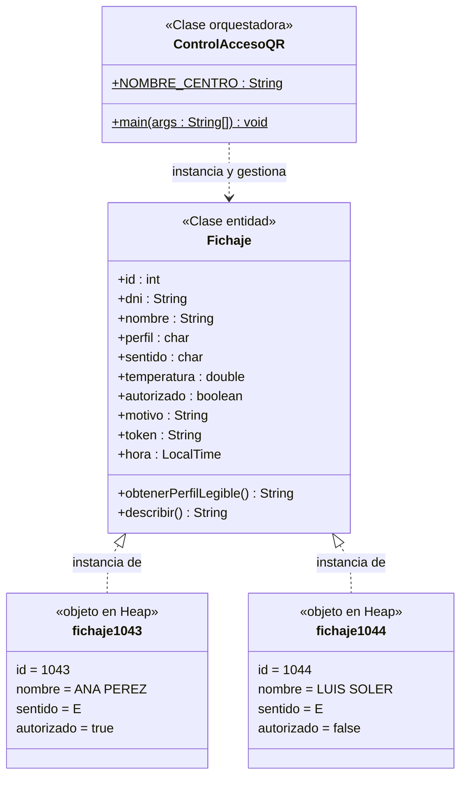

##### A. Clase orquestadora frente a clase entidad (arquitectura multi-archivo)

En Java, cada clase pública reside en su propio archivo `.java`:

* **Clase orquestadora (`ControlAccesoQR.java`):** Contiene el método `public static void main` y coordina la interacción con el usuario y el flujo del programa.  
* **Clase entidad (`Fichaje.java`):** **No contiene método `main`**, pues no está diseñada para arrancar sola, sino para ser instanciada tantas veces como tránsitos ocurran.  

Sus dos bloques internos fundamentales en este punto del curso son:

1. **Atributos de instancia:** Variables declaradas directamente en la clase (fuera de cualquier método) **sin `static`**. Cada objeto fabricado con `new` posee su propia copia privada.  
2. **Métodos de instancia:** Funciones declaradas **sin `static`** que operan directamente sobre los atributos del objeto receptor concreto sobre el que se invocan.  

##### B. Contraste clave: `static` (Sprints 2–3) frente a instancia (Sprint 4)

El error más frecuente al dar el salto a la POO propia es arrastrar la palabra clave `static` del Sprint 2 y 3 hacia las nuevas entidades:

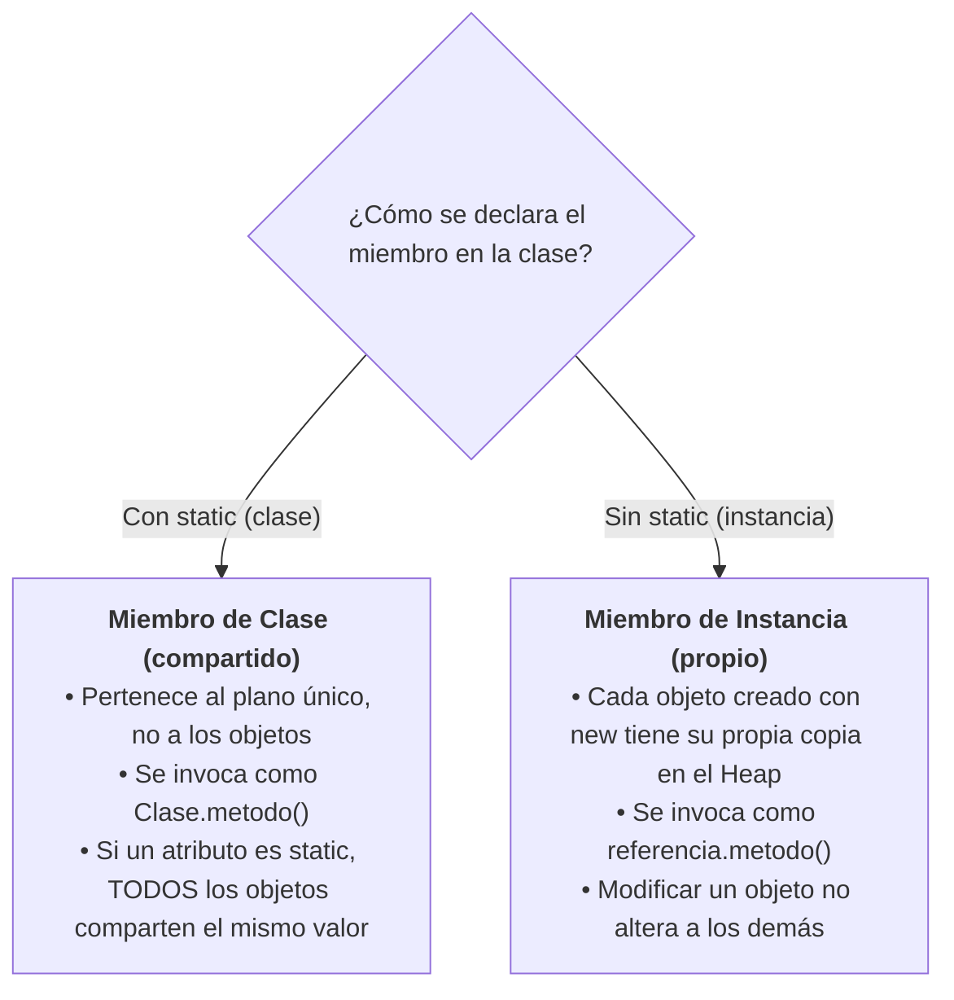

##### C. Valores por defecto en el *Heap*

A diferencia de las variables locales de un método (que no pueden leerse sin inicializar), al fabricar un objeto con `new` la máquina virtual inicializa automáticamente todos sus atributos de instancia si no se les asigna un valor explícito en la clase:

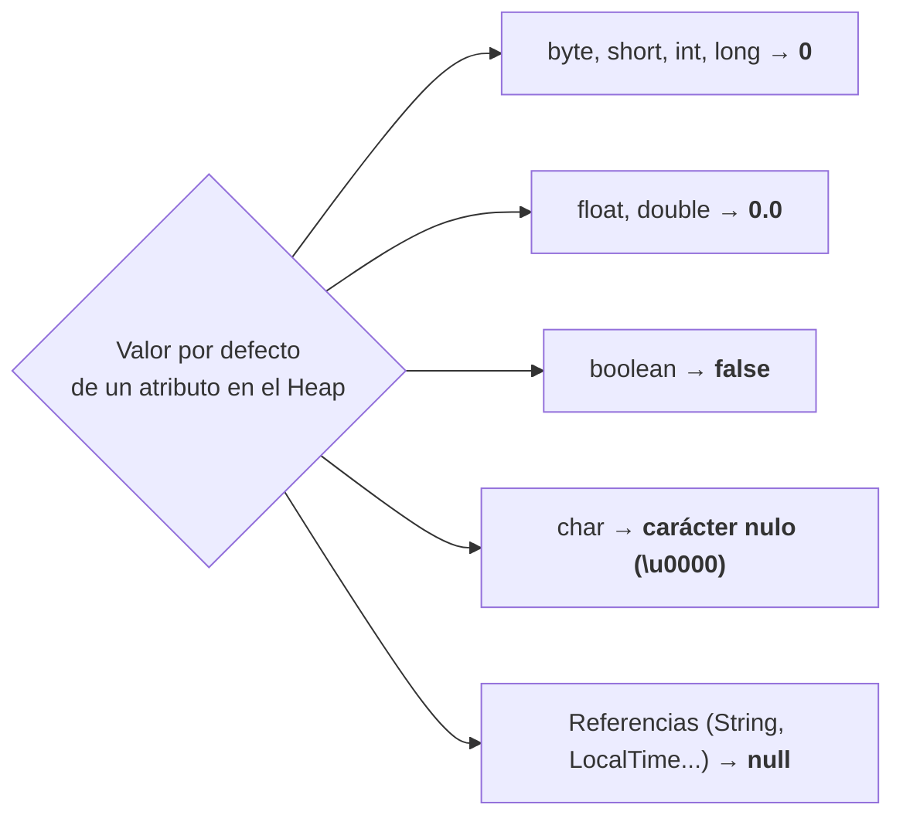

##### D. Referencias en pila (*Stack*), objetos en *Heap*, alias y ciclo de vida

Como ya vimos en el Sprint 2 al instanciar `Random`, las variables de tipo clase no guardan el objeto en la pila (*Stack*), sino **la referencia de memoria** hacia el objeto alojado en el montículo (*Heap*):

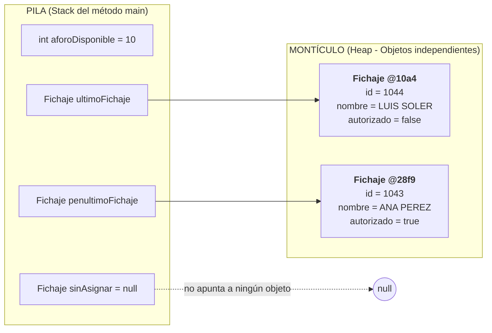

De este modelo se derivan tres consecuencias en nuestros bucles:

1. **Desplazamiento por copia de referencia:** Al hacer `penultimoFichaje = ultimoFichaje; ultimoFichaje = nuevoFichaje;`, no se duplican los datos en el *Heap*; simplemente se reorientan los punteros del *Stack* para mantener trazabilidad de los dos últimos tránsitos.  
2. **Seguridad contra `null`:** Si intentamos invocar `ultimoFichaje.describir()` antes de que se haya registrado el primer acceso (`ultimoFichaje == null`), la JVM lanzará **`NullPointerException`**. Debemos proteger siempre la llamada con `if (ultimoFichaje != null)`.  
3. **Ciclo de vida automático:** Cuando ni `ultimoFichaje` ni `penultimoFichaje` apuntan ya a un `Fichaje` antiguo (al llegar un tercero), ese objeto queda huérfano y el *Garbage Collector* libera su memoria automáticamente.  

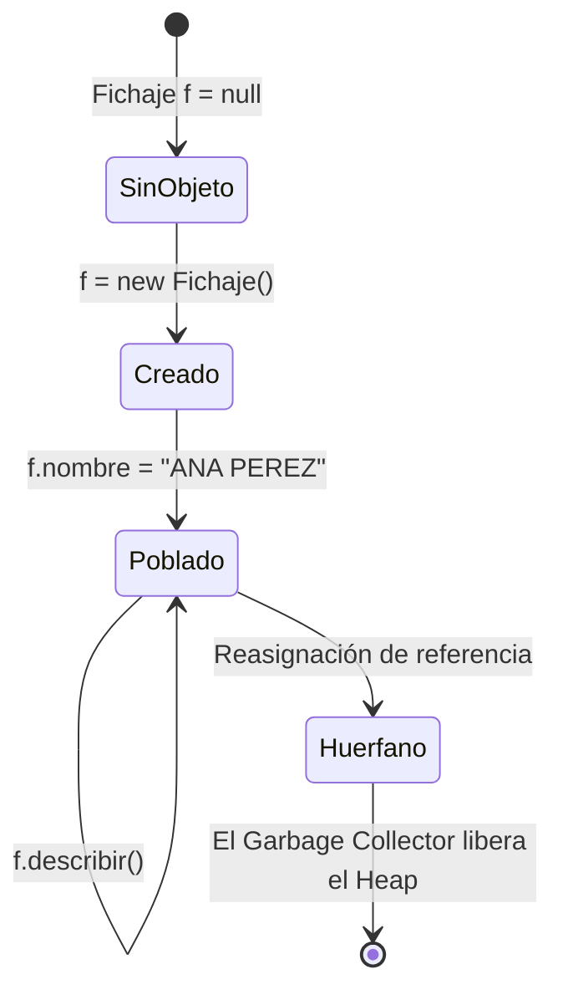

---

#### 3. Evolución del caso guía a `ControlAccesoQR v3.1` (Arquitectura multi-archivo)

Evolucionamos la solución dividiendo el proyecto en **dos archivos independientes** dentro de `pr/src/`:

1. **`Fichaje.java` (Nueva clase entidad desacoplada):** Modela de forma autónoma los 10 atributos de cada tránsito y dos métodos de instancia (`obtenerPerfilLegible` y `describir`), sin depender de `ControlAccesoQR`.  
2. **`ControlAccesoQR.java` (`v3.1`):** Instancia un nuevo objeto `Fichaje` en cada tránsito de la Opción 1, mantiene vivas las referencias `ultimoFichaje` y `penultimoFichaje` fuera del bucle e incorpora guardias contra `null` en el monitor de telemetría (Opción 3).  

##### A. Comparativa de cambios respecto a v3.0 (`diff`)

```diff
+ // =========================================================================
+ // NUEVO ARCHIVO: pr/src/Fichaje.java (Clase de dominio autónoma sin main)
+ // =========================================================================
+ public class Fichaje {
+     int id;
+     String dni = "N/D";
+     String nombre = "N/D";
+     char perfil = '?';
+     char sentido = 'E';
+     double temperatura;
+     boolean autorizado;
+     String motivo = "Sin evaluar";
+     String token = "N/D";
+     LocalTime hora = LocalTime.MIDNIGHT;
+
+     public String obtenerPerfilLegible() { ... }
+     public String describir() { ... }
+ }

  // =========================================================================
  // ARCHIVO: pr/src/ControlAccesoQR.java (v3.1)
  // =========================================================================
+ Fichaje ultimoFichaje = null;
+ Fichaje penultimoFichaje = null;

  case 1:
+     Fichaje nuevoFichaje = new Fichaje();
+     nuevoFichaje.nombre = nombrePersonaLimpio;
+     nuevoFichaje.sentido = (sentidoTransito == 'S') ? 'S' : 'E';
+     nuevoFichaje.hora = LocalTime.now();
      // ... [Validación de entrada/salida y población de atributos] ...
+     penultimoFichaje = ultimoFichaje;   // Desplazamiento de referencia
+     ultimoFichaje = nuevoFichaje;

  case 3:
+     if (ultimoFichaje != null) {
+         System.out.println("ÚLTIMO FICHAJE: " + ultimoFichaje.describir());
+     }
+     if (penultimoFichaje != null) {
+         System.out.println("PENÚLTIMO FICHAJE: " + penultimoFichaje.describir());
+     }
```

##### B. Foco en la novedad: la entidad `Fichaje` y el desplazamiento de referencias

Observa cómo `Fichaje` encapsula de forma autónoma su propia lógica descriptiva y cómo `ControlAccesoQR` gestiona sus referencias sin riesgos de `NullPointerException`:

```java
// -------------------------------------------------------------------------
// Archivo 1: pr/src/Fichaje.java (Clase independiente)
// -------------------------------------------------------------------------
import java.time.LocalTime;

public class Fichaje {
    // Atributos de instancia (sin static)
    int id;
    String dni = "N/D";
    String nombre = "N/D";
    char perfil = '?';
    char sentido = 'E';
    double temperatura;
    boolean autorizado;
    String motivo = "Sin evaluar";
    String token = "N/D";
    LocalTime hora = LocalTime.MIDNIGHT;

    // Métodos de instancia (sin static)
    public String obtenerPerfilLegible() {
        String descripcion;
        switch (perfil) {
            case 'E': descripcion = "Estudiante Oficial"; break;
            case 'D': descripcion = "Docente / Claustro"; break;
            case 'V': descripcion = "Visita Externa / Proveedor"; break;
            case 'A': descripcion = "Personal de Administración y Servicios (PAS)"; break;
            default:  descripcion = "No especificado"; break;
        }
        return descripcion;
    }

    public String describir() {
        String detalleRol = (sentido == 'S') ? "Tránsito exterior" : obtenerPerfilLegible();
        return String.format("#%d [%s] %s (%s) | %s | %s | %s",
                id, sentido == 'S' ? "SALIDA" : "ENTRADA", nombre, detalleRol,
                autorizado ? "AUTORIZADO" : "DENEGADO", motivo, hora.withNano(0));
    }
}

// -------------------------------------------------------------------------
// Archivo 2: Fragmento en pr/src/ControlAccesoQR.java (v3.1)
// -------------------------------------------------------------------------
// Fuera del bucle: nacen a null hasta que ocurra el primer tránsito
Fichaje ultimoFichaje = null;
Fichaje penultimoFichaje = null;

// Dentro de la Opción 1: fabricación y población del nuevo objeto
Fichaje nuevoFichaje = new Fichaje();
nuevoFichaje.nombre = nombrePersonaLimpio;
nuevoFichaje.sentido = (sentidoTransito == 'S') ? 'S' : 'E';
nuevoFichaje.hora = LocalTime.now();
// ... [Población de id, dni, perfil, temperatura, autorizado, motivo y token] ...

// Desplazamiento de referencias en el Stack
penultimoFichaje = ultimoFichaje;
ultimoFichaje = nuevoFichaje;

// Dentro de la Opción 3: lectura segura con guardia contra null
if (ultimoFichaje != null) {
    System.out.println("ÚLTIMO FICHAJE:           " + ultimoFichaje.describir());
} else {
    System.out.println("ÚLTIMO FICHAJE:           (sin registros en esta sesión)");
}
```

##### C. Código fuente completo integrado

<details>
<summary><b>🔍 Desplegar archivos completos: Fichaje.java y ControlAccesoQR.java (v3.1)</b></summary>

**Archivo 1: `pr/src/Fichaje.java`**
```java
/**
 * ENTIDAD DE DOMINIO: REGISTRO DE FICHAJE EN TORNO
 * Cliente: IES El Caminàs (Castellón de la Plana)
 * Consultora: AzaharTech Software Consulting
 *
 * Modela de forma autónoma los datos y el comportamiento básico de cada tránsito
 * (entrada o salida) registrado en el campus. Cada instancia creada con new
 * mantiene su propio estado independiente en el Heap.
 *
 * @author Equipo AzaharTech (Alba Torres, Pau Ferrer, Laia Claramunt)
 * @version 3.1 (Noviembre 2026)
 * @since JDK 21 LTS
 */

import java.time.LocalTime;

public class Fichaje {

    // -------------------------------------------------------------------------
    // 1. ATRIBUTOS DE INSTANCIA (Estado independiente por objeto en el Heap)
    // -------------------------------------------------------------------------
    int id;
    String dni = "N/D";
    String nombre = "N/D";
    char perfil = '?';
    char sentido = 'E';
    double temperatura;
    boolean autorizado;
    String motivo = "Sin evaluar";
    String token = "N/D";
    LocalTime hora = LocalTime.MIDNIGHT;

    // -------------------------------------------------------------------------
    // 2. MÉTODOS DE INSTANCIA (Comportamiento propio del objeto, SIN static)
    // -------------------------------------------------------------------------

    /**
     * Traduce el código de carácter del perfil a su denominación institucional legible.
     */
    public String obtenerPerfilLegible() {
        String descripcion;
        switch (perfil) {
            case 'E':
                descripcion = "Estudiante Oficial";
                break;
            case 'D':
                descripcion = "Docente / Claustro";
                break;
            case 'V':
                descripcion = "Visita Externa / Proveedor";
                break;
            case 'A':
                descripcion = "Personal de Administración y Servicios (PAS)";
                break;
            default:
                descripcion = "No especificado";
                break;
        }
        return descripcion;
    }

    /**
     * Genera una línea formateada completa con la auditoría del tránsito registrado.
     */
    public String describir() {
        String detalleRol = (sentido == 'S') ? "Tránsito exterior" : obtenerPerfilLegible();
        return String.format("#%d [%s] %s (%s) | %s | %s | %s",
                id,
                sentido == 'S' ? "SALIDA" : "ENTRADA",
                nombre,
                detalleRol,
                autorizado ? "AUTORIZADO" : "DENEGADO",
                motivo,
                hora.withNano(0));
    }
}
```

**Archivo 2: `pr/src/ControlAccesoQR.java` (v3.1)**
```java
/**
 * SISTEMA DE CONTROL DE ASISTENCIA POR CÓDIGO QR
 * Cliente: IES El Caminàs (Castellón de la Plana)
 * Consultora: AzaharTech Software Consulting
 * 
 * Versión 3.1:
 * Apertura del Sprint 4 («Arquitectos de software») y de la Semana 10.
 * Desacopla la entidad de tránsito en el archivo independiente Fichaje.java:
 * - Materializa cada registro mediante instanciación con new y operador punto.
 * - Conserva en memoria los dos últimos fichajes mediante desplazamiento de referencias.
 * - Aplica guardias defensivas contra null en el monitor de telemetría.
 * Mantiene el cumplimiento estricto del principio SESE y blindaje try-catch.
 * 
 * @author Equipo AzaharTech (Alba Torres, Pau Ferrer, Laia Claramunt)
 * @version 3.1 (Noviembre 2026)
 * @since JDK 21 LTS
 * 
 */

import java.util.Scanner;
import java.util.Random;
import java.time.LocalTime;
import java.time.LocalDate;
import java.time.Duration;

public class ControlAccesoQR {

    // -------------------------------------------------------------------------
    // 1. CONSTANTES INMUTABLES DEL SISTEMA (configuración corporativa)
    // -------------------------------------------------------------------------
    final static String NOMBRE_CENTRO = "IES El Caminàs (Castellón)";
    final static String PREFIJO_CENTRO = "CAMINAS";
    final static String RUTA_LOGS = ".\\caminas\\terminal\\logs";

    final static int MINUTOS_POR_HORA = 60;
    final static int SEGUNDOS_POR_HORA = 3600;
    final static int SEGUNDOS_POR_MINUTO = 60;
    final static int JORNADA_BASE_MINUTOS = 480; // 8 horas
    final static double FACTOR_PORCENTAJE = 100.0;

    final static int ID_TERMINAL_PUERTA_NORTE = 102;
    final static int BASE_TOKEN_SEGURIDAD = 1000;
    final static int RANGO_TOKEN_SEGURIDAD = 9000;
    final static long SEMILLA_CALIBRACION = 987654321L;

    final static double TEMP_MIN_SEGURA = 15.0;
    final static double TEMP_MAX_SEGURA = 35.0;
    final static double MAX_VARIACION_TERMICA = 0.5;
    final static int LONGITUD_DNI_ESTANDAR = 9;

    // Umbrales biométricos y capacidad
    final static double TEMP_CORPORAL_MAX_FIEBRE = 37.5;
    final static double TEMP_CORPORAL_MIN_FALLO = 35.0;

    // Control de puntualidad y hardware perimetral
    final static LocalTime HORA_LIMITE_PUNTUALIDAD = LocalTime.of(8, 15);
    final static int NUM_SENSORES_TORNO = 8;
    final static int HORAS_TURNO_LECTIVO = 6;
    final static int TOTAL_TORNOS_CAMPUS = 3;
    final static int CANALES_POR_TORNO = 4;

    // -------------------------------------------------------------------------
    // 2. MÉTODOS ESTÁTICOS AUXILIARES DEL ORQUESTADOR
    // -------------------------------------------------------------------------

    public static int calcularEstanciaMinutos(LocalTime entrada, LocalTime salida) {
        return (int) Duration.between(entrada, salida).toMinutes();
    }

    public static double calcularPorcentajeOcupacion(int personas, int aforoTotal) {
        return ((double) personas / aforoTotal) * FACTOR_PORCENTAJE;
    }

    public static String construirTokenQR(String prefijo, String dni, int terminalId, int codigoSec, int idFichaje) {
        String token = prefijo + "-" + dni;
        token += "-T" + terminalId;
        token += "-SEC#" + codigoSec;
        token += "-REG" + idFichaje;
        return token;
    }

    public static double calcularDistanciaDiagonal(double x, double y) {
        return Math.sqrt(Math.pow(x, 2.0) + Math.pow(y, 2.0));
    }

    public static String determinarZonaAutorizada(char perfil) {
        String zona;
        switch (perfil) {
            case 'E':
                zona = "Aulas Docentes y Talleres de Informática";
                break;
            case 'D':
                zona = "Departamentos Didácticos, Aulas y Sala de Profesores";
                break;
            case 'V':
                zona = "Secretaría, Conserjería y Despachos de Dirección";
                break;
            case 'A':
                zona = "Área de Gestión Administrativa y Archivo Central";
                break;
            default:
                zona = "Acceso Denegado / Zona No Autorizada";
                break;
        }
        return zona;
    }

    public static int obtenerEstanciaMaximaPorPerfil(char perfil) {
        int estanciaMinutos;
        switch (perfil) {
            case 'E':
                estanciaMinutos = 360;
                break;
            case 'D':
                estanciaMinutos = 480;
                break;
            case 'V':
                estanciaMinutos = 120;
                break;
            case 'A':
                estanciaMinutos = 420;
                break;
            default:
                estanciaMinutos = 0;
                break;
        }
        return estanciaMinutos;
    }

    // -------------------------------------------------------------------------
    // 3. MÉTODOS PREDICADO BOOLEANOS (reglas de negocio desacopladas)
    // -------------------------------------------------------------------------

    public static boolean esTemperaturaCorporalSegura(double temperatura) {
        return (temperatura >= TEMP_CORPORAL_MIN_FALLO && temperatura <= TEMP_CORPORAL_MAX_FIEBRE);
    }

    public static boolean esDocumentoValido(String dni) {
        return (dni != null && dni.length() == LONGITUD_DNI_ESTANDAR);
    }

    public static boolean esPerfilAutorizado(char perfil) {
        boolean autorizado;
        switch (perfil) {
            case 'E':
            case 'D':
            case 'V':
            case 'A':
                autorizado = true;
                break;
            default:
                autorizado = false;
                break;
        }
        return autorizado;
    }

    // -------------------------------------------------------------------------
    // 4. MÉTODO PRINCIPAL: CONSOLA INTEGRAL v3.1 (ENTIDAD FICHAJE)
    // -------------------------------------------------------------------------
    public static void main(String[] args) {
        Scanner teclado = new Scanner(System.in);

        Random generadorVestibulo = new Random();

        LocalDate fechaActual = LocalDate.now();

        // Estado persistente del campus
        int personasEnCentro = 1190;
        int aforoDisponible = 10;
        int idUltimoFichaje = 1042;

        int totalFichajesProcesados = 0;
        int totalFichajesAutorizados = 0;
        int totalFichajesDenegados = 0;

        // Referencias a objetos Fichaje: nacen a null (todavía no hay tránsitos)
        Fichaje ultimoFichaje = null;
        Fichaje penultimoFichaje = null;

        // Acumuladores estadísticos
        double tempMaximaRegistrada = -1.0;
        double tempMinimaRegistrada = 100.0;
        int minutosEstanciaAcumulados = 0;

        boolean sesionActiva = true;

        System.out.println("======================================================================");
        System.out.println("   AZAHARTECH · CONTROL INTEGRAL DE ACCESOS - IES EL CAMINÀS          ");
        System.out.println("   Versión 3.1 (Sprint 4: primera clase propia, Fichaje.java)         ");
        System.out.println("   Fecha de sesión: " + fechaActual);
        System.out.println("======================================================================");

        // BUCLE PRINCIPAL DE GESTIÓN (MENÚ DE OPERACIONES)
        do {
            System.out.println("\n----------------------------------------------------------------------");
            System.out.println("                    PANEL DE OPERACIONES DEL TORNO                    ");
            System.out.println("----------------------------------------------------------------------");
            System.out.println("  [1] Registrar tránsito individual (genera un objeto Fichaje)");
            System.out.println("  [2] Procesar cola en ráfaga (Modo Burst con parada en cabecera)");
            System.out.println("  [3] Consultar telemetría y últimos fichajes en memoria");
            System.out.println("  [4] Diagnóstico perimetral estructurado SESE (3 tornos x 4 canales)");
            System.out.println("  [5] Activar protocolo de evacuación de emergencia");
            System.out.println("  [6] Cerrar jornada y apagar terminal");
            System.out.print("Seleccione una operación (1-6): ");

            int opcionMenu = 0;
            try {
                opcionMenu = Integer.parseInt(teclado.nextLine().trim());
            } catch (NumberFormatException e) {
                opcionMenu = -1;
            }

            switch (opcionMenu) {
                case 1:
                    // TRÁNSITO INDIVIDUAL BIDIRECCIONAL CON OBJETO FICHAJE
                    totalFichajesProcesados++;
                    System.out.println("\n--- [MODO 1: TRÁNSITO INDIVIDUAL] ---");
                    System.out.print("Sentido del tránsito (E = Entrada, S = Salida): ");
                    String lineaSentido = teclado.nextLine().trim().toUpperCase();
                    char sentidoTransito = lineaSentido.isEmpty() ? 'E' : lineaSentido.charAt(0);

                    System.out.print("Nombre completo: ");
                    String nombrePersonaLimpio = teclado.nextLine().trim().toUpperCase();

                    // Fabricación del objeto en el Heap con sus valores por defecto
                    Fichaje nuevoFichaje = new Fichaje();
                    nuevoFichaje.nombre = nombrePersonaLimpio.isEmpty() ? "N/D" : nombrePersonaLimpio;
                    nuevoFichaje.sentido = (sentidoTransito == 'S') ? 'S' : 'E';
                    nuevoFichaje.hora = LocalTime.now();

                    if (sentidoTransito == 'S') {
                        if (personasEnCentro > 0) {
                            personasEnCentro--;
                            aforoDisponible++;
                            totalFichajesAutorizados++;
                            idUltimoFichaje++;
                            nuevoFichaje.autorizado = true;
                            nuevoFichaje.motivo = "Salida registrada";
                            System.out.println(">> VEREDICTO: [SALIDA AUTORIZADA] Torno exterior abierto.");
                        } else {
                            totalFichajesDenegados++;
                            nuevoFichaje.autorizado = false;
                            nuevoFichaje.motivo = "Recinto vacío";
                            System.err.println(">> ALERTA: Imposible autorizar salida; recinto vacío.");
                        }
                        nuevoFichaje.id = idUltimoFichaje;
                    } else {
                        int terminalId = 0;
                        double tempVestibulo = 0.0;
                        String dniPersonaLimpio = "N/D";
                        char perfilNormalizado = '?';
                        boolean datosSintacticamenteCorrectos = true;
                        String motivoDenegacion = "";

                        try {
                            System.out.print("ID Terminal: ");
                            terminalId = Integer.parseInt(teclado.nextLine().trim());
                            System.out.print("Temperatura (ºC): ");
                            tempVestibulo = Double.parseDouble(teclado.nextLine().trim());
                            System.out.print("DNI: ");
                            dniPersonaLimpio = teclado.nextLine().trim().toUpperCase();
                            System.out.print("Perfil (E/D/V/A): ");
                            String lineaPerfil = teclado.nextLine().trim();
                            perfilNormalizado = lineaPerfil.isEmpty() ? '?' : Character.toUpperCase(lineaPerfil.charAt(0));
                        } catch (NumberFormatException e) {
                            datosSintacticamenteCorrectos = false;
                            motivoDenegacion = "Error de formato numérico.";
                        }

                        boolean accesoConcedido;
                        if (!datosSintacticamenteCorrectos) {
                            accesoConcedido = false;
                            totalFichajesDenegados++;
                        } else if (!esTemperaturaCorporalSegura(tempVestibulo)) {
                            accesoConcedido = false;
                            motivoDenegacion = "Temperatura anómala.";
                            totalFichajesDenegados++;
                        } else if (aforoDisponible <= 0) {
                            accesoConcedido = false;
                            motivoDenegacion = "Aforo completo.";
                            totalFichajesDenegados++;
                        } else if (!esDocumentoValido(dniPersonaLimpio)) {
                            accesoConcedido = false;
                            motivoDenegacion = "DNI no reglamentario.";
                            totalFichajesDenegados++;
                        } else if (!esPerfilAutorizado(perfilNormalizado)) {
                            accesoConcedido = false;
                            motivoDenegacion = "Perfil no catalogado.";
                            totalFichajesDenegados++;
                        } else {
                            accesoConcedido = true;
                            totalFichajesAutorizados++;
                            personasEnCentro++;
                            aforoDisponible--;
                            idUltimoFichaje++;

                            tempMaximaRegistrada = Math.max(tempMaximaRegistrada, tempVestibulo);
                            tempMinimaRegistrada = Math.min(tempMinimaRegistrada, tempVestibulo);
                            minutosEstanciaAcumulados += 360;
                        }

                        int codigoToken = BASE_TOKEN_SEGURIDAD + generadorVestibulo.nextInt(RANGO_TOKEN_SEGURIDAD);
                        String token = construirTokenQR(PREFIJO_CENTRO, dniPersonaLimpio, terminalId, codigoToken, idUltimoFichaje);
                        System.out.printf(">> VEREDICTO: %s [Token: %s]%n",
                                accesoConcedido ? "[ENTRADA AUTORIZADA]" : "[ENTRADA DENEGADA - " + motivoDenegacion + "]", token);

                        // Población del objeto mediante el operador punto
                        nuevoFichaje.id = idUltimoFichaje;
                        nuevoFichaje.dni = dniPersonaLimpio;
                        nuevoFichaje.perfil = perfilNormalizado;
                        nuevoFichaje.temperatura = tempVestibulo;
                        nuevoFichaje.autorizado = accesoConcedido;
                        nuevoFichaje.motivo = accesoConcedido ? "Acceso concedido" : motivoDenegacion;
                        nuevoFichaje.token = token;
                    }

                    // Desplazamiento de referencias: el anterior último pasa a ser penúltimo
                    penultimoFichaje = ultimoFichaje;
                    ultimoFichaje = nuevoFichaje;
                    System.out.println(">> Objeto Fichaje creado: " + nuevoFichaje.describir());
                    break;

                case 2:
                    // RÁFAGA DE COLA CON GUARDIA EN CABECERA (PRINCIPIO SESE)
                    System.out.println("\n--- [MODO 2: RÁFAGA CON PARADA ESTRUCTURADA EN CABECERA] ---");
                    System.out.print("Personas en cola para esta ráfaga: ");
                    int personasEnCola = 0;
                    try {
                        personasEnCola = Integer.parseInt(teclado.nextLine().trim());
                    } catch (NumberFormatException e) {
                        personasEnCola = 0;
                    }

                    boolean vetoJudicialDetectado = false;

                    while (personasEnCola > 0 && aforoDisponible > 0 && !vetoJudicialDetectado) {
                        if (idUltimoFichaje == 1044) {
                            System.out.println(">> [ALERTA JUDICIAL]: Credencial bloqueada. Suspendiendo cola en cabecera...");
                            vetoJudicialDetectado = true;
                        } else {
                            totalFichajesProcesados++;
                            totalFichajesAutorizados++;
                            personasEnCentro++;
                            aforoDisponible--;
                            idUltimoFichaje++;
                            personasEnCola--;

                            double tempSimulada = 36.4 + (generadorVestibulo.nextDouble() * 0.5);
                            tempMaximaRegistrada = Math.max(tempMaximaRegistrada, tempSimulada);
                            tempMinimaRegistrada = Math.min(tempMinimaRegistrada, tempSimulada);
                            minutosEstanciaAcumulados += 360;
                        }
                    }
                    System.out.printf(">> Estado tras ráfaga. Plazas disponibles: %d | Restantes en cola: %d%n",
                            aforoDisponible, personasEnCola);
                    break;

                case 3:
                    // MONITOR DE TELEMETRÍA EN VIVO Y FICHAJES EN MEMORIA
                    System.out.println("\n--- [MODO 3: MONITOR DE TELEMETRÍA EN VIVO] ---");
                    int aforoTotal = personasEnCentro + aforoDisponible;
                    double porcentajeOcupacion = calcularPorcentajeOcupacion(personasEnCentro, aforoTotal);
                    double estanciaMedia = totalFichajesAutorizados > 0 
                            ? ((double) minutosEstanciaAcumulados / totalFichajesAutorizados) : 0.0;

                    System.out.printf("OCUPACIÓN ACTUAL:         %d/%d personas (%6.2f %%)%n", personasEnCentro, aforoTotal, porcentajeOcupacion);
                    System.out.printf("PLAZAS LIBRES:            %d vacantes disponibles%n", aforoDisponible);
                    System.out.printf("TRANSACCIONES TOTALES:    %d registros (%d autorizados, %d denegados)%n",
                            totalFichajesProcesados, totalFichajesAutorizados, totalFichajesDenegados);
                    System.out.printf("PICO TÉRMICO MÁXIMO:      %.1f ºC%n", Math.max(0.0, tempMaximaRegistrada));
                    System.out.printf("PICO TÉRMICO MÍNIMO:      %.1f ºC%n", tempMinimaRegistrada > 50.0 ? 0.0 : tempMinimaRegistrada);
                    System.out.printf("ESTANCIA PROMEDIO:        %.1f minutos (Total acumulado: %d min)%n",
                            estanciaMedia, minutosEstanciaAcumulados);

                    // Guardias defensivas: evitar NullPointerException si aún no hay registros
                    if (ultimoFichaje != null) {
                        System.out.println("ÚLTIMO FICHAJE:           " + ultimoFichaje.describir());
                    } else {
                        System.out.println("ÚLTIMO FICHAJE:           (sin registros en esta sesión)");
                    }
                    if (penultimoFichaje != null) {
                        System.out.println("PENÚLTIMO FICHAJE:        " + penultimoFichaje.describir());
                    } else {
                        System.out.println("PENÚLTIMO FICHAJE:        (sin registros en esta sesión)");
                    }
                    break;

                case 4:
                    // DIAGNÓSTICO SECUENCIAL Y MATRIZ PERIMETRAL SESE
                    System.out.println("\n--- [MODO 4: INSPECCIÓN PERIMETRAL ESTRUCTURADA (SESE)] ---");
                    boolean alarmaSabotajeDetectada = false;

                    for (int torno = 1; torno <= TOTAL_TORNOS_CAMPUS && !alarmaSabotajeDetectada; torno++) {
                        String nombreAcceso = switch (torno) {
                            case 1 -> "Vestíbulo Central  | ";
                            case 2 -> "Puerta Norte Ciclos| ";
                            case 3 -> "Puerta Sur Talleres| ";
                            default -> "Acceso Perimetral  | ";
                        };
                        System.out.print(nombreAcceso);

                        for (int canal = 1; canal <= CANALES_POR_TORNO && !alarmaSabotajeDetectada; canal++) {
                            if (torno == 2 && canal == 2) {
                                System.out.print("[REVISIÓN] ");
                            } else {
                                boolean falloCritico = (torno == 3 && canal == 2 && false);

                                if (falloCritico) {
                                    System.out.print("[SABOTAJE] ");
                                    alarmaSabotajeDetectada = true;
                                } else {
                                    System.out.printf("[C%d: OK]   ", canal);
                                }
                            }
                        }
                        System.out.println();
                    }

                    if (alarmaSabotajeDetectada) {
                        System.out.println(">> [ALERTA DE SEGURIDAD]: Barrido perimetral detenido por fallo crítico.");
                    }
                    System.out.println("-------------------------------------------------------------------");
                    break;

                case 5:
                    // PROTOCOLO DE EVACUACIÓN CON WHILE DE DRENAJE
                    System.out.println("\n--- [MODO 5: PROTOCOLO DE EVACUACIÓN DE EMERGENCIA] ---");
                    if (personasEnCentro == 0) {
                        System.out.println(">> El campus ya se encuentra completamente vacío.");
                    } else {
                        int loteSalidaSimultanea = 300;
                        int oleada = 1;

                        while (personasEnCentro > 0) {
                            int evacuadosLote = Math.min(personasEnCentro, loteSalidaSimultanea);
                            personasEnCentro -= evacuadosLote;
                            aforoDisponible += evacuadosLote;

                            System.out.printf("  -> Oleada #%d: Desalojadas %d personas por salidas de emergencia (Ocupantes restantes: %d)%n",
                                    oleada, evacuadosLote, personasEnCentro);
                            oleada++;
                        }
                        System.out.println(">> CERTIFICACIÓN DE SEGURIDAD: Recinto 100% desalojado. Aforo íntegro restaurado.");
                    }
                    break;

                case 6:
                    // APAGADO Y SALIDA
                    System.out.println("\n>> Desconectando terminal de presencia de forma ordenada...");
                    sesionActiva = false;
                    break;

                default:
                    System.err.println(">> Error: Opción no válida. Seleccione una operación entre 1 y 6.");
                    break;
            }

        } while (sesionActiva);

        // AUDITORÍA FINAL AL APAGAR
        System.out.println("\n======================================================================");
        System.out.println("          AUDITORÍA FINAL DE LA JORNADA · IES EL CAMINÀS              ");
        System.out.println("======================================================================");
        System.out.printf("TOTAL OPERACIONES GESTIONADAS: %d%n", totalFichajesProcesados);
        System.out.printf("ACCESOS AUTORIZADOS (TOTAL):   %d%n", totalFichajesAutorizados);
        System.out.printf("ACCESOS DENEGADOS (BLOQUEO):   %d%n", totalFichajesDenegados);
        System.out.printf("OCUPACIÓN FINAL REGISTRADA:    %d personas%n", personasEnCentro);
        System.out.println("ESTADO DEL DISPOSITIVO:        Terminal desconectado de forma segura.");
        System.out.println("======================================================================");

        teclado.close();
    }
}
```

</details>

---

#### 4. Segunda sesión: dojo de entrenamiento y katas de código

En esta sesión práctica, cada estudiante diseñará su primera clase entidad en un archivo Java separado dentro de `pr/src/` e instanciará múltiples objetos independientes desde su programa principal.

##### Kata 1 (Cinturón blanco / Nivel base). Mi primera clase entidad en archivo propio

Crea un nuevo archivo `.java` en `pr/src/` para modelar la entidad principal de tu proyecto (sin método `main`), creando al menos 4 atributos de instancia y 2 métodos propios (sin `static`). Instancia dos objetos independientes desde `MiProyecto.java`, puebla sus atributos con el operador punto e invoca sus métodos:

* **Aventura conversacional.** Archivo `Personaje.java` con atributos de instancia para su nombre, salud actual, potencia de ataque y si es aliado; incluye un método que devuelva su ficha descriptiva y otro que indique si sigue con vida. Crea un héroe y un enemigo.
* **Motor de recomendación.** Archivo `Item.java` con atributos de instancia para el título, categoría temática, valoración media y etiqueta de disponibilidad; incluye un método que devuelva su línea formateada de catálogo y otro booleano que verifique si supera el umbral de recomendación destacada. Crea dos ítems de categorías distintas.
* **Simulador de físicas 2D.** Archivo `Bola.java` con atributos de instancia para sus coordenadas espaciales (`x`, `y`) y componentes de velocidad (`velocidadX`, `velocidadY`); incluye un método que calcule la rapidez total con `Math.sqrt` y otro que imprima su estado cinemático. Crea una bola lenta y otra rápida.
* **Bóveda de contraseñas.** Archivo `Credencial.java` con atributos de instancia para el nombre del servicio, usuario, clave y días hasta su caducidad; incluye un método que devuelva la longitud de la clave y otro que imprima su ficha ocultando la contraseña. Crea dos credenciales de servicios distintos.

---

##### Kata 2 (Cinturón marrón / Nivel avanzado). La trampa de `static`, alias en el *Heap* y guardia contra `null`

Comprueba empíricamente en tu proyecto las tres trampas habituales al empezar a diseñar clases propias:

1. **El peligro de `static` en atributos de entidad:**  
   Añade temporalmente `static` al atributo de nombre o título de tu clase entidad. Comprueba que, tras crear dos objetos diferentes (`obj1` y `obj2`), cambiar el nombre en `obj2` sobrescribe automáticamente el nombre de `obj1` porque un miembro `static` pertenece al molde único y no a cada objeto. Retira el `static` tras verificar el fallo.
2. **El bug del alias:**  
   Crea `MiEntidad a = new MiEntidad(); MiEntidad b = a;`, modifica un atributo a través de `b` y demuestra que `a` también refleja el cambio. Dibuja en un comentario o documento externo un diagrama `mermaid` (`flowchart LR`) ilustrando cómo ambas referencias de pila apuntan al mismo objeto en el montículo.
3. **La seguridad contra `null`:**  
   Declara una referencia `null` de tu nueva clase, intenta leer uno de sus atributos o invocar su método y protege esa llamada mediante una condición previa `if (referencia != null)` para impedir una `NullPointerException`.

---

##### Kata 3 (Cinturón negro / «Hacker AzaharTech»). Auditoría de memoria en IntelliJ (`@id`) e igualdad de contenido

Dos objetos distintos pueden contener exactamente los mismos datos y, sin embargo, ocupar regiones diferentes de la memoria dinámica:

1. **Inspección de identificadores `@id` en el Depurador:**  
   Coloca un *breakpoint* justo después de instanciar tus dos objetos independientes (con atributos idénticos) y lanza el programa en modo Debug (**`Shift + F9`**):
    * Observa en la pestaña **Variables** el identificador único asignado por la JVM a la derecha del nombre de la clase (por ejemplo, `Fichaje@1042` frente a `Fichaje@1089`).
    * Verifica también qué valores por defecto muestra un objeto recién salido de `new` antes de rellenar sus campos.
2. **Identidad (`==`) frente a igualdad de contenido:**  
   Compara ambos objetos idénticos con `objetoA == objetoB` y justifica por qué devuelve `false` al comparar direcciones de memoria distintas. A continuación, implementa en tu clase entidad un método de instancia `boolean mismosDatos(TuClase otra)` que compare atributo a atributo (usando `.equals(...)` en los `String` y `==` en los primitivos), incluyendo una guardia obligatoria contra `otra == null`.
3. **Certificación:**  
   Documenta en la cabecera Javadoc de tu nueva clase entidad la diferencia entre identidad de referencia e igualdad lógica de estado, declarando tu arquitectura lista para incorporar constructores propios en la siguiente sesión.

...en lenguaje claro, directo y paso a paso...

##### Kata 1 (Cinturón blanco). Tu primera clase y tus primeros objetos

Crea un archivo `.java` nuevo dentro de la carpeta `pr/src/` (sin método `main`) para la clase principal de tu proyecto. Ponle **4 atributos** (variables de clase sin `static`) y **2 métodos** propios (sin `static`). Después, ve a `MiProyecto.java` (`main`), crea **dos objetos distintos** con `new`, rellena sus datos usando el punto (`.`) y llama a sus métodos para comprobar que cada uno tiene sus propios datos:

* **Aventura conversacional:** Crea `Personaje.java` con los atributos `nombre`, `salud`, `ataque` y `esAliado`. Añade un método `describir()` que devuelva una frase con sus datos y otro método `estaVivo()` que devuelva `true` si su salud es mayor que 0. En `main`, crea un héroe y un enemigo distintos e imprime sus fichas.
* **Motor de recomendación:** Crea `Item.java` con los atributos `titulo`, `categoria`, `valoracionMedia` y `disponible`. Añade un método `describir()` que devuelva la línea del catálogo y otro método `esDestacado()` que devuelva `true` si la valoración es mayor o igual a 7.5. En `main`, crea dos ítems de categorías diferentes e imprime sus fichas.
* **Simulador de físicas 2D:** Crea `Bola.java` con los atributos `nombre`, `x`, `y`, `velocidadX` y `velocidadY`. Añade un método `calcularRapidez()` que devuelva el módulo de la velocidad usando `Math.sqrt` y otro método `describir()` con sus coordenadas actuales. En `main`, crea una bola lenta y otra rápida y muestra la rapidez de ambas.
* **Bóveda de contraseñas:** Crea `Credencial.java` con los atributos `servicio`, `usuario`, `clave` y `diasCaducidad`. Añade un método `obtenerLongitudClave()` que devuelva cuántos caracteres tiene la clave y otro método `describir()` que muestre el servicio y el usuario **sin** mostrar la contraseña real (por ejemplo, con asteriscos). En `main`, crea dos credenciales de servicios distintos.

---

##### Kata 2 (Cinturón marrón). Tres errores típicos al empezar con objetos

Haz estas tres pequeñas pruebas en tu código para ver cómo funciona la memoria de Java:

1. **¿Por qué NO debemos poner `static` en los atributos de un objeto?**  
   Pon temporalmente la palabra `static` delante del atributo `nombre` (o `titulo` / `servicio`) en tu nueva clase. Ejecuta tu programa, cambia el nombre solo al **segundo objeto** y luego imprime los dos objetos. Verás que el primero también ha cambiado porque `static` hace que todos compartan la misma variable. Cuando lo hayas comprobado, **borra el `static`**.
2. **El error de copiar un objeto con `=` (alias):**  
   En `main`, crea un objeto `a` y después escribe `TuClase b = a;` (fíjate en que **no** usas `new`). Cambia un dato usando `b` (por ejemplo, `b.nombre = "OTRO"`) e imprime el dato de `a`. Verás que `a` también ha cambiado porque ambos apuntan al mismo objeto en memoria. Haz un dibujo sencillo en Mermaid (`flowchart LR`) explicándolo.
3. **Evitar el fallo de `null`:**  
   Crea una variable de tu clase igualada a `null` (por ejemplo, `Personaje p = null;`). Si intentas llamar a un método suyo, el programa explotará con un `NullPointerException`. Rodea esa llamada con un `if (p != null)` para protegerla y que no falle.

---

##### Kata 3 (Cinturón negro). Ver la memoria en IntelliJ y comparar dos objetos

1. **Ver las direcciones de memoria reales (`@id`):**  
   Pon un punto rojo (*breakpoint*) en `main` justo después de crear y rellenar tus dos objetos. Ejecuta en modo depuración (**`Shift + F9`**) y mira la pestaña **Variables** abajo:
   * Fíjate en el número que sale al lado de cada objeto (por ejemplo, `Personaje@1042` y `Personaje@1089`). Aunque les pusieras los mismos datos por dentro, verás que sus números `@` son distintos porque ocupan sitios distintos en la memoria.
2. **Comparar objetos por fuera (`==`) vs. compararlos por dentro:**  
   Crea dos objetos con `new` que tengan exactamente los mismos datos por dentro e imprime el resultado de `objeto1 == objeto2`. Verás que da **`false`** (porque `==` compara los números `@` de la memoria, no los datos).  
   Para compararlos por dentro, crea en tu clase un método `boolean mismosDatos(TuClase otro)` que primero compruebe que `otro != null` y luego compare atributo por atributo (usando `.equals(...)` en los `String` y `==` en los números y booleanos).

---

### Día 37 - 2 sesiones

---

#### 1. Caso guía en AzaharTech

Son las 15:00 h del **martes 17 de noviembre de 2026**. En la sede de **AzaharTech** en Castellón de la Plana, el equipo revisa los registros generados por la versión `v3.1` desplegada ayer en el vestíbulo del **IES El Caminàs**.

**Pau Ferrer** proyecta el método `main` de `ControlAccesoQR` y señala un punto de fragilidad importante a **Alba Torres** y **Laia Claramunt**:

> *«Fijaos en lo que sucede ahora mismo cada vez que fabricamos un objeto `Fichaje`:*
> ```java
> Fichaje nuevoFichaje = new Fichaje();
> nuevoFichaje.nombre = nombrePersonaLimpio;
> nuevoFichaje.sentido = 'E';
> nuevoFichaje.hora = LocalTime.now();
> // ... 50 líneas después:
> nuevoFichaje.id = idUltimoFichaje;
> nuevoFichaje.dni = dniPersonaLimpio;
> // ...
> ```
> *Tenemos dos problemas graves de diseño:*
> 1. * **Objetos nacidos en estado inconsistente:** Entre la línea donde ejecutamos `new Fichaje()` y la línea donde rellenamos su último atributo, el objeto vaga por la memoria medio vacío (con `id = 0`, `dni = "N/D"` y `hora = 00:00`). Si alguien olvida asignar el DNI o la hora en una nueva rama del código, el objeto queda corrupto para siempre.*
> 2. * **Casuísticas distintas según el tránsito:** Una **entrada** requiere 9 datos completos (DNI, perfil, temperatura, token...), mientras que una **salida** solo necesita 5 datos básicos (ID, nombre, sentido, autorización y motivo).*
>
> *No podemos depender eternamente del constructor vacío que regala Java. Necesitamos que todo objeto `Fichaje` nazca **completamente inicializado y coherente desde el mismo instante de su creación**»*.

**Laia Claramunt** asiente y escribe el objetivo de la sesión:

> *«Hoy diseñamos nuestros propios **constructores**. Aprenderemos cómo desaparece el constructor por defecto cuando definimos uno propio, resolveremos el conflicto de nombres entre parámetros y atributos con la palabra clave **`this`**, y aplicaremos **sobrecarga de constructores** encadenados mediante **`this(...)`** para construir tanto fichajes de entrada como de salida en una sola línea atómica»*.

---

#### 2. Fundamento teórico: constructores propios, `this` y sobrecarga

Un **constructor** es una rutina especial de inicialización que se ejecuta automáticamente en el instante en que invocamos el operador `new`. Su misión es garantizar que el objeto comience su ciclo de vida en un estado válido y consistente.

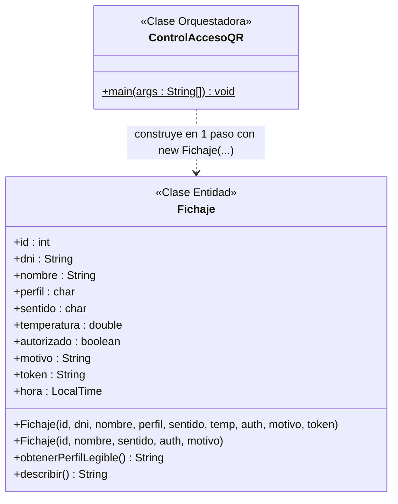

##### A. Reglas sintácticas de un constructor

Un constructor se diferencia de un método convencional por dos reglas inquebrantables:
1. **Mismo nombre exacto que la clase:** Si la clase se llama `Fichaje`, el constructor debe llamarse `Fichaje` (respetando mayúsculas).
2. **Sin tipo de retorno:** No devuelve ningún valor, **ni siquiera `void`**. Si escribes `public void Fichaje()`, Java lo interpretará como un método común y no como un constructor.

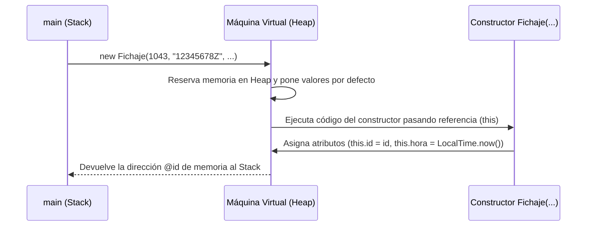

##### B. La desaparición del constructor por defecto

Cuando una clase no define ningún constructor explícito (como ocurrió ayer en el Día 36), el compilador `javac` inyecta invisiblemente un **constructor por defecto sin parámetros** (`public Fichaje() {}`). Sin embargo, esta regla cambia en cuanto programamos nuestro primer constructor:

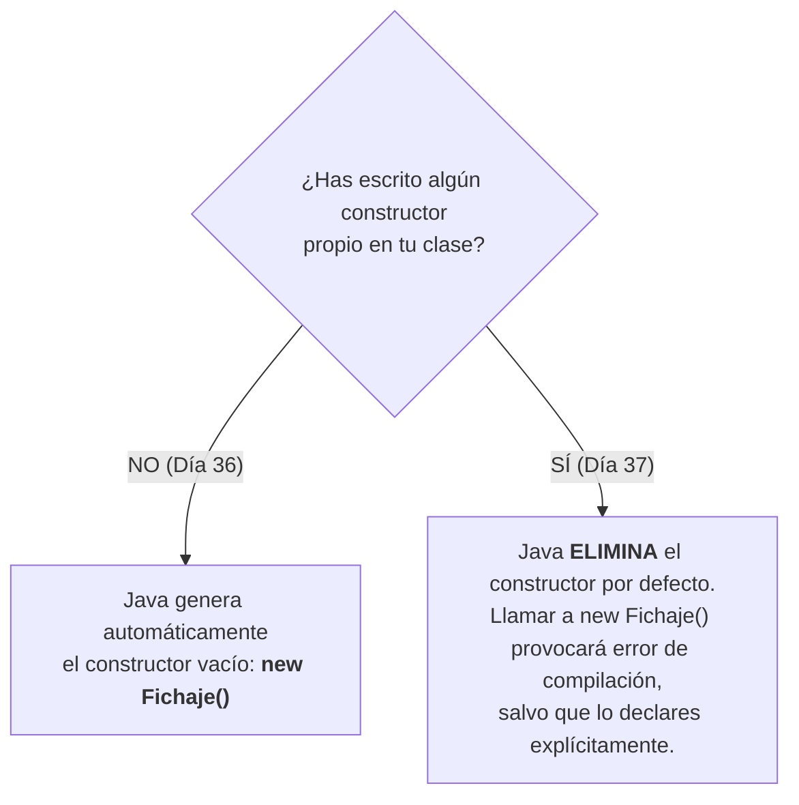

##### C. La palabra reservada `this` y el ocultamiento de nombres (*Shadowing*)

Es buena práctica dar a los parámetros del constructor exactamente el mismo nombre descriptivo que tienen los atributos de la clase (por ejemplo, `id`, `nombre`, `temperatura`). Al coincidir los nombres, el parámetro local **oculta (*shadows*)** al atributo de la instancia.

Para resolver esta ambigüedad, Java proporciona la referencia **`this`**, que apunta siempre **al objeto concreto que está siendo construido o invocado en ese instante**:

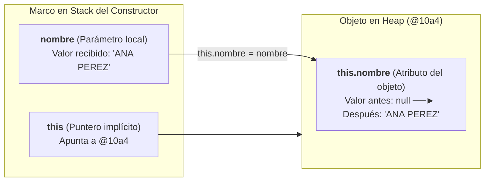

> **Peligro frecuente:** Si escribes `nombre = nombre;` olvidando el `this.`, Java asignará el parámetro sobre sí mismo sin modificar el atributo del objeto, dejándolo con su valor por defecto (`null`).

##### D. Sobrecarga de constructores (*Overloading*) y delegación con `this(...)`

Una clase puede disponer de **múltiples constructores** siempre que se distingan por su **lista de parámetros** (diferente número de argumentos o distinto orden de tipos).

Para evitar duplicar código de inicialización (principio *DRY — Don't Repeat Yourself*), un constructor simplificado puede delegar en el constructor completo mediante la llamada **`this(...)`**, que debe ser obligatoriamente la **primera instrucción** del constructor:

```java
// Constructor 1 (Maestro): inicializa todos los atributos
public Fichaje(int id, String dni, String nombre, char perfil, char sentido,
               double temperatura, boolean autorizado, String motivo, String token) {
    this.id = id;
    this.dni = dni;
    // ... resto de asignaciones
    this.hora = LocalTime.now();
}

// Constructor 2 (Sobrecargado para salidas): delega en el maestro con this(...)
public Fichaje(int id, String nombre, char sentido, boolean autorizado, String motivo) {
    this(id, "N/D", nombre, '?', sentido, 0.0, autorizado, motivo, "N/D");
}
```

---

#### 3. Evolución del caso guía a `ControlAccesoQR v3.2` (Java nativo)

Evolucionamos la versión `v3.1` a la **`v3.2`**. Mantenemos los archivos separados `Fichaje.java` y `ControlAccesoQR.java`, incorporando:
1. Dos **constructores sobrecargados** en `Fichaje.java`: uno completo de 9 parámetros para entradas y otro simplificado de 5 parámetros para salidas que delega mediante `this(...)`.
2. Inicialización automática e infalible de `this.hora = LocalTime.now()` en el momento exacto de la creación del objeto.
3. Creación atómica de cada `Fichaje` en `ControlAccesoQR.java` una vez evaluadas las reglas de acceso, eliminando por completo las asignaciones sueltas dispersas y asegurando que ningún objeto nazca a medias.

##### A. Comparativa de cambios respecto a v3.1 (`diff`)

```diff
  // =========================================================================
  // ARCHIVO: pr/src/Fichaje.java
  // =========================================================================
  public class Fichaje {
      int id;
      String dni;
      String nombre;
      // ... [Atributos sin inicializar a valores falsos por defecto] ...

+     // CONSTRUCTOR MAESTRO (9 parámetros - Entradas completas)
+     public Fichaje(int id, String dni, String nombre, char perfil, char sentido,
+                    double temperatura, boolean autorizado, String motivo, String token) {
+         this.id = id;
+         this.dni = dni;
+         this.nombre = nombre;
+         this.perfil = perfil;
+         this.sentido = sentido;
+         this.temperatura = temperatura;
+         this.autorizado = autorizado;
+         this.motivo = motivo;
+         this.token = token;
+         this.hora = LocalTime.now();
+     }
+
+     // CONSTRUCTOR SOBRECARGADO (5 parámetros - Salidas, delega con this(...))
+     public Fichaje(int id, String nombre, char sentido, boolean autorizado, String motivo) {
+         this(id, "N/D", nombre, '?', sentido, 0.0, autorizado, motivo, "N/D");
+     }
  }

  // =========================================================================
  // ARCHIVO: pr/src/ControlAccesoQR.java (v3.2)
  // =========================================================================
  case 1:
-     Fichaje nuevoFichaje = new Fichaje(); // Ya no compila ni es necesario
-     nuevoFichaje.nombre = nombrePersonaLimpio;
-     nuevoFichaje.sentido = ...;
      if (sentidoTransito == 'S') {
          // ... [Validación de salida] ...
+         nuevoFichaje = new Fichaje(idUltimoFichaje, nombreLimpio, 'S', salidaAutorizada, motivoSalida);
      } else {
          // ... [Captura y validación de entrada] ...
+         nuevoFichaje = new Fichaje(idUltimoFichaje, dniPersonaLimpio, nombreLimpio,
+                 perfilNormalizado, 'E', tempVestibulo, accesoConcedido, motivoFinal, token);
      }
```

##### B. Foco en la novedad: constructores en `Fichaje.java` e instanciación atómica en `main`

Observa la claridad del código al delegar la construcción completa en los constructores propios:

```java
// -------------------------------------------------------------------------
// Constructores sobrecargados en pr/src/Fichaje.java
// -------------------------------------------------------------------------
public Fichaje(int id, String dni, String nombre, char perfil, char sentido,
               double temperatura, boolean autorizado, String motivo, String token) {
    this.id = id;
    this.dni = dni;
    this.nombre = nombre;
    this.perfil = perfil;
    this.sentido = sentido;
    this.temperatura = temperatura;
    this.autorizado = autorizado;
    this.motivo = motivo;
    this.token = token;
    this.hora = LocalTime.now(); // Marca temporal capturada en el nacimiento del objeto
}

public Fichaje(int id, String nombre, char sentido, boolean autorizado, String motivo) {
    // Delegación obligatoria en la primera línea mediante this(...)
    this(id, "N/D", nombre, '?', sentido, 0.0, autorizado, motivo, "N/D");
}

// -------------------------------------------------------------------------
// Instanciación atómica desde ControlAccesoQR.java (v3.2)
// -------------------------------------------------------------------------
Fichaje nuevoFichaje; // Declaración de la referencia en el Stack

if (sentidoTransito == 'S') {
    // ... [Validación de salida] ...
    nuevoFichaje = new Fichaje(idUltimoFichaje, nombreLimpio, 'S', salidaAutorizada, motivoSalida);
} else {
    // ... [Captura con try-catch y validaciones biométricas] ...
    String motivoFinal = accesoConcedido ? "Acceso concedido" : motivoDenegacion;
    nuevoFichaje = new Fichaje(idUltimoFichaje, dniPersonaLimpio, nombreLimpio,
            perfilNormalizado, 'E', tempVestibulo, accesoConcedido, motivoFinal, token);
}
```

##### C. Código fuente completo integrado

<details>
<summary><b>🔍 Desplegar archivos completos: Fichaje.java y ControlAccesoQR.java (v3.2)</b></summary>

**Archivo 1: `pr/src/Fichaje.java`**
```java
/**
 * ENTIDAD DE DOMINIO: REGISTRO DE FICHAJE EN TORNO
 * Cliente: IES El Caminàs (Castellón de la Plana)
 * Consultora: AzaharTech Software Consulting
 *
 * Versión 3.2:
 * Incorpora constructores propios sobrecargados y uso de la referencia this:
 * - Constructor maestro completo (9 parámetros) para entradas al recinto.
 * - Constructor sobrecargado simplificado (5 parámetros) para salidas, delegando con this(...).
 * Garantiza que ningún objeto Fichaje nazca sin estado inicializado o sin marca horaria.
 *
 * @author Equipo AzaharTech (Alba Torres, Pau Ferrer, Laia Claramunt)
 * @version 3.2 (Noviembre 2026)
 * @since JDK 21 LTS
 */

import java.time.LocalTime;

public class Fichaje {

    // -------------------------------------------------------------------------
    // 1. ATRIBUTOS DE INSTANCIA (Estado independiente por objeto en el Heap)
    // -------------------------------------------------------------------------
    int id;
    String dni;
    String nombre;
    char perfil;
    char sentido;
    double temperatura;
    boolean autorizado;
    String motivo;
    String token;
    LocalTime hora;

    // -------------------------------------------------------------------------
    // 2. CONSTRUCTORES SOBRECARGADOS (Garantía de nacimiento consistente)
    // -------------------------------------------------------------------------

    /**
     * Constructor maestro completo utilizado para registrar entradas detalladas.
     */
    public Fichaje(int id, String dni, String nombre, char perfil, char sentido,
                   double temperatura, boolean autorizado, String motivo, String token) {
        this.id = id;
        this.dni = dni;
        this.nombre = nombre;
        this.perfil = perfil;
        this.sentido = sentido;
        this.temperatura = temperatura;
        this.autorizado = autorizado;
        this.motivo = motivo;
        this.token = token;
        this.hora = LocalTime.now();
    }

    /**
     * Constructor sobrecargado simplificado para tránsitos de salida ('S').
     * Delega la inicialización al constructor maestro evitando duplicidad de código.
     */
    public Fichaje(int id, String nombre, char sentido, boolean autorizado, String motivo) {
        this(id, "N/D", nombre, '?', sentido, 0.0, autorizado, motivo, "N/D");
    }

    // -------------------------------------------------------------------------
    // 3. MÉTODOS DE INSTANCIA (Comportamiento propio del objeto, SIN static)
    // -------------------------------------------------------------------------

    /**
     * Traduce el código de carácter del perfil a su denominación institucional legible.
     */
    public String obtenerPerfilLegible() {
        String descripcion;
        switch (this.perfil) {
            case 'E':
                descripcion = "Estudiante Oficial";
                break;
            case 'D':
                descripcion = "Docente / Claustro";
                break;
            case 'V':
                descripcion = "Visita Externa / Proveedor";
                break;
            case 'A':
                descripcion = "Personal de Administración y Servicios (PAS)";
                break;
            default:
                descripcion = "No especificado";
                break;
        }
        return descripcion;
    }

    /**
     * Genera una línea formateada completa con la auditoría del tránsito registrado.
     */
    public String describir() {
        String detalleRol = (this.sentido == 'S') ? "Tránsito exterior" : obtenerPerfilLegible();
        return String.format("#%d [%s] %s (%s) | %s | %s | %s",
                this.id,
                this.sentido == 'S' ? "SALIDA" : "ENTRADA",
                this.nombre,
                detalleRol,
                this.autorizado ? "AUTORIZADO" : "DENEGADO",
                this.motivo,
                this.hora.withNano(0));
    }
}
```

**Archivo 2: `pr/src/ControlAccesoQR.java` (v3.2)**
```java
/**
 * SISTEMA DE CONTROL DE ASISTENCIA POR CÓDIGO QR
 * Cliente: IES El Caminàs (Castellón de la Plana)
 * Consultora: AzaharTech Software Consulting
 * 
 * Versión 3.2:
 * Evolución del Sprint 4 («Arquitectos de software»).
 * Adapta la orquestación de tránsitos para fabricar objetos Fichaje completos en un
 * único paso atómico mediante constructores propios sobrecargados.
 * Elimina asignaciones dispersas y garantiza coherencia desde el nacimiento del objeto.
 * Mantiene el cumplimiento estricto del principio SESE y blindaje try-catch.
 * 
 * @author Equipo AzaharTech (Alba Torres, Pau Ferrer, Laia Claramunt)
 * @version 3.2 (Noviembre 2026)
 * @since JDK 21 LTS
 * 
 */

import java.util.Scanner;
import java.util.Random;
import java.time.LocalTime;
import java.time.LocalDate;
import java.time.Duration;

public class ControlAccesoQR {

    // -------------------------------------------------------------------------
    // 1. CONSTANTES INMUTABLES DEL SISTEMA (configuración corporativa)
    // -------------------------------------------------------------------------
    final static String NOMBRE_CENTRO = "IES El Caminàs (Castellón)";
    final static String PREFIJO_CENTRO = "CAMINAS";
    final static String RUTA_LOGS = ".\\caminas\\terminal\\logs";

    final static int MINUTOS_POR_HORA = 60;
    final static int SEGUNDOS_POR_HORA = 3600;
    final static int SEGUNDOS_POR_MINUTO = 60;
    final static int JORNADA_BASE_MINUTOS = 480; // 8 horas
    final static double FACTOR_PORCENTAJE = 100.0;

    final static int ID_TERMINAL_PUERTA_NORTE = 102;
    final static int BASE_TOKEN_SEGURIDAD = 1000;
    final static int RANGO_TOKEN_SEGURIDAD = 9000;
    final static long SEMILLA_CALIBRACION = 987654321L;

    final static double TEMP_MIN_SEGURA = 15.0;
    final static double TEMP_MAX_SEGURA = 35.0;
    final static double MAX_VARIACION_TERMICA = 0.5;
    final static int LONGITUD_DNI_ESTANDAR = 9;

    // Umbrales biométricos y capacidad
    final static double TEMP_CORPORAL_MAX_FIEBRE = 37.5;
    final static double TEMP_CORPORAL_MIN_FALLO = 35.0;

    // Control de puntualidad y hardware perimetral
    final static LocalTime HORA_LIMITE_PUNTUALIDAD = LocalTime.of(8, 15);
    final static int NUM_SENSORES_TORNO = 8;
    final static int HORAS_TURNO_LECTIVO = 6;
    final static int TOTAL_TORNOS_CAMPUS = 3;
    final static int CANALES_POR_TORNO = 4;

    // -------------------------------------------------------------------------
    // 2. MÉTODOS ESTÁTICOS AUXILIARES DEL ORQUESTADOR
    // -------------------------------------------------------------------------

    public static int calcularEstanciaMinutos(LocalTime entrada, LocalTime salida) {
        return (int) Duration.between(entrada, salida).toMinutes();
    }

    public static double calcularPorcentajeOcupacion(int personas, int aforoTotal) {
        return ((double) personas / aforoTotal) * FACTOR_PORCENTAJE;
    }

    public static String construirTokenQR(String prefijo, String dni, int terminalId, int codigoSec, int idFichaje) {
        String token = prefijo + "-" + dni;
        token += "-T" + terminalId;
        token += "-SEC#" + codigoSec;
        token += "-REG" + idFichaje;
        return token;
    }

    public static double calcularDistanciaDiagonal(double x, double y) {
        return Math.sqrt(Math.pow(x, 2.0) + Math.pow(y, 2.0));
    }

    public static String determinarZonaAutorizada(char perfil) {
        String zona;
        switch (perfil) {
            case 'E':
                zona = "Aulas Docentes y Talleres de Informática";
                break;
            case 'D':
                zona = "Departamentos Didácticos, Aulas y Sala de Profesores";
                break;
            case 'V':
                zona = "Secretaría, Conserjería y Despachos de Dirección";
                break;
            case 'A':
                zona = "Área de Gestión Administrativa y Archivo Central";
                break;
            default:
                zona = "Acceso Denegado / Zona No Autorizada";
                break;
        }
        return zona;
    }

    public static int obtenerEstanciaMaximaPorPerfil(char perfil) {
        int estanciaMinutos;
        switch (perfil) {
            case 'E':
                estanciaMinutos = 360;
                break;
            case 'D':
                estanciaMinutos = 480;
                break;
            case 'V':
                estanciaMinutos = 120;
                break;
            case 'A':
                estanciaMinutos = 420;
                break;
            default:
                estanciaMinutos = 0;
                break;
        }
        return estanciaMinutos;
    }

    // -------------------------------------------------------------------------
    // 3. MÉTODOS PREDICADO BOOLEANOS (reglas de negocio desacopladas)
    // -------------------------------------------------------------------------

    public static boolean esTemperaturaCorporalSegura(double temperatura) {
        return (temperatura >= TEMP_CORPORAL_MIN_FALLO && temperatura <= TEMP_CORPORAL_MAX_FIEBRE);
    }

    public static boolean esDocumentoValido(String dni) {
        return (dni != null && dni.length() == LONGITUD_DNI_ESTANDAR);
    }

    public static boolean esPerfilAutorizado(char perfil) {
        boolean autorizado;
        switch (perfil) {
            case 'E':
            case 'D':
            case 'V':
            case 'A':
                autorizado = true;
                break;
            default:
                autorizado = false;
                break;
        }
        return autorizado;
    }

    // -------------------------------------------------------------------------
    // 4. MÉTODO PRINCIPAL: CONSOLA INTEGRAL v3.2 (CONSTRUCTORES PROPIOS)
    // -------------------------------------------------------------------------
    public static void main(String[] args) {
        Scanner teclado = new Scanner(System.in);

        Random generadorVestibulo = new Random();

        LocalDate fechaActual = LocalDate.now();

        // Estado persistente del campus
        int personasEnCentro = 1190;
        int aforoDisponible = 10;
        int idUltimoFichaje = 1042;

        int totalFichajesProcesados = 0;
        int totalFichajesAutorizados = 0;
        int totalFichajesDenegados = 0;

        // Referencias a objetos Fichaje: nacen a null (todavía no hay tránsitos)
        Fichaje ultimoFichaje = null;
        Fichaje penultimoFichaje = null;

        // Acumuladores estadísticos
        double tempMaximaRegistrada = -1.0;
        double tempMinimaRegistrada = 100.0;
        int minutosEstanciaAcumulados = 0;

        boolean sesionActiva = true;

        System.out.println("======================================================================");
        System.out.println("   AZAHARTECH · CONTROL INTEGRAL DE ACCESOS - IES EL CAMINÀS          ");
        System.out.println("   Versión 3.2 (Sprint 4: Constructores Sobrecargados y this)         ");
        System.out.println("   Fecha de sesión: " + fechaActual);
        System.out.println("======================================================================");

        // BUCLE PRINCIPAL DE GESTIÓN (MENÚ DE OPERACIONES)
        do {
            System.out.println("\n----------------------------------------------------------------------");
            System.out.println("                    PANEL DE OPERACIONES DEL TORNO                    ");
            System.out.println("----------------------------------------------------------------------");
            System.out.println("  [1] Registrar tránsito individual (construcción atómica de Fichaje)");
            System.out.println("  [2] Procesar cola en ráfaga (Modo Burst con parada en cabecera)");
            System.out.println("  [3] Consultar telemetría y últimos fichajes en memoria");
            System.out.println("  [4] Diagnóstico perimetral estructurado SESE (3 tornos x 4 canales)");
            System.out.println("  [5] Activar protocolo de evacuación de emergencia");
            System.out.println("  [6] Cerrar jornada y apagar terminal");
            System.out.print("Seleccione una operación (1-6): ");

            int opcionMenu = 0;
            try {
                opcionMenu = Integer.parseInt(teclado.nextLine().trim());
            } catch (NumberFormatException e) {
                opcionMenu = -1;
            }

            switch (opcionMenu) {
                case 1:
                    // TRÁNSITO INDIVIDUAL CON CONSTRUCTORES SOBRECARGADOS
                    totalFichajesProcesados++;
                    System.out.println("\n--- [MODO 1: TRÁNSITO INDIVIDUAL] ---");
                    System.out.print("Sentido del tránsito (E = Entrada, S = Salida): ");
                    String lineaSentido = teclado.nextLine().trim().toUpperCase();
                    char sentidoTransito = lineaSentido.isEmpty() ? 'E' : lineaSentido.charAt(0);

                    System.out.print("Nombre completo: ");
                    String nombreCapturado = teclado.nextLine().trim().toUpperCase();
                    String nombreLimpio = nombreCapturado.isEmpty() ? "N/D" : nombreCapturado;

                    Fichaje nuevoFichaje;

                    if (sentidoTransito == 'S') {
                        boolean salidaAutorizada;
                        String motivoSalida;

                        if (personasEnCentro > 0) {
                            personasEnCentro--;
                            aforoDisponible++;
                            totalFichajesAutorizados++;
                            idUltimoFichaje++;
                            salidaAutorizada = true;
                            motivoSalida = "Salida registrada";
                            System.out.println(">> VEREDICTO: [SALIDA AUTORIZADA] Torno exterior abierto.");
                        } else {
                            totalFichajesDenegados++;
                            salidaAutorizada = false;
                            motivoSalida = "Recinto vacío";
                            System.err.println(">> ALERTA: Imposible autorizar salida; recinto vacío.");
                        }

                        // Invocación al constructor sobrecargado de 5 parámetros
                        nuevoFichaje = new Fichaje(idUltimoFichaje, nombreLimpio, 'S', salidaAutorizada, motivoSalida);
                    } else {
                        int terminalId = 0;
                        double tempVestibulo = 0.0;
                        String dniPersonaLimpio = "N/D";
                        char perfilNormalizado = '?';
                        boolean datosSintacticamenteCorrectos = true;
                        String motivoDenegacion = "";

                        try {
                            System.out.print("ID Terminal: ");
                            terminalId = Integer.parseInt(teclado.nextLine().trim());
                            System.out.print("Temperatura (ºC): ");
                            tempVestibulo = Double.parseDouble(teclado.nextLine().trim());
                            System.out.print("DNI: ");
                            dniPersonaLimpio = teclado.nextLine().trim().toUpperCase();
                            System.out.print("Perfil (E/D/V/A): ");
                            String lineaPerfil = teclado.nextLine().trim();
                            perfilNormalizado = lineaPerfil.isEmpty() ? '?' : Character.toUpperCase(lineaPerfil.charAt(0));
                        } catch (NumberFormatException e) {
                            datosSintacticamenteCorrectos = false;
                            motivoDenegacion = "Error de formato numérico.";
                        }

                        boolean accesoConcedido;
                        if (!datosSintacticamenteCorrectos) {
                            accesoConcedido = false;
                            totalFichajesDenegados++;
                        } else if (!esTemperaturaCorporalSegura(tempVestibulo)) {
                            accesoConcedido = false;
                            motivoDenegacion = "Temperatura anómala.";
                            totalFichajesDenegados++;
                        } else if (aforoDisponible <= 0) {
                            accesoConcedido = false;
                            motivoDenegacion = "Aforo completo.";
                            totalFichajesDenegados++;
                        } else if (!esDocumentoValido(dniPersonaLimpio)) {
                            accesoConcedido = false;
                            motivoDenegacion = "DNI no reglamentario.";
                            totalFichajesDenegados++;
                        } else if (!esPerfilAutorizado(perfilNormalizado)) {
                            accesoConcedido = false;
                            motivoDenegacion = "Perfil no catalogado.";
                            totalFichajesDenegados++;
                        } else {
                            accesoConcedido = true;
                            totalFichajesAutorizados++;
                            personasEnCentro++;
                            aforoDisponible--;
                            idUltimoFichaje++;

                            tempMaximaRegistrada = Math.max(tempMaximaRegistrada, tempVestibulo);
                            tempMinimaRegistrada = Math.min(tempMinimaRegistrada, tempVestibulo);
                            minutosEstanciaAcumulados += 360;
                        }

                        int codigoToken = BASE_TOKEN_SEGURIDAD + generadorVestibulo.nextInt(RANGO_TOKEN_SEGURIDAD);
                        String token = construirTokenQR(PREFIJO_CENTRO, dniPersonaLimpio, terminalId, codigoToken, idUltimoFichaje);
                        System.out.printf(">> VEREDICTO: %s [Token: %s]%n",
                                accesoConcedido ? "[ENTRADA AUTORIZADA]" : "[ENTRADA DENEGADA - " + motivoDenegacion + "]", token);

                        String motivoFinal = accesoConcedido ? "Acceso concedido" : motivoDenegacion;

                        // Invocación atómica al constructor maestro completo (9 parámetros)
                        nuevoFichaje = new Fichaje(idUltimoFichaje, dniPersonaLimpio, nombreLimpio,
                                perfilNormalizado, 'E', tempVestibulo, accesoConcedido, motivoFinal, token);
                    }

                    // Desplazamiento de referencias en el Stack
                    penultimoFichaje = ultimoFichaje;
                    ultimoFichaje = nuevoFichaje;
                    System.out.println(">> Objeto Fichaje construido: " + nuevoFichaje.describir());
                    break;

                case 2:
                    // RÁFAGA DE COLA CON GUARDIA EN CABECERA (PRINCIPIO SESE)
                    System.out.println("\n--- [MODO 2: RÁFAGA CON PARADA ESTRUCTURADA EN CABECERA] ---");
                    System.out.print("Personas en cola para esta ráfaga: ");
                    int personasEnCola = 0;
                    try {
                        personasEnCola = Integer.parseInt(teclado.nextLine().trim());
                    } catch (NumberFormatException e) {
                        personasEnCola = 0;
                    }

                    boolean vetoJudicialDetectado = false;

                    while (personasEnCola > 0 && aforoDisponible > 0 && !vetoJudicialDetectado) {
                        if (idUltimoFichaje == 1044) {
                            System.out.println(">> [ALERTA JUDICIAL]: Credencial bloqueada. Suspendiendo cola en cabecera...");
                            vetoJudicialDetectado = true;
                        } else {
                            totalFichajesProcesados++;
                            totalFichajesAutorizados++;
                            personasEnCentro++;
                            aforoDisponible--;
                            idUltimoFichaje++;
                            personasEnCola--;

                            double tempSimulada = 36.4 + (generadorVestibulo.nextDouble() * 0.5);
                            tempMaximaRegistrada = Math.max(tempMaximaRegistrada, tempSimulada);
                            tempMinimaRegistrada = Math.min(tempMinimaRegistrada, tempSimulada);
                            minutosEstanciaAcumulados += 360;
                        }
                    }
                    System.out.printf(">> Estado tras ráfaga. Plazas disponibles: %d | Restantes en cola: %d%n",
                            aforoDisponible, personasEnCola);
                    break;

                case 3:
                    // MONITOR DE TELEMETRÍA EN VIVO Y FICHAJES EN MEMORIA
                    System.out.println("\n--- [MODO 3: MONITOR DE TELEMETRÍA EN VIVO] ---");
                    int aforoTotal = personasEnCentro + aforoDisponible;
                    double porcentajeOcupacion = calcularPorcentajeOcupacion(personasEnCentro, aforoTotal);
                    double estanciaMedia = totalFichajesAutorizados > 0 
                            ? ((double) minutosEstanciaAcumulados / totalFichajesAutorizados) : 0.0;

                    System.out.printf("OCUPACIÓN ACTUAL:         %d/%d personas (%6.2f %%)%n", personasEnCentro, aforoTotal, porcentajeOcupacion);
                    System.out.printf("PLAZAS LIBRES:            %d vacantes disponibles%n", aforoDisponible);
                    System.out.printf("TRANSACCIONES TOTALES:    %d registros (%d autorizados, %d denegados)%n",
                            totalFichajesProcesados, totalFichajesAutorizados, totalFichajesDenegados);
                    System.out.printf("PICO TÉRMICO MÁXIMO:      %.1f ºC%n", Math.max(0.0, tempMaximaRegistrada));
                    System.out.printf("PICO TÉRMICO MÍNIMO:      %.1f ºC%n", tempMinimaRegistrada > 50.0 ? 0.0 : tempMinimaRegistrada);
                    System.out.printf("ESTANCIA PROMEDIO:        %.1f minutos (Total acumulado: %d min)%n",
                            estanciaMedia, minutosEstanciaAcumulados);

                    if (ultimoFichaje != null) {
                        System.out.println("ÚLTIMO FICHAJE:           " + ultimoFichaje.describir());
                    } else {
                        System.out.println("ÚLTIMO FICHAJE:           (sin registros en esta sesión)");
                    }
                    if (penultimoFichaje != null) {
                        System.out.println("PENÚLTIMO FICHAJE:        " + penultimoFichaje.describir());
                    } else {
                        System.out.println("PENÚLTIMO FICHAJE:        (sin registros en esta sesión)");
                    }
                    break;

                case 4:
                    // DIAGNÓSTICO SECUENCIAL Y MATRIZ PERIMETRAL SESE
                    System.out.println("\n--- [MODO 4: INSPECCIÓN PERIMETRAL ESTRUCTURADA (SESE)] ---");
                    boolean alarmaSabotajeDetectada = false;

                    for (int torno = 1; torno <= TOTAL_TORNOS_CAMPUS && !alarmaSabotajeDetectada; torno++) {
                        String nombreAcceso = switch (torno) {
                            case 1 -> "Vestíbulo Central  | ";
                            case 2 -> "Puerta Norte Ciclos| ";
                            case 3 -> "Puerta Sur Talleres| ";
                            default -> "Acceso Perimetral  | ";
                        };
                        System.out.print(nombreAcceso);

                        for (int canal = 1; canal <= CANALES_POR_TORNO && !alarmaSabotajeDetectada; canal++) {
                            if (torno == 2 && canal == 2) {
                                System.out.print("[REVISIÓN] ");
                            } else {
                                boolean falloCritico = (torno == 3 && canal == 2 && false);

                                if (falloCritico) {
                                    System.out.print("[SABOTAJE] ");
                                    alarmaSabotajeDetectada = true;
                                } else {
                                    System.out.printf("[C%d: OK]   ", canal);
                                }
                            }
                        }
                        System.out.println();
                    }

                    if (alarmaSabotajeDetectada) {
                        System.out.println(">> [ALERTA DE SEGURIDAD]: Barrido perimetral detenido por fallo crítico.");
                    }
                    System.out.println("-------------------------------------------------------------------");
                    break;

                case 5:
                    // PROTOCOLO DE EVACUACIÓN CON WHILE DE DRENAJE
                    System.out.println("\n--- [MODO 5: PROTOCOLO DE EVACUACIÓN DE EMERGENCIA] ---");
                    if (personasEnCentro == 0) {
                        System.out.println(">> El campus ya se encuentra completamente vacío.");
                    } else {
                        int loteSalidaSimultanea = 300;
                        int oleada = 1;

                        while (personasEnCentro > 0) {
                            int evacuadosLote = Math.min(personasEnCentro, loteSalidaSimultanea);
                            personasEnCentro -= evacuadosLote;
                            aforoDisponible += evacuadosLote;

                            System.out.printf("  -> Oleada #%d: Desalojadas %d personas por salidas de emergencia (Ocupantes restantes: %d)%n",
                                    oleada, evacuadosLote, personasEnCentro);
                            oleada++;
                        }
                        System.out.println(">> CERTIFICACIÓN DE SEGURIDAD: Recinto 100% desalojado. Aforo íntegro restaurado.");
                    }
                    break;

                case 6:
                    // APAGADO Y SALIDA
                    System.out.println("\n>> Desconectando terminal de presencia de forma ordenada...");
                    sesionActiva = false;
                    break;

                default:
                    System.err.println(">> Error: Opción no válida. Seleccione una operación entre 1 y 6.");
                    break;
            }

        } while (sesionActiva);

        // AUDITORÍA FINAL AL APAGAR
        System.out.println("\n======================================================================");
        System.out.println("          AUDITORÍA FINAL DE LA JORNADA · IES EL CAMINÀS              ");
        System.out.println("======================================================================");
        System.out.printf("TOTAL OPERACIONES GESTIONADAS: %d%n", totalFichajesProcesados);
        System.out.printf("ACCESOS AUTORIZADOS (TOTAL):   %d%n", totalFichajesAutorizados);
        System.out.printf("ACCESOS DENEGADOS (BLOQUEO):   %d%n", totalFichajesDenegados);
        System.out.printf("OCUPACIÓN FINAL REGISTRADA:    %d personas%n", personasEnCentro);
        System.out.println("ESTADO DEL DISPOSITIVO:        Terminal desconectado de forma segura.");
        System.out.println("======================================================================");

        teclado.close();
    }
}
```

</details>

---

#### 4. Segunda sesión: dojo de entrenamiento y katas de código

En esta sesión práctica, cada estudiante dotará de constructores sobrecargados a la clase entidad creada en la sesión anterior y sustituirá las asignaciones manuales dispersas de su método `main`.

##### Kata 1 (Cinturón blanco / Nivel base). Constructores propios y sobrecarga en proyectos asignados

Abre el archivo de tu clase entidad en `pr/src/` y diseña **al menos dos constructores sobrecargados** utilizando `this` para resolver la ambigüedad con los parámetros, eliminando las asignaciones atributo a atributo en `MiProyecto.java`:

* **Aventura conversacional.** En `Personaje.java`, crea un constructor completo que inicialice el nombre, puntos de vida máximos, potencia de ataque y si es aliado; añade un segundo constructor sobrecargado que reciba únicamente el nombre y si es aliado, delegando en el primero con `this(...)` para asignar valores base estándar de vida y fuerza.
* **Motor de recomendación.** En `Item.java`, implementa un constructor maestro para el título, categoría, valoración media y etiqueta; diseña un constructor sobrecargado para nuevos lanzamientos que solo requiera título y categoría, delegando con `this(...)` para inicializar la valoración a cero y la etiqueta como novedad.
* **Simulador de físicas 2D.** En `Bola.java`, define un constructor completo para las coordenadas iniciales (`x`, `y`) y componentes de velocidad (`velocidadX`, `velocidadY`); añade un segundo constructor para cuerpos lanzados desde el origen en reposo que solo reciba las coordenadas iniciales, delegando en el maestro con `this(...)` para fijar velocidades iniciales nulas.
* **Bóveda de contraseñas.** En `Credencial.java`, implementa un constructor maestro que reciba servicio, usuario, clave y días hasta la caducidad; crea un constructor sobrecargado para credenciales temporales de invitado que solo reciba servicio, usuario y clave, delegando con `this(...)` para establecer automáticamente una caducidad estándar de 30 días.

---

##### Kata 2 (Cinturón marrón / Nivel avanzado). El bug del *Shadowing* y la pérdida del constructor vacío

Investiga empíricamente las dos trampas más frecuentes al programar constructores en Java:

1. **La ilusión de inicialización (*Shadowing* sin `this`):**  
   En un constructor de prueba, escribe `nombre = nombre;` olvidando el prefijo `this.`. Ejecuta el programa e imprime el atributo del objeto tras salir del constructor: comprobarás que conserva el valor nulo (`null`) porque el parámetro local ha ocultado al atributo del objeto. Corrige el defecto anteponiendo `this.`.
2. **Desaparición del constructor por defecto:**  
   Comprueba qué error arroja IntelliJ si, tras haber programado tus constructores con parámetros, intentas escribir `new TuClase()` sin argumentos. Documenta por qué la JVM exige que, si deseas seguir permitiendo instancias vacías, debes programar explícitamente el constructor sin parámetros delegando valores por defecto mediante `this(...)`.

---

##### Kata 3 (Cinturón negro / «Hacker AzaharTech»). Auditoría en caliente del constructor con `Step Into` (`F7`)

Realiza una traza paso a paso del nacimiento de un objeto en memoria utilizando el depurador de IntelliJ:

1. **Punto de ruptura en la instanciación:**  
   Coloca un *breakpoint* exactamente en la línea del `main` donde invocas el constructor sobrecargado de tu entidad (por ejemplo, `new Credencial(...)` o `new Personaje(...)`).
2. **Inmersión en el marco de pila del constructor:**  
   Inicia en modo Debug (**`Shift + F9`**). Cuando se detenga la ejecución, pulsa **`F7` (*Step Into*)** para entrar en el código del constructor:
   * Si el constructor delega con `this(...)`, vuelve a pulsar **`F7`** para saltar al constructor maestro.
   * Inspecciona la pestaña **Variables**: observa el objeto implícito **`this`** en la cima de la lista con su identificador hexadecimal único (`@id`), despliega sus atributos y comprueba cómo **antes** de ejecutarse las asignaciones contienen los valores por defecto (`0`, `0.0`, `null`), y cómo van mutando uno a uno al avanzar línea a línea con **`F8`**.
3. **Certificación:**  
   Al regresar al `main` tras terminar el constructor, verifica que la variable receptora del *Stack* muestra exactamente **el mismo identificador `@id`** que tenía la referencia `this` dentro del constructor. Documenta esta comprobación técnica en la cabecera Javadoc de tu clase entidad.

...en lenguaje claro, directo y paso a paso...

##### Kata 1 (Cinturón blanco). Crear objetos en una sola línea con constructores

Abre la clase que creaste ayer (`Personaje`, `Item`, `Bola` o `Credencial`) y añade **dos constructores** (recuerda que llevan exactamente el mismo nombre de la clase y **no** llevan `void`): uno largo con todos los datos y otro más corto que llame al largo usando `this(...)` para rellenar el resto automáticamente. Después, ve a `MiProyecto.java` y sustituye las líneas sueltas de ayer (`obj.dato = ...`) por una única llamada al `new` con parámetros:

* **Aventura conversacional:** En `Personaje.java`, haz un constructor que reciba `nombre`, `salud`, `ataque` y `esAliado`. Haz un segundo constructor que solo reciba `nombre` y `esAliado`, y que llame al primero con `this(...)` poniéndole `100` de salud y `15` de ataque por defecto.
* **Motor de recomendación:** En `Item.java`, haz un constructor que reciba `titulo`, `categoria`, `valoracionMedia` y `disponible`. Haz un segundo constructor para estrenos que solo reciba `titulo` y `categoria`, y que llame al primero con `this(...)` poniendo `0.0` de valoración y `true` en disponible.
* **Simulador de físicas 2D:** En `Bola.java`, haz un constructor que reciba `nombre`, `x`, `y`, `velocidadX` y `velocidadY`. Haz un segundo constructor para bolas quietas que solo reciba `nombre`, `x` e `y`, y que llame al primero con `this(...)` poniendo `0.0` en ambas velocidades.
* **Bóveda de contraseñas:** En `Credencial.java`, haz un constructor que reciba `servicio`, `usuario`, `clave` y `diasCaducidad`. Haz un segundo constructor para cuentas temporales que solo reciba `servicio`, `usuario` y `clave`, y que llame al primero con `this(...)` poniendo `30` días de caducidad por defecto.

---

##### Kata 2 (Cinturón marrón). Qué pasa si olvidas `this.` y por qué desaparece `new MiClase()`

1. **El error de olvidar `this.`:**  
   Si el parámetro del constructor se llama igual que el atributo (por ejemplo, `nombre`), prueba a quitar el `this.` en una línea para dejarlo así: `nombre = nombre;`. Ejecuta el programa y verás que el objeto se queda con el atributo vacío (`null` o `0`), porque Java copia la variable sobre sí misma sin tocar el objeto. Vuelve a poner `this.nombre = nombre;`.
2. **¿Por qué ya no funciona `new MiClase()`?**  
   Prueba a escribir `new Personaje()` (vacío, sin nada dentro de los paréntesis) en `main`. Verás que IntelliJ te lo marca en rojo. Esto pasa porque en el momento en que tú escribes tu propio constructor, Java borra el constructor vacío que te regalaba el primer día. Borra esa línea de prueba y deja un comentario explicando por qué dio error.

---

##### Kata 3 (Cinturón negro). Ver nacer un objeto paso a paso en el Debug (`F7`)

1. Pon un punto rojo (*breakpoint*) en `main` justo en la línea donde llamas a tu **constructor corto** (por ejemplo, `new Personaje("Gimli", true)`).
2. Lanza el depurador (**`Shift + F9`**). Cuando se pare ahí, pulsa **`F7`** (*Step Into*) para meterte dentro del constructor corto, y vuelve a pulsar **`F7`** para saltar al constructor largo (`this(...)`).
3. Mira en la pestaña **Variables** la línea que pone **`this`**:
   * Despliégala antes de avanzar y verás que todos tus atributos empiezan en `0`, `0.0`, `false` o `null`.
   * Ve pulsando **`F8`** línea a línea y observa en vivo cómo se van rellenando los atributos del objeto uno por uno antes de volver al `main`.

---

### Día 38 - 2 sesiones

---

#### 1. Caso guía en AzaharTech

Son las 15:00 h del **miércoles 18 de noviembre de 2026**. En las oficinas de **AzaharTech** en Castellón de la Plana, **Alba Torres** acaba de realizar una auditoría de seguridad sobre la versión `v3.2` desplegada en el **IES El Caminàs** y convoca de urgencia a **Pau Ferrer** y **Laia Claramunt**:

> *«Equipo, tenemos una brecha de integridad grave en nuestra clase `Fichaje`. Ayer logramos que todos los objetos nazcan bien inicializados gracias a los constructores sobrecargados, pero mirad qué ocurre si cualquier otra parte del programa escribe esto después de instanciar un fichaje:*
> ```java
> // ¡PELIGRO!: Manipulación directa sin control desde fuera de la clase
> ultimoFichaje.autorizado = true;     // Un fichaje denegado por fiebre pasa a autorizado
> ultimoFichaje.id = -999;             // Identificador corrupto
> ultimoFichaje.temperatura = -500.0;  // Temperatura físicamente imposible
> ultimoFichaje.nombre = null;         // Dejamos un null que romperá futuros métodos
> ```
> *Como los atributos de `Fichaje` no tienen modificador de acceso restrictivo, están expuestos al exterior. Cualquier clase del mismo paquete puede meter la mano en las entrañas del objeto, saltar nuestras reglas de negocio y corromper la auditoría de seguridad del instituto.*
>
> *En Programación Orientada a Objetos profesional, **un objeto debe proteger su propio estado**»*.

**Laia Claramunt** toma la palabra y marca el tercer pilar del Sprint 4:

> *«Hoy implantamos la **encapsulación estricta**. Cerraremos todos los atributos de `Fichaje` con el modificador **`private`**, habilitaremos puntos de lectura controlada mediante métodos **getters** (`get...` / `is...`) y diseñaremos métodos **setters** selectivos dotados de validación defensiva interna, protegiendo los datos de auditoría críticos que jamás deberían poder modificarse una vez construido el objeto»*.

---

#### 2. Fundamento teórico: encapsulación, visibilidad y métodos de acceso

La **encapsulación** es el principio de la POO que consiste en ocultar el estado interno de un objeto (*Information Hiding*) y obligar a que toda interacción exterior se realice a través de una interfaz pública controlada de métodos.

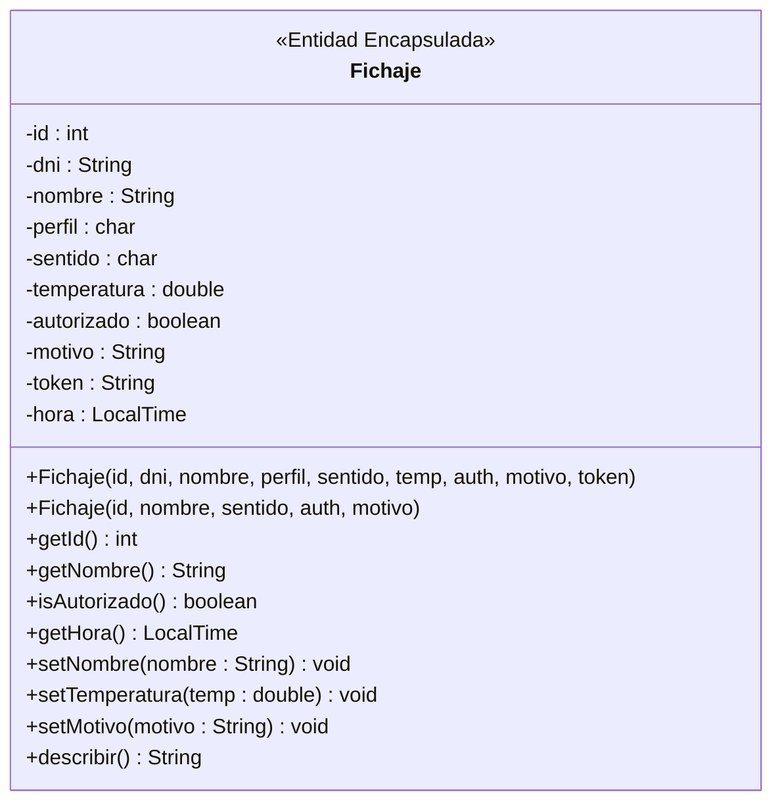

##### A. Modificadores de visibilidad (`private`, paquete y `public`)

En Java, la visibilidad de cualquier atributo, constructor o método se controla anteponiendo una palabra clave de acceso:

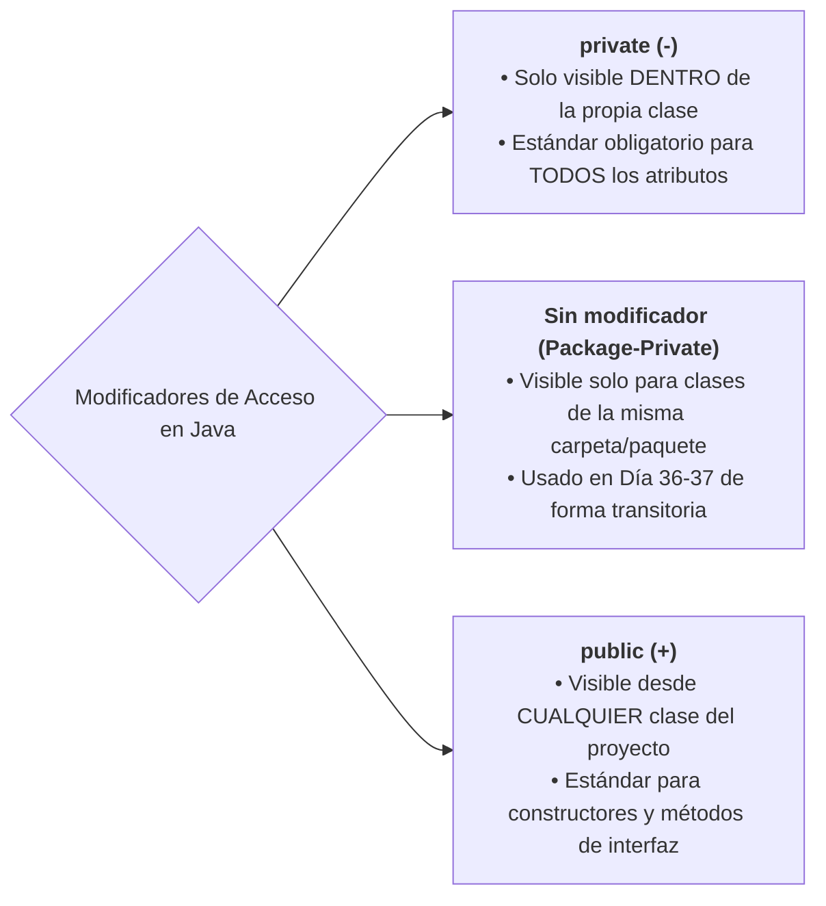

##### B. La aduana del objeto: *Getters* y *Setters*

Al declarar un atributo como `private`, el compilador bloquea cualquier acceso directo con el operador punto desde fuera de la clase (`nuevoFichaje.nombre` produce error de compilación). Para interactuar de forma segura creamos métodos públicos específicos:

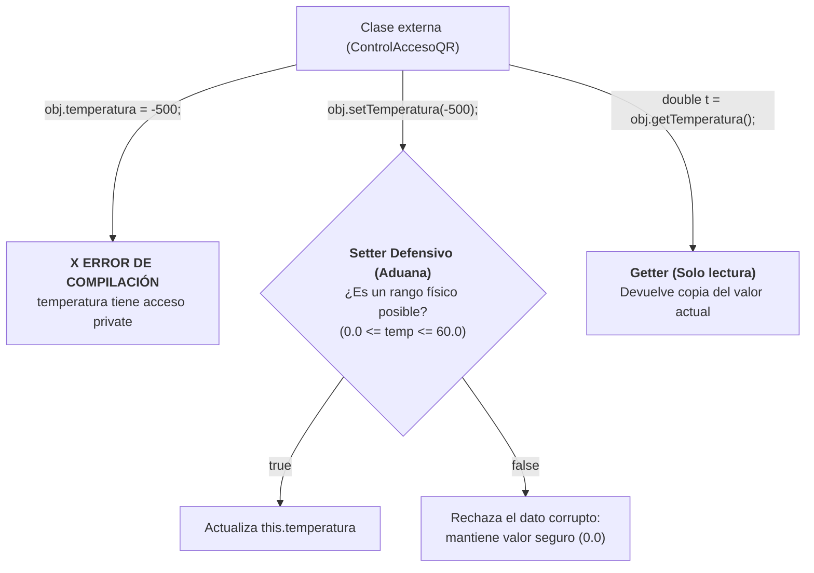

1. **Métodos de consulta (*Getters*):** Devuelven el valor de un atributo privado sin permitir alterarlo.
   * Convención estándar JavaBeans: `public Tipo getNombreAtributo()`.
   * **Excepción para `boolean`:** Por convención profesional, el *getter* de un atributo booleano comienza por **`is`** en lugar de `get` (ejemplo: `public boolean isAutorizado()`).
2. **Métodos modificadores (*Setters*):** Reciben un parámetro, **validan** que cumpla las reglas invariantes de la clase y, solo si es legítimo, actualizan el atributo privado (`public void setNombre(String nombre)`).

##### C. Inmutabilidad selectiva: ¿todos los atributos deben tener *Setter*?

Un error habitual de principiante es generar automáticamente *getters* y *setters* para todos los atributos de una clase sin reflexionar. Si pones un `setAutorizado(boolean)` público en `Fichaje`, vuelves a abrir el agujero de seguridad que intentabas cerrar.

* **Atributos de solo lectura tras el nacimiento (Solo *Getter*, SIN *Setter*):** `id`, `dni`, `sentido`, `autorizado`, `token`, `hora`. Una vez que el torno ha emitido el fichaje, estos datos son históricos e inalterables para garantizar la integridad de la auditoría.
* **Atributos rectificables de forma controlada (Con *Getter* y *Setter* validado):** `nombre` (para corregir una errata tipográfica o normalizar espacios), `temperatura` (protegida frente a lecturas imposibles de hardware), `motivo` (para añadir observaciones de conserjería).

##### D. Validación centralizada en el constructor

Para no duplicar las reglas de validación (principio DRY), el constructor maestro invoca directamente a los *setters* internos de la propia clase (`this.setNombre(nombre);`, `this.setTemperatura(temperatura);`). Así, tanto al nacer el objeto como al modificarse después, pasa exactamente por el mismo filtro de seguridad.

---

#### 3. Evolución del caso guía a `ControlAccesoQR v3.3` (Java nativo)

Evolucionamos la versión `v3.2` a la **`v3.3`**. Mantenemos los archivos separados `Fichaje.java` y `ControlAccesoQR.java`, incorporando:
1. **Ocultación total de atributos** en `Fichaje.java` mediante `private`.
2. **Getters públicos** siguiendo la convención JavaBeans (`getId()`, `getNombre()`, `isAutorizado()`, `getHora()`, etc.).
3. **Setters defensivos selectivos** (`setNombre`, `setTemperatura`, `setMotivo`) e **inmutabilidad tras construcción** en `id`, `dni`, `sentido`, `autorizado`, `token` y `hora`.
4. Adaptación de `ControlAccesoQR.java` (Opción 3) para consultar los atributos encapsulados a través de sus *getters* públicos.

##### A. Comparativa de cambios respecto a v3.2 (`diff`)

```diff
  // =========================================================================
  // ARCHIVO: pr/src/Fichaje.java
  // =========================================================================
  public class Fichaje {
-     int id;
-     String dni;
-     String nombre;
-     // ...
+     private int id;
+     private String dni;
+     private String nombre;
+     private char perfil;
+     private char sentido;
+     private double temperatura;
+     private boolean autorizado;
+     private String motivo;
+     private String token;
+     private LocalTime hora;

      public Fichaje(int id, String dni, String nombre, char perfil, char sentido,
                     double temperatura, boolean autorizado, String motivo, String token) {
          this.id = Math.max(0, id);
          this.dni = (dni == null || dni.isBlank()) ? "N/D" : dni.trim().toUpperCase();
-         this.nombre = nombre;
+         this.setNombre(nombre);           // Validación centralizada
-         this.temperatura = temperatura;
+         this.setTemperatura(temperatura); // Validación de rango físico
-         this.motivo = motivo;
+         this.setMotivo(motivo);
          // ...
      }

+     // GETTERS PÚBLICOS Y SETTERS SELECTIVOS DEFENSIVOS
+     public int getId() { return this.id; }
+     public String getNombre() { return this.nombre; }
+     public boolean isAutorizado() { return this.autorizado; }
+     public LocalTime getHora() { return this.hora; }
+     public void setNombre(String nombre) { ... }
+     public void setTemperatura(double temperatura) { ... }
+     public void setMotivo(String motivo) { ... }
  }

  // =========================================================================
  // ARCHIVO: pr/src/ControlAccesoQR.java (v3.3 - Opción 3 Telemetría)
  // =========================================================================
  if (ultimoFichaje != null) {
      System.out.println("ÚLTIMO FICHAJE:           " + ultimoFichaje.describir());
+     System.out.printf("  -> Auditoría rápida:    Usuario: %s | Estado: %s | Hora: %s%n",
+             ultimoFichaje.getNombre(),
+             ultimoFichaje.isAutorizado() ? "PERMITIDO" : "RECHAZADO",
+             ultimoFichaje.getHora().withNano(0));
  }
```

##### B. Foco en la novedad: encapsulación en `Fichaje` y validación en *Setters*

Observa cómo `Fichaje` protege sus invariantes desde el nacimiento hasta cualquier modificación controlada posterior:

```java
// -------------------------------------------------------------------------
// Atributos blindados y constructores delegando en setters (Fichaje.java)
// -------------------------------------------------------------------------
private int id;
private String dni;
private String nombre;
private char perfil;
private char sentido;
private double temperatura;
private boolean autorizado;
private String motivo;
private String token;
private LocalTime hora;

public Fichaje(int id, String dni, String nombre, char perfil, char sentido,
               double temperatura, boolean autorizado, String motivo, String token) {
    this.id = Math.max(0, id);
    this.dni = (dni == null || dni.isBlank()) ? "N/D" : dni.trim().toUpperCase();
    this.setNombre(nombre);
    this.perfil = perfil;
    this.sentido = (sentido == 'S') ? 'S' : 'E';
    this.setTemperatura(temperatura);
    this.autorizado = autorizado;
    this.setMotivo(motivo);
    this.token = (token == null || token.isBlank()) ? "N/D" : token;
    this.hora = LocalTime.now();
}

// -------------------------------------------------------------------------
// Getters (JavaBeans) y Setters defensivos selectivos
// -------------------------------------------------------------------------
public int getId() { return this.id; }
public String getNombre() { return this.nombre; }
public boolean isAutorizado() { return this.autorizado; }
public LocalTime getHora() { return this.hora; }

public void setNombre(String nombre) {
    if (nombre == null || nombre.trim().isEmpty()) {
        this.nombre = "N/D";
    } else {
        this.nombre = nombre.trim().toUpperCase();
    }
}

public void setTemperatura(double temperatura) {
    // Rango físicamente válido de hardware (0.0 reservado para salidas sin lectura)
    if (temperatura >= 0.0 && temperatura <= 60.0) {
        this.temperatura = temperatura;
    } else {
        this.temperatura = 0.0;
    }
}
```

##### C. Código fuente completo integrado

<details>
<summary><b>🔍 Desplegar archivos completos: Fichaje.java y ControlAccesoQR.java (v3.3)</b></summary>

**Archivo 1: `pr/src/Fichaje.java`**
```java
/**
 * ENTIDAD DE DOMINIO: REGISTRO DE FICHAJE EN TORNO
 * Cliente: IES El Caminàs (Castellón de la Plana)
 * Consultora: AzaharTech Software Consulting
 *
 * Versión 3.3:
 * Incorpora encapsulación estricta (Sprint 4: «Arquitectos de software»):
 * - Todos los atributos declarados como private para ocultar el estado interno.
 * - Métodos getters públicos siguiendo la convención JavaBeans (get... / is...).
 * - Setters selectivos con validación defensiva (nombre, temperatura, motivo).
 * - Inmutabilidad tras construcción en campos críticos de auditoría (id, autorizado, hora).
 *
 * @author Equipo AzaharTech (Alba Torres, Pau Ferrer, Laia Claramunt)
 * @version 3.3 (Noviembre 2026)
 * @since JDK 21 LTS
 */

import java.time.LocalTime;

public class Fichaje {

    // -------------------------------------------------------------------------
    // 1. ATRIBUTOS PRIVADOS (Ocultación estricta del estado interno en Heap)
    // -------------------------------------------------------------------------
    private int id;
    private String dni;
    private String nombre;
    private char perfil;
    private char sentido;
    private double temperatura;
    private boolean autorizado;
    private String motivo;
    private String token;
    private LocalTime hora;

    // -------------------------------------------------------------------------
    // 2. CONSTRUCTORES SOBRECARGADOS (Validación centralizada vía setters)
    // -------------------------------------------------------------------------

    /**
     * Constructor maestro completo para registrar entradas detalladas.
     */
    public Fichaje(int id, String dni, String nombre, char perfil, char sentido,
                   double temperatura, boolean autorizado, String motivo, String token) {
        this.id = Math.max(0, id);
        this.dni = (dni == null || dni.isBlank()) ? "N/D" : dni.trim().toUpperCase();
        this.setNombre(nombre);
        this.perfil = perfil;
        this.sentido = (sentido == 'S') ? 'S' : 'E';
        this.setTemperatura(temperatura);
        this.autorizado = autorizado;
        this.setMotivo(motivo);
        this.token = (token == null || token.isBlank()) ? "N/D" : token;
        this.hora = LocalTime.now();
    }

    /**
     * Constructor sobrecargado simplificado para tránsitos de salida ('S').
     */
    public Fichaje(int id, String nombre, char sentido, boolean autorizado, String motivo) {
        this(id, "N/D", nombre, '?', sentido, 0.0, autorizado, motivo, "N/D");
    }

    // -------------------------------------------------------------------------
    // 3. MÉTODOS DE ACCESO: GETTERS (Lectura controlada JavaBeans)
    // -------------------------------------------------------------------------

    public int getId() {
        return this.id;
    }

    public String getDni() {
        return this.dni;
    }

    public String getNombre() {
        return this.nombre;
    }

    public char getPerfil() {
        return this.perfil;
    }

    public char getSentido() {
        return this.sentido;
    }

    public double getTemperatura() {
        return this.temperatura;
    }

    public boolean isAutorizado() {
        return this.autorizado;
    }

    public String getMotivo() {
        return this.motivo;
    }

    public String getToken() {
        return this.token;
    }

    public LocalTime getHora() {
        return this.hora;
    }

    // -------------------------------------------------------------------------
    // 4. MÉTODOS MODIFICADORES: SETTERS SELECTIVOS DEFENSIVOS
    //    (Los campos críticos id, dni, sentido, autorizado, token y hora
    //     carecen de setter público para garantizar integridad de auditoría)
    // -------------------------------------------------------------------------

    /**
     * Normaliza el nombre y garantiza que nunca quede nulo o en blanco.
     */
    public void setNombre(String nombre) {
        if (nombre == null || nombre.trim().isEmpty()) {
            this.nombre = "N/D";
        } else {
            this.nombre = nombre.trim().toUpperCase();
        }
    }

    /**
     * Protege el registro térmico ante lecturas corruptas fuera de rango físico [0.0 - 60.0].
     */
    public void setTemperatura(double temperatura) {
        if (temperatura >= 0.0 && temperatura <= 60.0) {
            this.temperatura = temperatura;
        } else {
            this.temperatura = 0.0;
        }
    }

    /**
     * Permite anotar o rectificar observaciones administrativas del motivo de paso.
     */
    public void setMotivo(String motivo) {
        if (motivo == null || motivo.trim().isEmpty()) {
            this.motivo = "Sin evaluar";
        } else {
            this.motivo = motivo.trim();
        }
    }

    // -------------------------------------------------------------------------
    // 5. MÉTODOS DE COMPORTAMIENTO (Lógica propia de la entidad)
    // -------------------------------------------------------------------------

    public String obtenerPerfilLegible() {
        String descripcion;
        switch (this.perfil) {
            case 'E':
                descripcion = "Estudiante Oficial";
                break;
            case 'D':
                descripcion = "Docente / Claustro";
                break;
            case 'V':
                descripcion = "Visita Externa / Proveedor";
                break;
            case 'A':
                descripcion = "Personal de Administración y Servicios (PAS)";
                break;
            default:
                descripcion = "No especificado";
                break;
        }
        return descripcion;
    }

    public String describir() {
        String detalleRol = (this.sentido == 'S') ? "Tránsito exterior" : obtenerPerfilLegible();
        return String.format("#%d [%s] %s (%s) | %s | %s | %s",
                this.id,
                this.sentido == 'S' ? "SALIDA" : "ENTRADA",
                this.nombre,
                detalleRol,
                this.autorizado ? "AUTORIZADO" : "DENEGADO",
                this.motivo,
                this.hora.withNano(0));
    }
}
```

**Archivo 2: `pr/src/ControlAccesoQR.java` (v3.3)**
```java
/**
 * SISTEMA DE CONTROL DE ASISTENCIA POR CÓDIGO QR
 * Cliente: IES El Caminàs (Castellón de la Plana)
 * Consultora: AzaharTech Software Consulting
 * 
 * Versión 3.3:
 * Evolución del Sprint 4 («Arquitectos de software»).
 * Adapta la interacción con la entidad encapsulada Fichaje consumiendo exclusivamente
 * su interfaz pública mediante métodos getters (getNombre, isAutorizado, getHora).
 * Mantiene el cumplimiento estricto del principio SESE y blindaje try-catch.
 * 
 * @author Equipo AzaharTech (Alba Torres, Pau Ferrer, Laia Claramunt)
 * @version 3.3 (Noviembre 2026)
 * @since JDK 21 LTS
 * 
 */

import java.util.Scanner;
import java.util.Random;
import java.time.LocalTime;
import java.time.LocalDate;
import java.time.Duration;

public class ControlAccesoQR {

    // -------------------------------------------------------------------------
    // 1. CONSTANTES INMUTABLES DEL SISTEMA (configuración corporativa)
    // -------------------------------------------------------------------------
    final static String NOMBRE_CENTRO = "IES El Caminàs (Castellón)";
    final static String PREFIJO_CENTRO = "CAMINAS";
    final static String RUTA_LOGS = ".\\caminas\\terminal\\logs";

    final static int MINUTOS_POR_HORA = 60;
    final static int SEGUNDOS_POR_HORA = 3600;
    final static int SEGUNDOS_POR_MINUTO = 60;
    final static int JORNADA_BASE_MINUTOS = 480; // 8 horas
    final static double FACTOR_PORCENTAJE = 100.0;

    final static int ID_TERMINAL_PUERTA_NORTE = 102;
    final static int BASE_TOKEN_SEGURIDAD = 1000;
    final static int RANGO_TOKEN_SEGURIDAD = 9000;
    final static long SEMILLA_CALIBRACION = 987654321L;

    final static double TEMP_MIN_SEGURA = 15.0;
    final static double TEMP_MAX_SEGURA = 35.0;
    final static double MAX_VARIACION_TERMICA = 0.5;
    final static int LONGITUD_DNI_ESTANDAR = 9;

    // Umbrales biométricos y capacidad
    final static double TEMP_CORPORAL_MAX_FIEBRE = 37.5;
    final static double TEMP_CORPORAL_MIN_FALLO = 35.0;

    // Control de puntualidad y hardware perimetral
    final static LocalTime HORA_LIMITE_PUNTUALIDAD = LocalTime.of(8, 15);
    final static int NUM_SENSORES_TORNO = 8;
    final static int HORAS_TURNO_LECTIVO = 6;
    final static int TOTAL_TORNOS_CAMPUS = 3;
    final static int CANALES_POR_TORNO = 4;

    // -------------------------------------------------------------------------
    // 2. MÉTODOS ESTÁTICOS AUXILIARES DEL ORQUESTADOR
    // -------------------------------------------------------------------------

    public static int calcularEstanciaMinutos(LocalTime entrada, LocalTime salida) {
        return (int) Duration.between(entrada, salida).toMinutes();
    }

    public static double calcularPorcentajeOcupacion(int personas, int aforoTotal) {
        return ((double) personas / aforoTotal) * FACTOR_PORCENTAJE;
    }

    public static String construirTokenQR(String prefijo, String dni, int terminalId, int codigoSec, int idFichaje) {
        String token = prefijo + "-" + dni;
        token += "-T" + terminalId;
        token += "-SEC#" + codigoSec;
        token += "-REG" + idFichaje;
        return token;
    }

    public static double calcularDistanciaDiagonal(double x, double y) {
        return Math.sqrt(Math.pow(x, 2.0) + Math.pow(y, 2.0));
    }

    public static String determinarZonaAutorizada(char perfil) {
        String zona;
        switch (perfil) {
            case 'E':
                zona = "Aulas Docentes y Talleres de Informática";
                break;
            case 'D':
                zona = "Departamentos Didácticos, Aulas y Sala de Profesores";
                break;
            case 'V':
                zona = "Secretaría, Conserjería y Despachos de Dirección";
                break;
            case 'A':
                zona = "Área de Gestión Administrativa y Archivo Central";
                break;
            default:
                zona = "Acceso Denegado / Zona No Autorizada";
                break;
        }
        return zona;
    }

    public static int obtenerEstanciaMaximaPorPerfil(char perfil) {
        int estanciaMinutos;
        switch (perfil) {
            case 'E':
                estanciaMinutos = 360;
                break;
            case 'D':
                estanciaMinutos = 480;
                break;
            case 'V':
                estanciaMinutos = 120;
                break;
            case 'A':
                estanciaMinutos = 420;
                break;
            default:
                estanciaMinutos = 0;
                break;
        }
        return estanciaMinutos;
    }

    // -------------------------------------------------------------------------
    // 3. MÉTODOS PREDICADO BOOLEANOS (reglas de negocio desacopladas)
    // -------------------------------------------------------------------------

    public static boolean esTemperaturaCorporalSegura(double temperatura) {
        return (temperatura >= TEMP_CORPORAL_MIN_FALLO && temperatura <= TEMP_CORPORAL_MAX_FIEBRE);
    }

    public static boolean esDocumentoValido(String dni) {
        return (dni != null && dni.length() == LONGITUD_DNI_ESTANDAR);
    }

    public static boolean esPerfilAutorizado(char perfil) {
        boolean autorizado;
        switch (perfil) {
            case 'E':
            case 'D':
            case 'V':
            case 'A':
                autorizado = true;
                break;
            default:
                autorizado = false;
                break;
        }
        return autorizado;
    }

    // -------------------------------------------------------------------------
    // 4. MÉTODO PRINCIPAL: CONSOLA INTEGRAL v3.3 (ENCAPSULACIÓN ESTRICTA)
    // -------------------------------------------------------------------------
    public static void main(String[] args) {
        Scanner teclado = new Scanner(System.in);

        Random generadorVestibulo = new Random();

        LocalDate fechaActual = LocalDate.now();

        // Estado persistente del campus
        int personasEnCentro = 1190;
        int aforoDisponible = 10;
        int idUltimoFichaje = 1042;

        int totalFichajesProcesados = 0;
        int totalFichajesAutorizados = 0;
        int totalFichajesDenegados = 0;

        // Referencias a objetos Fichaje: nacen a null (todavía no hay tránsitos)
        Fichaje ultimoFichaje = null;
        Fichaje penultimoFichaje = null;

        // Acumuladores estadísticos
        double tempMaximaRegistrada = -1.0;
        double tempMinimaRegistrada = 100.0;
        int minutosEstanciaAcumulados = 0;

        boolean sesionActiva = true;

        System.out.println("======================================================================");
        System.out.println("   AZAHARTECH · CONTROL INTEGRAL DE ACCESOS - IES EL CAMINÀS          ");
        System.out.println("   Versión 3.3 (Sprint 4: Encapsulación private/public y Getters)     ");
        System.out.println("   Fecha de sesión: " + fechaActual);
        System.out.println("======================================================================");

        // BUCLE PRINCIPAL DE GESTIÓN (MENÚ DE OPERACIONES)
        do {
            System.out.println("\n----------------------------------------------------------------------");
            System.out.println("                    PANEL DE OPERACIONES DEL TORNO                    ");
            System.out.println("----------------------------------------------------------------------");
            System.out.println("  [1] Registrar tránsito individual (construcción atómica de Fichaje)");
            System.out.println("  [2] Procesar cola en ráfaga (Modo Burst con parada en cabecera)");
            System.out.println("  [3] Consultar telemetría y auditoría de últimos fichajes");
            System.out.println("  [4] Diagnóstico perimetral estructurado SESE (3 tornos x 4 canales)");
            System.out.println("  [5] Activar protocolo de evacuación de emergencia");
            System.out.println("  [6] Cerrar jornada y apagar terminal");
            System.out.print("Seleccione una operación (1-6): ");

            int opcionMenu = 0;
            try {
                opcionMenu = Integer.parseInt(teclado.nextLine().trim());
            } catch (NumberFormatException e) {
                opcionMenu = -1;
            }

            switch (opcionMenu) {
                case 1:
                    // TRÁNSITO INDIVIDUAL CON OBJETO ENCAPSULADO
                    totalFichajesProcesados++;
                    System.out.println("\n--- [MODO 1: TRÁNSITO INDIVIDUAL] ---");
                    System.out.print("Sentido del tránsito (E = Entrada, S = Salida): ");
                    String lineaSentido = teclado.nextLine().trim().toUpperCase();
                    char sentidoTransito = lineaSentido.isEmpty() ? 'E' : lineaSentido.charAt(0);

                    System.out.print("Nombre completo: ");
                    String nombreCapturado = teclado.nextLine().trim().toUpperCase();
                    String nombreLimpio = nombreCapturado.isEmpty() ? "N/D" : nombreCapturado;

                    Fichaje nuevoFichaje;

                    if (sentidoTransito == 'S') {
                        boolean salidaAutorizada;
                        String motivoSalida;

                        if (personasEnCentro > 0) {
                            personasEnCentro--;
                            aforoDisponible++;
                            totalFichajesAutorizados++;
                            idUltimoFichaje++;
                            salidaAutorizada = true;
                            motivoSalida = "Salida registrada";
                            System.out.println(">> VEREDICTO: [SALIDA AUTORIZADA] Torno exterior abierto.");
                        } else {
                            totalFichajesDenegados++;
                            salidaAutorizada = false;
                            motivoSalida = "Recinto vacío";
                            System.err.println(">> ALERTA: Imposible autorizar salida; recinto vacío.");
                        }

                        nuevoFichaje = new Fichaje(idUltimoFichaje, nombreLimpio, 'S', salidaAutorizada, motivoSalida);
                    } else {
                        int terminalId = 0;
                        double tempVestibulo = 0.0;
                        String dniPersonaLimpio = "N/D";
                        char perfilNormalizado = '?';
                        boolean datosSintacticamenteCorrectos = true;
                        String motivoDenegacion = "";

                        try {
                            System.out.print("ID Terminal: ");
                            terminalId = Integer.parseInt(teclado.nextLine().trim());
                            System.out.print("Temperatura (ºC): ");
                            tempVestibulo = Double.parseDouble(teclado.nextLine().trim());
                            System.out.print("DNI: ");
                            dniPersonaLimpio = teclado.nextLine().trim().toUpperCase();
                            System.out.print("Perfil (E/D/V/A): ");
                            String lineaPerfil = teclado.nextLine().trim();
                            perfilNormalizado = lineaPerfil.isEmpty() ? '?' : Character.toUpperCase(lineaPerfil.charAt(0));
                        } catch (NumberFormatException e) {
                            datosSintacticamenteCorrectos = false;
                            motivoDenegacion = "Error de formato numérico.";
                        }

                        boolean accesoConcedido;
                        if (!datosSintacticamenteCorrectos) {
                            accesoConcedido = false;
                            totalFichajesDenegados++;
                        } else if (!esTemperaturaCorporalSegura(tempVestibulo)) {
                            accesoConcedido = false;
                            motivoDenegacion = "Temperatura anómala.";
                            totalFichajesDenegados++;
                        } else if (aforoDisponible <= 0) {
                            accesoConcedido = false;
                            motivoDenegacion = "Aforo completo.";
                            totalFichajesDenegados++;
                        } else if (!esDocumentoValido(dniPersonaLimpio)) {
                            accesoConcedido = false;
                            motivoDenegacion = "DNI no reglamentario.";
                            totalFichajesDenegados++;
                        } else if (!esPerfilAutorizado(perfilNormalizado)) {
                            accesoConcedido = false;
                            motivoDenegacion = "Perfil no catalogado.";
                            totalFichajesDenegados++;
                        } else {
                            accesoConcedido = true;
                            totalFichajesAutorizados++;
                            personasEnCentro++;
                            aforoDisponible--;
                            idUltimoFichaje++;

                            tempMaximaRegistrada = Math.max(tempMaximaRegistrada, tempVestibulo);
                            tempMinimaRegistrada = Math.min(tempMinimaRegistrada, tempVestibulo);
                            minutosEstanciaAcumulados += 360;
                        }

                        int codigoToken = BASE_TOKEN_SEGURIDAD + generadorVestibulo.nextInt(RANGO_TOKEN_SEGURIDAD);
                        String token = construirTokenQR(PREFIJO_CENTRO, dniPersonaLimpio, terminalId, codigoToken, idUltimoFichaje);
                        System.out.printf(">> VEREDICTO: %s [Token: %s]%n",
                                accesoConcedido ? "[ENTRADA AUTORIZADA]" : "[ENTRADA DENEGADA - " + motivoDenegacion + "]", token);

                        String motivoFinal = accesoConcedido ? "Acceso concedido" : motivoDenegacion;

                        nuevoFichaje = new Fichaje(idUltimoFichaje, dniPersonaLimpio, nombreLimpio,
                                perfilNormalizado, 'E', tempVestibulo, accesoConcedido, motivoFinal, token);
                    }

                    penultimoFichaje = ultimoFichaje;
                    ultimoFichaje = nuevoFichaje;
                    System.out.println(">> Objeto Fichaje protegido: " + nuevoFichaje.describir());
                    break;

                case 2:
                    // RÁFAGA DE COLA CON GUARDIA EN CABECERA (PRINCIPIO SESE)
                    System.out.println("\n--- [MODO 2: RÁFAGA CON PARADA ESTRUCTURADA EN CABECERA] ---");
                    System.out.print("Personas en cola para esta ráfaga: ");
                    int personasEnCola = 0;
                    try {
                        personasEnCola = Integer.parseInt(teclado.nextLine().trim());
                    } catch (NumberFormatException e) {
                        personasEnCola = 0;
                    }

                    boolean vetoJudicialDetectado = false;

                    while (personasEnCola > 0 && aforoDisponible > 0 && !vetoJudicialDetectado) {
                        if (idUltimoFichaje == 1044) {
                            System.out.println(">> [ALERTA JUDICIAL]: Credencial bloqueada. Suspendiendo cola en cabecera...");
                            vetoJudicialDetectado = true;
                        } else {
                            totalFichajesProcesados++;
                            totalFichajesAutorizados++;
                            personasEnCentro++;
                            aforoDisponible--;
                            idUltimoFichaje++;
                            personasEnCola--;

                            double tempSimulada = 36.4 + (generadorVestibulo.nextDouble() * 0.5);
                            tempMaximaRegistrada = Math.max(tempMaximaRegistrada, tempSimulada);
                            tempMinimaRegistrada = Math.min(tempMinimaRegistrada, tempSimulada);
                            minutosEstanciaAcumulados += 360;
                        }
                    }
                    System.out.printf(">> Estado tras ráfaga. Plazas disponibles: %d | Restantes en cola: %d%n",
                            aforoDisponible, personasEnCola);
                    break;

                case 3:
                    // MONITOR DE TELEMETRÍA EN VIVO Y CONSUMO VÍA GETTERS
                    System.out.println("\n--- [MODO 3: MONITOR DE TELEMETRÍA EN VIVO] ---");
                    int aforoTotal = personasEnCentro + aforoDisponible;
                    double porcentajeOcupacion = calcularPorcentajeOcupacion(personasEnCentro, aforoTotal);
                    double estanciaMedia = totalFichajesAutorizados > 0 
                            ? ((double) minutosEstanciaAcumulados / totalFichajesAutorizados) : 0.0;

                    System.out.printf("OCUPACIÓN ACTUAL:         %d/%d personas (%6.2f %%)%n", personasEnCentro, aforoTotal, porcentajeOcupacion);
                    System.out.printf("PLAZAS LIBRES:            %d vacantes disponibles%n", aforoDisponible);
                    System.out.printf("TRANSACCIONES TOTALES:    %d registros (%d autorizados, %d denegados)%n",
                            totalFichajesProcesados, totalFichajesAutorizados, totalFichajesDenegados);
                    System.out.printf("PICO TÉRMICO MÁXIMO:      %.1f ºC%n", Math.max(0.0, tempMaximaRegistrada));
                    System.out.printf("PICO TÉRMICO MÍNIMO:      %.1f ºC%n", tempMinimaRegistrada > 50.0 ? 0.0 : tempMinimaRegistrada);
                    System.out.printf("ESTANCIA PROMEDIO:        %.1f minutos (Total acumulado: %d min)%n",
                            estanciaMedia, minutosEstanciaAcumulados);

                    if (ultimoFichaje != null) {
                        System.out.println("ÚLTIMO FICHAJE:           " + ultimoFichaje.describir());
                        // Acceso seguro de lectura exclusivamente a través de getters públicos
                        System.out.printf("  -> Auditoría rápida:    Usuario: %s | Estado: %s | Hora: %s%n",
                                ultimoFichaje.getNombre(),
                                ultimoFichaje.isAutorizado() ? "PERMITIDO" : "RECHAZADO",
                                ultimoFichaje.getHora().withNano(0));
                    } else {
                        System.out.println("ÚLTIMO FICHAJE:           (sin registros en esta sesión)");
                    }

                    if (penultimoFichaje != null) {
                        System.out.println("PENÚLTIMO FICHAJE:        " + penultimoFichaje.describir());
                    } else {
                        System.out.println("PENÚLTIMO FICHAJE:        (sin registros en esta sesión)");
                    }
                    break;

                case 4:
                    // DIAGNÓSTICO SECUENCIAL Y MATRIZ PERIMETRAL SESE
                    System.out.println("\n--- [MODO 4: INSPECCIÓN PERIMETRAL ESTRUCTURADA (SESE)] ---");
                    boolean alarmaSabotajeDetectada = false;

                    for (int torno = 1; torno <= TOTAL_TORNOS_CAMPUS && !alarmaSabotajeDetectada; torno++) {
                        String nombreAcceso = switch (torno) {
                            case 1 -> "Vestíbulo Central  | ";
                            case 2 -> "Puerta Norte Ciclos| ";
                            case 3 -> "Puerta Sur Talleres| ";
                            default -> "Acceso Perimetral  | ";
                        };
                        System.out.print(nombreAcceso);

                        for (int canal = 1; canal <= CANALES_POR_TORNO && !alarmaSabotajeDetectada; canal++) {
                            if (torno == 2 && canal == 2) {
                                System.out.print("[REVISIÓN] ");
                            } else {
                                boolean falloCritico = (torno == 3 && canal == 2 && false);

                                if (falloCritico) {
                                    System.out.print("[SABOTAJE] ");
                                    alarmaSabotajeDetectada = true;
                                } else {
                                    System.out.printf("[C%d: OK]   ", canal);
                                }
                            }
                        }
                        System.out.println();
                    }

                    if (alarmaSabotajeDetectada) {
                        System.out.println(">> [ALERTA DE SEGURIDAD]: Barrido perimetral detenido por fallo crítico.");
                    }
                    System.out.println("-------------------------------------------------------------------");
                    break;

                case 5:
                    // PROTOCOLO DE EVACUACIÓN CON WHILE DE DRENAJE
                    System.out.println("\n--- [MODO 5: PROTOCOLO DE EVACUACIÓN DE EMERGENCIA] ---");
                    if (personasEnCentro == 0) {
                        System.out.println(">> El campus ya se encuentra completamente vacío.");
                    } else {
                        int loteSalidaSimultanea = 300;
                        int oleada = 1;

                        while (personasEnCentro > 0) {
                            int evacuadosLote = Math.min(personasEnCentro, loteSalidaSimultanea);
                            personasEnCentro -= evacuadosLote;
                            aforoDisponible += evacuadosLote;

                            System.out.printf("  -> Oleada #%d: Desalojadas %d personas por salidas de emergencia (Ocupantes restantes: %d)%n",
                                    oleada, evacuadosLote, personasEnCentro);
                            oleada++;
                        }
                        System.out.println(">> CERTIFICACIÓN DE SEGURIDAD: Recinto 100% desalojado. Aforo íntegro restaurado.");
                    }
                    break;

                case 6:
                    // APAGADO Y SALIDA
                    System.out.println("\n>> Desconectando terminal de presencia de forma ordenada...");
                    sesionActiva = false;
                    break;

                default:
                    System.err.println(">> Error: Opción no válida. Seleccione una operación entre 1 y 6.");
                    break;
            }

        } while (sesionActiva);

        // AUDITORÍA FINAL AL APAGAR
        System.out.println("\n======================================================================");
        System.out.println("          AUDITORÍA FINAL DE LA JORNADA · IES EL CAMINÀS              ");
        System.out.println("======================================================================");
        System.out.printf("TOTAL OPERACIONES GESTIONADAS: %d%n", totalFichajesProcesados);
        System.out.printf("ACCESOS AUTORIZADOS (TOTAL):   %d%n", totalFichajesAutorizados);
        System.out.printf("ACCESOS DENEGADOS (BLOQUEO):   %d%n", totalFichajesDenegados);
        System.out.printf("OCUPACIÓN FINAL REGISTRADA:    %d personas%n", personasEnCentro);
        System.out.println("ESTADO DEL DISPOSITIVO:        Terminal desconectado de forma segura.");
        System.out.println("======================================================================");

        teclado.close();
    }
}
```

</details>

---

#### 4. Segunda sesión: dojo de entrenamiento y katas de código

En esta sesión práctica, cada estudiante blindará los atributos de su clase entidad mediante encapsulación estricta (`private`), diseñará *getters* y *setters* defensivos e implementará inmutabilidad selectiva.

##### Kata 1 (Cinturón blanco / Nivel base). Encapsulación estricta en proyectos asignados

Abre la clase entidad de tu proyecto en `pr/src/` y declara **todos sus atributos como `private`**. Implementa sus métodos *getters* públicos siguiendo la convención JavaBeans (`get...` / `is...`) y diseña **setters defensivos** únicamente en aquellos atributos que deban poder modificarse con validación, conectando los constructores a dichos *setters*:

* **Aventura conversacional.** En `Personaje.java`, privatiza los atributos de nombre, salud actual, ataque y estado de alianza. Implementa `setSalud(int)` asegurando que los puntos de vida jamás caigan por debajo de cero (`Math.max(0, salud)`) y actualiza automáticamente el indicador booleano de supervivencia; omite el *setter* del indicador de bando para impedir que un enemigo cambie de bando de forma ilegítima tras nacer.
* **Motor de recomendación.** En `Item.java`, oculta título, categoría, valoración media y etiqueta como `private`. Implementa un `setValoracionMedia(double)` que acote defensivamente la puntuación al rango válido de negocio (`[0.0, 10.0]`) y un `setEtiqueta(String)` que rechace cadenas vacías; conserva el título y la categoría como atributos de solo lectura tras la construcción.
* **Simulador de físicas 2D.** En `Bola.java`, encapsula las coordenadas espaciales y los componentes del vector velocidad como `private`. Implementa *getters* para todas las magnitudes y *setters* validados para la posición (evitando que salga de los límites del escenario simulado) y velocidad, manteniendo el identificador o radio inicial como constante de instancia sin *setter*.
* **Bóveda de contraseñas.** En `Credencial.java`, blinda servicio, usuario, clave y días hasta la caducidad como `private`. Implementa un `setClave(String)` que rechace cualquier modificación si la nueva contraseña no cumple la longitud mínima de seguridad y un `setDiasCaducidad(int)` que impida plazos negativos; omite el *setter* del nombre de servicio y mantén un *getter* enmascarado que no exponga la clave en texto plano.

---

##### Kata 2 (Cinturón marrón / Nivel avanzado). Generación asistida en IntelliJ e inmutabilidad selectiva

1. **Productividad con el generador de IntelliJ (`Alt + Insert`):**  
   En lugar de teclear manualmente diez métodos repetitivos, sitúa el cursor dentro de tu clase entidad y pulsa **`Alt + Insert`** (en macOS, `Cmd + N`) $\rightarrow$ **Getter**, o **Getter and Setter**. Selecciona los atributos apropiados y observa cómo IntelliJ respeta automáticamente la convención `isNombre()` para los tipos `boolean`.
2. **Auditoría de diseño (*Inmutabilidad Selectiva*):**  
   Añade a mano la lógica de validación dentro de los *setters* generados y documenta en un comentario junto a los atributos sin *setter* por qué esos campos deben ser de **solo lectura** tras la creación del objeto.

---

##### Kata 3 (Cinturón negro / «Hacker AzaharTech»). Test de penetración sobre invariantes de clase

Demuestra empíricamente que tu clase entidad es ahora inmune a la corrupción de datos desde el exterior:

1. **Verificación del muro de compilación:**  
   Intenta escribir desde el método `main` de tu proyecto una asignación directa ilegal sobre un atributo de tu objeto (por ejemplo, `heroe.salud = -500;` o `item.valoracionMedia = 999.0;`). Comprueba el mensaje de error exacto del compilador (`'...' has private access in '...'`) y comenta esa línea dejando constancia del bloqueo.
2. **Ataque a través de la interfaz pública (*Fuzzing de Setters*):**  
   Crea una pequeña batería de pruebas en `main` invocando tus *setters* con datos hostiles: cadenas `null`, textos con espacios en blanco, números negativos extremos o valores desbordados.
3. **Certificación:**  
   Imprime el estado del objeto tras el ataque comprobando mediante *getters* que todos los invariantes matemáticos y de seguridad permanecen intactos. Documenta los resultados de la prueba en la cabecera Javadoc de tu clase entidad.

...en lenguaje claro, directo y paso a paso...

##### Kata 1 (Cinturón blanco). Proteger los datos con `private`

Abre tu clase (`Personaje`, `Item`, `Bola` o `Credencial`) y pon la palabra **`private`** delante de todos sus atributos para que nadie pueda modificarlos directamente desde fuera. Después:
1. Crea métodos **getters** públicos (`getNombre()`, `isAliado()`, etc.) para poder leerlos desde `main`.
2. Crea métodos **setters** públicos **solo** para los atributos que sí deban poder cambiar después, poniendo un `if` dentro para bloquear valores absurdos. Los atributos fijos déjalos **sin setter**.
3. En tu constructor largo, sustituye las asignaciones directas (`this.salud = salud;`) por llamadas a tus setters (`this.setSalud(salud);`) para validar también cuando nace el objeto.

* **Aventura conversacional:** Pon `private` a todo. Crea *getters* para todo. Crea `setSalud(int)` comprobando que si pasan un número negativo, la salud se quede en `0` (nunca negativa). No hagas `setEsAliado` para que nadie pueda cambiar de bando por trampa.
* **Motor de recomendación:** Pon `private` a todo. Crea *getters* para todo. Crea `setValoracionMedia(double)` asegurando que si pasan menos de `0.0` o más de `10.0`, se quede acotado entre `0` y `10`. No hagas `setTitulo` ni `setCategoria` para que no se altere el producto después de crearlo.
* **Simulador de físicas 2D:** Pon `private` a todo. Crea *getters* para todo. Crea `setX(double)` y `setY(double)` comprobando que las coordenadas no sean negativas (si pasan negativo, poner `0.0`). Deja el `nombre` de la bola sin setter.
* **Bóveda de contraseñas:** Pon `private` a todo. Crea *getters* para todo (pero en `getClave()`, devuelve una versión tapada con asteriscos o solo los dos últimos caracteres, nunca la clave entera). Crea `setClave(String)` para que solo cambie la contraseña si la nueva tiene al menos 8 caracteres, y `setDiasCaducidad(int)` para que no acepte días negativos. No hagas `setServicio`.

---

##### Kata 2 (Cinturón marrón). Generar *getters* y *setters* rápido con IntelliJ

No hace falta que escribas todos los *getters* a mano letra por letra:

1. Borra temporalmente un par de *getters* de tu clase, deja el cursor dentro de la clase y pulsa **`Alt + Insert`** (en Mac `Cmd + N`) $\rightarrow$ **Getter** (o haz clic derecho $\rightarrow$ *Generate...* $\rightarrow$ *Getter*).
2. Marca los atributos que quieras y pulsa *OK*. Fíjate en que para los atributos `boolean`, IntelliJ crea automáticamente `is...()` en vez de `get...()`.
3. Si generas *setters* con este atajo, recuerda añadir dentro tus `if` de protección para no aceptar datos malos.

---

##### Kata 3 (Cinturón negro). Intentar romper tus propias reglas de seguridad

Haz la siguiente prueba rápida al principio de tu `main` para comprobar que tu clase es segura:

1. **Bloqueo de acceso directo:** Escribe una línea en `main` intentando cambiar un atributo directamente (por ejemplo, `heroe.salud = -500;` o `item.valoracionMedia = 999;`). Comprueba que IntelliJ te da un error rojo diciendo que es `private`. **Comenta esa línea** (`// ...`) para que el programa vuelva a compilar.
2. **Prueba con datos malos en los setters:** Llama a tus *setters* pasando valores trampa a propósito (una nota de `500.0`, una salud de `-200`, una clave de `"123"`, un texto vacío `""` o `null`).
3. Imprime los datos del objeto después usando tus *getters* y comprueba en la consola que tu clase **ha bloqueado o corregido** todos los datos malos manteniendo el objeto sano.

---

### Día 39 - 2 sesiones

---

#### 1. Caso guía en AzaharTech

Son las 15:00 h del **jueves 19 de noviembre de 2026**. En la sede de **AzaharTech** en Castellón de la Plana, el equipo de desarrollo se prepara para cerrar la primera semana del **Sprint 4: «Arquitectos de software»**. Con la versión `v3.3`, la clase `Fichaje` ya protege sus atributos mediante encapsulación `private` y valida su estado en constructores y *setters*.

Sin embargo, durante la revisión de código de cierre de semana, **Alba Torres** detecta tres síntomas de diseño que aún deben pulirse en el **IES El Caminàs**:

> *«Equipo, hemos encapsulado los datos de `Fichaje`, pero mirad cómo seguimos tratando al objeto desde `ControlAccesoQR`:*
> 1. * **Clase medio anémica:** Métodos como `determinarZonaAutorizada(char)` y `obtenerEstanciaMaximaPorPerfil(char)` siguen viviendo dentro de `ControlAccesoQR` como funciones estáticas sueltas, obligándonos a sacar el `perfil` del fichaje para preguntarlo fuera. Esos comportamientos pertenecen a `Fichaje`.*
> 2. * **Llamada manual a `.describir()`:** Cada vez que imprimimos un objeto directamente en consola o lo inspeccionamos en el depurador sin llamar a `.describir()`, Java muestra algo críptico como `Fichaje@4a574795`. Java tiene un mecanismo estándar para que cualquier objeto sepa presentarse a sí mismo automáticamente: el método **`toString()`**.*
> 3. * **Detección de doble lectura accidental (anti-rebote):** El conserje nos pidió detectar si un alumno pasa dos veces seguidas su tarjeta por el lector en el mismo sentido (`ultimoFichaje` y el nuevo tránsito tienen el mismo DNI). Para resolverlo sin extraer datos en el `main`, un objeto `Fichaje` debe saber **compararse directamente con otro objeto `Fichaje` recibido como parámetro**»*.

**Laia Claramunt** y **Pau Ferrer** concretan el cierre técnico de la Semana 10:

> *«Hoy consolidamos el diseño orientado a objetos aplicando el principio **«Díselo, no se lo preguntes» (*Tell, Don't Ask*)**. Dotaremos a `Fichaje` de comportamiento rico, pasaremos objetos como argumentos entre métodos comprendiendo el **paso por valor de la referencia**, y sobrescribiremos el método estándar **`toString()`** antes de abordar las relaciones entre múltiples clases la semana próxima»*.

---

#### 2. Fundamento teórico: modelo rico, paso de objetos y `toString()`

##### A. Modelo de dominio anémico frente a modelo rico (*Tell, Don't Ask*)

Cuando empezamos a programar con objetos, es muy común caer en el **antipatrón del modelo anémico**: crear clases que solo contienen atributos privados, *getters* y *setters*, dejando toda la lógica y cálculos en el método `main`.

El principio ***Tell, Don't Ask*** (*«Díselo, no se lo preguntes»*) dicta que **la lógica que opera sobre los datos de un objeto debe vivir dentro de la propia clase**:

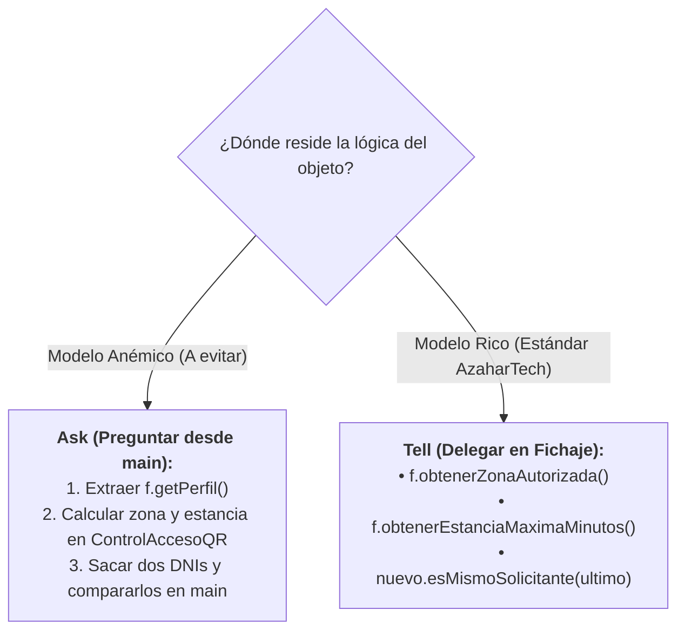

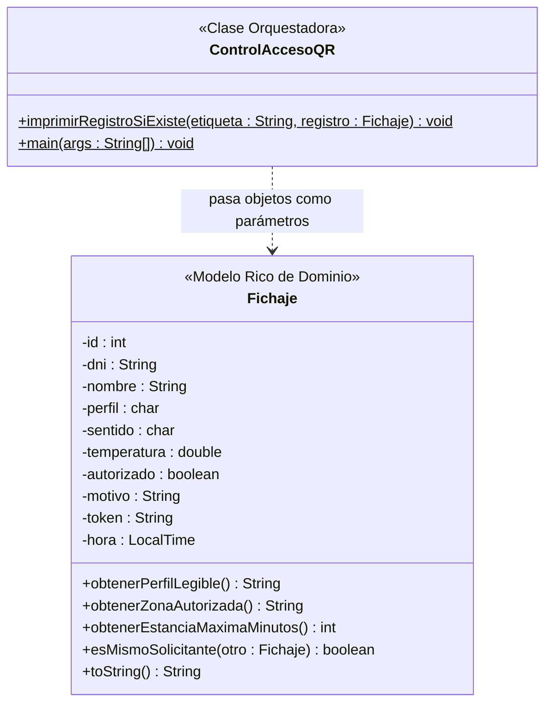

##### B. Paso de objetos como parámetros: paso por valor de la referencia

En Java, **todos** los parámetros se pasan **por valor**. Sin embargo, en el caso de los objetos, lo que se copia en la pila del método llamado es **el valor de la dirección de memoria (la referencia)** que apunta al objeto en el *Heap*.

Esto produce dos consecuencias fundamentales que debes dominar:

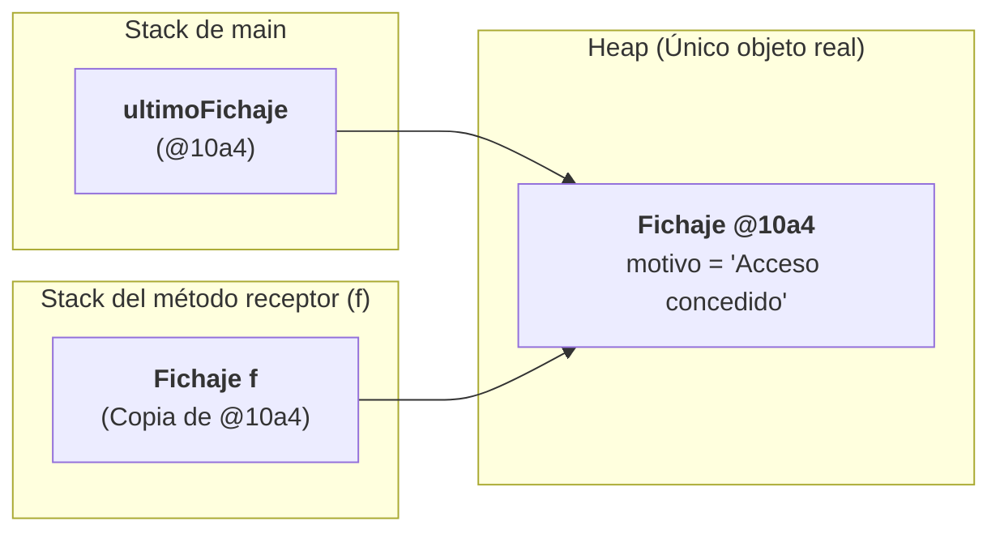

1. **Los cambios sobre el estado del objeto SÍ persisten:** Si dentro de un método ejecutas `f.setMotivo("Rectificado")`, estás modificando el objeto real del *Heap*, por lo que `ultimoFichaje` en `main` verá ese cambio.
2. **Reasignar el parámetro NO afecta a la variable original:** Si dentro del método escribes `f = null;` o `f = new Fichaje(...)`, solo cambias hacia dónde apunta la copia local `f` en la pila del método; `ultimoFichaje` en `main` seguirá apuntando imperturbable al objeto `@10a4`.

##### C. El método universal `toString()` y la anotación `@Override`

Todas las clases que creamos en Java descienden automáticamente de una clase raíz universal llamada **`Object`**, la cual posee un método llamado `toString()`. Por defecto, ese método heredado devuelve `NombreClase@codigoHexadecimal` (la identidad en memoria).

Cuando queremos que un objeto se imprima de forma legible al pasarlo directamente a `System.out.println(objeto)` o al concatenarlo con un `String` (`"Registro: " + objeto`), **sobrescribimos** ese método con la firma exacta `public String toString()`:

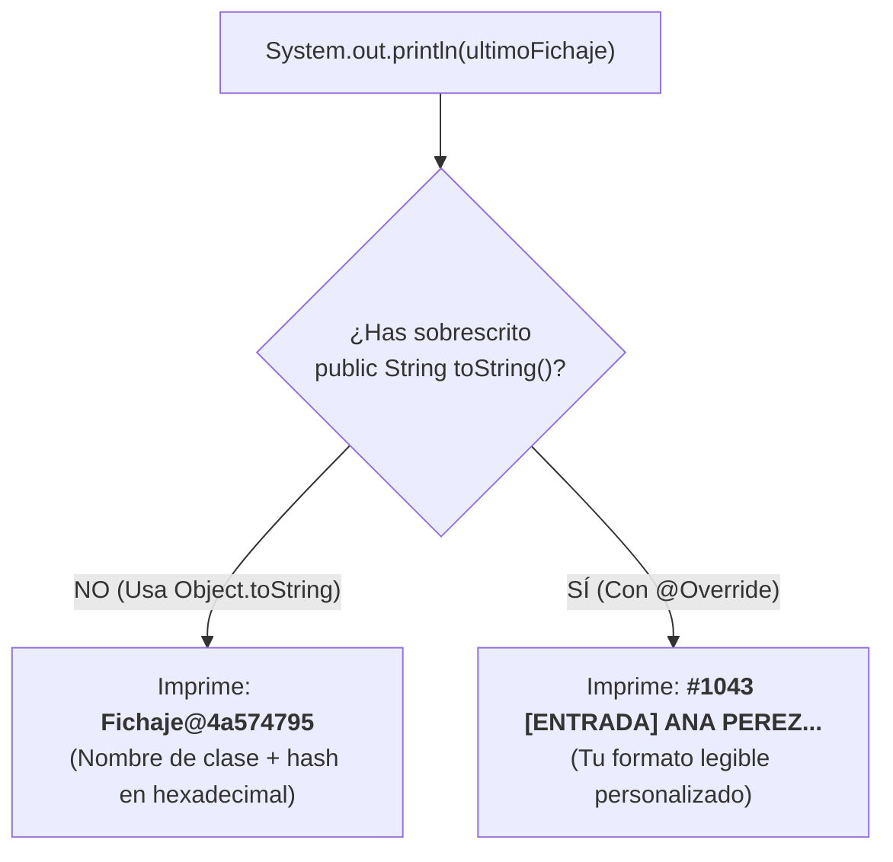

La anotación **`@Override`** colocada justo encima del método actúa como un seguro ante errores tipográficos: indica al compilador que nuestra intención es redefinir un método estándar de Java (si escribieras `tostring()` en minúscula por error, `javac` avisará de inmediato en lugar de ignorarlo).

##### D. Comparación segura entre dos objetos (`otro == null`)

Cuando un método de instancia recibe otro objeto de su misma clase para compararse (por ejemplo, `public boolean esMismoSolicitante(Fichaje otro)`), debe blindarse siempre comprobando que la referencia entrante no sea `null` antes de acceder a sus atributos o métodos:

```java
public boolean esMismoSolicitante(Fichaje otro) {
    boolean mismo = false;
    if (otro != null && !this.dni.equals("N/D")) {
        mismo = this.dni.equals(otro.getDni());
    }
    return mismo;
}
```

---

#### 3. Evolución del caso guía a `ControlAccesoQR v3.4` (Java nativo)

Evolucionamos la versión `v3.3` a la **`v3.4`**, consolidando el cierre de la Semana 10:
1. **`Fichaje.java` se convierte en un modelo rico:** Incorpora `obtenerZonaAutorizada()`, `obtenerEstanciaMaximaMinutos()` y el método comparativo `esMismoSolicitante(Fichaje otro)` con guardia contra `null`.
2. **Sustitución de `describir()` por `@Override public String toString()`:** Ahora basta imprimir o concatenar cualquier objeto `Fichaje` directamente en consola y en el depurador de IntelliJ.
3. **`ControlAccesoQR.java` más ligero:** Se eliminan los métodos estáticos desplazados a `Fichaje`, se añade el método auxiliar `imprimirRegistroSiExiste(String etiqueta, Fichaje registro)` (demostrando el paso de objetos como parámetros) y se activa la alerta de doble fichaje anti-rebote en la Opción 1.

##### A. Comparativa de cambios respecto a v3.3 (`diff`)

```diff
  // =========================================================================
  // ARCHIVO: pr/src/Fichaje.java
  // =========================================================================
+ public String obtenerZonaAutorizada() { ... }          // Movido desde ControlAccesoQR
+ public int obtenerEstanciaMaximaMinutos() { ... }      // Movido desde ControlAccesoQR
+
+ public boolean esMismoSolicitante(Fichaje otro) {      // Comparación entre objetos
+     boolean mismo = false;
+     if (otro != null && !this.dni.equals("N/D")) {
+         mismo = this.dni.equals(otro.getDni());
+     }
+     return mismo;
+ }
+
- public String describir() {
+ @Override
+ public String toString() {
      // ... formato completo del fichaje ...
  }

  // =========================================================================
  // ARCHIVO: pr/src/ControlAccesoQR.java (v3.4)
  // =========================================================================
- public static String determinarZonaAutorizada(char perfil) { ... }      // Ya vive en Fichaje
- public static int obtenerEstanciaMaximaPorPerfil(char perfil) { ... }  // Ya vive en Fichaje

+ public static void imprimirRegistroSiExiste(String etiqueta, Fichaje registro) {
+     if (registro != null) {
+         System.out.println(etiqueta + registro); // Invoca toString() automáticamente
+     } else {
+         System.out.println(etiqueta + "(sin registros en esta sesión)");
+     }
+ }

  case 1:
+     if (nuevoFichaje.esMismoSolicitante(ultimoFichaje) && nuevoFichaje.getSentido() == ultimoFichaje.getSentido()) {
+         System.out.println(">> AVISO ANTI-REBOTE: El DNI coincide con el fichaje inmediatamente anterior.");
+     }
+     if (nuevoFichaje.isAutorizado()) {
+         System.out.printf("   Zona autorizada: %s (Estancia máx: %d min)%n",
+                 nuevoFichaje.obtenerZonaAutorizada(), nuevoFichaje.obtenerEstanciaMaximaMinutos());
+     }
-     System.out.println(">> Objeto Fichaje protegido: " + nuevoFichaje.describir());
+     System.out.println(">> Objeto Fichaje registrado: " + nuevoFichaje);

  case 3:
-     if (ultimoFichaje != null) { ... }
+     imprimirRegistroSiExiste("ÚLTIMO FICHAJE:           ", ultimoFichaje);
+     imprimirRegistroSiExiste("PENÚLTIMO FICHAJE:        ", penultimoFichaje);
```

##### B. Foco en la novedad: comportamiento rico, `toString()` y paso de objetos

Observa cómo se simplifica el uso del objeto al delegar en él sus reglas de negocio y la presentación de su cadena:

```java
// -------------------------------------------------------------------------
// Fragmento en Fichaje.java (v3.4): Comportamiento propio e igualdad de DNI
// -------------------------------------------------------------------------
public boolean esMismoSolicitante(Fichaje otro) {
    boolean mismo = false;
    if (otro != null && !this.dni.equals("N/D")) {
        mismo = this.dni.equals(otro.getDni());
    }
    return mismo;
}

@Override
public String toString() {
    String detalleRol = (this.sentido == 'S') ? "Tránsito exterior" : obtenerPerfilLegible();
    return String.format("#%d [%s] %s (%s) | %s | %s | %s",
            this.id,
            this.sentido == 'S' ? "SALIDA" : "ENTRADA",
            this.nombre,
            detalleRol,
            this.autorizado ? "AUTORIZADO" : "DENEGADO",
            this.motivo,
            this.hora.withNano(0));
}

// -------------------------------------------------------------------------
// Fragmento en ControlAccesoQR.java (v3.4): Método que recibe un objeto
// -------------------------------------------------------------------------
public static void imprimirRegistroSiExiste(String etiqueta, Fichaje registro) {
    if (registro != null) {
        // Concatenar o imprimir directamente un objeto invoca su toString()
        System.out.println(etiqueta + registro);
    } else {
        System.out.println(etiqueta + "(sin registros en esta sesión)");
    }
}
```

##### C. Código fuente completo integrado

<details>
<summary><b>🔍 Desplegar archivos completos: Fichaje.java y ControlAccesoQR.java (v3.4)</b></summary>

**Archivo 1: `pr/src/Fichaje.java`**
```java
/**
 * ENTIDAD DE DOMINIO: REGISTRO DE FICHAJE EN TORNO
 * Cliente: IES El Caminàs (Castellón de la Plana)
 * Consultora: AzaharTech Software Consulting
 *
 * Versión 3.4:
 * Cierre de la Semana 10 (Modelo Rico de Dominio):
 * - Encapsula la lógica de asignación de zonas y estancias máximas según el perfil.
 * - Incorpora comparación segura entre instancias mediante esMismoSolicitante(Fichaje).
 * - Sobrescribe @Override toString() para representación estándar en consola y debugger.
 * Mantiene encapsulación estricta (private/public), constructores sobrecargados y setters defensivos.
 *
 * @author Equipo AzaharTech (Alba Torres, Pau Ferrer, Laia Claramunt)
 * @version 3.4 (Noviembre 2026)
 * @since JDK 21 LTS
 */

import java.time.LocalTime;

public class Fichaje {

    // -------------------------------------------------------------------------
    // 1. ATRIBUTOS PRIVADOS (Ocultación estricta del estado interno en Heap)
    // -------------------------------------------------------------------------
    private int id;
    private String dni;
    private String nombre;
    private char perfil;
    private char sentido;
    private double temperatura;
    private boolean autorizado;
    private String motivo;
    private String token;
    private LocalTime hora;

    // -------------------------------------------------------------------------
    // 2. CONSTRUCTORES SOBRECARGADOS (Validación centralizada vía setters)
    // -------------------------------------------------------------------------

    /**
     * Constructor maestro completo para registrar entradas detalladas.
     */
    public Fichaje(int id, String dni, String nombre, char perfil, char sentido,
                   double temperatura, boolean autorizado, String motivo, String token) {
        this.id = Math.max(0, id);
        this.dni = (dni == null || dni.isBlank()) ? "N/D" : dni.trim().toUpperCase();
        this.setNombre(nombre);
        this.perfil = perfil;
        this.sentido = (sentido == 'S') ? 'S' : 'E';
        this.setTemperatura(temperatura);
        this.autorizado = autorizado;
        this.setMotivo(motivo);
        this.token = (token == null || token.isBlank()) ? "N/D" : token;
        this.hora = LocalTime.now();
    }

    /**
     * Constructor sobrecargado simplificado para tránsitos de salida ('S').
     */
    public Fichaje(int id, String nombre, char sentido, boolean autorizado, String motivo) {
        this(id, "N/D", nombre, '?', sentido, 0.0, autorizado, motivo, "N/D");
    }

    // -------------------------------------------------------------------------
    // 3. MÉTODOS DE ACCESO: GETTERS (Lectura controlada JavaBeans)
    // -------------------------------------------------------------------------

    public int getId() {
        return this.id;
    }

    public String getDni() {
        return this.dni;
    }

    public String getNombre() {
        return this.nombre;
    }

    public char getPerfil() {
        return this.perfil;
    }

    public char getSentido() {
        return this.sentido;
    }

    public double getTemperatura() {
        return this.temperatura;
    }

    public boolean isAutorizado() {
        return this.autorizado;
    }

    public String getMotivo() {
        return this.motivo;
    }

    public String getToken() {
        return this.token;
    }

    public LocalTime getHora() {
        return this.hora;
    }

    // -------------------------------------------------------------------------
    // 4. MÉTODOS MODIFICADORES: SETTERS SELECTIVOS DEFENSIVOS
    // -------------------------------------------------------------------------

    public void setNombre(String nombre) {
        if (nombre == null || nombre.trim().isEmpty()) {
            this.nombre = "N/D";
        } else {
            this.nombre = nombre.trim().toUpperCase();
        }
    }

    public void setTemperatura(double temperatura) {
        if (temperatura >= 0.0 && temperatura <= 60.0) {
            this.temperatura = temperatura;
        } else {
            this.temperatura = 0.0;
        }
    }

    public void setMotivo(String motivo) {
        if (motivo == null || motivo.trim().isEmpty()) {
            this.motivo = "Sin evaluar";
        } else {
            this.motivo = motivo.trim();
        }
    }

    // -------------------------------------------------------------------------
    // 5. MÉTODOS DE COMPORTAMIENTO RICO (Reglas de negocio propias de la entidad)
    // -------------------------------------------------------------------------

    public String obtenerPerfilLegible() {
        String descripcion;
        switch (this.perfil) {
            case 'E':
                descripcion = "Estudiante Oficial";
                break;
            case 'D':
                descripcion = "Docente / Claustro";
                break;
            case 'V':
                descripcion = "Visita Externa / Proveedor";
                break;
            case 'A':
                descripcion = "Personal de Administración y Servicios (PAS)";
                break;
            default:
                descripcion = "No especificado";
                break;
        }
        return descripcion;
    }

    /**
     * Determina la zona del campus autorizada para el perfil de este fichaje.
     */
    public String obtenerZonaAutorizada() {
        String zona;
        switch (this.perfil) {
            case 'E':
                zona = "Aulas Docentes y Talleres de Informática";
                break;
            case 'D':
                zona = "Departamentos Didácticos, Aulas y Sala de Profesores";
                break;
            case 'V':
                zona = "Secretaría, Conserjería y Despachos de Dirección";
                break;
            case 'A':
                zona = "Área de Gestión Administrativa y Archivo Central";
                break;
            default:
                zona = "Acceso Denegado / Zona No Autorizada";
                break;
        }
        return zona;
    }

    /**
     * Devuelve el límite de minutos de estancia permitido según el perfil de este fichaje.
     */
    public int obtenerEstanciaMaximaMinutos() {
        int estanciaMinutos;
        switch (this.perfil) {
            case 'E':
                estanciaMinutos = 360;
                break;
            case 'D':
                estanciaMinutos = 480;
                break;
            case 'V':
                estanciaMinutos = 120;
                break;
            case 'A':
                estanciaMinutos = 420;
                break;
            default:
                estanciaMinutos = 0;
                break;
        }
        return estanciaMinutos;
    }

    /**
     * Compara este fichaje con otro recibido como parámetro para detectar si comparten
     * el mismo DNI válido (útil para prevenir lecturas duplicadas o rebotes en tornos).
     */
    public boolean esMismoSolicitante(Fichaje otro) {
        boolean mismo = false;
        if (otro != null && !this.dni.equals("N/D")) {
            mismo = this.dni.equals(otro.getDni());
        }
        return mismo;
    }

    /**
     * Redefinición estándar de Object.toString() invocada automáticamente por Java
     * al imprimir el objeto o inspeccionarlo en el depurador.
     */
    @Override
    public String toString() {
        String detalleRol = (this.sentido == 'S') ? "Tránsito exterior" : obtenerPerfilLegible();
        return String.format("#%d [%s] %s (%s) | %s | %s | %s",
                this.id,
                this.sentido == 'S' ? "SALIDA" : "ENTRADA",
                this.nombre,
                detalleRol,
                this.autorizado ? "AUTORIZADO" : "DENEGADO",
                this.motivo,
                this.hora.withNano(0));
    }
}
```

**Archivo 2: `pr/src/ControlAccesoQR.java` (v3.4)**
```java
/**
 * SISTEMA DE CONTROL DE ASISTENCIA POR CÓDIGO QR
 * Cliente: IES El Caminàs (Castellón de la Plana)
 * Consultora: AzaharTech Software Consulting
 * 
 * Versión 3.4:
 * Cierre de la Semana 10 (Sprint 4: «Arquitectos de software»).
 * Aligera el orquestador delegando zona y estancia máxima en la entidad Fichaje.
 * Incorpora paso de objetos como parámetros (imprimirRegistroSiExiste), detección
 * anti-rebote comparando instancias y uso implícito de @Override toString().
 * Mantiene el cumplimiento estricto del principio SESE y blindaje try-catch.
 * 
 * @author Equipo AzaharTech (Alba Torres, Pau Ferrer, Laia Claramunt)
 * @version 3.4 (Noviembre 2026)
 * @since JDK 21 LTS
 * 
 */

import java.util.Scanner;
import java.util.Random;
import java.time.LocalTime;
import java.time.LocalDate;
import java.time.Duration;

public class ControlAccesoQR {

    // -------------------------------------------------------------------------
    // 1. CONSTANTES INMUTABLES DEL SISTEMA (configuración corporativa)
    // -------------------------------------------------------------------------
    final static String NOMBRE_CENTRO = "IES El Caminàs (Castellón)";
    final static String PREFIJO_CENTRO = "CAMINAS";
    final static String RUTA_LOGS = ".\\caminas\\terminal\\logs";

    final static int MINUTOS_POR_HORA = 60;
    final static int SEGUNDOS_POR_HORA = 3600;
    final static int SEGUNDOS_POR_MINUTO = 60;
    final static int JORNADA_BASE_MINUTOS = 480; // 8 horas
    final static double FACTOR_PORCENTAJE = 100.0;

    final static int ID_TERMINAL_PUERTA_NORTE = 102;
    final static int BASE_TOKEN_SEGURIDAD = 1000;
    final static int RANGO_TOKEN_SEGURIDAD = 9000;
    final static long SEMILLA_CALIBRACION = 987654321L;

    final static double TEMP_MIN_SEGURA = 15.0;
    final static double TEMP_MAX_SEGURA = 35.0;
    final static double MAX_VARIACION_TERMICA = 0.5;
    final static int LONGITUD_DNI_ESTANDAR = 9;

    // Umbrales biométricos y capacidad
    final static double TEMP_CORPORAL_MAX_FIEBRE = 37.5;
    final static double TEMP_CORPORAL_MIN_FALLO = 35.0;

    // Control de puntualidad y hardware perimetral
    final static LocalTime HORA_LIMITE_PUNTUALIDAD = LocalTime.of(8, 15);
    final static int NUM_SENSORES_TORNO = 8;
    final static int HORAS_TURNO_LECTIVO = 6;
    final static int TOTAL_TORNOS_CAMPUS = 3;
    final static int CANALES_POR_TORNO = 4;

    // -------------------------------------------------------------------------
    // 2. MÉTODOS ESTÁTICOS AUXILIARES DEL ORQUESTADOR
    // -------------------------------------------------------------------------

    public static int calcularEstanciaMinutos(LocalTime entrada, LocalTime salida) {
        return (int) Duration.between(entrada, salida).toMinutes();
    }

    public static double calcularPorcentajeOcupacion(int personas, int aforoTotal) {
        return ((double) personas / aforoTotal) * FACTOR_PORCENTAJE;
    }

    public static String construirTokenQR(String prefijo, String dni, int terminalId, int codigoSec, int idFichaje) {
        String token = prefijo + "-" + dni;
        token += "-T" + terminalId;
        token += "-SEC#" + codigoSec;
        token += "-REG" + idFichaje;
        return token;
    }

    public static double calcularDistanciaDiagonal(double x, double y) {
        return Math.sqrt(Math.pow(x, 2.0) + Math.pow(y, 2.0));
    }

    /**
     * Método auxiliar que recibe un objeto Fichaje como parámetro (paso por valor
     * de la referencia) y lo imprime con guardia contra null usando su toString().
     */
    public static void imprimirRegistroSiExiste(String etiqueta, Fichaje registro) {
        if (registro != null) {
            System.out.println(etiqueta + registro);
        } else {
            System.out.println(etiqueta + "(sin registros en esta sesión)");
        }
    }

    // -------------------------------------------------------------------------
    // 3. MÉTODOS PREDICADO BOOLEANOS (reglas de negocio desacopladas)
    // -------------------------------------------------------------------------

    public static boolean esTemperaturaCorporalSegura(double temperatura) {
        return (temperatura >= TEMP_CORPORAL_MIN_FALLO && temperatura <= TEMP_CORPORAL_MAX_FIEBRE);
    }

    public static boolean esDocumentoValido(String dni) {
        return (dni != null && dni.length() == LONGITUD_DNI_ESTANDAR);
    }

    public static boolean esPerfilAutorizado(char perfil) {
        boolean autorizado;
        switch (perfil) {
            case 'E':
            case 'D':
            case 'V':
            case 'A':
                autorizado = true;
                break;
            default:
                autorizado = false;
                break;
        }
        return autorizado;
    }

    // -------------------------------------------------------------------------
    // 4. MÉTODO PRINCIPAL: CONSOLA INTEGRAL v3.4 (MODELO RICO Y toString)
    // -------------------------------------------------------------------------
    public static void main(String[] args) {
        Scanner teclado = new Scanner(System.in);

        Random generadorVestibulo = new Random();

        LocalDate fechaActual = LocalDate.now();

        // Estado persistente del campus
        int personasEnCentro = 1190;
        int aforoDisponible = 10;
        int idUltimoFichaje = 1042;

        int totalFichajesProcesados = 0;
        int totalFichajesAutorizados = 0;
        int totalFichajesDenegados = 0;

        // Referencias a objetos Fichaje: nacen a null (todavía no hay tránsitos)
        Fichaje ultimoFichaje = null;
        Fichaje penultimoFichaje = null;

        // Acumuladores estadísticos
        double tempMaximaRegistrada = -1.0;
        double tempMinimaRegistrada = 100.0;
        int minutosEstanciaAcumulados = 0;

        boolean sesionActiva = true;

        System.out.println("======================================================================");
        System.out.println("   AZAHARTECH · CONTROL INTEGRAL DE ACCESOS - IES EL CAMINÀS          ");
        System.out.println("   Versión 3.4 (Sprint 4: Modelo Rico, Paso de Objetos y toString)    ");
        System.out.println("   Fecha de sesión: " + fechaActual);
        System.out.println("======================================================================");

        // BUCLE PRINCIPAL DE GESTIÓN (MENÚ DE OPERACIONES)
        do {
            System.out.println("\n----------------------------------------------------------------------");
            System.out.println("                    PANEL DE OPERACIONES DEL TORNO                    ");
            System.out.println("----------------------------------------------------------------------");
            System.out.println("  [1] Registrar tránsito individual (construcción y anti-rebote)");
            System.out.println("  [2] Procesar cola en ráfaga (Modo Burst con parada en cabecera)");
            System.out.println("  [3] Consultar telemetría y auditoría de últimos fichajes");
            System.out.println("  [4] Diagnóstico perimetral estructurado SESE (3 tornos x 4 canales)");
            System.out.println("  [5] Activar protocolo de evacuación de emergencia");
            System.out.println("  [6] Cerrar jornada y apagar terminal");
            System.out.print("Seleccione una operación (1-6): ");

            int opcionMenu = 0;
            try {
                opcionMenu = Integer.parseInt(teclado.nextLine().trim());
            } catch (NumberFormatException e) {
                opcionMenu = -1;
            }

            switch (opcionMenu) {
                case 1:
                    // TRÁNSITO INDIVIDUAL CON MODELO RICO Y DETECCIÓN ANTI-REBOTE
                    totalFichajesProcesados++;
                    System.out.println("\n--- [MODO 1: TRÁNSITO INDIVIDUAL] ---");
                    System.out.print("Sentido del tránsito (E = Entrada, S = Salida): ");
                    String lineaSentido = teclado.nextLine().trim().toUpperCase();
                    char sentidoTransito = lineaSentido.isEmpty() ? 'E' : lineaSentido.charAt(0);

                    System.out.print("Nombre completo: ");
                    String nombreCapturado = teclado.nextLine().trim().toUpperCase();
                    String nombreLimpio = nombreCapturado.isEmpty() ? "N/D" : nombreCapturado;

                    Fichaje nuevoFichaje;

                    if (sentidoTransito == 'S') {
                        boolean salidaAutorizada;
                        String motivoSalida;

                        if (personasEnCentro > 0) {
                            personasEnCentro--;
                            aforoDisponible++;
                            totalFichajesAutorizados++;
                            idUltimoFichaje++;
                            salidaAutorizada = true;
                            motivoSalida = "Salida registrada";
                            System.out.println(">> VEREDICTO: [SALIDA AUTORIZADA] Torno exterior abierto.");
                        } else {
                            totalFichajesDenegados++;
                            salidaAutorizada = false;
                            motivoSalida = "Recinto vacío";
                            System.err.println(">> ALERTA: Imposible autorizar salida; recinto vacío.");
                        }

                        nuevoFichaje = new Fichaje(idUltimoFichaje, nombreLimpio, 'S', salidaAutorizada, motivoSalida);
                    } else {
                        int terminalId = 0;
                        double tempVestibulo = 0.0;
                        String dniPersonaLimpio = "N/D";
                        char perfilNormalizado = '?';
                        boolean datosSintacticamenteCorrectos = true;
                        String motivoDenegacion = "";

                        try {
                            System.out.print("ID Terminal: ");
                            terminalId = Integer.parseInt(teclado.nextLine().trim());
                            System.out.print("Temperatura (ºC): ");
                            tempVestibulo = Double.parseDouble(teclado.nextLine().trim());
                            System.out.print("DNI: ");
                            dniPersonaLimpio = teclado.nextLine().trim().toUpperCase();
                            System.out.print("Perfil (E/D/V/A): ");
                            String lineaPerfil = teclado.nextLine().trim();
                            perfilNormalizado = lineaPerfil.isEmpty() ? '?' : Character.toUpperCase(lineaPerfil.charAt(0));
                        } catch (NumberFormatException e) {
                            datosSintacticamenteCorrectos = false;
                            motivoDenegacion = "Error de formato numérico.";
                        }

                        boolean accesoConcedido;
                        if (!datosSintacticamenteCorrectos) {
                            accesoConcedido = false;
                            totalFichajesDenegados++;
                        } else if (!esTemperaturaCorporalSegura(tempVestibulo)) {
                            accesoConcedido = false;
                            motivoDenegacion = "Temperatura anómala.";
                            totalFichajesDenegados++;
                        } else if (aforoDisponible <= 0) {
                            accesoConcedido = false;
                            motivoDenegacion = "Aforo completo.";
                            totalFichajesDenegados++;
                        } else if (!esDocumentoValido(dniPersonaLimpio)) {
                            accesoConcedido = false;
                            motivoDenegacion = "DNI no reglamentario.";
                            totalFichajesDenegados++;
                        } else if (!esPerfilAutorizado(perfilNormalizado)) {
                            accesoConcedido = false;
                            motivoDenegacion = "Perfil no catalogado.";
                            totalFichajesDenegados++;
                        } else {
                            accesoConcedido = true;
                            totalFichajesAutorizados++;
                            personasEnCentro++;
                            aforoDisponible--;
                            idUltimoFichaje++;

                            tempMaximaRegistrada = Math.max(tempMaximaRegistrada, tempVestibulo);
                            tempMinimaRegistrada = Math.min(tempMinimaRegistrada, tempVestibulo);
                            minutosEstanciaAcumulados += 360;
                        }

                        int codigoToken = BASE_TOKEN_SEGURIDAD + generadorVestibulo.nextInt(RANGO_TOKEN_SEGURIDAD);
                        String token = construirTokenQR(PREFIJO_CENTRO, dniPersonaLimpio, terminalId, codigoToken, idUltimoFichaje);
                        System.out.printf(">> VEREDICTO: %s [Token: %s]%n",
                                accesoConcedido ? "[ENTRADA AUTORIZADA]" : "[ENTRADA DENEGADA - " + motivoDenegacion + "]", token);

                        String motivoFinal = accesoConcedido ? "Acceso concedido" : motivoDenegacion;

                        nuevoFichaje = new Fichaje(idUltimoFichaje, dniPersonaLimpio, nombreLimpio,
                                perfilNormalizado, 'E', tempVestibulo, accesoConcedido, motivoFinal, token);

                        // Delegación en la propia entidad para zona y estancia máxima (Tell, Don't Ask)
                        if (nuevoFichaje.isAutorizado()) {
                            System.out.printf("   Zona asignada: %s (Estancia máx: %d min)%n",
                                    nuevoFichaje.obtenerZonaAutorizada(), nuevoFichaje.obtenerEstanciaMaximaMinutos());
                        }

                        // Comparación entre objetos pasados por parámetro (detección anti-rebote)
                        if (nuevoFichaje.esMismoSolicitante(ultimoFichaje)
                                && nuevoFichaje.getSentido() == ultimoFichaje.getSentido()) {
                            System.out.println(">> AVISO ANTI-REBOTE: El DNI " + nuevoFichaje.getDni()
                                    + " coincide con el tránsito inmediatamente anterior.");
                        }
                    }

                    penultimoFichaje = ultimoFichaje;
                    ultimoFichaje = nuevoFichaje;
                    // Al imprimir el objeto directamente se invoca automáticamente toString()
                    System.out.println(">> Objeto Fichaje registrado: " + nuevoFichaje);
                    break;

                case 2:
                    // RÁFAGA DE COLA CON GUARDIA EN CABECERA (PRINCIPIO SESE)
                    System.out.println("\n--- [MODO 2: RÁFAGA CON PARADA ESTRUCTURADA EN CABECERA] ---");
                    System.out.print("Personas en cola para esta ráfaga: ");
                    int personasEnCola = 0;
                    try {
                        personasEnCola = Integer.parseInt(teclado.nextLine().trim());
                    } catch (NumberFormatException e) {
                        personasEnCola = 0;
                    }

                    boolean vetoJudicialDetectado = false;

                    while (personasEnCola > 0 && aforoDisponible > 0 && !vetoJudicialDetectado) {
                        if (idUltimoFichaje == 1044) {
                            System.out.println(">> [ALERTA JUDICIAL]: Credencial bloqueada. Suspendiendo cola en cabecera...");
                            vetoJudicialDetectado = true;
                        } else {
                            totalFichajesProcesados++;
                            totalFichajesAutorizados++;
                            personasEnCentro++;
                            aforoDisponible--;
                            idUltimoFichaje++;
                            personasEnCola--;

                            double tempSimulada = 36.4 + (generadorVestibulo.nextDouble() * 0.5);
                            tempMaximaRegistrada = Math.max(tempMaximaRegistrada, tempSimulada);
                            tempMinimaRegistrada = Math.min(tempMinimaRegistrada, tempSimulada);
                            minutosEstanciaAcumulados += 360;
                        }
                    }
                    System.out.printf(">> Estado tras ráfaga. Plazas disponibles: %d | Restantes en cola: %d%n",
                            aforoDisponible, personasEnCola);
                    break;

                case 3:
                    // MONITOR DE TELEMETRÍA EN VIVO Y PASO DE OBJETOS A MÉTODO AUXILIAR
                    System.out.println("\n--- [MODO 3: MONITOR DE TELEMETRÍA EN VIVO] ---");
                    int aforoTotal = personasEnCentro + aforoDisponible;
                    double porcentajeOcupacion = calcularPorcentajeOcupacion(personasEnCentro, aforoTotal);
                    double estanciaMedia = totalFichajesAutorizados > 0 
                            ? ((double) minutosEstanciaAcumulados / totalFichajesAutorizados) : 0.0;

                    System.out.printf("OCUPACIÓN ACTUAL:         %d/%d personas (%6.2f %%)%n", personasEnCentro, aforoTotal, porcentajeOcupacion);
                    System.out.printf("PLAZAS LIBRES:            %d vacantes disponibles%n", aforoDisponible);
                    System.out.printf("TRANSACCIONES TOTALES:    %d registros (%d autorizados, %d denegados)%n",
                            totalFichajesProcesados, totalFichajesAutorizados, totalFichajesDenegados);
                    System.out.printf("PICO TÉRMICO MÁXIMO:      %.1f ºC%n", Math.max(0.0, tempMaximaRegistrada));
                    System.out.printf("PICO TÉRMICO MÍNIMO:      %.1f ºC%n", tempMinimaRegistrada > 50.0 ? 0.0 : tempMinimaRegistrada);
                    System.out.printf("ESTANCIA PROMEDIO:        %.1f minutos (Total acumulado: %d min)%n",
                            estanciaMedia, minutosEstanciaAcumulados);

                    // Paso de los objetos Fichaje como argumentos al método auxiliar
                    imprimirRegistroSiExiste("ÚLTIMO FICHAJE:           ", ultimoFichaje);
                    imprimirRegistroSiExiste("PENÚLTIMO FICHAJE:        ", penultimoFichaje);
                    break;

                case 4:
                    // DIAGNÓSTICO SECUENCIAL Y MATRIZ PERIMETRAL SESE
                    System.out.println("\n--- [MODO 4: INSPECCIÓN PERIMETRAL ESTRUCTURADA (SESE)] ---");
                    boolean alarmaSabotajeDetectada = false;

                    for (int torno = 1; torno <= TOTAL_TORNOS_CAMPUS && !alarmaSabotajeDetectada; torno++) {
                        String nombreAcceso = switch (torno) {
                            case 1 -> "Vestíbulo Central  | ";
                            case 2 -> "Puerta Norte Ciclos| ";
                            case 3 -> "Puerta Sur Talleres| ";
                            default -> "Acceso Perimetral  | ";
                        };
                        System.out.print(nombreAcceso);

                        for (int canal = 1; canal <= CANALES_POR_TORNO && !alarmaSabotajeDetectada; canal++) {
                            if (torno == 2 && canal == 2) {
                                System.out.print("[REVISIÓN] ");
                            } else {
                                boolean falloCritico = (torno == 3 && canal == 2 && false);

                                if (falloCritico) {
                                    System.out.print("[SABOTAJE] ");
                                    alarmaSabotajeDetectada = true;
                                } else {
                                    System.out.printf("[C%d: OK]   ", canal);
                                }
                            }
                        }
                        System.out.println();
                    }

                    if (alarmaSabotajeDetectada) {
                        System.out.println(">> [ALERTA DE SEGURIDAD]: Barrido perimetral detenido por fallo crítico.");
                    }
                    System.out.println("-------------------------------------------------------------------");
                    break;

                case 5:
                    // PROTOCOLO DE EVACUACIÓN CON WHILE DE DRENAJE
                    System.out.println("\n--- [MODO 5: PROTOCOLO DE EVACUACIÓN DE EMERGENCIA] ---");
                    if (personasEnCentro == 0) {
                        System.out.println(">> El campus ya se encuentra completamente vacío.");
                    } else {
                        int loteSalidaSimultanea = 300;
                        int oleada = 1;

                        while (personasEnCentro > 0) {
                            int evacuadosLote = Math.min(personasEnCentro, loteSalidaSimultanea);
                            personasEnCentro -= evacuadosLote;
                            aforoDisponible += evacuadosLote;

                            System.out.printf("  -> Oleada #%d: Desalojadas %d personas por salidas de emergencia (Ocupantes restantes: %d)%n",
                                    oleada, evacuadosLote, personasEnCentro);
                            oleada++;
                        }
                        System.out.println(">> CERTIFICACIÓN DE SEGURIDAD: Recinto 100% desalojado. Aforo íntegro restaurado.");
                    }
                    break;

                case 6:
                    // APAGADO Y SALIDA
                    System.out.println("\n>> Desconectando terminal de presencia de forma ordenada...");
                    sesionActiva = false;
                    break;

                default:
                    System.err.println(">> Error: Opción no válida. Seleccione una operación entre 1 y 6.");
                    break;
            }

        } while (sesionActiva);

        // AUDITORÍA FINAL AL APAGAR
        System.out.println("\n======================================================================");
        System.out.println("          AUDITORÍA FINAL DE LA JORNADA · IES EL CAMINÀS              ");
        System.out.println("======================================================================");
        System.out.printf("TOTAL OPERACIONES GESTIONADAS: %d%n", totalFichajesProcesados);
        System.out.printf("ACCESOS AUTORIZADOS (TOTAL):   %d%n", totalFichajesAutorizados);
        System.out.printf("ACCESOS DENEGADOS (BLOQUEO):   %d%n", totalFichajesDenegados);
        System.out.printf("OCUPACIÓN FINAL REGISTRADA:    %d personas%n", personasEnCentro);
        System.out.println("ESTADO DEL DISPOSITIVO:        Terminal desconectado de forma segura.");
        System.out.println("======================================================================");

        teclado.close();
    }
}
```

</details>

---

#### 4. Segunda sesión: dojo de entrenamiento y katas de código

En esta sesión de cierre de la Semana 10, cada alumno transformará su entidad en un modelo rico dotándola de `@Override toString()` y de métodos capaces de interactuar con otros objetos recibidos como parámetro.

##### Kata 1 (Cinturón blanco / Nivel base). Comportamiento rico, `toString()` e interacción entre objetos

Abre la clase entidad de tu proyecto en `pr/src/`, reescribe el método de presentación utilizando `@Override public String toString()` e implementa un método de instancia que reciba **otro objeto de tu misma clase como parámetro** (con guardia contra `null`) para operar o compararse con él:

* **Aventura conversacional.** En `Personaje.java`, sustituye tu método descriptivo por `@Override toString()`. Implementa un método de combate que reciba a otro `Personaje` como parámetro para restarle puntos de salud en función del ataque propio y comprueba desde `MiProyecto.java` que la salud del objetivo muta en el *Heap*, añadiendo además un método en `MiProyecto` que imprima el estado de cualquier personaje pasado por parámetro.
* **Motor de recomendación.** En `Item.java`, implementa `@Override toString()` para mostrar su ficha de catálogo al imprimir el objeto. Añade un método que reciba otro `Item` por parámetro y devuelva un booleano indicando si el actual tiene mayor valoración media que el recibido (protegiendo el caso `otro == null`), utilizándolo desde `MiProyecto.java` para comparar dos contenidos.
* **Simulador de físicas 2D.** En `Bola.java`, redefine `@Override toString()` con sus coordenadas y velocidad formateadas. Crea un método que reciba otra `Bola` como parámetro y calcule la distancia euclídea entre ambos centros mediante `Math.sqrt` y `Math.pow`, evaluando desde `MiProyecto.java` si dos móviles están próximos a colisionar.
* **Bóveda de contraseñas.** En `Credencial.java`, implementa `@Override toString()` mostrando el resumen enmascarado del registro. Añade un método que reciba otra `Credencial` como parámetro para detectar si comparten el mismo nombre de servicio o el mismo identificador de usuario (alerta de reutilización de identidad), probándolo con dos objetos desde `MiProyecto.java`.

---

##### Kata 2 (Cinturón marrón / Nivel avanzado). Experimento sobre paso por valor de la referencia

Demuestra en un método estático auxiliar de tu clase principal la diferencia entre **mutar un objeto** a través de la copia de su referencia y **reasignar el parámetro**:

1. **Mutación frente a reasignación:**  
   Crea un método `public static void probarReferencia(TuClase obj)` que haga dos cosas en su interior:
   * Primero, cambie un atributo modificable del objeto mediante su *setter* (por ejemplo, `obj.setEtiqueta("AUDITADO");` o `obj.setMotivo("Verificado");`).
   * Segundo, reasigne el parámetro local a `null` (`obj = null;`).
2. **Comprobación desde `main`:**  
   Invoca el método pasándole uno de tus objetos y, al regresar a `main`, imprime el objeto con `System.out.println(...)`. Comprueba que:
   * El cambio hecho con el *setter* **sí sobrevivió** fuera del método.
   * La variable original en `main` **no se volvió `null`** tras reasignar `obj = null;`.
3. **Diagrama explicativo:** Documenta brevemente este resultado explicando cómo la copia de la referencia en la pila permite modificar el objeto compartido en el *Heap* sin alterar la variable puntero original del llamante.

---

##### Kata 3 (Cinturón negro / «Hacker AzaharTech»). Auditoría *Tell, Don't Ask* y refactorización en IntelliJ

Realiza una inspección crítica de acoplamiento sobre `MiProyecto.java` para eliminar rastros de modelo anémico:

1. **Caza de *getters* encadenados:**  
   Revisa tu archivo orquestador (`MiProyecto.java`) buscando cualquier bloque `if` o cálculo matemático que extraiga múltiples atributos de un objeto mediante sus *getters* para tomar una decisión externa (por ejemplo, comprobar si una credencial está caducada leyendo `c.getDiasCaducidad() <= 0` desde `main`, o si una bola supera un límite leyendo `b.getX()`).
2. **Migración hacia el dominio rico:**  
   Traslada al menos una de esas comprobaciones al interior de tu clase entidad como un **método de instancia booleano o calculado** (por ejemplo, `c.estaCaducada()` o `b.estaDentroDeLimites(...)`), sustituyendo las llamadas externas por la invocación directa al comportamiento del objeto.
3. **Certificación:**  
   Documenta en la cabecera Javadoc de tu clase entidad la regla de negocio migrada bajo el principio *Tell, Don't Ask*, dejando la arquitectura preparada para abordar la composición entre múltiples clases propias y miembros `static` en la **Semana 11**.

...en lenguaje claro, directo y paso a paso...

##### Kata 1 (Cinturón blanco). Imprimir con `toString()` y relacionar dos objetos

Abre tu clase entidad y haz dos mejoras importantes:
1. Cambia tu antiguo método `describir()` por el método estándar de Java `@Override public String toString()`, devolviendo exactamente el mismo texto formateado. Comprueba en `main` que al escribir `System.out.println(miObjeto);` (sin llamar a ningún método) se imprime tu texto bonito en lugar de códigos raros como `Personaje@3f99bd52`.
2. Añade un método nuevo que reciba **otro objeto de tu misma clase como parámetro** (comprobando antes con `if (otro != null)` que no sea nulo):

* **Aventura conversacional:** Crea el método `public void atacar(Personaje enemigo)`. Si `enemigo != null` y el atacante está vivo, resta a la salud del enemigo el valor de ataque del atacante usando `enemigo.setSalud(...)`. Pruébalo en `main` haciendo que el héroe ataque al enemigo y mostrando luego la salud de ambos.
* **Motor de recomendación:** Crea el método `public boolean esMejorQue(Item otro)`. Si `otro != null`, devuelve `true` si la `valoracionMedia` de este ítem es mayor que la de `otro`. Pruébalo comparando tus dos ítems en `main`.
* **Simulador de físicas 2D:** Crea el método `public double distanciaHasta(Bola otra)`. Si `otra != null`, calcula y devuelve la distancia entre esta bola y `otra` usando `Math.sqrt` y `Math.pow` con las coordenadas `x` e `y` de ambas. Pruébalo en `main` con tus dos bolas.
* **Bóveda de contraseñas:** Crea el método `public boolean mismoUsuarioQue(Credencial otra)`. Si `otra != null`, devuelve `true` si ambas credenciales tienen el mismo `usuario` (usando `.equalsIgnoreCase`). Úsalo en `main` para avisar si estás reutilizando el mismo usuario en dos servicios.

---

##### Kata 2 (Cinturón marrón). ¿Se cambia el objeto original si lo paso a un método?

Haz este experimento para entender qué pasa cuando pasas un objeto como parámetro a un método en `MiProyecto.java`:

1. Crea debajo de `main` un método auxiliar `public static void metodoDePrueba(TuClase obj)`.
2. Dentro de ese método haz dos cosas en este orden:
   * Cambia un dato del objeto usando un *setter* (por ejemplo, `obj.setMotivo(...)`, `obj.setEtiqueta(...)`, `obj.setSalud(50)` o `obj.setDiasCaducidad(99)`).
   * Justo después, pon `obj = null;`.
3. En `main`, llama a `metodoDePrueba(miObjeto);` y, en la línea siguiente, imprime `System.out.println(miObjeto);`.
4. **Comprueba lo que pasa:** el cambio que hiciste con el *setter* **SÍ se ha quedado guardado**, pero tu variable `miObjeto` en `main` **NO se ha vuelto `null`** (ni ha dado error). Escribe un comentario de dos líneas explicando por qué: dentro del método recibiste una copia de la flecha hacia el mismo objeto, así que al modificar el objeto se ve desde fuera, pero borrar la flecha local (`obj = null`) no borra la flecha original de `main`.

---

##### Kata 3 (Cinturón negro). Que el objeto trabaje por sí mismo (limpiar el `main`)

En programación orientada a objetos, el método `main` no debería estar sacando datos del objeto con muchos `get...()` para hacer cuentas o tomar decisiones fuera. Esas preguntas las debe responder el propio objeto:

1. **Busca en `MiProyecto.java` (`main`)** algún `if` o cálculo que esté pidiendo datos a tu objeto con `get...()` para decidir algo (por ejemplo: comprobar fuera si `credencial.getDiasCaducidad() <= 0`, si `item.getValoracionMedia() >= 7.5`, si `bola.getX() > 800`, o si `personaje.getSalud() <= 0`).
2. **Mueve esa pregunta dentro de tu clase:** crea un método de instancia limpio en tu clase (por ejemplo, `estaCaducada()`, `esRecomendable()`, `estaFueraDeLimites(double ancho)` o `estaHeridoCritico()`) que haga ese cálculo usando sus propios atributos.
3. Sustituye el `if` largo de tu `main` por una llamada directa a tu nuevo método (por ejemplo, `if (credencial.estaCaducada())`) y comprueba que todo funciona igual pero con un `main` mucho más limpio.

---

## Semana 11. Miembros static y composición

---

### Día 40 - 2 sesiones

---

#### 1. Caso guía en AzaharTech

Son las 15:00 h del **lunes 23 de noviembre de 2026**. En las oficinas de **AzaharTech** en Castellón de la Plana arranca la segunda semana del **Sprint 4: «Arquitectos de software»**. Con el cierre de la Semana 10, `Fichaje.java` se convirtió en una entidad encapsulada, con constructores propios, comportamiento rico y `toString()`.

Sin embargo, al preparar el sistema del **IES El Caminàs** para operar con múltiples terminales y puntos de acceso, **Pau Ferrer** detecta dos responsabilidades que siguen mal ubicadas en `ControlAccesoQR.java`:

> *«Fijaos en nuestra variable `int idUltimoFichaje = 1042;` dentro del `main`:*  
> 1. * **Dependencia del orquestador para numerar objetos:** Cada vez que el sistema crea un `Fichaje`, el `main` tiene que acordarse de incrementar manualmente `idUltimoFichaje++` y pasárselo al constructor. Peor aún: si un acceso es denegado en una salida, no incrementábamos el contador y dos objetos `Fichaje` terminaban compartiendo el **mismo número de registro `#1042`**. La clase `Fichaje` debería saber **autonumerar cada instancia de forma única y global** desde el mismo constructor, y llevar su propia cuenta de cuántos objetos se han fabricado.*  
> 2. * **Reglas de dominio dispersas:** Métodos como `esTemperaturaCorporalSegura`, `esDocumentoValido` o `esPerfilAutorizado` siguen viviendo en `ControlAccesoQR`, cuando en realidad validan reglas propias de un fichaje, útiles incluso **antes** de instanciar el objeto»*.  

**Laia Claramunt** toma el rotulador y abre la pizarra para presentar el tema del día:

> *«Hasta ahora en este sprint habíamos evitado `static` dentro de `Fichaje` para entender los atributos de instancia. Hoy recuperamos la palabra clave **`static`** con un propósito arquitectónico preciso: crear **miembros de clase compartidos** dentro de nuestras propias entidades.*  
>
> *Veremos cómo un **atributo `static`** vive en una única celda compartida por todos los objetos para generar secuencias autoincrementales, y cómo los **métodos `static`** nos permiten exponer utilidades de validación y consultas globales directamente a través del nombre de la clase (`Fichaje.esDniValido(...)` o `Fichaje.getTotalFichajesCreados()`)»*.  

---

#### 2. Fundamento teórico: miembros `static` en clases propias

Dentro de una clase Java pueden convivir miembros **de instancia** (sin `static`, propios de cada objeto en el *Heap*) y miembros **de clase** (con `static`, únicos y compartidos por toda la aplicación en el área de clases o *Metaspace* de la JVM).

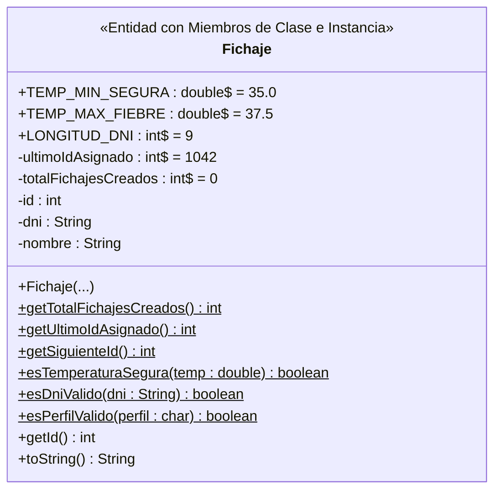

*(En diagramas UML, los miembros subrayados —o anotados con `$` en Mermaid— representan miembros **`static`** pertenecientes a la clase).*

##### A. Atributos `static`: memoria compartida y contadores autoincrementales

Cuando declaramos un atributo como `private static int ultimoIdAsignado = 1042;`:
* No existe una copia dentro de cada objeto `Fichaje`.
* Existe **una sola copia compartida** en la memoria de clase desde que arranca el programa.
* Si el constructor ejecuta `ultimoIdAsignado++; this.id = ultimoIdAsignado;`, cada nuevo objeto creado con `new` recibe automáticamente un identificador irrepetible y consecutivo (`1043`, `1044`, `1045`...), sin que `main` tenga que llevar la cuenta.

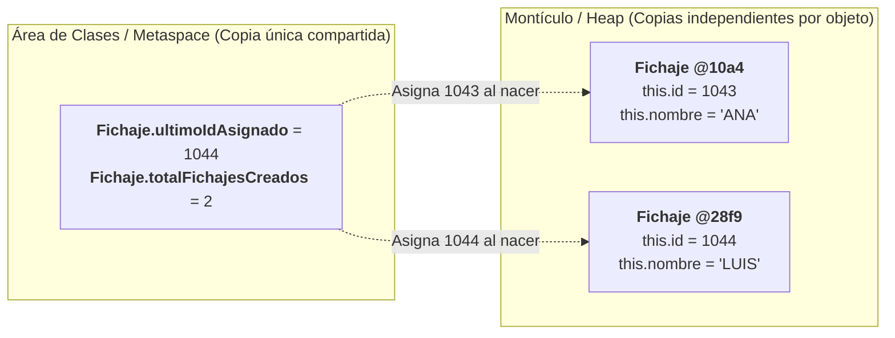

##### B. Constantes de clase (`public static final`)

Las constantes propias de una entidad (como `TEMP_MIN_SEGURA = 35.0` o `LONGITUD_DNI = 9`) deben declararse como `public static final` en la propia entidad que las necesita, en lugar de quedar amontonadas en la clase del `main`:

* `static`: porque el valor es idéntico para todos los objetos (no tiene sentido duplicar `37.5` en la memoria de cada fichaje).  
* `final`: porque es inmutable tras su inicialización.  
* `public`: para que cualquier otra clase pueda consultarla leyendo `Fichaje.TEMP_MAX_FIEBRE`.  

##### C. Métodos `static` en entidades y la regla de oro del contexto estático

Un método `static` dentro de `Fichaje` (como `Fichaje.esDniValido(dni)` o `Fichaje.getTotalFichajesCreados()`) se invoca usando **el nombre de la clase**, sin necesidad de haber creado ningún objeto previo.

Esto impone una restricción fundamental en Java conocida como **la barrera del contexto estático**:

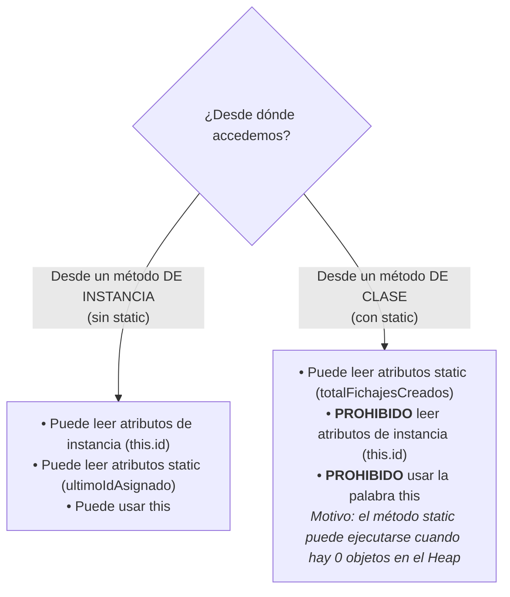

Si intentas leer `this.nombre` o `id` dentro de un método `static`, el compilador detendrá el proceso inmediatamente con el clásico error: **`non-static variable cannot be referenced from a static context`**.

---

#### 3. Evolución del caso guía a `ControlAccesoQR v3.5` (Java nativo)

Evolucionamos la versión `v3.4` a la **`v3.5`**, iniciando la Semana 11:

1. **`Fichaje.java` autonumera sus instancias:** Incorpora `ultimoIdAsignado` y `totalFichajesCreados` como atributos `private static`, eliminando el parámetro `id` manual de sus constructores. Cada `Fichaje` (autorizado o denegado) obtiene un identificador irrepetible al nacer.  
2. **Migración de constantes y validaciones estáticas a `Fichaje`:** Se trasladan a `Fichaje` sus constantes biométricas/documentales (`TEMP_MIN_SEGURA`, `TEMP_MAX_FIEBRE`, `LONGITUD_DNI`) y sus predicados estáticos (`esTemperaturaSegura`, `esDniValido`, `esPerfilValido`).  
3. **`ControlAccesoQR.java` liberado de contadores manuales:** Desaparece la variable suelta `idUltimoFichaje` del `main`. Tanto la Opción 1 como la Opción 2 (ráfagas) fabrican objetos `Fichaje` directamente, y el Monitor de Telemetría (Opción 3) consulta `Fichaje.getTotalFichajesCreados()`.  

##### A. Comparativa de cambios respecto a v3.4 (`diff`)

```diff
  // =========================================================================
  // ARCHIVO: pr/src/Fichaje.java
  // =========================================================================
  public class Fichaje {
+     // Constantes y contadores globales de clase (static)
+     public static final double TEMP_MIN_SEGURA = 35.0;
+     public static final double TEMP_MAX_FIEBRE = 37.5;
+     public static final int LONGITUD_DNI = 9;
+
+     private static int ultimoIdAsignado = 1042;
+     private static int totalFichajesCreados = 0;

      // Constructores: ya NO reciben 'id' por parámetro; se autoasigna al nacer
-     public Fichaje(int id, String dni, String nombre, ...) {
+     public Fichaje(String dni, String nombre, ...) {
+         ultimoIdAsignado++;
+         totalFichajesCreados++;
+         this.id = ultimoIdAsignado;
          // ...
      }
-     public Fichaje(int id, String nombre, ...) {
+     public Fichaje(String nombre, ...) {
+         this("N/D", nombre, ...);
+     }

+     // Métodos estáticos de consulta global y validación de dominio
+     public static int getTotalFichajesCreados() { return totalFichajesCreados; }
+     public static int getUltimoIdAsignado() { return ultimoIdAsignado; }
+     public static int getSiguienteId() { return ultimoIdAsignado + 1; }
+     public static boolean esTemperaturaSegura(double temp) { ... }
+     public static boolean esDniValido(String dni) { ... }
+     public static boolean esPerfilValido(char perfil) { ... }
  }

  // =========================================================================
  // ARCHIVO: pr/src/ControlAccesoQR.java (v3.5)
  // =========================================================================
- int idUltimoFichaje = 1042; // Eliminado de main: ahora lo gestiona Fichaje
- public static boolean esTemperaturaCorporalSegura(...) { ... } // Movido a Fichaje

  case 1:
-     nuevoFichaje = new Fichaje(idUltimoFichaje, nombreLimpio, 'S', ...);
+     nuevoFichaje = new Fichaje(nombreLimpio, 'S', salidaAutorizada, motivoSalida);

  case 2:
-     if (idUltimoFichaje == 1044) { ... }
+     if (Fichaje.getUltimoIdAsignado() == 1044) { ... }
+     else {
+         Fichaje fRafaga = new Fichaje("N/D", "USUARIO RÁFAGA", 'E', 'E', ...);
+         penultimoFichaje = ultimoFichaje;
+         ultimoFichaje = fRafaga;
+     }

  case 3:
+     System.out.printf("INSTANCIAS FICHAJE (RAM): %d creadas (Último ID: #%d)%n",
+             Fichaje.getTotalFichajesCreados(), Fichaje.getUltimoIdAsignado());
```

##### B. Foco en la novedad: secuencia autoincremental y métodos `static` en `Fichaje`

Observa cómo el constructor maestro actualiza las variables estáticas para garantizar identificadores únicos y cómo los métodos estáticos validan reglas antes de instanciar:

```java
// -------------------------------------------------------------------------
// Atributos static y autoasignación de ID en pr/src/Fichaje.java
// -------------------------------------------------------------------------
public static final double TEMP_MIN_SEGURA = 35.0;
public static final double TEMP_MAX_FIEBRE = 37.5;
public static final int LONGITUD_DNI = 9;

private static int ultimoIdAsignado = 1042;
private static int totalFichajesCreados = 0;

public Fichaje(String dni, String nombre, char perfil, char sentido,
               double temperatura, boolean autorizado, String motivo, String token) {
    // Autoasignación única y compartida para todas las instancias
    ultimoIdAsignado++;
    totalFichajesCreados++;
    this.id = ultimoIdAsignado;

    this.dni = (dni == null || dni.isBlank()) ? "N/D" : dni.trim().toUpperCase();
    this.setNombre(nombre);
    // ... resto de atributos
}

// -------------------------------------------------------------------------
// Métodos static propios de la entidad (se invocan con Fichaje.metodo())
// -------------------------------------------------------------------------
public static int getTotalFichajesCreados() {
    return totalFichajesCreados;
}

public static int getSiguienteId() {
    return ultimoIdAsignado + 1;
}

public static boolean esTemperaturaSegura(double temperatura) {
    return (temperatura >= TEMP_MIN_SEGURA && temperatura <= TEMP_MAX_FIEBRE);
}

public static boolean esDniValido(String dni) {
    return (dni != null && dni.length() == LONGITUD_DNI);
}
```

##### C. Código fuente completo integrado

<details>
<summary><b>🔍 Desplegar archivos completos: Fichaje.java y ControlAccesoQR.java (v3.5)</b></summary>

**Archivo 1: `pr/src/Fichaje.java`**
```java
/**
 * ENTIDAD DE DOMINIO: REGISTRO DE FICHAJE EN TORNO
 * Cliente: IES El Caminàs (Castellón de la Plana)
 * Consultora: AzaharTech Software Consulting
 *
 * Versión 3.5:
 * Inicio de la Semana 11 (Miembros static y composición).
 * Incorpora miembros de clase (static) en la propia entidad:
 * - Constantes públicas inmutables del dominio (TEMP_MIN_SEGURA, TEMP_MAX_FIEBRE, LONGITUD_DNI).
 * - Contadores estáticos privados (ultimoIdAsignado, totalFichajesCreados) para
 *   autoasignación secuencial e irrepetible de identificadores desde el constructor.
 * - Métodos estáticos de consulta global y validación de reglas de dominio.
 *
 * @author Equipo AzaharTech (Alba Torres, Pau Ferrer, Laia Claramunt)
 * @version 3.5 (Noviembre 2026)
 * @since JDK 21 LTS
 */

import java.time.LocalTime;

public class Fichaje {

    // -------------------------------------------------------------------------
    // 1. MIEMBROS DE CLASE (STATIC): Únicos y compartidos por todos los objetos
    // -------------------------------------------------------------------------
    public static final double TEMP_MIN_SEGURA = 35.0;
    public static final double TEMP_MAX_FIEBRE = 37.5;
    public static final int LONGITUD_DNI = 9;

    private static int ultimoIdAsignado = 1042;
    private static int totalFichajesCreados = 0;

    // -------------------------------------------------------------------------
    // 2. ATRIBUTOS DE INSTANCIA (Estado independiente por objeto en el Heap)
    // -------------------------------------------------------------------------
    private int id;
    private String dni;
    private String nombre;
    private char perfil;
    private char sentido;
    private double temperatura;
    private boolean autorizado;
    private String motivo;
    private String token;
    private LocalTime hora;

    // -------------------------------------------------------------------------
    // 3. CONSTRUCTORES SOBRECARGADOS (Con autoasignación de ID secuencial)
    // -------------------------------------------------------------------------

    /**
     * Constructor maestro completo para registrar entradas detalladas.
     * Genera automáticamente un ID único secuencial mediante el contador static.
     */
    public Fichaje(String dni, String nombre, char perfil, char sentido,
                   double temperatura, boolean autorizado, String motivo, String token) {
        ultimoIdAsignado++;
        totalFichajesCreados++;
        this.id = ultimoIdAsignado;

        this.dni = (dni == null || dni.isBlank()) ? "N/D" : dni.trim().toUpperCase();
        this.setNombre(nombre);
        this.perfil = perfil;
        this.sentido = (sentido == 'S') ? 'S' : 'E';
        this.setTemperatura(temperatura);
        this.autorizado = autorizado;
        this.setMotivo(motivo);
        this.token = (token == null || token.isBlank()) ? "N/D" : token;
        this.hora = LocalTime.now();
    }

    /**
     * Constructor sobrecargado simplificado para tránsitos de salida ('S').
     */
    public Fichaje(String nombre, char sentido, boolean autorizado, String motivo) {
        this("N/D", nombre, '?', sentido, 0.0, autorizado, motivo, "N/D");
    }

    // -------------------------------------------------------------------------
    // 4. MÉTODOS ESTÁTICOS DE CLASE (No acceden a atributos de instancia ni this)
    // -------------------------------------------------------------------------

    public static int getTotalFichajesCreados() {
        return totalFichajesCreados;
    }

    public static int getUltimoIdAsignado() {
        return ultimoIdAsignado;
    }

    public static int getSiguienteId() {
        return ultimoIdAsignado + 1;
    }

    public static boolean esTemperaturaSegura(double temperatura) {
        return (temperatura >= TEMP_MIN_SEGURA && temperatura <= TEMP_MAX_FIEBRE);
    }

    public static boolean esDniValido(String dni) {
        return (dni != null && dni.length() == LONGITUD_DNI);
    }

    public static boolean esPerfilValido(char perfil) {
        boolean autorizado;
        switch (perfil) {
            case 'E':
            case 'D':
            case 'V':
            case 'A':
                autorizado = true;
                break;
            default:
                autorizado = false;
                break;
        }
        return autorizado;
    }

    // -------------------------------------------------------------------------
    // 5. MÉTODOS DE ACCESO: GETTERS Y SETTERS SELECTIVOS DEFENSIVOS
    // -------------------------------------------------------------------------

    public int getId() {
        return this.id;
    }

    public String getDni() {
        return this.dni;
    }

    public String getNombre() {
        return this.nombre;
    }

    public char getPerfil() {
        return this.perfil;
    }

    public char getSentido() {
        return this.sentido;
    }

    public double getTemperatura() {
        return this.temperatura;
    }

    public boolean isAutorizado() {
        return this.autorizado;
    }

    public String getMotivo() {
        return this.motivo;
    }

    public String getToken() {
        return this.token;
    }

    public LocalTime getHora() {
        return this.hora;
    }

    public void setNombre(String nombre) {
        if (nombre == null || nombre.trim().isEmpty()) {
            this.nombre = "N/D";
        } else {
            this.nombre = nombre.trim().toUpperCase();
        }
    }

    public void setTemperatura(double temperatura) {
        if (temperatura >= 0.0 && temperatura <= 60.0) {
            this.temperatura = temperatura;
        } else {
            this.temperatura = 0.0;
        }
    }

    public void setMotivo(String motivo) {
        if (motivo == null || motivo.trim().isEmpty()) {
            this.motivo = "Sin evaluar";
        } else {
            this.motivo = motivo.trim();
        }
    }

    // -------------------------------------------------------------------------
    // 6. MÉTODOS DE COMPORTAMIENTO RICO DE INSTANCIA
    // -------------------------------------------------------------------------

    public String obtenerPerfilLegible() {
        String descripcion;
        switch (this.perfil) {
            case 'E':
                descripcion = "Estudiante Oficial";
                break;
            case 'D':
                descripcion = "Docente / Claustro";
                break;
            case 'V':
                descripcion = "Visita Externa / Proveedor";
                break;
            case 'A':
                descripcion = "Personal de Administración y Servicios (PAS)";
                break;
            default:
                descripcion = "No especificado";
                break;
        }
        return descripcion;
    }

    public String obtenerZonaAutorizada() {
        String zona;
        switch (this.perfil) {
            case 'E':
                zona = "Aulas Docentes y Talleres de Informática";
                break;
            case 'D':
                zona = "Departamentos Didácticos, Aulas y Sala de Profesores";
                break;
            case 'V':
                zona = "Secretaría, Conserjería y Despachos de Dirección";
                break;
            case 'A':
                zona = "Área de Gestión Administrativa y Archivo Central";
                break;
            default:
                zona = "Acceso Denegado / Zona No Autorizada";
                break;
        }
        return zona;
    }

    public int obtenerEstanciaMaximaMinutos() {
        int estanciaMinutos;
        switch (this.perfil) {
            case 'E':
                estanciaMinutos = 360;
                break;
            case 'D':
                estanciaMinutos = 480;
                break;
            case 'V':
                estanciaMinutos = 120;
                break;
            case 'A':
                estanciaMinutos = 420;
                break;
            default:
                estanciaMinutos = 0;
                break;
        }
        return estanciaMinutos;
    }

    public boolean esMismoSolicitante(Fichaje otro) {
        boolean mismo = false;
        if (otro != null && !this.dni.equals("N/D")) {
            mismo = this.dni.equals(otro.getDni());
        }
        return mismo;
    }

    @Override
    public String toString() {
        String detalleRol = (this.sentido == 'S') ? "Tránsito exterior" : obtenerPerfilLegible();
        return String.format("#%d [%s] %s (%s) | %s | %s | %s",
                this.id,
                this.sentido == 'S' ? "SALIDA" : "ENTRADA",
                this.nombre,
                detalleRol,
                this.autorizado ? "AUTORIZADO" : "DENEGADO",
                this.motivo,
                this.hora.withNano(0));
    }
}
```

**Archivo 2: `pr/src/ControlAccesoQR.java` (v3.5)**
```java
/**
 * SISTEMA DE CONTROL DE ASISTENCIA POR CÓDIGO QR
 * Cliente: IES El Caminàs (Castellón de la Plana)
 * Consultora: AzaharTech Software Consulting
 * 
 * Versión 3.5:
 * Semana 11 (Sprint 4: «Arquitectos de software»).
 * Delega la secuencia de identificadores y validaciones estáticas en la clase Fichaje:
 * - Elimina el contador manual idUltimoFichaje de main.
 * - Invoca métodos estáticos de dominio (Fichaje.esTemperaturaSegura, Fichaje.esDniValido).
 * - Materializa también los fichajes en ráfaga como objetos Fichaje reales.
 * - Consulta las métricas globales de clase (Fichaje.getTotalFichajesCreados()).
 * Mantiene el cumplimiento estricto del principio SESE y blindaje try-catch.
 * 
 * @author Equipo AzaharTech (Alba Torres, Pau Ferrer, Laia Claramunt)
 * @version 3.5 (Noviembre 2026)
 * @since JDK 21 LTS
 * 
 */

import java.util.Scanner;
import java.util.Random;
import java.time.LocalTime;
import java.time.LocalDate;
import java.time.Duration;

public class ControlAccesoQR {

    // -------------------------------------------------------------------------
    // 1. CONSTANTES CORPORATIVAS DE INFRAESTRUCTURA
    // -------------------------------------------------------------------------
    final static String NOMBRE_CENTRO = "IES El Caminàs (Castellón)";
    final static String PREFIJO_CENTRO = "CAMINAS";
    final static String RUTA_LOGS = ".\\caminas\\terminal\\logs";

    final static double FACTOR_PORCENTAJE = 100.0;
    final static int BASE_TOKEN_SEGURIDAD = 1000;
    final static int RANGO_TOKEN_SEGURIDAD = 9000;

    final static int TOTAL_TORNOS_CAMPUS = 3;
    final static int CANALES_POR_TORNO = 4;

    // -------------------------------------------------------------------------
    // 2. MÉTODOS ESTÁTICOS AUXILIARES DEL ORQUESTADOR
    // -------------------------------------------------------------------------

    public static int calcularEstanciaMinutos(LocalTime entrada, LocalTime salida) {
        return (int) Duration.between(entrada, salida).toMinutes();
    }

    public static double calcularPorcentajeOcupacion(int personas, int aforoTotal) {
        return ((double) personas / aforoTotal) * FACTOR_PORCENTAJE;
    }

    public static String construirTokenQR(String prefijo, String dni, int terminalId, int codigoSec, int idFichaje) {
        String token = prefijo + "-" + dni;
        token += "-T" + terminalId;
        token += "-SEC#" + codigoSec;
        token += "-REG" + idFichaje;
        return token;
    }

    public static double calcularDistanciaDiagonal(double x, double y) {
        return Math.sqrt(Math.pow(x, 2.0) + Math.pow(y, 2.0));
    }

    public static void imprimirRegistroSiExiste(String etiqueta, Fichaje registro) {
        if (registro != null) {
            System.out.println(etiqueta + registro);
        } else {
            System.out.println(etiqueta + "(sin registros en esta sesión)");
        }
    }

    // -------------------------------------------------------------------------
    // 3. MÉTODO PRINCIPAL: CONSOLA INTEGRAL v3.5 (MIEMBROS STATIC EN ENTIDAD)
    // -------------------------------------------------------------------------
    public static void main(String[] args) {
        Scanner teclado = new Scanner(System.in);
        Random generadorVestibulo = new Random();
        LocalDate fechaActual = LocalDate.now();

        // Estado persistente del campus
        int personasEnCentro = 1190;
        int aforoDisponible = 10;

        int totalFichajesProcesados = 0;
        int totalFichajesAutorizados = 0;
        int totalFichajesDenegados = 0;

        // Referencias a objetos Fichaje: nacen a null
        Fichaje ultimoFichaje = null;
        Fichaje penultimoFichaje = null;

        // Acumuladores estadísticos
        double tempMaximaRegistrada = -1.0;
        double tempMinimaRegistrada = 100.0;
        int minutosEstanciaAcumulados = 0;

        boolean sesionActiva = true;

        System.out.println("======================================================================");
        System.out.println("   AZAHARTECH · CONTROL INTEGRAL DE ACCESOS - IES EL CAMINÀS          ");
        System.out.println("   Versión 3.5 (Sprint 4: Miembros static propios en Fichaje.java)    ");
        System.out.println("   Fecha de sesión: " + fechaActual);
        System.out.println("======================================================================");

        do {
            System.out.println("\n----------------------------------------------------------------------");
            System.out.println("                    PANEL DE OPERACIONES DEL TORNO                    ");
            System.out.println("----------------------------------------------------------------------");
            System.out.println("  [1] Registrar tránsito individual (ID automático desde Fichaje)");
            System.out.println("  [2] Procesar cola en ráfaga (creación masiva de objetos Fichaje)");
            System.out.println("  [3] Consultar telemetría, contador static y últimos fichajes");
            System.out.println("  [4] Diagnóstico perimetral estructurado SESE (3 tornos x 4 canales)");
            System.out.println("  [5] Activar protocolo de evacuación de emergencia");
            System.out.println("  [6] Cerrar jornada y apagar terminal");
            System.out.print("Seleccione una operación (1-6): ");

            int opcionMenu = 0;
            try {
                opcionMenu = Integer.parseInt(teclado.nextLine().trim());
            } catch (NumberFormatException e) {
                opcionMenu = -1;
            }

            switch (opcionMenu) {
                case 1:
                    // TRÁNSITO INDIVIDUAL CON ID AUTOINCREMENTAL DE CLASE
                    totalFichajesProcesados++;
                    System.out.println("\n--- [MODO 1: TRÁNSITO INDIVIDUAL] ---");
                    System.out.print("Sentido del tránsito (E = Entrada, S = Salida): ");
                    String lineaSentido = teclado.nextLine().trim().toUpperCase();
                    char sentidoTransito = lineaSentido.isEmpty() ? 'E' : lineaSentido.charAt(0);

                    System.out.print("Nombre completo: ");
                    String nombreCapturado = teclado.nextLine().trim().toUpperCase();
                    String nombreLimpio = nombreCapturado.isEmpty() ? "N/D" : nombreCapturado;

                    Fichaje nuevoFichaje;

                    if (sentidoTransito == 'S') {
                        boolean salidaAutorizada;
                        String motivoSalida;

                        if (personasEnCentro > 0) {
                            personasEnCentro--;
                            aforoDisponible++;
                            totalFichajesAutorizados++;
                            salidaAutorizada = true;
                            motivoSalida = "Salida registrada";
                            System.out.println(">> VEREDICTO: [SALIDA AUTORIZADA] Torno exterior abierto.");
                        } else {
                            totalFichajesDenegados++;
                            salidaAutorizada = false;
                            motivoSalida = "Recinto vacío";
                            System.err.println(">> ALERTA: Imposible autorizar salida; recinto vacío.");
                        }

                        // El constructor autonumera la instancia mediante atributo static
                        nuevoFichaje = new Fichaje(nombreLimpio, 'S', salidaAutorizada, motivoSalida);
                    } else {
                        int terminalId = 0;
                        double tempVestibulo = 0.0;
                        String dniPersonaLimpio = "N/D";
                        char perfilNormalizado = '?';
                        boolean datosSintacticamenteCorrectos = true;
                        String motivoDenegacion = "";

                        try {
                            System.out.print("ID Terminal: ");
                            terminalId = Integer.parseInt(teclado.nextLine().trim());
                            System.out.print("Temperatura (ºC): ");
                            tempVestibulo = Double.parseDouble(teclado.nextLine().trim());
                            System.out.print("DNI: ");
                            dniPersonaLimpio = teclado.nextLine().trim().toUpperCase();
                            System.out.print("Perfil (E/D/V/A): ");
                            String lineaPerfil = teclado.nextLine().trim();
                            perfilNormalizado = lineaPerfil.isEmpty() ? '?' : Character.toUpperCase(lineaPerfil.charAt(0));
                        } catch (NumberFormatException e) {
                            datosSintacticamenteCorrectos = false;
                            motivoDenegacion = "Error de formato numérico.";
                        }

                        // Invocación directa a los métodos static de validación en Fichaje
                        boolean accesoConcedido;
                        if (!datosSintacticamenteCorrectos) {
                            accesoConcedido = false;
                            totalFichajesDenegados++;
                        } else if (!Fichaje.esTemperaturaSegura(tempVestibulo)) {
                            accesoConcedido = false;
                            motivoDenegacion = "Temperatura anómala.";
                            totalFichajesDenegados++;
                        } else if (aforoDisponible <= 0) {
                            accesoConcedido = false;
                            motivoDenegacion = "Aforo completo.";
                            totalFichajesDenegados++;
                        } else if (!Fichaje.esDniValido(dniPersonaLimpio)) {
                            accesoConcedido = false;
                            motivoDenegacion = "DNI no reglamentario.";
                            totalFichajesDenegados++;
                        } else if (!Fichaje.esPerfilValido(perfilNormalizado)) {
                            accesoConcedido = false;
                            motivoDenegacion = "Perfil no catalogado.";
                            totalFichajesDenegados++;
                        } else {
                            accesoConcedido = true;
                            totalFichajesAutorizados++;
                            personasEnCentro++;
                            aforoDisponible--;

                            tempMaximaRegistrada = Math.max(tempMaximaRegistrada, tempVestibulo);
                            tempMinimaRegistrada = Math.min(tempMinimaRegistrada, tempVestibulo);
                            minutosEstanciaAcumulados += 360;
                        }

                        int codigoToken = BASE_TOKEN_SEGURIDAD + generadorVestibulo.nextInt(RANGO_TOKEN_SEGURIDAD);
                        // Consultamos el siguiente ID estático para generar el token antes de construir
                        String token = construirTokenQR(PREFIJO_CENTRO, dniPersonaLimpio, terminalId,
                                codigoToken, Fichaje.getSiguienteId());
                        System.out.printf(">> VEREDICTO: %s [Token: %s]%n",
                                accesoConcedido ? "[ENTRADA AUTORIZADA]" : "[ENTRADA DENEGADA - " + motivoDenegacion + "]", token);

                        String motivoFinal = accesoConcedido ? "Acceso concedido" : motivoDenegacion;

                        nuevoFichaje = new Fichaje(dniPersonaLimpio, nombreLimpio, perfilNormalizado,
                                'E', tempVestibulo, accesoConcedido, motivoFinal, token);

                        if (nuevoFichaje.isAutorizado()) {
                            System.out.printf("   Zona asignada: %s (Estancia máx: %d min)%n",
                                    nuevoFichaje.obtenerZonaAutorizada(), nuevoFichaje.obtenerEstanciaMaximaMinutos());
                        }

                        if (nuevoFichaje.esMismoSolicitante(ultimoFichaje)
                                && nuevoFichaje.getSentido() == ultimoFichaje.getSentido()) {
                            System.out.println(">> AVISO ANTI-REBOTE: El DNI " + nuevoFichaje.getDni()
                                    + " coincide con el tránsito inmediatamente anterior.");
                        }
                    }

                    penultimoFichaje = ultimoFichaje;
                    ultimoFichaje = nuevoFichaje;
                    System.out.println(">> Objeto Fichaje registrado: " + nuevoFichaje);
                    break;

                case 2:
                    // RÁFAGA DE COLA CON INSTANCIAS REALES Y CONTROL STATIC
                    System.out.println("\n--- [MODO 2: RÁFAGA CON INSTANCIACIÓN Y CONTROL STATIC] ---");
                    System.out.print("Personas en cola para esta ráfaga: ");
                    int personasEnCola = 0;
                    try {
                        personasEnCola = Integer.parseInt(teclado.nextLine().trim());
                    } catch (NumberFormatException e) {
                        personasEnCola = 0;
                    }

                    boolean vetoJudicialDetectado = false;

                    while (personasEnCola > 0 && aforoDisponible > 0 && !vetoJudicialDetectado) {
                        if (Fichaje.getUltimoIdAsignado() == 1044) {
                            System.out.println(">> [ALERTA JUDICIAL]: Credencial #1044 bloqueada. Suspendiendo cola en cabecera...");
                            vetoJudicialDetectado = true;
                        } else {
                            totalFichajesProcesados++;
                            totalFichajesAutorizados++;
                            personasEnCentro++;
                            aforoDisponible--;
                            personasEnCola--;

                            double tempSimulada = 36.4 + (generadorVestibulo.nextDouble() * 0.5);
                            tempMaximaRegistrada = Math.max(tempMaximaRegistrada, tempSimulada);
                            tempMinimaRegistrada = Math.min(tempMinimaRegistrada, tempSimulada);
                            minutosEstanciaAcumulados += 360;

                            Fichaje fRafaga = new Fichaje("N/D", "USUARIO RÁFAGA", 'E', 'E',
                                    tempSimulada, true, "Paso automático en ráfaga", "CAMINAS-BURST");
                            penultimoFichaje = ultimoFichaje;
                            ultimoFichaje = fRafaga;
                        }
                    }
                    System.out.printf(">> Estado tras ráfaga. Plazas disponibles: %d | Restantes en cola: %d%n",
                            aforoDisponible, personasEnCola);
                    break;

                case 3:
                    // MONITOR DE TELEMETRÍA EN VIVO Y LECTURA GLOBAL STATIC
                    System.out.println("\n--- [MODO 3: MONITOR DE TELEMETRÍA EN VIVO] ---");
                    int aforoTotal = personasEnCentro + aforoDisponible;
                    double porcentajeOcupacion = calcularPorcentajeOcupacion(personasEnCentro, aforoTotal);
                    double estanciaMedia = totalFichajesAutorizados > 0 
                            ? ((double) minutosEstanciaAcumulados / totalFichajesAutorizados) : 0.0;

                    System.out.printf("OCUPACIÓN ACTUAL:         %d/%d personas (%6.2f %%)%n", personasEnCentro, aforoTotal, porcentajeOcupacion);
                    System.out.printf("PLAZAS LIBRES:            %d vacantes disponibles%n", aforoDisponible);
                    System.out.printf("INSTANCIAS FICHAJE (RAM): %d objetos fabricados (Último ID: #%d)%n",
                            Fichaje.getTotalFichajesCreados(), Fichaje.getUltimoIdAsignado());
                    System.out.printf("PICO TÉRMICO MÁXIMO:      %.1f ºC%n", Math.max(0.0, tempMaximaRegistrada));
                    System.out.printf("PICO TÉRMICO MÍNIMO:      %.1f ºC%n", tempMinimaRegistrada > 50.0 ? 0.0 : tempMinimaRegistrada);
                    System.out.printf("ESTANCIA PROMEDIO:        %.1f minutos (Total acumulado: %d min)%n",
                            estanciaMedia, minutosEstanciaAcumulados);

                    imprimirRegistroSiExiste("ÚLTIMO FICHAJE:           ", ultimoFichaje);
                    imprimirRegistroSiExiste("PENÚLTIMO FICHAJE:        ", penultimoFichaje);
                    break;

                case 4:
                    // DIAGNÓSTICO SECUENCIAL Y MATRIZ PERIMETRAL SESE
                    System.out.println("\n--- [MODO 4: INSPECCIÓN PERIMETRAL ESTRUCTURADA (SESE)] ---");
                    boolean alarmaSabotajeDetectada = false;

                    for (int torno = 1; torno <= TOTAL_TORNOS_CAMPUS && !alarmaSabotajeDetectada; torno++) {
                        String nombreAcceso = switch (torno) {
                            case 1 -> "Vestíbulo Central  | ";
                            case 2 -> "Puerta Norte Ciclos| ";
                            case 3 -> "Puerta Sur Talleres| ";
                            default -> "Acceso Perimetral  | ";
                        };
                        System.out.print(nombreAcceso);

                        for (int canal = 1; canal <= CANALES_POR_TORNO && !alarmaSabotajeDetectada; canal++) {
                            if (torno == 2 && canal == 2) {
                                System.out.print("[REVISIÓN] ");
                            } else {
                                boolean falloCritico = (torno == 3 && canal == 2 && false);

                                if (falloCritico) {
                                    System.out.print("[SABOTAJE] ");
                                    alarmaSabotajeDetectada = true;
                                } else {
                                    System.out.printf("[C%d: OK]   ", canal);
                                }
                            }
                        }
                        System.out.println();
                    }

                    if (alarmaSabotajeDetectada) {
                        System.out.println(">> [ALERTA DE SEGURIDAD]: Barrido perimetral detenido por fallo crítico.");
                    }
                    System.out.println("-------------------------------------------------------------------");
                    break;

                case 5:
                    // PROTOCOLO DE EVACUACIÓN CON WHILE DE DRENAJE
                    System.out.println("\n--- [MODO 5: PROTOCOLO DE EVACUACIÓN DE EMERGENCIA] ---");
                    if (personasEnCentro == 0) {
                        System.out.println(">> El campus ya se encuentra completamente vacío.");
                    } else {
                        int loteSalidaSimultanea = 300;
                        int oleada = 1;

                        while (personasEnCentro > 0) {
                            int evacuadosLote = Math.min(personasEnCentro, loteSalidaSimultanea);
                            personasEnCentro -= evacuadosLote;
                            aforoDisponible += evacuadosLote;

                            System.out.printf("  -> Oleada #%d: Desalojadas %d personas por salidas de emergencia (Ocupantes restantes: %d)%n",
                                    oleada, evacuadosLote, personasEnCentro);
                            oleada++;
                        }
                        System.out.println(">> CERTIFICACIÓN DE SEGURIDAD: Recinto 100% desalojado. Aforo íntegro restaurado.");
                    }
                    break;

                case 6:
                    // APAGADO Y SALIDA
                    System.out.println("\n>> Desconectando terminal de presencia de forma ordenada...");
                    sesionActiva = false;
                    break;

                default:
                    System.err.println(">> Error: Opción no válida. Seleccione una operación entre 1 y 6.");
                    break;
            }

        } while (sesionActiva);

        // AUDITORÍA FINAL AL APAGAR
        System.out.println("\n======================================================================");
        System.out.println("          AUDITORÍA FINAL DE LA JORNADA · IES EL CAMINÀS              ");
        System.out.println("======================================================================");
        System.out.printf("TOTAL OPERACIONES GESTIONADAS: %d%n", totalFichajesProcesados);
        System.out.printf("OBJETOS FICHAJE CREADOS (RAM): %d%n", Fichaje.getTotalFichajesCreados());
        System.out.printf("ACCESOS AUTORIZADOS (TOTAL):   %d%n", totalFichajesAutorizados);
        System.out.printf("ACCESOS DENEGADOS (BLOQUEO):   %d%n", totalFichajesDenegados);
        System.out.printf("OCUPACIÓN FINAL REGISTRADA:    %d personas%n", personasEnCentro);
        System.out.println("ESTADO DEL DISPOSITIVO:        Terminal desconectado de forma segura.");
        System.out.println("======================================================================");

        teclado.close();
    }
}
```

</details>

---

#### 4. Segunda sesión: dojo de entrenamiento y katas de código

En esta sesión práctica, cada estudiante dotará a su clase entidad de atributos compartidos (`static`), identificadores autoincrementales y utilidades de validación de clase.

##### Kata 1 (Cinturón blanco / Nivel base). Contadores `static` y reglas de dominio en proyectos asignados

Abre la clase entidad de tu especialidad en `pr/src/` y añade un contador privado `static` que asigne un identificador único a cada objeto creado y registre el total de instancias fabricadas, junto con constantes `public static final` y un método `static` de validación previa o consulta global:

* **Aventura conversacional.** En `Personaje.java`, añade un contador `static` privado para asignar un código de registro único a cada combatiente que nazca en el constructor y contabilizar cuántos personajes han sido creados en la partida. Traslada los umbrales de salud máxima o ataque base a constantes `public static final` e implementa un método `static` para consultar el censo total de combatientes generados.
* **Motor de recomendación.** En `Item.java`, incorpora un atributo `static` autoincremental que genere un SKU o código de catálogo irrepetible para cada contenido instanciado sin tener que pasarlo por parámetro. Declara las constantes de puntuación mínima y máxima como `public static final` en la propia clase y añade un método `static` que valide si una nota decimal está dentro de ese rango antes de instanciar el ítem.
* **Simulador de físicas 2D.** En `Bola.java`, añade un contador `static` privado que asigne automáticamente un número de serie único a cada partícula creada y contabilice el total de cuerpos simulados. Traslada las constantes físicas del entorno (como la gravedad estándar o el radio mínimo permitido) a constantes `public static final` dentro de `Bola` y expón un método `static` para consultar el número total de cuerpos lanzados.
* **Bóveda de contraseñas.** En `Credencial.java`, incorpora un contador `static` para asignar un ID de auditoría único a cada registro almacenado y llevar la cuenta global de credenciales procesadas. Mueve la constante de longitud mínima segura (`LONGITUD_MINIMA_SEGURA`) a `Credencial` como `public static final` e implementa un método `static` que evalúe la robustez de cualquier cadena de texto candidata sin necesidad de instanciar primero el objeto.

---

##### Kata 2 (Cinturón marrón / Nivel avanzado). La barrera del contexto estático

Comprueba empíricamente por qué los miembros de instancia y los miembros estáticos viven en mundos separados:

1. **Provocar el error de compilación:**  
   Dentro de un método `static` de tu clase entidad, intenta leer directamente un atributo de instancia (como `nombre` o `id`) o escribir `this.`. Anota el mensaje exacto que arroja el compilador (`non-static variable ... cannot be referenced from a static context`) y razona en un comentario por qué Java impide compilarlo.
2. **La relación asimétrica:**  
   Demuestra el caso inverso: escribe un método de instancia (sin `static`) que consulte el contador global `static` (por ejemplo, que en `toString()` indique `"Objeto #3 de 5 creados"`), verificando que desde un objeto concreto sí es perfectamente válido leer los miembros compartidos de su clase.

---

##### Kata 3 (Cinturón negro / «Hacker AzaharTech»). Auditoría de *Metaspace* frente a *Heap* en el Depurador de IntelliJ

Inspecciona en tiempo de ejecución cómo separa la JVM la memoria compartida de clase frente a la memoria individual de cada objeto:

1. **Configuración de la observación:**  
   Crea al menos tres instancias sucesivas de tu entidad desde `MiProyecto.java`, coloca un *breakpoint* justo después de crear la tercera y ejecuta en modo Debug (**`Shift + F9`**).
2. **Inspección de la sección `static` en la pestaña *Variables*:**  
   En la ventana de variables del depurador, despliega cualquiera de tus instancias (por ejemplo, `obj1`):
   * Localiza la carpeta o nodo **`static`** que aparece dentro del objeto en IntelliJ y despliégala.
   * Comprueba que los atributos `id` de `obj1`, `obj2` y `obj3` muestran valores distintos (`1`, `2`, `3` o `1043`, `1044`, `1045`), pero dentro del nodo **`static`** de los tres objetos aparece **exactamente el mismo contador global (`3`)**.
3. **Verificación de persistencia tras limpieza:**  
   Asigna `obj1 = null; obj2 = null;`, avanza un paso con **`F8`** e invoca en la consola de evaluación (`Alt + F8`) el *getter* estático de tu clase (`TuClase.getTotalCreados()`). Certifica en la cabecera Javadoc de tu clase que el contador estático sobrevive intacto en el área de clases aunque los objetos individuales hayan quedado huérfanos en el *Heap*.

# Sprint 4. Desarrollo de clases
## Semana 11. Miembros static y composición

---

### Día 41 - 2 sesiones

---

#### 1. Caso guía en AzaharTech

Son las 15:00 h del **martes 24 de noviembre de 2026**. En las oficinas de **AzaharTech** en Castellón de la Plana, el equipo revisa el archivo `ControlAccesoQR.java` de la versión `v3.5`. Aunque `Fichaje.java` ya gestiona su propia secuencia autoincremental `static` y sus validaciones, **Alba Torres** señala un problema evidente en el archivo principal:

> *«Equipo, mirad el tamaño que sigue teniendo el método `main` de `ControlAccesoQR.java`: supera las doscientas líneas. Aunque hemos extraído la entidad `Fichaje`, nuestro `main` sigue mezclando dos mundos completamente distintos:*
> 1. *Por un lado, **la interfaz de consola** (dibujar el menú, leer texto con `Scanner` y capturar excepciones `try-catch`).*
> 2. *Por otro, **el estado físico y la lógica operativa del torno del instituto**: controlar `personasEnCentro`, calcular el aforo disponible, acumular los picos térmicos, recordar `ultimoFichaje` y `penultimoFichaje`, procesar las ráfagas y ejecutar la evacuación.*
>
> *Si mañana el **IES El Caminàs** nos pide controlar dos tornos independientes con estados separados (el del Vestíbulo Principal y el de Puerta Norte), no podríamos hacerlo sin duplicar de nuevo todas las variables del `main`»*.

**Laia Claramunt** y **Pau Ferrer** proponen la solución arquitectónica definitiva:

> *«Ha llegado el momento de aplicar la **composición de clases**. Vamos a crear una nueva clase entidad llamada **`Torno.java`** que encapsule el estado físico y las operaciones de un torno real.*
>
> *Y lo más importante: **un objeto `Torno` contendrá en su interior referencias a objetos `Fichaje` (`ultimoFichaje` y `penultimoFichaje`)**. De este modo, `ControlAccesoQR` quedará limpio como una mera capa de presentación por consola que delega el trabajo real en una instancia de `Torno`, que a su vez fabrica y coordina instancias de `Fichaje`»*.

---

#### 2. Fundamento teórico: composición de objetos y separación de capas

En Programación Orientada a Objetos, las clases no viven aisladas: colaboran entre sí. Cuando una clase contiene entre sus atributos una referencia a un objeto de otra clase, decimos que existe una relación de **composición** o relación **«tiene-un» (*has-a*)**.

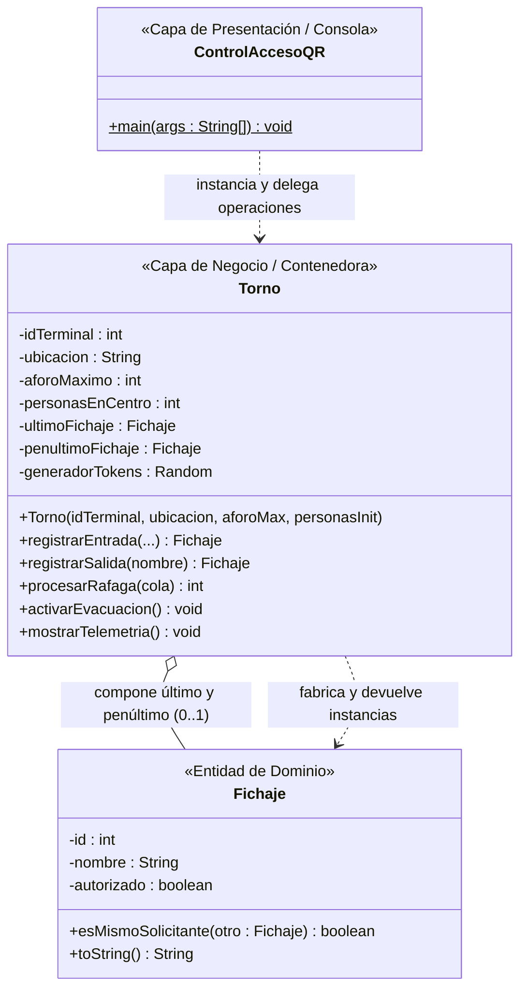

##### A. Objetos compuestos en la memoria dinámica (*Heap*)

Cuando instanciamos `Torno tornoPrincipal = new Torno(...)`, dicho objeto ocupa una región en el *Heap*. A medida que los alumnos pasan por el lector, el objeto `Torno` fabrica objetos `Fichaje` independientes y guarda **las direcciones de memoria** hacia esos `Fichaje` dentro de sus propios atributos privados:

```mermaid
flowchart LR
    subgraph Stack ["Stack de main"]
        RefTorno["<b>tornoPrincipal</b><br/>(@10a4)"]
    end

    subgraph Heap ["Montículo (Heap): Cadena de Objetos Compuestos"]
        ObjTorno["<b>Torno @10a4</b><br/>• idTerminal: 101<br/>• ubicacion: 'Vestíbulo'<br/>• personasEnCentro: 1191<br/>• ultimoFichaje ─────────►<br/>• penultimoFichaje ──────►"]
        ObjF2["<b>Fichaje @28f9</b><br/>id = 1044<br/>nombre = 'CARLOS RUIZ'"]
        ObjF1["<b>Fichaje @3c12</b><br/>id = 1043<br/>nombre = 'ANA PEREZ'"]
    end

    RefTorno --> ObjTorno
    ObjTorno --> ObjF2
    ObjTorno --> ObjF1
```

Observa cómo un `Torno` también compone una clase estándar del JDK: `private Random generadorTokens;`, instanciada dentro del propio constructor de `Torno` con `this.generadorTokens = new Random();`.

##### B. Flujo de colaboración entre capas (*Presentación vs. Dominio*)

Separar la entrada/salida de consola de la lógica de negocio permite que las clases entidades puedan reutilizarse mañana en una interfaz gráfica de escritorio o en una aplicación móvil sin reescribir las reglas del negocio:

```mermaid
sequenceDiagram
    participant Op as Operador (Consola)
    participant Main as ControlAccesoQR (Presentación)
    participant Torno as Torno @10a4 (Negocio)
    participant Fichaje as Fichaje (Entidad)

    Op->>Main: Introduce DNI, perfil, temperatura
    Main->>Torno: registrarEntrada(dni, nombre, perfil, temp, ...)
    Torno->>Fichaje: Fichaje.esTemperaturaSegura(temp)
    Torno->>Fichaje: new Fichaje(dni, nombre, ...)
    Fichaje-->>Torno: Devuelve instancia @28f9
    Torno->>Torno: Actualiza aforo, picos y ultimoFichaje
    Torno-->>Main: Retorna objeto Fichaje @28f9
    Main->>Op: Imprime veredicto y nuevoFichaje.toString()
```

##### C. Protección contra `NullPointerException` en cadena

Al navegar por objetos compuestos (por ejemplo, preguntando al torno por su último fichaje y a este por su nombre: `torno.getUltimoFichaje().getNombre()`), se produce un **encadenamiento de llamadas**. Si el torno aún no ha registrado ningún acceso, `torno.getUltimoFichaje()` devolverá `null`, y encadenar `.getNombre()` sobre `null` provocará una caída inmediata.

La regla defensiva exige comprobar cada eslabón susceptible de ser `null` antes de invocar el siguiente método:

```java
if (tornoPrincipal != null && tornoPrincipal.getUltimoFichaje() != null) {
    System.out.println(tornoPrincipal.getUltimoFichaje().getNombre());
}
```

---

#### 3. Evolución del caso guía a `ControlAccesoQR v3.6` (Arquitectura en 3 clases)

Evolucionamos el proyecto de la versión `v3.5` a la **`v3.6`**, distribuyendo el sistema en **tres archivos Java cooperantes**:
1. **`Fichaje.java` (Sin cambios necesarios respecto a `v3.5`):** Prueba palpable del desacoplo modular: la entidad base sigue funcionando intacta sin saber que ahora es administrada por un `Torno`.
2. **`Torno.java` (Nueva clase contenedora de negocio):** Encapsula el estado del campus (`personasEnCentro`, `aforoMaximo`), los acumuladores estadísticos, el generador de tokens `Random` y la composición con `ultimoFichaje` y `penultimoFichaje`. Sus métodos `registrarEntrada` y `registrarSalida` **fabrican y retornan objetos `Fichaje`**.
3. **`ControlAccesoQR.java` (`v3.6` - Capa de presentación depurada):** Se reduce drásticamente. Su única misión es mostrar el panel de operaciones, capturar datos por `Scanner` con `try-catch` y delegar cada acción en `tornoPrincipal`.

##### A. Comparativa de cambios respecto a v3.5 (`diff`)

```diff
+ // =========================================================================
+ // NUEVO ARCHIVO: pr/src/Torno.java (Clase contenedora y lógica de negocio)
+ // =========================================================================
+ public class Torno {
+     private int idTerminal;
+     private String ubicacion;
+     private int aforoMaximo;
+     private int personasEnCentro;
+     private Fichaje ultimoFichaje;    // Composición: Torno tiene-un Fichaje
+     private Fichaje penultimoFichaje; // Composición: historial inmediato
+     private Random generadorTokens;   // Composición con API estándar JDK
+
+     public Torno(int idTerminal, String ubicacion, int aforoMaximo, int personasIniciales) { ... }
+     public Fichaje registrarEntrada(...) { ... }
+     public Fichaje registrarSalida(String nombre) { ... }
+     public int procesarRafaga(int personasEnCola) { ... }
+     public void activarEvacuacion() { ... }
+     public void mostrarTelemetria() { ... }
+     public void mostrarAuditoriaFinal() { ... }
+ }

  // =========================================================================
  // ARCHIVO: pr/src/ControlAccesoQR.java (v3.6 - Interfaz limpia)
  // =========================================================================
- int personasEnCentro = 1190;
- int aforoDisponible = 10;
- Fichaje ultimoFichaje = null;
- Fichaje penultimoFichaje = null;
- double tempMaximaRegistrada = -1.0; ...
+ Torno tornoPrincipal = new Torno(101, "Vestíbulo Principal", 1200, 1190);

  case 1:
-     // [Más de 80 líneas de lógica de validación, contadores y tokens en main]
+     Fichaje nuevoFichaje = tornoPrincipal.registrarEntrada(dni, nombre, perfil, temp, datosOk, motivoError);
+     if (nuevoFichaje.esMismoSolicitante(tornoPrincipal.getPenultimoFichaje()) ...) { ... }

  case 2:
-     // [Bucle while de ráfaga en main]
+     int pendientes = tornoPrincipal.procesarRafaga(personasEnCola);

  case 3:
-     // [Cálculos de ocupación y printf en main]
+     tornoPrincipal.mostrarTelemetria();

  case 5:
-     // [Bucle while de evacuación en main]
+     tornoPrincipal.activarEvacuacion();
```

##### B. Foco en la novedad: la clase `Torno` componiendo y retornando objetos `Fichaje`

Observa cómo `Torno` oculta la complejidad de la gestión de memoria y el desplazamiento de referencias, exponiendo una API limpia para el orquestador:

```java
// -------------------------------------------------------------------------
// Fragmento de composición y retorno de objetos en pr/src/Torno.java
// -------------------------------------------------------------------------
public class Torno {
    private int idTerminal;
    private String ubicacion;
    private int aforoMaximo;
    private int personasEnCentro;
    // Composición: referencias a instancias de otra clase propia
    private Fichaje ultimoFichaje;
    private Fichaje penultimoFichaje;
    private Random generadorTokens;

    public Fichaje registrarEntrada(String dni, String nombre, char perfil,
                                    double temperatura, boolean datosCorrectos, String motivoError) {
        this.totalProcesados++;
        boolean accesoConcedido = false;
        String motivo = motivoError;

        if (!datosCorrectos) {
            this.totalDenegados++;
        } else if (!Fichaje.esTemperaturaSegura(temperatura)) {
            motivo = "Temperatura anómala.";
            this.totalDenegados++;
        } else if (this.getAforoDisponible() <= 0) {
            motivo = "Aforo completo.";
            this.totalDenegados++;
        } else if (!Fichaje.esDniValido(dni)) {
            motivo = "DNI no reglamentario.";
            this.totalDenegados++;
        } else if (!Fichaje.esPerfilValido(perfil)) {
            motivo = "Perfil no catalogado.";
            this.totalDenegados++;
        } else {
            accesoConcedido = true;
            this.totalAutorizados++;
            this.personasEnCentro++;
            this.tempMaxima = Math.max(this.tempMaxima, temperatura);
            this.tempMinima = Math.min(this.tempMinima, temperatura);
            this.minutosEstanciaAcumulados += 360;
            motivo = "Acceso concedido";
        }

        String token = construirTokenQR(dni, Fichaje.getSiguienteId());
        Fichaje nuevoFichaje = new Fichaje(dni, nombre, perfil, 'E', temperatura, accesoConcedido, motivo, token);

        // Desplazamiento interno encapsulado dentro de Torno
        this.penultimoFichaje = this.ultimoFichaje;
        this.ultimoFichaje = nuevoFichaje;

        return nuevoFichaje;
    }
}
```

##### C. Código fuente completo integrado

<details>
<summary><b>🔍 Desplegar archivos completos: Fichaje.java, Torno.java y ControlAccesoQR.java (v3.6)</b></summary>

**Archivo 1: `pr/src/Fichaje.java`** *(Se mantiene íntegro desde `v3.5` gracias al desacoplo modular)*
```java
/**
 * ENTIDAD DE DOMINIO: REGISTRO DE FICHAJE EN TORNO
 * Cliente: IES El Caminàs (Castellón de la Plana)
 * Consultora: AzaharTech Software Consulting
 *
 * Versión 3.5 (compatible sin cambios con v3.6):
 * Modela de forma autónoma cada tránsito registrado por los tornos del centro.
 *
 * @author Equipo AzaharTech (Alba Torres, Pau Ferrer, Laia Claramunt)
 * @version 3.5 (Noviembre 2026)
 * @since JDK 21 LTS
 */

import java.time.LocalTime;

public class Fichaje {

    public static final double TEMP_MIN_SEGURA = 35.0;
    public static final double TEMP_MAX_FIEBRE = 37.5;
    public static final int LONGITUD_DNI = 9;

    private static int ultimoIdAsignado = 1042;
    private static int totalFichajesCreados = 0;

    private int id;
    private String dni;
    private String nombre;
    private char perfil;
    private char sentido;
    private double temperatura;
    private boolean autorizado;
    private String motivo;
    private String token;
    private LocalTime hora;

    public Fichaje(String dni, String nombre, char perfil, char sentido,
                   double temperatura, boolean autorizado, String motivo, String token) {
        ultimoIdAsignado++;
        totalFichajesCreados++;
        this.id = ultimoIdAsignado;

        this.dni = (dni == null || dni.isBlank()) ? "N/D" : dni.trim().toUpperCase();
        this.setNombre(nombre);
        this.perfil = perfil;
        this.sentido = (sentido == 'S') ? 'S' : 'E';
        this.setTemperatura(temperatura);
        this.autorizado = autorizado;
        this.setMotivo(motivo);
        this.token = (token == null || token.isBlank()) ? "N/D" : token;
        this.hora = LocalTime.now();
    }

    public Fichaje(String nombre, char sentido, boolean autorizado, String motivo) {
        this("N/D", nombre, '?', sentido, 0.0, autorizado, motivo, "N/D");
    }

    public static int getTotalFichajesCreados() {
        return totalFichajesCreados;
    }

    public static int getUltimoIdAsignado() {
        return ultimoIdAsignado;
    }

    public static int getSiguienteId() {
        return ultimoIdAsignado + 1;
    }

    public static boolean esTemperaturaSegura(double temperatura) {
        return (temperatura >= TEMP_MIN_SEGURA && temperatura <= TEMP_MAX_FIEBRE);
    }

    public static boolean esDniValido(String dni) {
        return (dni != null && dni.length() == LONGITUD_DNI);
    }

    public static boolean esPerfilValido(char perfil) {
        boolean autorizado;
        switch (perfil) {
            case 'E':
            case 'D':
            case 'V':
            case 'A':
                autorizado = true;
                break;
            default:
                autorizado = false;
                break;
        }
        return autorizado;
    }

    public int getId() { return this.id; }
    public String getDni() { return this.dni; }
    public String getNombre() { return this.nombre; }
    public char getPerfil() { return this.perfil; }
    public char getSentido() { return this.sentido; }
    public double getTemperatura() { return this.temperatura; }
    public boolean isAutorizado() { return this.autorizado; }
    public String getMotivo() { return this.motivo; }
    public String getToken() { return this.token; }
    public LocalTime getHora() { return this.hora; }

    public void setNombre(String nombre) {
        if (nombre == null || nombre.trim().isEmpty()) {
            this.nombre = "N/D";
        } else {
            this.nombre = nombre.trim().toUpperCase();
        }
    }

    public void setTemperatura(double temperatura) {
        if (temperatura >= 0.0 && temperatura <= 60.0) {
            this.temperatura = temperatura;
        } else {
            this.temperatura = 0.0;
        }
    }

    public void setMotivo(String motivo) {
        if (motivo == null || motivo.trim().isEmpty()) {
            this.motivo = "Sin evaluar";
        } else {
            this.motivo = motivo.trim();
        }
    }

    public String obtenerPerfilLegible() {
        String descripcion;
        switch (this.perfil) {
            case 'E': descripcion = "Estudiante Oficial"; break;
            case 'D': descripcion = "Docente / Claustro"; break;
            case 'V': descripcion = "Visita Externa / Proveedor"; break;
            case 'A': descripcion = "Personal de Administración y Servicios (PAS)"; break;
            default:  descripcion = "No especificado"; break;
        }
        return descripcion;
    }

    public String obtenerZonaAutorizada() {
        String zona;
        switch (this.perfil) {
            case 'E': zona = "Aulas Docentes y Talleres de Informática"; break;
            case 'D': zona = "Departamentos Didácticos, Aulas y Sala de Profesores"; break;
            case 'V': zona = "Secretaría, Conserjería y Despachos de Dirección"; break;
            case 'A': zona = "Área de Gestión Administrativa y Archivo Central"; break;
            default:  zona = "Acceso Denegado / Zona No Autorizada"; break;
        }
        return zona;
    }

    public int obtenerEstanciaMaximaMinutos() {
        int estanciaMinutos;
        switch (this.perfil) {
            case 'E': estanciaMinutos = 360; break;
            case 'D': estanciaMinutos = 480; break;
            case 'V': estanciaMinutos = 120; break;
            case 'A': estanciaMinutos = 420; break;
            default:  estanciaMinutos = 0; break;
        }
        return estanciaMinutos;
    }

    public boolean esMismoSolicitante(Fichaje otro) {
        boolean mismo = false;
        if (otro != null && !this.dni.equals("N/D")) {
            mismo = this.dni.equals(otro.getDni());
        }
        return mismo;
    }

    @Override
    public String toString() {
        String detalleRol = (this.sentido == 'S') ? "Tránsito exterior" : obtenerPerfilLegible();
        return String.format("#%d [%s] %s (%s) | %s | %s | %s",
                this.id,
                this.sentido == 'S' ? "SALIDA" : "ENTRADA",
                this.nombre,
                detalleRol,
                this.autorizado ? "AUTORIZADO" : "DENEGADO",
                this.motivo,
                this.hora.withNano(0));
    }
}
```

**Archivo 2: `pr/src/Torno.java`** *(Nueva clase contenedora y lógica de negocio)*
```java
/**
 * ENTIDAD DE NEGOCIO: TORNO DE CONTROL DE ACCESO
 * Cliente: IES El Caminàs (Castellón de la Plana)
 * Consultora: AzaharTech Software Consulting
 *
 * Versión 3.6:
 * Modela un torno físico del campus aplicando composición de clases:
 * - Compone referencias a los últimos objetos Fichaje registrados (has-a).
 * - Compone una instancia privada de Random para la emisión de tokens.
 * - Encapsula la gestión de aforo, validación de accesos, ráfagas y evacuación.
 * Mantiene cumplimiento estricto del principio SESE.
 *
 * @author Equipo AzaharTech (Alba Torres, Pau Ferrer, Laia Claramunt)
 * @version 3.6 (Noviembre 2026)
 * @since JDK 21 LTS
 */

import java.util.Random;

public class Torno {

    // -------------------------------------------------------------------------
    // 1. CONSTANTES DE CONFIGURACIÓN DEL DISPOSITIVO
    // -------------------------------------------------------------------------
    private static final String PREFIJO_CENTRO = "CAMINAS";
    private static final int BASE_TOKEN_SEGURIDAD = 1000;
    private static final int RANGO_TOKEN_SEGURIDAD = 9000;
    private static final double FACTOR_PORCENTAJE = 100.0;

    // -------------------------------------------------------------------------
    // 2. ATRIBUTOS PRIVADOS Y COMPOSICIÓN DE OBJETOS (has-a)
    // -------------------------------------------------------------------------
    private int idTerminal;
    private String ubicacion;
    private int aforoMaximo;
    private int personasEnCentro;

    private int totalProcesados;
    private int totalAutorizados;
    private int totalDenegados;

    private double tempMaxima;
    private double tempMinima;
    private int minutosEstanciaAcumulados;

    private Fichaje ultimoFichaje;
    private Fichaje penultimoFichaje;
    private Random generadorTokens;

    // -------------------------------------------------------------------------
    // 3. CONSTRUCTOR
    // -------------------------------------------------------------------------

    public Torno(int idTerminal, String ubicacion, int aforoMaximo, int personasIniciales) {
        this.idTerminal = Math.max(1, idTerminal);
        this.ubicacion = (ubicacion == null || ubicacion.isBlank()) ? "Acceso General" : ubicacion.trim();
        this.aforoMaximo = Math.max(1, aforoMaximo);
        this.personasEnCentro = Math.max(0, Math.min(personasIniciales, this.aforoMaximo));

        this.totalProcesados = 0;
        this.totalAutorizados = 0;
        this.totalDenegados = 0;

        this.tempMaxima = -1.0;
        this.tempMinima = 100.0;
        this.minutosEstanciaAcumulados = 0;

        this.ultimoFichaje = null;
        this.penultimoFichaje = null;
        this.generadorTokens = new Random();
    }

    // -------------------------------------------------------------------------
    // 4. GETTERS Y MÉTODOS PRIVADOS AUXILIARES
    // -------------------------------------------------------------------------

    public int getIdTerminal() {
        return this.idTerminal;
    }

    public String getUbicacion() {
        return this.ubicacion;
    }

    public int getAforoDisponible() {
        return this.aforoMaximo - this.personasEnCentro;
    }

    public Fichaje getUltimoFichaje() {
        return this.ultimoFichaje;
    }

    public Fichaje getPenultimoFichaje() {
        return this.penultimoFichaje;
    }

    private String construirTokenQR(String dni, int idFichaje) {
        int codigoSec = BASE_TOKEN_SEGURIDAD + this.generadorTokens.nextInt(RANGO_TOKEN_SEGURIDAD);
        String token = PREFIJO_CENTRO + "-" + dni;
        token += "-T" + this.idTerminal;
        token += "-SEC#" + codigoSec;
        token += "-REG" + idFichaje;
        return token;
    }

    private void registrarFichajeEnHistorial(Fichaje nuevo) {
        this.penultimoFichaje = this.ultimoFichaje;
        this.ultimoFichaje = nuevo;
    }

    // -------------------------------------------------------------------------
    // 5. OPERACIONES DE NEGOCIO DEL TORNO
    // -------------------------------------------------------------------------

    /**
     * Procesa un tránsito de salida validando la guardia de subdesbordamiento.
     * Fabrica, almacena en historial y devuelve el objeto Fichaje resultante.
     */
    public Fichaje registrarSalida(String nombre) {
        this.totalProcesados++;
        boolean salidaAutorizada;
        String motivoSalida;

        if (this.personasEnCentro > 0) {
            this.personasEnCentro--;
            this.totalAutorizados++;
            salidaAutorizada = true;
            motivoSalida = "Salida registrada";
        } else {
            this.totalDenegados++;
            salidaAutorizada = false;
            motivoSalida = "Recinto vacío";
        }

        Fichaje nuevoFichaje = new Fichaje(nombre, 'S', salidaAutorizada, motivoSalida);
        this.registrarFichajeEnHistorial(nuevoFichaje);
        return nuevoFichaje;
    }

    /**
     * Evalúa todas las reglas de acceso de una entrada, actualiza estadísticas y
     * devuelve el objeto Fichaje creado.
     */
    public Fichaje registrarEntrada(String dni, String nombre, char perfil,
                                    double temperatura, boolean datosSintacticamenteOk, String motivoError) {
        this.totalProcesados++;
        boolean accesoConcedido = false;
        String motivoFinal = motivoError;

        if (!datosSintacticamenteOk) {
            this.totalDenegados++;
        } else if (!Fichaje.esTemperaturaSegura(temperatura)) {
            motivoFinal = "Temperatura anómala.";
            this.totalDenegados++;
        } else if (this.getAforoDisponible() <= 0) {
            motivoFinal = "Aforo completo.";
            this.totalDenegados++;
        } else if (!Fichaje.esDniValido(dni)) {
            motivoFinal = "DNI no reglamentario.";
            this.totalDenegados++;
        } else if (!Fichaje.esPerfilValido(perfil)) {
            motivoFinal = "Perfil no catalogado.";
            this.totalDenegados++;
        } else {
            accesoConcedido = true;
            this.totalAutorizados++;
            this.personasEnCentro++;
            this.tempMaxima = Math.max(this.tempMaxima, temperatura);
            this.tempMinima = Math.min(this.tempMinima, temperatura);
            this.minutosEstanciaAcumulados += 360;
            motivoFinal = "Acceso concedido";
        }

        String token = this.construirTokenQR(dni, Fichaje.getSiguienteId());
        Fichaje nuevoFichaje = new Fichaje(dni, nombre, perfil, 'E', temperatura,
                accesoConcedido, motivoFinal, token);

        this.registrarFichajeEnHistorial(nuevoFichaje);
        return nuevoFichaje;
    }

    /**
     * Procesa una ráfaga de personas en espera bajo el principio SESE.
     * Devuelve el número de personas que quedaron en cola si se interrumpió el paso.
     */
    public int procesarRafaga(int personasEnCola) {
        boolean vetoJudicialDetectado = false;

        while (personasEnCola > 0 && this.getAforoDisponible() > 0 && !vetoJudicialDetectado) {
            if (Fichaje.getUltimoIdAsignado() == 1044) {
                System.out.println(">> [ALERTA JUDICIAL]: Credencial #1044 bloqueada. Suspendiendo cola en cabecera...");
                vetoJudicialDetectado = true;
            } else {
                this.totalProcesados++;
                this.totalAutorizados++;
                this.personasEnCentro++;
                personasEnCola--;

                double tempSimulada = 36.4 + (this.generadorTokens.nextDouble() * 0.5);
                this.tempMaxima = Math.max(this.tempMaxima, tempSimulada);
                this.tempMinima = Math.min(this.tempMinima, tempSimulada);
                this.minutosEstanciaAcumulados += 360;

                Fichaje fRafaga = new Fichaje("N/D", "USUARIO RÁFAGA", 'E', 'E',
                        tempSimulada, true, "Paso automático en ráfaga", "CAMINAS-BURST");
                this.registrarFichajeEnHistorial(fRafaga);
            }
        }
        return personasEnCola;
    }

    /**
     * Ejecuta el protocolo de vaciado de emergencia en oleadas controladas (SESE).
     */
    public void activarEvacuacion() {
        if (this.personasEnCentro == 0) {
            System.out.println(">> El campus ya se encuentra completamente vacío.");
        } else {
            int loteSalidaSimultanea = 300;
            int oleada = 1;

            while (this.personasEnCentro > 0) {
                int evacuadosLote = Math.min(this.personasEnCentro, loteSalidaSimultanea);
                this.personasEnCentro -= evacuadosLote;
                System.out.printf("  -> Oleada #%d: Desalojadas %d personas por salidas de emergencia (Ocupantes restantes: %d)%n",
                        oleada, evacuadosLote, this.personasEnCentro);
                oleada++;
            }
            System.out.println(">> CERTIFICACIÓN DE SEGURIDAD: Recinto 100% desalojado. Aforo íntegro restaurado.");
        }
    }

    /**
     * Imprime las métricas en tiempo real y el historial reciente con guardia contra null.
     */
    public void mostrarTelemetria() {
        double porcentajeOcupacion = ((double) this.personasEnCentro / this.aforoMaximo) * FACTOR_PORCENTAJE;
        double estanciaMedia = this.totalAutorizados > 0
                ? ((double) this.minutosEstanciaAcumulados / this.totalAutorizados) : 0.0;

        System.out.printf("TORNO ACTIVO:             #%d (%s)%n", this.idTerminal, this.ubicacion);
        System.out.printf("OCUPACIÓN ACTUAL:         %d/%d personas (%6.2f %%)%n",
                this.personasEnCentro, this.aforoMaximo, porcentajeOcupacion);
        System.out.printf("PLAZAS LIBRES:            %d vacantes disponibles%n", this.getAforoDisponible());
        System.out.printf("INSTANCIAS FICHAJE (RAM): %d objetos fabricados (Último ID: #%d)%n",
                Fichaje.getTotalFichajesCreados(), Fichaje.getUltimoIdAsignado());
        System.out.printf("PICO TÉRMICO MÁXIMO:      %.1f ºC%n", Math.max(0.0, this.tempMaxima));
        System.out.printf("PICO TÉRMICO MÍNIMO:      %.1f ºC%n", this.tempMinima > 50.0 ? 0.0 : this.tempMinima);
        System.out.printf("ESTANCIA PROMEDIO:        %.1f minutos (Total acumulado: %d min)%n",
                estanciaMedia, this.minutosEstanciaAcumulados);

        if (this.ultimoFichaje != null) {
            System.out.println("ÚLTIMO FICHAJE:           " + this.ultimoFichaje);
        } else {
            System.out.println("ÚLTIMO FICHAJE:           (sin registros en esta sesión)");
        }

        if (this.penultimoFichaje != null) {
            System.out.println("PENÚLTIMO FICHAJE:        " + this.penultimoFichaje);
        } else {
            System.out.println("PENÚLTIMO FICHAJE:        (sin registros en esta sesión)");
        }
    }

    /**
     * Emite la auditoría final consolidada al cerrar la jornada del torno.
     */
    public void mostrarAuditoriaFinal() {
        System.out.println("\n======================================================================");
        System.out.printf("   AUDITORÍA FINAL · TORNO #%d (%s)%n", this.idTerminal, this.ubicacion);
        System.out.println("======================================================================");
        System.out.printf("TOTAL OPERACIONES GESTIONADAS: %d%n", this.totalProcesados);
        System.out.printf("OBJETOS FICHAJE CREADOS (RAM): %d%n", Fichaje.getTotalFichajesCreados());
        System.out.printf("ACCESOS AUTORIZADOS (TOTAL):   %d%n", this.totalAutorizados);
        System.out.printf("ACCESOS DENEGADOS (BLOQUEO):   %d%n", this.totalDenegados);
        System.out.printf("OCUPACIÓN FINAL REGISTRADA:    %d personas%n", this.personasEnCentro);
        System.out.println("ESTADO DEL DISPOSITIVO:        Terminal desconectado de forma segura.");
        System.out.println("======================================================================");
    }
}
```

**Archivo 3: `pr/src/ControlAccesoQR.java` (v3.6 - Capa de presentación depurada)**
```java
/**
 * SISTEMA DE CONTROL DE ASISTENCIA POR CÓDIGO QR
 * Cliente: IES El Caminàs (Castellón de la Plana)
 * Consultora: AzaharTech Software Consulting
 * 
 * Versión 3.6:
 * Semana 11 (Sprint 4: «Arquitectos de software»).
 * Arquitectura separada en tres clases cooperantes (ControlAccesoQR, Torno, Fichaje):
 * - ControlAccesoQR actúa únicamente como capa de interfaz de consola (UI).
 * - Delega la gestión del campus, las reglas de negocio y el historial de Fichajes
 *   en una instancia compuesta de la clase Torno.
 * Mantiene el cumplimiento estricto del principio SESE y blindaje try-catch.
 * 
 * @author Equipo AzaharTech (Alba Torres, Pau Ferrer, Laia Claramunt)
 * @version 3.6 (Noviembre 2026)
 * @since JDK 21 LTS
 * 
 */

import java.util.Scanner;
import java.time.LocalDate;

public class ControlAccesoQR {

    final static String NOMBRE_CENTRO = "IES El Caminàs (Castellón)";
    final static int TOTAL_TORNOS_CAMPUS = 3;
    final static int CANALES_POR_TORNO = 4;

    public static void main(String[] args) {
        Scanner teclado = new Scanner(System.in);
        LocalDate fechaActual = LocalDate.now();

        // Instanciación de nuestra clase contenedora de negocio (Composición con Fichaje)
        Torno tornoPrincipal = new Torno(101, "Vestíbulo Principal", 1200, 1190);
        boolean sesionActiva = true;

        System.out.println("======================================================================");
        System.out.println("   AZAHARTECH · CONTROL INTEGRAL DE ACCESOS - IES EL CAMINÀS          ");
        System.out.println("   Versión 3.6 (Sprint 4: Composición Torno -> Fichaje)               ");
        System.out.println("   Fecha de sesión: " + fechaActual + " | Centro: " + NOMBRE_CENTRO);
        System.out.println("======================================================================");

        do {
            System.out.println("\n----------------------------------------------------------------------");
            System.out.printf("   PANEL DE OPERACIONES · TORNO #%d (%s)%n",
                    tornoPrincipal.getIdTerminal(), tornoPrincipal.getUbicacion());
            System.out.println("----------------------------------------------------------------------");
            System.out.println("  [1] Registrar tránsito individual (Entrada / Salida)");
            System.out.println("  [2] Procesar cola en ráfaga (delegado en Torno)");
            System.out.println("  [3] Consultar telemetría y últimos fichajes del torno");
            System.out.println("  [4] Diagnóstico perimetral estructurado SESE (3 tornos x 4 canales)");
            System.out.println("  [5] Activar protocolo de evacuación de emergencia");
            System.out.println("  [6] Cerrar jornada y apagar terminal");
            System.out.print("Seleccione una operación (1-6): ");

            int opcionMenu = 0;
            try {
                opcionMenu = Integer.parseInt(teclado.nextLine().trim());
            } catch (NumberFormatException e) {
                opcionMenu = -1;
            }

            switch (opcionMenu) {
                case 1:
                    System.out.println("\n--- [MODO 1: TRÁNSITO INDIVIDUAL] ---");
                    System.out.print("Sentido del tránsito (E = Entrada, S = Salida): ");
                    String lineaSentido = teclado.nextLine().trim().toUpperCase();
                    char sentidoTransito = lineaSentido.isEmpty() ? 'E' : lineaSentido.charAt(0);

                    System.out.print("Nombre completo: ");
                    String nombreLimpio = teclado.nextLine().trim().toUpperCase();
                    if (nombreLimpio.isEmpty()) {
                        nombreLimpio = "N/D";
                    }

                    Fichaje nuevoFichaje;

                    if (sentidoTransito == 'S') {
                        nuevoFichaje = tornoPrincipal.registrarSalida(nombreLimpio);
                        if (nuevoFichaje.isAutorizado()) {
                            System.out.println(">> VEREDICTO: [SALIDA AUTORIZADA] Torno exterior abierto.");
                        } else {
                            System.err.println(">> ALERTA: Imposible autorizar salida; recinto vacío.");
                        }
                    } else {
                        double tempVestibulo = 0.0;
                        String dniPersonaLimpio = "N/D";
                        char perfilNormalizado = '?';
                        boolean datosSintacticamenteCorrectos = true;
                        String motivoError = "";

                        try {
                            System.out.print("Temperatura (ºC): ");
                            tempVestibulo = Double.parseDouble(teclado.nextLine().trim());
                            System.out.print("DNI: ");
                            dniPersonaLimpio = teclado.nextLine().trim().toUpperCase();
                            System.out.print("Perfil (E/D/V/A): ");
                            String lineaPerfil = teclado.nextLine().trim();
                            perfilNormalizado = lineaPerfil.isEmpty() ? '?' : Character.toUpperCase(lineaPerfil.charAt(0));
                        } catch (NumberFormatException e) {
                            datosSintacticamenteCorrectos = false;
                            motivoError = "Error de formato numérico.";
                        }

                        // Delegamos la validación y creación del Fichaje en el objeto Torno
                        nuevoFichaje = tornoPrincipal.registrarEntrada(dniPersonaLimpio, nombreLimpio,
                                perfilNormalizado, tempVestibulo, datosSintacticamenteCorrectos, motivoError);

                        System.out.printf(">> VEREDICTO: %s [Token: %s]%n",
                                nuevoFichaje.isAutorizado()
                                        ? "[ENTRADA AUTORIZADA]"
                                        : "[ENTRADA DENEGADA - " + nuevoFichaje.getMotivo() + "]",
                                nuevoFichaje.getToken());

                        if (nuevoFichaje.isAutorizado()) {
                            System.out.printf("   Zona asignada: %s (Estancia máx: %d min)%n",
                                    nuevoFichaje.obtenerZonaAutorizada(), nuevoFichaje.obtenerEstanciaMaximaMinutos());
                        }

                        // Comparación anti-rebote frente al penúltimo registro almacenado en Torno
                        Fichaje previo = tornoPrincipal.getPenultimoFichaje();
                        if (nuevoFichaje.esMismoSolicitante(previo)
                                && nuevoFichaje.getSentido() == previo.getSentido()) {
                            System.out.println(">> AVISO ANTI-REBOTE: El DNI " + nuevoFichaje.getDni()
                                    + " coincide con el tránsito inmediatamente anterior.");
                        }
                    }

                    System.out.println(">> Objeto Fichaje registrado: " + nuevoFichaje);
                    break;

                case 2:
                    System.out.println("\n--- [MODO 2: RÁFAGA CON PARADA ESTRUCTURADA] ---");
                    System.out.print("Personas en cola para esta ráfaga: ");
                    int personasEnCola = 0;
                    try {
                        personasEnCola = Integer.parseInt(teclado.nextLine().trim());
                    } catch (NumberFormatException e) {
                        personasEnCola = 0;
                    }

                    int restantes = tornoPrincipal.procesarRafaga(personasEnCola);
                    System.out.printf(">> Estado tras ráfaga. Plazas disponibles: %d | Restantes en cola: %d%n",
                            tornoPrincipal.getAforoDisponible(), restantes);
                    break;

                case 3:
                    System.out.println("\n--- [MODO 3: MONITOR DE TELEMETRÍA EN VIVO] ---");
                    tornoPrincipal.mostrarTelemetria();
                    break;

                case 4:
                    System.out.println("\n--- [MODO 4: INSPECCIÓN PERIMETRAL ESTRUCTURADA (SESE)] ---");
                    boolean alarmaSabotajeDetectada = false;

                    for (int torno = 1; torno <= TOTAL_TORNOS_CAMPUS && !alarmaSabotajeDetectada; torno++) {
                        String nombreAcceso = switch (torno) {
                            case 1 -> "Vestíbulo Central  | ";
                            case 2 -> "Puerta Norte Ciclos| ";
                            case 3 -> "Puerta Sur Talleres| ";
                            default -> "Acceso Perimetral  | ";
                        };
                        System.out.print(nombreAcceso);

                        for (int canal = 1; canal <= CANALES_POR_TORNO && !alarmaSabotajeDetectada; canal++) {
                            if (torno == 2 && canal == 2) {
                                System.out.print("[REVISIÓN] ");
                            } else {
                                boolean falloCritico = (torno == 3 && canal == 2 && false);
                                if (falloCritico) {
                                    System.out.print("[SABOTAJE] ");
                                    alarmaSabotajeDetectada = true;
                                } else {
                                    System.out.printf("[C%d: OK]   ", canal);
                                }
                            }
                        }
                        System.out.println();
                    }
                    System.out.println("-------------------------------------------------------------------");
                    break;

                case 5:
                    System.out.println("\n--- [MODO 5: PROTOCOLO DE EVACUACIÓN DE EMERGENCIA] ---");
                    tornoPrincipal.activarEvacuacion();
                    break;

                case 6:
                    System.out.println("\n>> Desconectando terminal de presencia de forma ordenada...");
                    sesionActiva = false;
                    break;

                default:
                    System.err.println(">> Error: Opción no válida. Seleccione una operación entre 1 y 6.");
                    break;
            }

        } while (sesionActiva);

        tornoPrincipal.mostrarAuditoriaFinal();
        teclado.close();
    }
}
```

</details>

---

#### 4. Segunda sesión: dojo de entrenamiento y katas de código

En esta sesión práctica, cada estudiante creará una segunda clase entidad o contenedora que colabore mediante **composición** con la entidad diseñada en la Semana 10, reduciendo el tamaño de su archivo principal.

##### Kata 1 (Cinturón blanco / Nivel base). Composición de clases en proyectos asignados

Crea un segundo archivo Java en `pr/src/` para modelar la clase contenedora o colaboradora de tu proyecto, haciendo que componga al menos una referencia hacia tu primera clase entidad y delegando las operaciones desde `MiProyecto.java`:

* **Aventura conversacional.** Crea la clase `Escena.java` (con nombre de sala y nivel de dificultad) que componga dos referencias de tipo `Personaje`: el protagonista y el adversario actual de la sala. Implementa en `Escena` un método para resolver un asalto completo entre ambos y muestra la escena usando `toString()`, dejando `MiProyecto.java` únicamente como menú de turnos.
* **Motor de recomendación.** Crea la clase `Usuario.java` (con identificador de perfil y categoría favorita) que componga referencias al último `Item` evaluado y al `Item` con mejor afinidad detectado hasta el momento. Implementa un método en `Usuario` que reciba un nuevo `Item`, actualice cuál es el mejor recomendado y muestre el resumen del perfil.
* **Simulador de físicas 2D.** Crea la clase `Escenario.java` (con ancho máximo y altura límite del recinto) que componga una o dos instancias de `Bola`. Traslada al interior de `Escenario` el método que hace avanzar la simulación paso a paso y detecta el rebote de la bola compuesta contra las fronteras del propio escenario.
* **Bóveda de contraseñas.** Crea la clase `PoliticaSeguridad.java` (con requisitos de longitud mínima y caducidad máxima permitida) que colabore con `Credencial` componiendo la última credencial auditada y la última rechazada. Añade un método en `PoliticaSeguridad` que reciba los datos de entrada, valide, fabrique y devuelva el objeto `Credencial` resultante.

---

##### Kata 2 (Cinturón marrón / Nivel avanzado). Nulidad en cascada y encadenamiento seguro

Cuando una clase contiene a otra, acceder a la información del objeto interno suele hacerse encadenando llamadas (`contenedor.getContenido().getDato()`), lo que multiplica el riesgo de caída en ejecución:

1. **Provocar el fallo encadenado:**  
   Justo después de instanciar tu nueva clase contenedora (antes de añadir o procesar ningún elemento interno), intenta imprimir un dato del objeto contenido encadenando dos *getters* (por ejemplo, `escena.getEnemigo().getNombre()` o `usuario.getMejorItem().getTitulo()`). Observa la `NullPointerException` exacta y la línea que señala la traza.
2. **Guardia en cascada (*Short-Circuit Guard*):**  
   Envuelve la llamada en una condición compuesta ordenada de izquierda a derecha que aproveche el cortocircuito del operador `&&`:
   ```java
   if (contenedor != null && contenedor.getContenido() != null) {
       System.out.println(contenedor.getContenido().toString());
   }
   ```
3. **Encapsular el acceso seguro:**  
   Razona en un comentario por qué suele ser mejor que la propia clase contenedora disponga de un método seguro (como `mostrarTelemetria()` en `Torno`) en lugar de obligar al `main` a encadenar *getters* constantemente.

---

##### Kata 3 (Cinturón negro / «Hacker AzaharTech»). Auditoría de capas y árbol de objetos en el Depurador

Verifica visualmente la reducción de acoplamiento y la estructura anidada en memoria:

1. **Diagrama de arquitectura en Mermaid:**  
   Redacta en un comentario o en el `README` de tu carpeta un diagrama `classDiagram` en Mermaid que documente las relaciones reales entre tus tres clases (`MiProyecto`, tu clase contenedora y tu clase entidad), anotando qué clase actúa como capa de presentación y cuáles como capa de negocio.
2. **Inspección de composición en el *Heap*:**  
   Coloca un *breakpoint* en `MiProyecto.java` tras ejecutar una operación que haya poblado los objetos compuestos y lanza el depurador (**`Shift + F9`**):
   * En la pestaña **Variables**, localiza tu objeto contenedor (`Torno@id`, `Escena@id`, `Usuario@id`, `Escenario@id` o `PoliticaSeguridad@id`).
   * **Despliega el nodo** del objeto contenedor y comprueba cómo en su interior aparecen los atributos que apuntan a las instancias de tu primera entidad con sus propios `@id` independientes en el *Heap*.
3. **Métrica de adelgazamiento del orquestador:**  
   Anota en la cabecera Javadoc de tu clase contenedora cuántas líneas tenía tu método `main` antes de introducir la composición y a cuántas se ha reducido tras delegar la lógica de negocio en la nueva clase.

