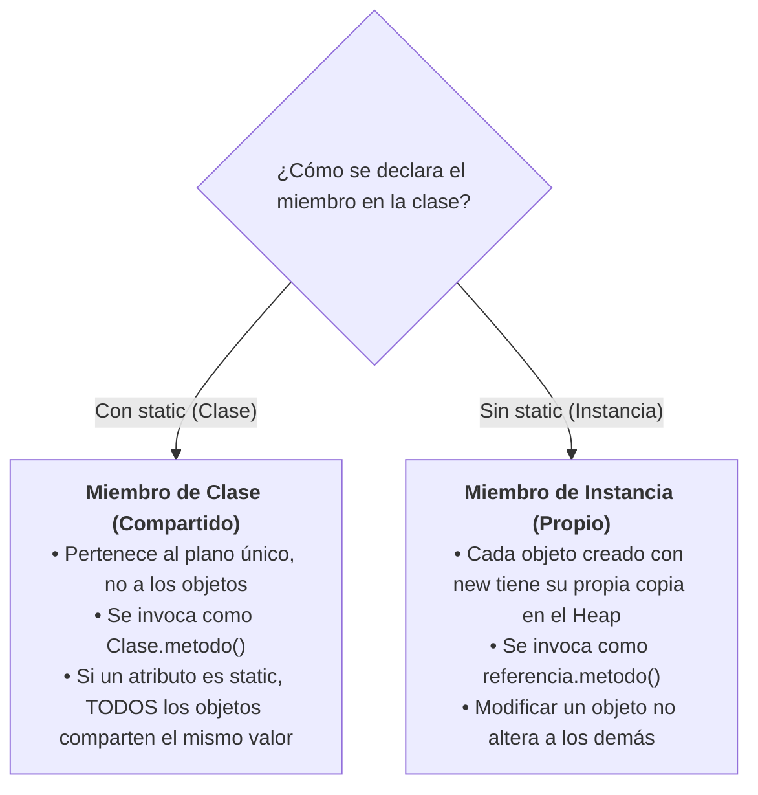
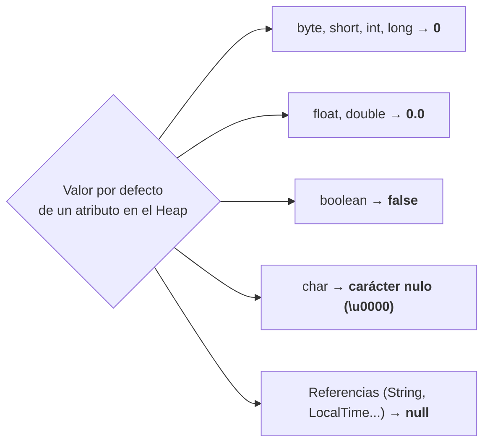
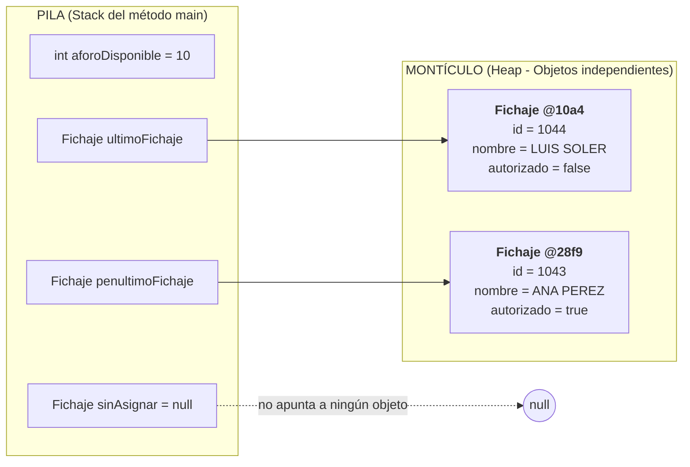
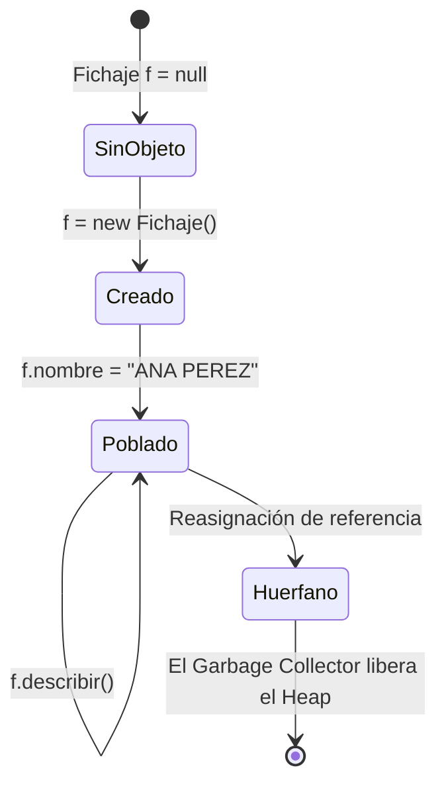

# Sprint 4. Desarrollo de clases
## Semana 10. Clases propias, atributos y objetos

---

### Día 36 - 2 sesiones

---

#### 1. Caso guía en AzaharTech

Son las 15:00 h del **lunes 16 de noviembre de 2026**. En la sede de **AzaharTech** en Castellón de la Plana, el equipo de desarrollo arranca formalmente el **Sprint 4: «Arquitectos de software»**. La versión `v3.0 Oficial` superó todas las pruebas del sprint anterior, pero durante la auditoría de despliegue el equipo directivo del **IES El Caminàs** detectó una limitación estructural evidente:

> *«Equipo: vuestro terminal funciona con solidez y gobierna los flujos con limpieza, pero cada fichaje se evapora en cuanto termina de procesarse. Solo conserváis contadores aislados (`totalFichajesAutorizados`, `idUltimoFichaje`...). Si en conserjería preguntan **quién fue la última persona que pasó, a qué hora exacta, con qué temperatura y por qué motivo se le denegó o autorizó el acceso**, el sistema no sabe responder.*
>
> *Para representar un único tránsito manejáis casi diez variables sueltas en el `main` sin vínculo entre sí. Si quisiéramos recordar los dos últimos tránsitos a la vez, tendríamos que duplicar todas esas variables. Necesitamos que cada fichaje sea una **entidad completa e indivisible** que viaje por el programa como un único objeto independiente»*.

**Laia Claramunt** reúne a **Alba Torres** y **Pau Ferrer** frente a la pizarra para marcar el cambio de paradigma:

> *«Hasta ahora hemos sido **consumidores de clases ajenas** (`Scanner`, `Random`, `String`, `LocalTime`) organizando nuestro código mediante variables locales y métodos estáticos. A partir de hoy damos el salto a la **Programación Orientada a Objetos (POO) propia**.*
>
> *Vamos a crear un segundo archivo Java para nuestra primera **clase entidad**: **`Fichaje.java`**. Dejaremos que `ControlAccesoQR.java` actúe como clase orquestadora, mientras `Fichaje` funciona como el plano arquitectónico de cada registro de acceso. Fabricaremos múltiples **objetos** independientes con `new`, consolidaremos la diferencia crítica entre miembros **`static` y de instancia**, y gestionaremos sus referencias en memoria aplicando guardias contra `null`»*.

---

#### 2. Fundamento teórico: clases propias, atributos de instancia y objetos en memoria

Una **clase** es un tipo de dato definido por el programador que agrupa en una sola unidad cohesiva los **datos** (atributos) y el **comportamiento** (métodos) de una entidad del dominio. Un **objeto** es cada instancia concreta fabricada a partir de ese plano, alojada de forma independiente en el montículo (*Heap*).


##### A. Clase orquestadora frente a clase entidad (arquitectura multi-archivo)

En Java corporativo, cada clase pública reside en su propio archivo `.java`:
* **Clase orquestadora (`ControlAccesoQR.java`):** Contiene el método `public static void main` y coordina la interacción con el usuario y el flujo del programa.
* **Clase entidad (`Fichaje.java`):** **No contiene método `main`**, pues no está diseñada para arrancar sola, sino para ser instanciada tantas veces como tránsitos ocurran.

Sus dos bloques internos fundamentales en este punto del curso son:
1. **Atributos de instancia:** Variables declaradas directamente en la clase (fuera de cualquier método) **sin `static`**. Cada objeto fabricado con `new` posee su propia copia privada.
2. **Métodos de instancia:** Funciones declaradas **sin `static`** que operan directamente sobre los atributos del objeto receptor concreto sobre el que se invocan.

##### B. Contraste clave: `static` (Sprints 2–3) frente a instancia (Sprint 4)

El error más frecuente al dar el salto a la POO propia es arrastrar la palabra clave `static` del Sprint 2 y 3 hacia las nuevas entidades:



##### C. Valores por defecto en el *Heap*

A diferencia de las variables locales de un método (que no pueden leerse sin inicializar), al fabricar un objeto con `new` la máquina virtual inicializa automáticamente todos sus atributos de instancia si no se les asigna un valor explícito en la clase:



##### D. Referencias en pila (*Stack*), objetos en *Heap*, alias y ciclo de vida

Como ya vimos en el Sprint 2 al instanciar `Random`, las variables de tipo clase no guardan el objeto en la pila (*Stack*), sino **la referencia de memoria** hacia el objeto alojado en el montículo (*Heap*):



De este modelo se derivan tres consecuencias operativas en nuestros bucles:
1. **Desplazamiento por copia de referencia:** Al hacer `penultimoFichaje = ultimoFichaje; ultimoFichaje = nuevoFichaje;`, no se duplican los datos en el *Heap*; simplemente se reorientan los punteros del *Stack* para mantener trazabilidad de los dos últimos tránsitos.
2. **Guardia contra `null`:** Si intentamos invocar `ultimoFichaje.describir()` antes de que se haya registrado el primer acceso (`ultimoFichaje == null`), la JVM lanzará **`NullPointerException`**. Debemos proteger siempre la llamada con `if (ultimoFichaje != null)`.
3. **Ciclo de vida automático:** Cuando ni `ultimoFichaje` ni `penultimoFichaje` apuntan ya a un `Fichaje` antiguo (al llegar un tercero), ese objeto queda huérfano y el *Garbage Collector* libera su memoria automáticamente.



---

#### 3. Evolución del caso guía a `ControlAccesoQR v3.1` (Arquitectura multi-archivo)

Evolucionamos la solución dividiendo el proyecto en **dos archivos independientes** dentro de `pr/src/`:
1. **`Fichaje.java` (Nueva clase entidad desacoplada):** Modela de forma autónoma los 10 atributos de cada tránsito y dos métodos de instancia (`obtenerPerfilLegible` y `describir`), sin depender de `ControlAccesoQR`.
2. **`ControlAccesoQR.java` (`v3.1`):** Instancia un nuevo objeto `Fichaje` en cada tránsito de la Opción 1, mantiene vivas las referencias `ultimoFichaje` y `penultimoFichaje` fuera del bucle e incorpora guardias contra `null` en el monitor de telemetría (Opción 3).

##### A. Comparativa de cambios respecto a v3.0 (`diff`)

```diff
+ // =========================================================================
+ // NUEVO ARCHIVO: pr/src/Fichaje.java (Clase de dominio autónoma sin main)
+ // =========================================================================
+ public class Fichaje {
+     int id;
+     String dni = "N/D";
+     String nombre = "N/D";
+     char perfil = '?';
+     char sentido = 'E';
+     double temperatura;
+     boolean autorizado;
+     String motivo = "Sin evaluar";
+     String token = "N/D";
+     LocalTime hora = LocalTime.MIDNIGHT;
+
+     public String obtenerPerfilLegible() { ... }
+     public String describir() { ... }
+ }

  // =========================================================================
  // ARCHIVO: pr/src/ControlAccesoQR.java (v3.1)
  // =========================================================================
+ Fichaje ultimoFichaje = null;
+ Fichaje penultimoFichaje = null;

  case 1:
+     Fichaje nuevoFichaje = new Fichaje();
+     nuevoFichaje.nombre = nombrePersonaLimpio;
+     nuevoFichaje.sentido = (sentidoTransito == 'S') ? 'S' : 'E';
+     nuevoFichaje.hora = LocalTime.now();
      // ... [Validación de entrada/salida y población de atributos] ...
+     penultimoFichaje = ultimoFichaje;   // Desplazamiento de referencia
+     ultimoFichaje = nuevoFichaje;

  case 3:
+     if (ultimoFichaje != null) {
+         System.out.println("ÚLTIMO FICHAJE: " + ultimoFichaje.describir());
+     }
+     if (penultimoFichaje != null) {
+         System.out.println("PENÚLTIMO FICHAJE: " + penultimoFichaje.describir());
+     }
```

##### B. Foco en la novedad: la entidad `Fichaje` y el desplazamiento de referencias

Observa cómo `Fichaje` encapsula de forma autónoma su propia lógica descriptiva y cómo `ControlAccesoQR` gestiona sus referencias sin riesgos de `NullPointerException`:

```java
// -------------------------------------------------------------------------
// Archivo 1: pr/src/Fichaje.java (Clase independiente)
// -------------------------------------------------------------------------
import java.time.LocalTime;

public class Fichaje {
    // Atributos de instancia (sin static)
    int id;
    String dni = "N/D";
    String nombre = "N/D";
    char perfil = '?';
    char sentido = 'E';
    double temperatura;
    boolean autorizado;
    String motivo = "Sin evaluar";
    String token = "N/D";
    LocalTime hora = LocalTime.MIDNIGHT;

    // Métodos de instancia (sin static)
    public String obtenerPerfilLegible() {
        String descripcion;
        switch (perfil) {
            case 'E': descripcion = "Estudiante Oficial"; break;
            case 'D': descripcion = "Docente / Claustro"; break;
            case 'V': descripcion = "Visita Externa / Proveedor"; break;
            case 'A': descripcion = "Personal de Administración y Servicios (PAS)"; break;
            default:  descripcion = "No especificado"; break;
        }
        return descripcion;
    }

    public String describir() {
        String detalleRol = (sentido == 'S') ? "Tránsito exterior" : obtenerPerfilLegible();
        return String.format("#%d [%s] %s (%s) | %s | %s | %s",
                id, sentido == 'S' ? "SALIDA" : "ENTRADA", nombre, detalleRol,
                autorizado ? "AUTORIZADO" : "DENEGADO", motivo, hora.withNano(0));
    }
}

// -------------------------------------------------------------------------
// Archivo 2: Fragmento en pr/src/ControlAccesoQR.java (v3.1)
// -------------------------------------------------------------------------
// Fuera del bucle: nacen a null hasta que ocurra el primer tránsito
Fichaje ultimoFichaje = null;
Fichaje penultimoFichaje = null;

// Dentro de la Opción 1: fabricación y población del nuevo objeto
Fichaje nuevoFichaje = new Fichaje();
nuevoFichaje.nombre = nombrePersonaLimpio;
nuevoFichaje.sentido = (sentidoTransito == 'S') ? 'S' : 'E';
nuevoFichaje.hora = LocalTime.now();
// ... [Población de id, dni, perfil, temperatura, autorizado, motivo y token] ...

// Desplazamiento de referencias en el Stack
penultimoFichaje = ultimoFichaje;
ultimoFichaje = nuevoFichaje;

// Dentro de la Opción 3: lectura segura con guardia contra null
if (ultimoFichaje != null) {
    System.out.println("ÚLTIMO FICHAJE:           " + ultimoFichaje.describir());
} else {
    System.out.println("ÚLTIMO FICHAJE:           (sin registros en esta sesión)");
}
```

##### C. Código fuente completo integrado

<details>
<summary><b>🔍 Desplegar archivos completos: Fichaje.java y ControlAccesoQR.java (v3.1)</b></summary>

**Archivo 1: `pr/src/Fichaje.java`**
```java
/**
 * ENTIDAD DE DOMINIO: REGISTRO DE FICHAJE EN TORNO
 * Cliente: IES El Caminàs (Castellón de la Plana)
 * Consultora: AzaharTech Software Consulting
 *
 * Modela de forma autónoma los datos y el comportamiento básico de cada tránsito
 * (entrada o salida) registrado en el campus. Cada instancia creada con new
 * mantiene su propio estado independiente en el Heap.
 *
 * @author Equipo AzaharTech (Alba Torres, Pau Ferrer, Laia Claramunt)
 * @version 3.1 (Noviembre 2026)
 * @since JDK 21 LTS
 */

import java.time.LocalTime;

public class Fichaje {

    // -------------------------------------------------------------------------
    // 1. ATRIBUTOS DE INSTANCIA (Estado independiente por objeto en el Heap)
    // -------------------------------------------------------------------------
    int id;
    String dni = "N/D";
    String nombre = "N/D";
    char perfil = '?';
    char sentido = 'E';
    double temperatura;
    boolean autorizado;
    String motivo = "Sin evaluar";
    String token = "N/D";
    LocalTime hora = LocalTime.MIDNIGHT;

    // -------------------------------------------------------------------------
    // 2. MÉTODOS DE INSTANCIA (Comportamiento propio del objeto, SIN static)
    // -------------------------------------------------------------------------

    /**
     * Traduce el código de carácter del perfil a su denominación institucional legible.
     */
    public String obtenerPerfilLegible() {
        String descripcion;
        switch (perfil) {
            case 'E':
                descripcion = "Estudiante Oficial";
                break;
            case 'D':
                descripcion = "Docente / Claustro";
                break;
            case 'V':
                descripcion = "Visita Externa / Proveedor";
                break;
            case 'A':
                descripcion = "Personal de Administración y Servicios (PAS)";
                break;
            default:
                descripcion = "No especificado";
                break;
        }
        return descripcion;
    }

    /**
     * Genera una línea formateada completa con la auditoría del tránsito registrado.
     */
    public String describir() {
        String detalleRol = (sentido == 'S') ? "Tránsito exterior" : obtenerPerfilLegible();
        return String.format("#%d [%s] %s (%s) | %s | %s | %s",
                id,
                sentido == 'S' ? "SALIDA" : "ENTRADA",
                nombre,
                detalleRol,
                autorizado ? "AUTORIZADO" : "DENEGADO",
                motivo,
                hora.withNano(0));
    }
}
```

**Archivo 2: `pr/src/ControlAccesoQR.java` (v3.1)**
```java
/**
 * SISTEMA DE CONTROL DE ASISTENCIA POR CÓDIGO QR
 * Cliente: IES El Caminàs (Castellón de la Plana)
 * Consultora: AzaharTech Software Consulting
 * 
 * Versión 3.1:
 * Apertura del Sprint 4 («Arquitectos de software») y de la Semana 10.
 * Desacopla la entidad de tránsito en el archivo independiente Fichaje.java:
 * - Materializa cada registro mediante instanciación con new y operador punto.
 * - Conserva en memoria los dos últimos fichajes mediante desplazamiento de referencias.
 * - Aplica guardias defensivas contra null en el monitor de telemetría.
 * Mantiene el cumplimiento estricto del principio SESE y blindaje try-catch.
 * 
 * @author Equipo AzaharTech (Alba Torres, Pau Ferrer, Laia Claramunt)
 * @version 3.1 (Noviembre 2026)
 * @since JDK 21 LTS
 * 
 */

import java.util.Scanner;
import java.util.Random;
import java.time.LocalTime;
import java.time.LocalDate;
import java.time.Duration;

public class ControlAccesoQR {

    // -------------------------------------------------------------------------
    // 1. CONSTANTES INMUTABLES DEL SISTEMA (configuración corporativa)
    // -------------------------------------------------------------------------
    final static String NOMBRE_CENTRO = "IES El Caminàs (Castellón)";
    final static String PREFIJO_CENTRO = "CAMINAS";
    final static String RUTA_LOGS = ".\\caminas\\terminal\\logs";

    final static int MINUTOS_POR_HORA = 60;
    final static int SEGUNDOS_POR_HORA = 3600;
    final static int SEGUNDOS_POR_MINUTO = 60;
    final static int JORNADA_BASE_MINUTOS = 480; // 8 horas
    final static double FACTOR_PORCENTAJE = 100.0;

    final static int ID_TERMINAL_PUERTA_NORTE = 102;
    final static int BASE_TOKEN_SEGURIDAD = 1000;
    final static int RANGO_TOKEN_SEGURIDAD = 9000;
    final static long SEMILLA_CALIBRACION = 987654321L;

    final static double TEMP_MIN_SEGURA = 15.0;
    final static double TEMP_MAX_SEGURA = 35.0;
    final static double MAX_VARIACION_TERMICA = 0.5;
    final static int LONGITUD_DNI_ESTANDAR = 9;

    // Umbrales biométricos y capacidad
    final static double TEMP_CORPORAL_MAX_FIEBRE = 37.5;
    final static double TEMP_CORPORAL_MIN_FALLO = 35.0;

    // Control de puntualidad y hardware perimetral
    final static LocalTime HORA_LIMITE_PUNTUALIDAD = LocalTime.of(8, 15);
    final static int NUM_SENSORES_TORNO = 8;
    final static int HORAS_TURNO_LECTIVO = 6;
    final static int TOTAL_TORNOS_CAMPUS = 3;
    final static int CANALES_POR_TORNO = 4;

    // -------------------------------------------------------------------------
    // 2. MÉTODOS ESTÁTICOS AUXILIARES DEL ORQUESTADOR
    // -------------------------------------------------------------------------

    public static int calcularEstanciaMinutos(LocalTime entrada, LocalTime salida) {
        return (int) Duration.between(entrada, salida).toMinutes();
    }

    public static double calcularPorcentajeOcupacion(int personas, int aforoTotal) {
        return ((double) personas / aforoTotal) * FACTOR_PORCENTAJE;
    }

    public static String construirTokenQR(String prefijo, String dni, int terminalId, int codigoSec, int idFichaje) {
        String token = prefijo + "-" + dni;
        token += "-T" + terminalId;
        token += "-SEC#" + codigoSec;
        token += "-REG" + idFichaje;
        return token;
    }

    public static double calcularDistanciaDiagonal(double x, double y) {
        return Math.sqrt(Math.pow(x, 2.0) + Math.pow(y, 2.0));
    }

    public static String determinarZonaAutorizada(char perfil) {
        String zona;
        switch (perfil) {
            case 'E':
                zona = "Aulas Docentes y Talleres de Informática";
                break;
            case 'D':
                zona = "Departamentos Didácticos, Aulas y Sala de Profesores";
                break;
            case 'V':
                zona = "Secretaría, Conserjería y Despachos de Dirección";
                break;
            case 'A':
                zona = "Área de Gestión Administrativa y Archivo Central";
                break;
            default:
                zona = "Acceso Denegado / Zona No Autorizada";
                break;
        }
        return zona;
    }

    public static int obtenerEstanciaMaximaPorPerfil(char perfil) {
        int estanciaMinutos;
        switch (perfil) {
            case 'E':
                estanciaMinutos = 360;
                break;
            case 'D':
                estanciaMinutos = 480;
                break;
            case 'V':
                estanciaMinutos = 120;
                break;
            case 'A':
                estanciaMinutos = 420;
                break;
            default:
                estanciaMinutos = 0;
                break;
        }
        return estanciaMinutos;
    }

    // -------------------------------------------------------------------------
    // 3. MÉTODOS PREDICADO BOOLEANOS (reglas de negocio desacopladas)
    // -------------------------------------------------------------------------

    public static boolean esTemperaturaCorporalSegura(double temperatura) {
        return (temperatura >= TEMP_CORPORAL_MIN_FALLO && temperatura <= TEMP_CORPORAL_MAX_FIEBRE);
    }

    public static boolean esDocumentoValido(String dni) {
        return (dni != null && dni.length() == LONGITUD_DNI_ESTANDAR);
    }

    public static boolean esPerfilAutorizado(char perfil) {
        boolean autorizado;
        switch (perfil) {
            case 'E':
            case 'D':
            case 'V':
            case 'A':
                autorizado = true;
                break;
            default:
                autorizado = false;
                break;
        }
        return autorizado;
    }

    // -------------------------------------------------------------------------
    // 4. MÉTODO PRINCIPAL: CONSOLA INTEGRAL v3.1 (ENTIDAD FICHAJE)
    // -------------------------------------------------------------------------
    public static void main(String[] args) {
        Scanner teclado = new Scanner(System.in);

        Random generadorVestibulo = new Random();

        LocalDate fechaActual = LocalDate.now();

        // Estado persistente del campus
        int personasEnCentro = 1190;
        int aforoDisponible = 10;
        int idUltimoFichaje = 1042;

        int totalFichajesProcesados = 0;
        int totalFichajesAutorizados = 0;
        int totalFichajesDenegados = 0;

        // Referencias a objetos Fichaje: nacen a null (todavía no hay tránsitos)
        Fichaje ultimoFichaje = null;
        Fichaje penultimoFichaje = null;

        // Acumuladores estadísticos
        double tempMaximaRegistrada = -1.0;
        double tempMinimaRegistrada = 100.0;
        int minutosEstanciaAcumulados = 0;

        boolean sesionActiva = true;

        System.out.println("======================================================================");
        System.out.println("   AZAHARTECH · CONTROL INTEGRAL DE ACCESOS - IES EL CAMINÀS          ");
        System.out.println("   Versión 3.1 (Sprint 4: primera clase propia, Fichaje.java)         ");
        System.out.println("   Fecha de sesión: " + fechaActual);
        System.out.println("======================================================================");

        // BUCLE PRINCIPAL DE GESTIÓN (MENÚ DE OPERACIONES)
        do {
            System.out.println("\n----------------------------------------------------------------------");
            System.out.println("                    PANEL DE OPERACIONES DEL TORNO                    ");
            System.out.println("----------------------------------------------------------------------");
            System.out.println("  [1] Registrar tránsito individual (genera un objeto Fichaje)");
            System.out.println("  [2] Procesar cola en ráfaga (Modo Burst con parada en cabecera)");
            System.out.println("  [3] Consultar telemetría y últimos fichajes en memoria");
            System.out.println("  [4] Diagnóstico perimetral estructurado SESE (3 tornos x 4 canales)");
            System.out.println("  [5] Activar protocolo de evacuación de emergencia");
            System.out.println("  [6] Cerrar jornada y apagar terminal");
            System.out.print("Seleccione una operación (1-6): ");

            int opcionMenu = 0;
            try {
                opcionMenu = Integer.parseInt(teclado.nextLine().trim());
            } catch (NumberFormatException e) {
                opcionMenu = -1;
            }

            switch (opcionMenu) {
                case 1:
                    // TRÁNSITO INDIVIDUAL BIDIRECCIONAL CON OBJETO FICHAJE
                    totalFichajesProcesados++;
                    System.out.println("\n--- [MODO 1: TRÁNSITO INDIVIDUAL] ---");
                    System.out.print("Sentido del tránsito (E = Entrada, S = Salida): ");
                    String lineaSentido = teclado.nextLine().trim().toUpperCase();
                    char sentidoTransito = lineaSentido.isEmpty() ? 'E' : lineaSentido.charAt(0);

                    System.out.print("Nombre completo: ");
                    String nombrePersonaLimpio = teclado.nextLine().trim().toUpperCase();

                    // Fabricación del objeto en el Heap con sus valores por defecto
                    Fichaje nuevoFichaje = new Fichaje();
                    nuevoFichaje.nombre = nombrePersonaLimpio.isEmpty() ? "N/D" : nombrePersonaLimpio;
                    nuevoFichaje.sentido = (sentidoTransito == 'S') ? 'S' : 'E';
                    nuevoFichaje.hora = LocalTime.now();

                    if (sentidoTransito == 'S') {
                        if (personasEnCentro > 0) {
                            personasEnCentro--;
                            aforoDisponible++;
                            totalFichajesAutorizados++;
                            idUltimoFichaje++;
                            nuevoFichaje.autorizado = true;
                            nuevoFichaje.motivo = "Salida registrada";
                            System.out.println(">> VEREDICTO: [SALIDA AUTORIZADA] Torno exterior abierto.");
                        } else {
                            totalFichajesDenegados++;
                            nuevoFichaje.autorizado = false;
                            nuevoFichaje.motivo = "Recinto vacío";
                            System.err.println(">> ALERTA: Imposible autorizar salida; recinto vacío.");
                        }
                        nuevoFichaje.id = idUltimoFichaje;
                    } else {
                        int terminalId = 0;
                        double tempVestibulo = 0.0;
                        String dniPersonaLimpio = "N/D";
                        char perfilNormalizado = '?';
                        boolean datosSintacticamenteCorrectos = true;
                        String motivoDenegacion = "";

                        try {
                            System.out.print("ID Terminal: ");
                            terminalId = Integer.parseInt(teclado.nextLine().trim());
                            System.out.print("Temperatura (ºC): ");
                            tempVestibulo = Double.parseDouble(teclado.nextLine().trim());
                            System.out.print("DNI: ");
                            dniPersonaLimpio = teclado.nextLine().trim().toUpperCase();
                            System.out.print("Perfil (E/D/V/A): ");
                            String lineaPerfil = teclado.nextLine().trim();
                            perfilNormalizado = lineaPerfil.isEmpty() ? '?' : Character.toUpperCase(lineaPerfil.charAt(0));
                        } catch (NumberFormatException e) {
                            datosSintacticamenteCorrectos = false;
                            motivoDenegacion = "Error de formato numérico.";
                        }

                        boolean accesoConcedido;
                        if (!datosSintacticamenteCorrectos) {
                            accesoConcedido = false;
                            totalFichajesDenegados++;
                        } else if (!esTemperaturaCorporalSegura(tempVestibulo)) {
                            accesoConcedido = false;
                            motivoDenegacion = "Temperatura anómala.";
                            totalFichajesDenegados++;
                        } else if (aforoDisponible <= 0) {
                            accesoConcedido = false;
                            motivoDenegacion = "Aforo completo.";
                            totalFichajesDenegados++;
                        } else if (!esDocumentoValido(dniPersonaLimpio)) {
                            accesoConcedido = false;
                            motivoDenegacion = "DNI no reglamentario.";
                            totalFichajesDenegados++;
                        } else if (!esPerfilAutorizado(perfilNormalizado)) {
                            accesoConcedido = false;
                            motivoDenegacion = "Perfil no catalogado.";
                            totalFichajesDenegados++;
                        } else {
                            accesoConcedido = true;
                            totalFichajesAutorizados++;
                            personasEnCentro++;
                            aforoDisponible--;
                            idUltimoFichaje++;

                            tempMaximaRegistrada = Math.max(tempMaximaRegistrada, tempVestibulo);
                            tempMinimaRegistrada = Math.min(tempMinimaRegistrada, tempVestibulo);
                            minutosEstanciaAcumulados += 360;
                        }

                        int codigoToken = BASE_TOKEN_SEGURIDAD + generadorVestibulo.nextInt(RANGO_TOKEN_SEGURIDAD);
                        String token = construirTokenQR(PREFIJO_CENTRO, dniPersonaLimpio, terminalId, codigoToken, idUltimoFichaje);
                        System.out.printf(">> VEREDICTO: %s [Token: %s]%n",
                                accesoConcedido ? "[ENTRADA AUTORIZADA]" : "[ENTRADA DENEGADA - " + motivoDenegacion + "]", token);

                        // Población del objeto mediante el operador punto
                        nuevoFichaje.id = idUltimoFichaje;
                        nuevoFichaje.dni = dniPersonaLimpio;
                        nuevoFichaje.perfil = perfilNormalizado;
                        nuevoFichaje.temperatura = tempVestibulo;
                        nuevoFichaje.autorizado = accesoConcedido;
                        nuevoFichaje.motivo = accesoConcedido ? "Acceso concedido" : motivoDenegacion;
                        nuevoFichaje.token = token;
                    }

                    // Desplazamiento de referencias: el anterior último pasa a ser penúltimo
                    penultimoFichaje = ultimoFichaje;
                    ultimoFichaje = nuevoFichaje;
                    System.out.println(">> Objeto Fichaje creado: " + nuevoFichaje.describir());
                    break;

                case 2:
                    // RÁFAGA DE COLA CON GUARDIA EN CABECERA (PRINCIPIO SESE)
                    System.out.println("\n--- [MODO 2: RÁFAGA CON PARADA ESTRUCTURADA EN CABECERA] ---");
                    System.out.print("Personas en cola para esta ráfaga: ");
                    int personasEnCola = 0;
                    try {
                        personasEnCola = Integer.parseInt(teclado.nextLine().trim());
                    } catch (NumberFormatException e) {
                        personasEnCola = 0;
                    }

                    boolean vetoJudicialDetectado = false;

                    while (personasEnCola > 0 && aforoDisponible > 0 && !vetoJudicialDetectado) {
                        if (idUltimoFichaje == 1044) {
                            System.out.println(">> [ALERTA JUDICIAL]: Credencial bloqueada. Suspendiendo cola en cabecera...");
                            vetoJudicialDetectado = true;
                        } else {
                            totalFichajesProcesados++;
                            totalFichajesAutorizados++;
                            personasEnCentro++;
                            aforoDisponible--;
                            idUltimoFichaje++;
                            personasEnCola--;

                            double tempSimulada = 36.4 + (generadorVestibulo.nextDouble() * 0.5);
                            tempMaximaRegistrada = Math.max(tempMaximaRegistrada, tempSimulada);
                            tempMinimaRegistrada = Math.min(tempMinimaRegistrada, tempSimulada);
                            minutosEstanciaAcumulados += 360;
                        }
                    }
                    System.out.printf(">> Estado tras ráfaga. Plazas disponibles: %d | Restantes en cola: %d%n",
                            aforoDisponible, personasEnCola);
                    break;

                case 3:
                    // MONITOR DE TELEMETRÍA EN VIVO Y FICHAJES EN MEMORIA
                    System.out.println("\n--- [MODO 3: MONITOR DE TELEMETRÍA EN VIVO] ---");
                    int aforoTotal = personasEnCentro + aforoDisponible;
                    double porcentajeOcupacion = calcularPorcentajeOcupacion(personasEnCentro, aforoTotal);
                    double estanciaMedia = totalFichajesAutorizados > 0 
                            ? ((double) minutosEstanciaAcumulados / totalFichajesAutorizados) : 0.0;

                    System.out.printf("OCUPACIÓN ACTUAL:         %d/%d personas (%6.2f %%)%n", personasEnCentro, aforoTotal, porcentajeOcupacion);
                    System.out.printf("PLAZAS LIBRES:            %d vacantes disponibles%n", aforoDisponible);
                    System.out.printf("TRANSACCIONES TOTALES:    %d registros (%d autorizados, %d denegados)%n",
                            totalFichajesProcesados, totalFichajesAutorizados, totalFichajesDenegados);
                    System.out.printf("PICO TÉRMICO MÁXIMO:      %.1f ºC%n", Math.max(0.0, tempMaximaRegistrada));
                    System.out.printf("PICO TÉRMICO MÍNIMO:      %.1f ºC%n", tempMinimaRegistrada > 50.0 ? 0.0 : tempMinimaRegistrada);
                    System.out.printf("ESTANCIA PROMEDIO:        %.1f minutos (Total acumulado: %d min)%n",
                            estanciaMedia, minutosEstanciaAcumulados);

                    // Guardias defensivas: evitar NullPointerException si aún no hay registros
                    if (ultimoFichaje != null) {
                        System.out.println("ÚLTIMO FICHAJE:           " + ultimoFichaje.describir());
                    } else {
                        System.out.println("ÚLTIMO FICHAJE:           (sin registros en esta sesión)");
                    }
                    if (penultimoFichaje != null) {
                        System.out.println("PENÚLTIMO FICHAJE:        " + penultimoFichaje.describir());
                    } else {
                        System.out.println("PENÚLTIMO FICHAJE:        (sin registros en esta sesión)");
                    }
                    break;

                case 4:
                    // DIAGNÓSTICO SECUENCIAL Y MATRIZ PERIMETRAL SESE
                    System.out.println("\n--- [MODO 4: INSPECCIÓN PERIMETRAL ESTRUCTURADA (SESE)] ---");
                    boolean alarmaSabotajeDetectada = false;

                    for (int torno = 1; torno <= TOTAL_TORNOS_CAMPUS && !alarmaSabotajeDetectada; torno++) {
                        String nombreAcceso = switch (torno) {
                            case 1 -> "Vestíbulo Central  | ";
                            case 2 -> "Puerta Norte Ciclos| ";
                            case 3 -> "Puerta Sur Talleres| ";
                            default -> "Acceso Perimetral  | ";
                        };
                        System.out.print(nombreAcceso);

                        for (int canal = 1; canal <= CANALES_POR_TORNO && !alarmaSabotajeDetectada; canal++) {
                            if (torno == 2 && canal == 2) {
                                System.out.print("[REVISIÓN] ");
                            } else {
                                boolean falloCritico = (torno == 3 && canal == 2 && false);

                                if (falloCritico) {
                                    System.out.print("[SABOTAJE] ");
                                    alarmaSabotajeDetectada = true;
                                } else {
                                    System.out.printf("[C%d: OK]   ", canal);
                                }
                            }
                        }
                        System.out.println();
                    }

                    if (alarmaSabotajeDetectada) {
                        System.out.println(">> [ALERTA DE SEGURIDAD]: Barrido perimetral detenido por fallo crítico.");
                    }
                    System.out.println("-------------------------------------------------------------------");
                    break;

                case 5:
                    // PROTOCOLO DE EVACUACIÓN CON WHILE DE DRENAJE
                    System.out.println("\n--- [MODO 5: PROTOCOLO DE EVACUACIÓN DE EMERGENCIA] ---");
                    if (personasEnCentro == 0) {
                        System.out.println(">> El campus ya se encuentra completamente vacío.");
                    } else {
                        int loteSalidaSimultanea = 300;
                        int oleada = 1;

                        while (personasEnCentro > 0) {
                            int evacuadosLote = Math.min(personasEnCentro, loteSalidaSimultanea);
                            personasEnCentro -= evacuadosLote;
                            aforoDisponible += evacuadosLote;

                            System.out.printf("  -> Oleada #%d: Desalojadas %d personas por salidas de emergencia (Ocupantes restantes: %d)%n",
                                    oleada, evacuadosLote, personasEnCentro);
                            oleada++;
                        }
                        System.out.println(">> CERTIFICACIÓN DE SEGURIDAD: Recinto 100% desalojado. Aforo íntegro restaurado.");
                    }
                    break;

                case 6:
                    // APAGADO Y SALIDA
                    System.out.println("\n>> Desconectando terminal de presencia de forma ordenada...");
                    sesionActiva = false;
                    break;

                default:
                    System.err.println(">> Error: Opción no válida. Seleccione una operación entre 1 y 6.");
                    break;
            }

        } while (sesionActiva);

        // AUDITORÍA FINAL AL APAGAR
        System.out.println("\n======================================================================");
        System.out.println("          AUDITORÍA FINAL DE LA JORNADA · IES EL CAMINÀS              ");
        System.out.println("======================================================================");
        System.out.printf("TOTAL OPERACIONES GESTIONADAS: %d%n", totalFichajesProcesados);
        System.out.printf("ACCESOS AUTORIZADOS (TOTAL):   %d%n", totalFichajesAutorizados);
        System.out.printf("ACCESOS DENEGADOS (BLOQUEO):   %d%n", totalFichajesDenegados);
        System.out.printf("OCUPACIÓN FINAL REGISTRADA:    %d personas%n", personasEnCentro);
        System.out.println("ESTADO DEL DISPOSITIVO:        Terminal desconectado de forma segura.");
        System.out.println("======================================================================");

        teclado.close();
    }
}
```

</details>

---

#### 4. Segunda sesión: dojo de entrenamiento y katas de código

En esta sesión práctica, cada estudiante diseñará su primera clase entidad en un archivo Java separado dentro de `pr/src/` e instanciará múltiples objetos independientes desde su programa principal.

##### Kata 1 (Cinturón blanco / Nivel base). Mi primera clase entidad en archivo propio

Crea un nuevo archivo `.java` en `pr/src/` para modelar la entidad principal de tu proyecto elegido (sin método `main`), dotándola de al menos 4 atributos de instancia y 2 métodos propios (sin `static`). Instancia dos objetos independientes desde `MiProyecto.java`, puebla sus atributos con el operador punto e invoca sus métodos:

* **Aventura conversacional.** Archivo `Personaje.java` con atributos de instancia para su nombre, salud actual, potencia de ataque y si es aliado; incluye un método que devuelva su ficha descriptiva y otro que indique si sigue con vida. Crea un héroe y un enemigo.
* **Motor de recomendación.** Archivo `Item.java` con atributos de instancia para el título, categoría temática, valoración media y etiqueta de disponibilidad; incluye un método que devuelva su línea formateada de catálogo y otro booleano que verifique si supera el umbral de recomendación destacada. Crea dos ítems de categorías distintas.
* **Simulador de físicas 2D.** Archivo `Bola.java` con atributos de instancia para sus coordenadas espaciales (`x`, `y`) y componentes de velocidad (`velocidadX`, `velocidadY`); incluye un método que calcule la rapidez total con `Math.sqrt` y otro que imprima su estado cinemático. Crea una bola lenta y otra rápida.
* **Bóveda de contraseñas.** Archivo `Credencial.java` con atributos de instancia para el nombre del servicio, usuario, clave y días hasta su caducidad; incluye un método que devuelva la longitud de la clave y otro que imprima su ficha ocultando la contraseña. Crea dos credenciales de servicios distintos.

---

##### Kata 2 (Cinturón marrón / Nivel avanzado). La trampa de `static`, alias en el *Heap* y guardia contra `null`

Comprueba empíricamente en tu proyecto las tres trampas habituales al empezar a diseñar clases propias:

1. **El peligro de `static` en atributos de entidad:**  
   Añade temporalmente `static` al atributo de nombre o título de tu clase entidad. Comprueba que, tras crear dos objetos diferentes (`obj1` y `obj2`), cambiar el nombre en `obj2` sobrescribe automáticamente el nombre de `obj1` porque un miembro `static` pertenece al molde único y no a cada objeto. Retira el `static` tras verificar el fallo.
2. **El bug del alias:**  
   Crea `MiEntidad a = new MiEntidad(); MiEntidad b = a;`, modifica un atributo a través de `b` y demuestra que `a` también refleja el cambio. Dibuja en un comentario o documento externo un diagrama `mermaid` (`flowchart LR`) ilustrando cómo ambas referencias de pila apuntan al mismo objeto en el montículo.
3. **La guardia contra `null`:**  
   Declara una referencia `null` de tu nueva clase, intenta leer uno de sus atributos o invocar su método y protege esa llamada mediante una condición previa `if (referencia != null)` para impedir una `NullPointerException`.

---

##### Kata 3 (Cinturón negro / «Hacker AzaharTech»). Auditoría de memoria en IntelliJ (`@id`) e igualdad de contenido

Dos objetos distintos pueden contener exactamente los mismos datos y, sin embargo, ocupar regiones diferentes de la memoria dinámica:

1. **Inspección de identificadores `@id` en el Depurador:**  
   Coloca un *breakpoint* justo después de instanciar tus dos objetos independientes (con atributos idénticos) y lanza el programa en modo Debug (**`Shift + F9`**):
    * Observa en la pestaña **Variables** el identificador único asignado por la JVM a la derecha del nombre de la clase (por ejemplo, `Fichaje@1042` frente a `Fichaje@1089`).
    * Verifica también qué valores por defecto muestra un objeto recién salido de `new` antes de rellenar sus campos.
2. **Identidad (`==`) frente a igualdad de contenido:**  
   Compara ambos objetos idénticos con `objetoA == objetoB` y justifica por qué devuelve `false` al comparar direcciones de memoria distintas. A continuación, implementa en tu clase entidad un método de instancia `boolean mismosDatos(TuClase otra)` que compare atributo a atributo (usando `.equals(...)` en los `String` y `==` en los primitivos), incluyendo una guardia obligatoria contra `otra == null`.
3. **Certificación:**  
   Documenta en la cabecera Javadoc de tu nueva clase entidad la diferencia entre identidad de referencia e igualdad lógica de estado, declarando tu arquitectura lista para incorporar constructores propios en la siguiente sesión.